# Metrology log of the NPEC camera rig

This is the log: every measurement, test method and result, with its source. For the case that
these measurements can be trusted, read `docs/measurement-trust.md` first.

**Status:** first draft 2026-10-05; raw-data sources, repeat counts and camera coverage added
2026-10-08; M2 acceptance on SN001 added 2026-10-14 (section 14). The camera was replaced on
2026-10-07 (old SN000, new SN001; section 8.2); current calibration and bands are the new camera's
from 2026-10-14. Section 13 says which results have
been repeated on SN001. Kept current as findings come in (CLAUDE.md, *Write up every
measurement*). Numbers marked **decision** are settings chosen by the project, not measurements.
Section 11 lists inconsistencies between project files that still need checking. Section 9
holds the M2 physical acceptance tests, run 2026-10-05 on SN000. Section 14 holds their repeat on
SN001 (method written 2026-10-09, run 2026-10-12 to 10-14; summary in 14.7). Current calibration
and bands: SN001, 2026-10-14, lens 6.05 (14.6). From 2026-10-16 each result carries a
label saying what kind of evidence it is: validation, reference comparison or development check
(section 12).

This document states every number the rig relies on to report plant canopy area and how far that
area can be trusted: what was measured, how, how often, the result, and what it does and does
not cover. It is written for a scientist without a background in measurement science
(metrology), and is meant as the basis for reports and a possible paper on the rig.

## 1. The principle

> Certainty is measured, never derived. If a number cannot be demonstrated with a ruler, a
> printed target, or a repeated observation, it does not ship.

The rig does not estimate its accuracy from a model of the camera and lens. It photographs printed
targets of known size, measured with callipers, and reports how far its own area readings of
those targets are off, position by position. Earlier attempts at this project modelled the camera
instead and never produced a working application.

## 2. How an area is measured

1. **Targets.** Calibration sheets carry square AprilTags (36h11 family). Each print run is measured
   with callipers; the current tags are 30.0 mm on a side.
2. **Calibration.** With the camera focus locked, the rig photographs sheets spread over the
   table. Each tag's apparent size in pixels, against its known size in millimetres, gives the
   scale (pixels per millimetre) at that spot. A smooth scale field is fitted across the image.
3. **Area.** An object's area in mm² is its area in pixels divided by the square of the local
   scale.
4. **Validation.** The sheets are moved to different trays and photographed again, 3 times. Each
   tag's area is computed with the calibration and compared with its true area. The spread of
   these errors in each tray slot is that slot's stated uncertainty (its *band*).

**Area error** throughout this document: (area read by the rig − true area) / true area, in
percent. A tag of true area 900 mm² read as 909 mm² has an area error of +1.0%. A change between
two area errors (for example +1.00% to +1.03%) is given in *points* (+0.03 points).

## 3. Physical references

| Quantity | Value | How measured | Date | Covers / does not cover |
|---|---|---|---|---|
| Calibration tag side | 30.0 ± 0.1 mm (readings X 30.10, 30.11, 29.96; Y 30.04, 29.96, 29.94; mean 30.018, SD 0.075, range 29.94 to 30.11) | Callipers, 3 tags (left, middle and right of one sheet), X and Y once each, outer edge to outer edge of the black border | 2026-09-21 (print of 2026-09-20, IDs 300 to 449) | That print run only. Every new print is measured again. ±0.1 mm on 30 mm is about ±0.67% in area |
| Corner tag side | 50.018 mm mean, SD 0.11 (X 50.09, 50.07, 49.92; Y 50.17, 49.87, 49.99) | Callipers, 3 tags, X and Y once each, as above | 2026-09-21 | Corner tags are used for the rig health check (tripwire) and table view, not for area |
| Sheet scale bars, nominal 180 mm | 30 mm sheet: 180.13, 179.91, 179.74 (mean 179.93, SD 0.20). 50 mm sheet: 180.10, 179.93, 180.06 (mean 180.03, SD 0.09) | Callipers, 3 readings of the bar on each of 2 sheets | 2026-09-21 | Confirms the sheets printed at 100% scale (both means within 0.04% of 180). The repeat readings of one bar spread over up to 0.39 mm, wider than the 0.1 mm resolution trusted (below) |
| Reference tag 500 side (60 mm, 36h11 ID 500, fixed at the north table edge) | 60.06 mm mean, SD 0.04 (Y 60.07, 60.05, 60.10, 60.05; X 60.01, 60.05, 60.00, 60.13) | Callipers, 8 readings, remeasured with care | 2026-10-06 | Supersedes a first set the same day (59.58 to 60.26, mean 59.94, SD 0.22; commit `8f77e8d`). Placed 2026-10-06 at the supervisor's suggestion as a static target |
| Callipers used for every reading in this table | NEIKO callipers; no model or serial number available | Stated by Aaron | 2026-10-08 | Not checked against a reference standard. The only independent check: the steel tape and the callipers agree on the sheets' 180 mm scale bars (section 9.2) |
| Calliper resolution trusted | 0.1 mm | **Decision** | | Readings are not used beyond 0.1 mm |
| Sheet-to-sheet difference | up to about 0.7% in area between sheets that both measure 30.0 mm | Fit residuals, 6 pages, 3 sessions | 2026-09-30 to 10-01 | `reference/arducam-central-error-2026-10.md` |
| Tray heights, table surface to the top edge of the tray | Black tray 40 mm; 4x5 tray 105 mm; 4x4 tray 150 mm; 1x1 tray 175 mm | Tape measure, by Aaron, one reading per tray, given in cm (4, 10.5, 15, 17.5) | 2026-10-09 | One tape reading each, so a few mm either way. For the black, 4x4 and 1x1 trays the top edge is the growing-medium height (Aaron, 2026-10-09). The 4x5 is the exception: see the next row |
| Growing medium height, 4x5 tray | 100 mm above the table surface; the tray lip stands 5 mm above the growing medium | Callipers, the 100 mm "normal tray" value of the height test (section 4); Aaron confirmed on 2026-10-09 that it is the growing-medium height and that the lip stands 5 mm proud of it | 2026-10-01 (callipers), 2026-10-09 (confirmed) | The height used for the 4x5 tray on the experiments page. Only the 4x5 has a lip above the growing medium |

**Where the calliper readings are.** The 2026-09-21 readings were typed by Aaron into a table and
given to a Claude Code session (2026-09-21 07:36 UTC), and given again on 2026-09-29 with the
mean rounded to 30.0 mm. The 2026-09-29 date in earlier versions of this log and in CLAUDE.md is
that second date; the measurement was made on or before 2026-09-21 (calibrations from 2026-09-21
12:12 UTC already used 30.02 mm). No other copy exists; this table is the record. The tag 500
readings were given the same way on 2026-10-06. The table does not record which 3 tags were
measured, only that they were at the left, middle and right of the sheet.

**Tray heights: lip and growing medium.** The height test of 2026-10-01 (section 4) used "normal
trays 100 mm, tall tray 175 mm", by callipers. The tape readings of 2026-10-09 gave 105 mm for the
4x5 (normal) tray. Aaron resolved the difference the same day: 100 mm is the height of the growing
medium, the height that matters for area because the plants start there, and the tray's lip stands
5 mm above it. The tape reading was to the lip.

Why tag size matters most: on the previous rig, trusting the 30 mm printed on the box (the tags
measured 29.3106 mm) caused about 4.7% area error, larger than any other source. The lesson is to
measure every printed sheet.

## 4. Camera and geometry

| Quantity | Value | How measured | Date | Notes |
|---|---|---|---|---|
| Camera | Arducam 64MP, serial SN001 from 2026-10-07 (SN000 before) | Serial as given by Aaron | 2026-10-07 | Replaced; comparison in section 8.2 |
| Image size | 9152 × 6944 px | Camera configuration | | Arducam 64MP |
| Scale at tray height | 4.858 px/mm mean (replacement camera, lens 6.04); old camera 4.85 px/mm at the image centre (2026-10-05) | Calibration fit, 355 tags, 08:18 UTC calibration | 2026-10-08 | About 0.21 mm per pixel; earlier calibrations 4.5 to 4.8 |
| Scale on the table surface | 4.52 px/mm (at the image centre), 6.79% below tray height in length, 15.1% in area | Calibration fit, 355 tags on the table, same camera position | 2026-10-05 | At 0.145% of area per mm this corresponds to about 100 mm of height (derived, not taped) |
| Camera height above the table surface | about 1482 mm, a best estimate, not a precise value | Tape measure, by Aaron, without touching the camera (stated as "around 148.2 cm", 2026-10-01 08:38 UTC). A good-faith estimate: the point on the camera measured to and the uncertainty were not recorded | 2026-10-01 | Old camera SN000, before the swap. Not re-measured since. The table-to-tray scale change (row above) is consistent with it |
| Height above tray top | about +0.145% area per mm for small heights (model); over a 75 mm step the model gives 11.8% and the one test 11.2% to 12.0% | See *The height test* below | 2026-10-01 | Bands cover flat objects at tray-top height only. Plant height adds to the uncertainty (section 7) |
| Perspective across the table | corrected by the scale field; positions mapped with a four-corner homography | Saved calibration frames | 2026-09-22 | Perspective within the table plane is modelled; lens distortion is not (section 10) |

**Label: development check** for the two scale rows (from calibration fits). The camera, image
size, camera height and perspective rows carry no label: they are camera details, a reference
measurement and method (section 12). The height row is the height test below.

**Label: development check** for the height test. The tall tray's reading is compared with a
prediction worked out from the camera and tray heights, not with a second measurement of area.

**The height test (2026-10-01, old camera SN000).** One tray 75 mm taller than the others (Aaron:
the tall tray is 175 mm, the normal trays 100 mm, both measured with callipers) was put in 3 slots in
turn, one validation round each: North 2, North 4, South 6. Lens 6.18, locked. Validation session
`20261001T082459271029`, calibration `20260930T094710139674` (the one current at that time,
identified by time). The sheets on the tall tray read 11.2% to 12.0% large.

*Prediction.* A camera at height H sees an object at distance D below it at a scale proportional
to 1/D, so area goes as 1/D². With H = 1482 mm (the tape-measure estimate, not a precise value), the normal tray top is 1382 mm from the camera and
the tall one 1307 mm: (1382 / 1307)² = 1.118, so 11.8% large. The figure **0.145% per mm** used in
this log is the slope of this model at tray-top height (2 / 1382 mm), the figure for small
heights; it is derived from Aaron's heights, not measured on its own. The effect grows as an object
comes nearer the camera, so over a larger height the average per mm is higher: over 75 mm the
model's 11.8% is 0.157% per mm. The test read 11.2% to 12.0% (0.149% to 0.160% per mm on
average), so it agrees with the model's prediction. For a plant tens of millimetres tall, the
larger average applies.

*What is stored.* The session's summary file is not in `/var/lib/npec-rig/calibration/validations/`;
the per-slot results are not stored anywhere. The 3 photos remain:
`/var/lib/npec-rig/captures/2026-10-01/082504_362942`, `082555_100396`, `082647_630918`. The
11.2% to 12.0% range comes from the session's report at the time (the chat record of that session
gives the low end as 11.3%).

*Covers.* One test, one camera (SN000), one height step (75 mm), 3 slots, one round each. The model
depends on the camera's height above the table, not on which camera unit is fitted.

## 5. Calibration

**Label: development check**, every result in this section: the residuals, their repeatability
between calibrations and the area-shape check test the calibration's own fit. The ImageJ area
check is in 5.1.

Current calibration (`20261008T081832283098`, 2026-10-08 08:18 UTC, replacement camera SN001,
lens position 6.04, 30.0 mm tags, 355 tags, 4 corner tags): scale field residual 0.50% (standard
deviation of the tags' scale about the fitted field). Made after the camera swap and the removal of
packing foam from the new camera (section 8.2). Its validation: section 8.2, "Recalibration after
the foam came off".

Before the camera swap: calibration `20261005T141101923639`, 2026-10-05 14:11 UTC, lens position
6.27, 30.0 mm tags, 355 tags, 4 corner tags: scale field residual 0.52%, holdout coverage error
0.4%.

It replaced the 07:11 UTC calibration (lens 6.15, also 0.52%), which no longer fitted after the
camera was knocked and re-framed in the roll test (section 9.3).

**How repeatable the residual is.** Each calibration is stored as
`/var/lib/npec-rig/calibration/<id>.json` (residual in `scale_field.residual_std_pct`). The file
does not record which camera made it, so the camera is assigned by date. Counting only calibrations
with the sheets on the trays and the current 30 mm sheets:

| Camera | Calibrations | Dates | Residual |
|---|---|---|---|
| SN000 | 8 | 2026-09-29 14:34 to 2026-10-05 14:11 UTC | 0.516% to 0.700% |
| SN001 | 3 (`20261007T114505498348`, `20261007T122200583188`, `20261008T081832283098`) | 2026-10-07 to 2026-10-08 | 0.491% to 0.503% |

Earlier calibrations (58 between 2026-09-21 and 09-28, sheets on the table, some with the old
rig's 29.3106 mm tag size) gave 1.48% to 2.01% and are not comparable. The holdout coverage error
(0.4%) quoted for `20261005T141101923639` is not stored in its file; its source was not found.

| Quantity | Value | Basis |
|---|---|---|
| Fitted scale field | a tilted plane over the image | **Decision**, simplest shape for a camera looking down at a slight angle |
| Local uncertainty claimed by the calibration | spread of the 5 nearest tags' residuals | **Decision** (k = 5); heatmap uses k = 40. Found too small in 7 of 12 slots (section 9.4). **Decision 2026-10-05:** removed from what the operator sees; the validation band (section 6) is the uncertainty |
| Area-shape check | worst tag -0.45%, mean -0.05% | 17 calibration frames, 2104 tags, 2026-09-21. Squaring a length scale is adequate for area at this level |
| Calibration needs focus locked and all 4 corner tags visible | | **Decision**, overridable |

### 5.1 ImageJ area check (2026-09-29, old camera SN000)

**Label: development check.** The ImageJ scale was set on a printed tag and the outlines were
traced by hand, so a wrongly printed sheet would affect both methods alike.

**Question.** Does a count of tag pixels made by hand, outside the rig, agree with the areas the
rig reports for the same tags?

**Method.** Aaron, 2026-09-29. In one photograph, 27 calibration tags (30 mm) were outlined by hand
in ImageJ as four-corner polygons: 3 tags at each of 9 positions (the image centre, the 4 edge
midpoints and the 4 corners of the frame). The scale was set on one tag near the image centre,
across its X side: 4.4706 px/mm (30 mm = 134.12 px). ImageJ gave each tag's area, perimeter and
Feret diameter (the longest distance across), compared with the nominal values of a 30 mm square:
900 mm², 120 mm and 42.426 mm. ImageJ's area for a polygon is the count of pixels whose centres
lie inside it. The outlines were then matched by position to the tags the rig detected (all 27
within 1.3 px), and the rig's area for each was compared with 900 mm² as well.

**Conditions.** Photo `captures/2026-09-29/122649_225311` (under `/var/lib/npec-rig/`), 12:26:49
UTC, old camera SN000, focus locked at lens 6.24, exposure 2702 µs. Rig calibration
`20260929T122605739060`, 30.0 mm tag size, made from a photo of the same tags taken 43 s earlier.
It is not among the 8 SN000 calibrations counted in section 5, which start at 14:34 UTC that day.
All 17 sheets in the photo are full scale, each checked by Aaron (2026-10-16). Whether the sheets
lay on the table or on the trays is not recorded.

**Table E2, as recorded by Aaron** (second pass; errors against the nominal values, in %):

| Tag | Area (mm²) | Perimeter (mm) | Feret (mm) | Area error | Perimeter error | Feret error |
|---|---|---|---|---|---|---|
| center0 | 913.066 | 120.865 | 42.852 | 1.452 | 0.721 | 1.003 |
| center1 | 919.871 | 121.318 | 42.899 | 2.208 | 1.098 | 1.114 |
| center2 | 917.419 | 121.141 | 42.858 | 1.935 | 0.951 | 1.017 |
| n0 | 952.793 | 123.474 | 43.659 | 5.866 | 2.895 | 2.905 |
| n1 | 973.157 | 124.593 | 44.090 | 8.129 | 3.828 | 3.921 |
| n2 | 954.494 | 123.588 | 43.738 | 6.055 | 2.990 | 3.091 |
| ne0 | 929.327 | 121.861 | 43.299 | 3.259 | 1.551 | 2.057 |
| ne1 | 955.045 | 123.595 | 43.896 | 6.116 | 2.996 | 3.464 |
| ne2 | 931.179 | 122.191 | 43.418 | 3.464 | 1.826 | 2.337 |
| e0 | 969.955 | 124.679 | 44.182 | 7.773 | 3.899 | 4.138 |
| e1 | 965.952 | 124.331 | 44.094 | 7.328 | 3.609 | 3.931 |
| e2 | 968.604 | 124.518 | 44.269 | 7.623 | 3.765 | 4.343 |
| se0 | 937.533 | 122.478 | 43.854 | 4.170 | 2.065 | 3.365 |
| se1 | 953.694 | 123.490 | 43.696 | 5.966 | 2.908 | 2.992 |
| se2 | 956.246 | 123.923 | 44.050 | 6.250 | 3.269 | 3.827 |
| s0 | 965.202 | 124.281 | 43.994 | 7.245 | 3.568 | 3.695 |
| s1 | 978.961 | 125.167 | 44.425 | 8.773 | 4.306 | 4.711 |
| s2 | 963.450 | 124.161 | 43.972 | 7.050 | 3.468 | 3.643 |
| sw0 | 930.728 | 122.170 | 43.312 | 3.414 | 1.808 | 2.087 |
| sw1 | 937.333 | 122.054 | 43.391 | 4.148 | 1.712 | 2.274 |
| sw2 | 941.235 | 122.592 | 43.866 | 4.582 | 2.160 | 3.393 |
| w0 | 961.799 | 124.071 | 44.210 | 6.867 | 3.392 | 4.204 |
| w1 | 959.248 | 123.888 | 43.851 | 6.583 | 3.240 | 3.358 |
| w2 | 972.106 | 124.719 | 44.342 | 8.012 | 3.932 | 4.515 |
| nw0 | 940.935 | 122.659 | 43.459 | 4.548 | 2.216 | 2.434 |
| nw1 | 941.886 | 122.954 | 43.655 | 4.654 | 2.462 | 2.896 |
| nw2 | 941.386 | 122.733 | 43.444 | 4.598 | 2.278 | 2.398 |

Checked against the saved outlines (2026-10-16): counting pixels as ImageJ does, every tag's area,
perimeter and Feret give 4.4706 px/mm, so the table comes from these outlines at one scale.
*Exception: the sw1 perimeter does not match its outline.* At 4.4706 px/mm the sw1 outline
measures 122.58 mm, not 122.054 mm. Its perimeter error (1.712%) was worked out from 122.054, so
the value was there before the error column. Cause not found. The sw1 area and Feret fit normally.
The number is given as recorded.

**Result.** Area error against 900 mm², mean of the 3 tags at each position:

| Position | ImageJ | Rig |
|---|---|---|
| Centre | +1.87% | -3.53% |
| North edge | +6.68% | +1.57% |
| North-east corner | +4.28% | -2.28% |
| East edge | +7.57% | +0.01% |
| South-east corner | +5.46% | -1.25% |
| South edge | +7.69% | +2.36% |
| South-west corner | +4.05% | -1.09% |
| West edge | +7.15% | +0.79% |
| North-west corner | +4.60% | -1.51% |
| All 27 tags, mean (SD) | +5.48% (2.03) | -0.55% (1.93) |
| Range | +1.45% to +8.77% | -4.05% (center0) to +3.07% (s1) |

The two methods follow the same pattern across the frame (correlation 0.90 over the 27 tags,
0.90 over the 9 positions): the centre lowest, the edge midpoints highest. ImageJ reads higher by
6.03 points on average (SD 0.89, 4.39 to 7.67).

**Where the 6 points come from.** Two parts, each measured from the saved files:

- *Tracing.* In pixels, with no scale involved, every hand outline is larger than the rig's tag,
  by 3.37% in area on average (SD 0.82, 1.73% to 4.90%). Along the middle 60% of each side, the
  outlines sit 0.79 px outside the edge at 50% brightness on average (SD 0.25, 0.28 to 1.34 px); the
  rig's tag corners sit 0.35 px inside it.
- *Scale.* ImageJ's single scale, 4.4706 px/mm, is below the rig's fitted scale field at the image
  centre, 4.5286 px/mm (x 4600, y 3670), about 2.6% in area. The scale measured from the 3 centre
  tags themselves is 4.4487 px/mm (4.4373, 4.4513, 4.4576), 0.5% below ImageJ's. So the fitted
  field lies 1.8% above the centre tags' own scale, about 3.5% in area: the central low reading
  (section 7). The centre tags' scales come from the rig's detected corners, ImageJ's from a line
  drawn by hand; which tag that line was drawn on is not recorded, so the 0.5% between them is
  not split further.

**The rig's confidence figure.** Rebuilt from the calibration file (the spread of the 5 nearest
calibration tags' residuals, turned into area; the claim section 9.4 later found too small and
that was removed): 16 of 27 tags read within it and 11 beyond. Worst: center0, -4.05% against
3.47%; largest excess: ne0, -3.71% against 2.02%. These tags built the calibration, so this is a
best case.

**The rejected first pass.** An earlier set of outlines, `ROI_Calibration Image_142533_041268.zip`,
was made on photo `captures/2026-09-28/142533_041268` (2026-09-28, 14:25:33 UTC, from its record),
which had sheets printed at 96% scale on the table. It is not used. Its outlines `se1-1` and `se2-1` are tags s1 and s2 under the wrong names.

**Raw data** (on the Pi, read only). The photo and its record (above). The outlines:
`/home/pi/scratch/ROI_Calibration_Image_122649_225311.zip` (`c0` to `c2` are center0 to
center2). The comparison, `/home/pi/scratch/imagej-comparison-2026-09-29/`: `run.json` (the
calibration), `compare.py`, `compare.out` and `comparison.csv` (matching and per-tag errors),
`check.py` and `check.out` (the confidence figure), `edges.py`, `edges.csv`, `rois.py` and
`crop_*.png` (the tracing offset). Summary: `/home/pi/scratch/122649-rig-figures.md`
(2026-10-02). Check of the table against the outlines: `/home/pi/scratch/imagej-check-179/`
(`roi_mask_check.py`, `table_e2.md`, 2026-10-16).

**Open points.**

- The corners read lower than the edge midpoints by both methods (ImageJ +4.05% to +5.46% against
  +6.68% to +7.69%; rig -2.28% to -1.09% against +0.01% to +2.36%), although the corners are
  further from the centre. Not explained.
- Tags s2 and sw2 both read as ID 351, at different positions: probably two sheets carrying the
  same ID. Not checked.
- The sw1 perimeter does not match its outline, cause not found (above).

**Covers / does not cover.** One photograph, one rig state (SN000 on 2026-09-29, before the camera
swap of 2026-10-07), 30 mm tags on the calibration sheets, and the same tags the calibration was
built from. Not plants, not other tag sizes, not SN001, not targets placed after calibration.

## 6. Validation and the per-slot bands

**Method.** After calibration, the operator moves each sheet to a different tray, leaving the trays
in place, and the rig photographs the table. This is one round. 3 rounds are required
(**decision**). A round counts only if at least 50% of tags moved more than 5 mm, so the same
layout is not counted twice (basis: a real shuffle moved 83% to 90% of tags; an untouched table
moved 0%). The calibration photograph is never a round, because the scale field was fitted to
those same tags. From 2026-10-07 the counted rounds should span at least 20 minutes, first to
last, with the chamber door closed for every round (**decision**, Aaron 2026-10-07; basis: run 3j
in section 8.1 found readings rising and falling on a cycle of about 19 minutes, and an open door
disturbed Control A). A shorter spread is not blocked: the session records its span
(`round_span_minutes`, `short_span`) and its status says "rounds spread over N min, under the
recommended 20". Counted rounds should also be at least 10 minutes apart (**decision**, Aaron
2026-10-07, first set at 6 and changed to 10 the same day so the rounds fall at 0, 10 and 20
minutes; with a cycle of about 19 minutes the first and last round then see nearly the same point
of it, so 3 rounds sample about 2 points of the cycle, and the cycle length varies with the
experiment): the page counts down to the next round and asks before a sooner one, and a session
with a shorter gap records it (`shortest_gap_minutes`, `short_gap`) and says "rounds N min apart,
under the recommended 10". The door cannot be detected by the rig; the operator confirms it for every round.

**The band.** For each tray slot, the band is the 95th percentile of the absolute area error of
all tags in that slot over all counted rounds: 95% of the tags read within that distance of
their true area. Fewer than 10 tags in a slot gives "not measured" (**decision**).

Every validation session is stored as `/var/lib/npec-rig/calibration/validations/<session>.json`,
with each round's tag errors.

**Label: validation**, every set of bands below (SN000 on 2026-10-05 twice and 2026-10-07, SN001
on 2026-10-08): routine validation sessions.

**Current bands, replacement camera SN001** (session `20261008T081846523784`, calibration
`20261008T081832283098`, lens 6.04, rounds at 08:20, 08:32 and 08:43 UTC, 23.6 minutes first to
last, door closed; 86.5%, 76.9% and 73.5% of tags moved; 30 tags per slot per round except one
slot of 25 in each round, so 85 to 90 per slot): ±1.3% (South 5) to ±2.7% (South 4); median of the
slot medians -0.14 points; per-slot table in section 8.2, "Recalibration after the foam came off".
This is one validation session; how much a slot's band changes between sessions is shown by the
two SN000 sessions of 2026-10-05 and 2026-10-07 below (up to 1.5 points, North 1).

**Bands of the old camera SN000 on 2026-10-05** (session `20261005T141310628479`, calibration
`20261005T141101923639`, lens 6.27, 3 rounds at 14:13, 14:14 and 14:15 UTC, 92% to 96% of tags moved, 85 to 90 tags per slot;
spread over 1.5 minutes, under the recommended 20, so these bands do not include the 19-minute
cycle of run 3j):

| Slot | Band | Median error | Slot | Band | Median error |
|---|---|---|---|---|---|
| North 1 | ±1.77% | -0.30 | South 1 | ±2.22% | -0.69 |
| North 2 | ±1.86% | +0.51 | South 2 | ±1.58% | +0.38 |
| North 3 | ±2.64% | -0.39 | South 3 | ±2.44% | +0.16 |
| North 4 | ±2.93% | -0.62 | South 4 | ±1.97% | +0.35 |
| North 5 | ±1.73% | +0.21 | South 5 | ±2.16% | -0.21 |
| North 6 | ±2.22% | +0.03 | South 6 | ±2.11% | -0.72 |

Slot medians moved at most 0.9 points between rounds (limit 2.5).

**Earlier bands, same day** (session `20261005T071549445423`, calibration of 07:11 UTC, lens 6.15,
3 counted rounds, 85 to 90 tags per slot; superseded when the camera moved):

| Slot | Band | Median error | Slot | Band | Median error |
|---|---|---|---|---|---|
| North 1 | ±2.12% | +0.13 | South 1 | ±1.89% | -0.01 |
| North 2 | ±1.94% | +0.71 | South 2 | ±1.63% | +0.45 |
| North 3 | ±2.69% | -0.18 | South 3 | ±2.25% | +0.52 |
| North 4 | ±3.36% | -0.48 | South 4 | ±2.38% | +0.38 |
| North 5 | ±1.43% | +0.00 | South 5 | ±1.51% | +0.09 |
| North 6 | ±2.98% | -0.53 | South 6 | ±1.78% | +0.04 |

Two calibrations and validations on the same day, at different camera positions and lens
positions, gave bands of ±1.43% to ±3.36% and ±1.58% to ±2.93%.

The bands belong to one calibration at one locked lens position. A new focus position means a new
calibration and validation.

**Validation of 2026-10-07, the first with rounds spread over time** (session
`20261007T070451149884`, same calibration `20261005T141101923639`, lens 6.27, chamber door closed;
rounds at 07:05, 07:14 and 07:26 UTC, 20.9 minutes first to last, shortest gap 9.6 minutes (the
10-minute gap was set while this session ran; the countdown then showed 6, so its status reads
"rounds 9.6 min apart, under the recommended 10"); 94%, 97% and 80% of tags moved; 80 to 90 tags
per slot). This is the old camera's last validation and the baseline for section 8.2.

| Slot | Band | Median error | Slot | Band | Median error |
|---|---|---|---|---|---|
| North 1 | ±3.3% | -0.90 | South 1 | ±2.8% | -1.33 |
| North 2 | ±2.5% | -0.80 | South 2 | ±2.2% | -0.76 |
| North 3 | ±2.9% | -1.36 | South 3 | ±1.5% | -0.16 |
| North 4 | ±2.3% | -0.25 | South 4 | ±1.6% | +0.11 |
| North 5 | ±2.4% | -0.71 | South 5 | ±3.1% | -1.20 |
| North 6 | ±3.0% | -0.91 | South 6 | ±2.2% | -0.37 |

Against the 2026-10-05 validation of the same calibration: bands ±1.5% to ±3.3% (then ±1.43% to
±3.36%); the median of the slot medians -0.78 points (then +0.07), a change of about -0.85 points,
inside the 2.5-point whole-table check. Between the two lay the cold start, the camera fault and
the lens tests of 2026-10-06 (section 8.1, runs 3 to 3j). Which of these, if any, caused the change
is not known.

**Label: development check** for the basis of these limits: an analysis of earlier validation
sessions.

**Checks on a validation**, each with the data it was set from:

| Check | Limit | Basis |
|---|---|---|
| A slot's median moves between rounds | 2.5 points | 3 validations with no known fault moved slot medians by at most 0.71, 1.48 and 1.96 points; a 96%-scale sheet reads about 7.8 points small (2026-09-30) |
| One slot reads off from the others | 3.0 points | 8 sessions: normal slots within 2.15 points of the all-slot median; an 89%-scale sheet read about 20.5 points off |
| Whole table reads off | 2.5 points | Same 8 sessions: within 0.66 points of 0 |
| Fraction of slots off together, to call it a whole-round shift | 50% | **Decision**, no data cited |

### 6.1 The percentile band compared with a normal (2 × RMS) estimate (method written 2026-10-13, before any number was computed)

**Label: development check.** An analysis of stored validation sessions, with Aaron's look at the
photographs that held the tails (item 8).

**Question.** The band is a percentile: it makes no assumption about the shape of the errors. The
usual metrology route to a 95% interval is the GUM's expanded uncertainty, U = k × u with k = 2
(JCGM 100:2008, sections 6.2.1 and 6.3.3), which is about 95% only when the errors are roughly normal, and
which treats a known bias separately. On this rig's data, do the two give the same number? Where
they differ, is the percentile catching a tail that a normal estimate would miss? No change to how
the rig computes or reports the band (issue #146).

**Data.** Stored validation sessions, read only, from
`/var/lib/npec-rig/calibration/validations/`. In each, the signed area error (%) of every tag in a
slot, pooled over the counted rounds, exactly as the rig pools them for the band:

| Session | Camera | Calibration | Lens | Note |
|---|---|---|---|---|
| `20261005T071549445423` | SN000 | 07:11 UTC | 6.15 | 3 counted rounds |
| `20261005T141310628479` | SN000 | `20261005T141101923639` | 6.27 | Rounds over 1.5 min |
| `20261007T070451149884` | SN000 | `20261005T141101923639` | 6.27 | Rounds over 20.9 min |
| `20261008T081846523784` | SN001 | `20261008T081832283098` | 6.04 | Rounds over 23.6 min |
| `20261012T070703613469` | SN001 | `20261012T070607812512` | 5.97 | Section 14.1, first session |
| `20261013T074951947771` | SN001 | `20261012T070607812512` | 5.97 | Section 14.1, repeat |
| `20261013T081945572660` | SN001 | `20261012T070607812512` | 5.97 | Third session of the same calibration |

The last three are the SN001 acceptance validations of section 14. Their pass or fail under 14.1
is reported there, not here. `20261009T073553378279` is left out: it was an interface check, not
part of acceptance (section 14.1).

**What is computed, per slot and session** (n = number of tags, 80 to 90; e = signed error in %):

1. `band`: 95th percentile of |e|, linear interpolation between order statistics (numpy's
   default, the same call the rig makes). It must reproduce the stored band and median to
   rounding; if any slot does not, the comparison stops and the mismatch is reported.
2. `median`: median of e, the slot's bias.
3. `rms`: square root of the mean of e², and `2 × rms`. RMS contains the bias: rms² is about
   bias² plus spread².
4. `gum_style`: |median| + 2 × SD, where SD = sqrt(Σ(e − median)² / (n − 1)), the spread about
   the median. This is bias plus a normal 95% spread, kept apart as the GUM keeps them.
5. `ratio`: band / (2 × rms).
6. Skewness: the sample skewness g1 (third moment about the mean over the second to the power
   1.5, divisor n). Normal errors give 0; with 90 tags its standard error is about
   sqrt(6/90) = 0.26. Tails: the share of tags below median − 2 × SD and above median + 2 × SD.
   Normal errors give 2.3% on each side, about 2 tags of 90.
7. Per-round slot medians, and the within-round SD (each tag about its own round's median), to
   show how much of the spread lies between rounds rather than between tags.

**Agreement rule (set beforehand).** Band and 2 × rms agree when they differ by 0.3 points or
less.

**What normal errors would give (worked out beforehand).** If a slot's errors were normal with
spread σ and no bias, the band would be 1.96σ and 2 × rms would be 2σ, a ratio of 0.98. With a
bias equal to σ, the band would be about 2.65σ and 2 × rms about 2.83σ, a ratio of about 0.93.
So for normal errors the ratio lies between about 0.93 and 0.98, with 2 × rms slightly the wider.
A ratio near 1 or above means a heavier tail than normal; well below 0.93 means a lighter one.

**Central slots (set beforehand).** The central low reading (section 7) is within about 1500 px
of the image centre, (4576, 3472) in the 9152 × 6944 frame. No slot centre lies that close. A slot
counts as central when its centre, as stored in the session, lies within 2000 px of the image
centre. From the stored layouts this should be North 3, North 4, South 3 and South 4 (about 1550
to 1850 px; every other slot is more than 2600 px away); the script lists them per session. They
hold the tags nearest the central error.

*Corrected after the run, 2026-10-13:* the distances above were read from one session's layout
only. Per session the four central slots lie 1231 to 1833 px from the image centre, and the
nearest other slot 2429 to 2571 px (`centre_dist_px` in `results.csv`). Some central slot
centres do lie within 1500 px: North 3 in `20261005T071549445423` (1455 px), North 3 and North 4
in `20261005T141310628479` and `20261007T070451149884` (1231 and 1481 px), South 4 in the three
sessions of calibration `20261012T070607812512` (1457 px). Which slots count as central is the
same in every session: North 3, North 4, South 3, South 4.

**What it cannot show.** 3 rounds are not 3 independent samples of 85 to 90 tags: the tags in one
photograph share the calibration, the lens position and the point in the 19-minute chamber cycle
(section 8.1, run 3j). So no confidence level is attached to any band or ratio here. Wilks (1941)
gives distribution-free tolerance limits from order statistics, which is the basis for using a
percentile without assuming a shape, but his result needs independent observations.

**Raw data and script.** `/home/pi/scratch/146-p95-vs-rms/` (`compare.py`, and its output
`results.csv` and `rounds.csv`; `tables.py` makes the tables below from `results.csv`).

**Result (computed 2026-10-13).** The script reproduced the stored band, median and tag count of
every slot in every session (84 slot-sessions: 7 sessions of 12 slots). All values are in points
of area error (%). (c) marks a central slot.

**Per-slot tables.** Band, median, 2 × RMS and |median| + 2 SD in points; ratio is band / (2 × RMS); below / above 2 SD is the share of tags (%) below median - 2 SD and above median + 2 SD; round medians are the slot's median in each counted round, in order.

**`20261005T071549445423`**

| Slot | n | Band | Median | 2 × RMS | Band - 2 × RMS | Ratio | \|Median\| + 2 SD | Skew | Below / above 2 SD | Round medians | SD within rounds |
|---|---|---|---|---|---|---|---|---|---|---|---|
| North 1 | 85 | 2.12 | +0.13 | 2.10 | +0.02 | 1.01 | 2.24 | -0.57 | 4.7 / 1.2 | +0.33, +0.22, +0.05 | 1.08 |
| North 2 | 85 | 1.94 | +0.71 | 2.19 | -0.25 | 0.89 | 2.45 | -0.35 | 5.9 / 1.2 | +0.75, +0.61, +0.81 | 0.88 |
| North 3 (c) | 90 | 2.69 | -0.18 | 2.64 | +0.05 | 1.02 | 2.75 | -0.51 | 5.6 / 0.0 | -0.54, -0.17, +0.16 | 1.27 |
| North 4 (c) | 90 | 3.36 | -0.48 | 3.36 | -0.01 | 1.00 | 3.56 | -0.40 | 4.4 / 0.0 | -0.51, -1.07, -0.20 | 1.52 |
| North 5 | 90 | 1.43 | +0.00 | 1.53 | -0.10 | 0.93 | 1.54 | -0.05 | 1.1 / 1.1 | +0.00, -0.39, +0.22 | 0.77 |
| North 6 | 90 | 2.98 | -0.53 | 2.45 | +0.53 | 1.21 | 2.61 | -1.20 | 7.8 / 0.0 | -0.53, -0.55, -0.56 | 1.05 |
| South 1 | 90 | 1.89 | -0.01 | 1.94 | -0.05 | 0.97 | 1.96 | -0.10 | 3.3 / 1.1 | +0.16, -0.13, -0.10 | 0.99 |
| South 2 | 85 | 1.63 | +0.45 | 1.71 | -0.08 | 0.95 | 1.95 | -0.34 | 5.9 / 0.0 | +0.47, +0.50, +0.32 | 0.76 |
| South 3 (c) | 90 | 2.25 | +0.52 | 2.51 | -0.26 | 0.89 | 3.01 | -0.58 | 4.4 / 0.0 | +0.31, +0.53, +0.63 | 1.26 |
| South 4 (c) | 90 | 2.38 | +0.38 | 2.55 | -0.17 | 0.93 | 3.01 | -0.48 | 5.6 / 0.0 | +0.56, +0.38, -0.19 | 1.28 |
| South 5 | 90 | 1.51 | +0.09 | 1.64 | -0.13 | 0.92 | 1.72 | +0.23 | 2.2 / 3.3 | +0.42, -0.16, -0.01 | 0.84 |
| South 6 | 90 | 1.78 | +0.04 | 1.82 | -0.04 | 0.98 | 1.86 | -0.14 | 2.2 / 2.2 | +0.27, +0.45, -0.11 | 0.91 |

**`20261005T141310628479`**

| Slot | n | Band | Median | 2 × RMS | Band - 2 × RMS | Ratio | \|Median\| + 2 SD | Skew | Below / above 2 SD | Round medians | SD within rounds |
|---|---|---|---|---|---|---|---|---|---|---|---|
| North 1 | 85 | 1.77 | -0.30 | 2.09 | -0.32 | 0.85 | 2.30 | -0.04 | 1.2 / 1.2 | +0.06, -0.30, -0.67 | 1.01 |
| North 2 | 90 | 1.86 | +0.51 | 1.97 | -0.11 | 0.94 | 2.33 | -0.52 | 6.7 / 1.1 | +0.52, +0.70, +0.35 | 0.91 |
| North 3 (c) | 85 | 2.64 | -0.39 | 2.82 | -0.18 | 0.94 | 3.09 | +0.09 | 2.4 / 2.4 | -0.75, -0.12, -0.45 | 1.34 |
| North 4 (c) | 90 | 2.93 | -0.62 | 3.14 | -0.21 | 0.93 | 3.56 | -0.07 | 1.1 / 1.1 | -0.53, -1.07, -0.41 | 1.50 |
| North 5 | 90 | 1.73 | +0.21 | 1.74 | -0.01 | 0.99 | 1.88 | -0.13 | 2.2 / 1.1 | +0.23, +0.19, +0.41 | 0.83 |
| North 6 | 88 | 2.22 | +0.03 | 2.51 | -0.29 | 0.88 | 2.57 | -1.34 | 3.4 / 1.1 | +0.04, -0.33, +0.24 | 1.30 |
| South 1 | 85 | 2.22 | -0.69 | 2.37 | -0.14 | 0.94 | 2.57 | -0.03 | 1.2 / 1.2 | -0.84, -0.55, -0.89 | 0.95 |
| South 2 | 90 | 1.58 | +0.38 | 1.59 | -0.01 | 0.99 | 1.91 | -0.20 | 3.3 / 1.1 | +0.37, +0.12, +0.53 | 0.77 |
| South 3 (c) | 90 | 2.44 | +0.16 | 2.60 | -0.16 | 0.94 | 2.79 | -0.65 | 4.4 / 0.0 | -0.21, +0.65, -0.12 | 1.27 |
| South 4 (c) | 90 | 1.97 | +0.35 | 2.06 | -0.08 | 0.96 | 2.34 | -0.58 | 4.4 / 0.0 | +0.32, +0.56, +0.57 | 1.02 |
| South 5 | 88 | 2.16 | -0.21 | 2.32 | -0.16 | 0.93 | 2.46 | -0.37 | 4.5 / 1.1 | +0.16, -0.21, -0.52 | 1.11 |
| South 6 | 90 | 2.11 | -0.72 | 2.27 | -0.16 | 0.93 | 2.76 | +0.48 | 0.0 / 4.4 | -0.89, -0.66, -0.72 | 1.03 |

**`20261007T070451149884`**

| Slot | n | Band | Median | 2 × RMS | Band - 2 × RMS | Ratio | \|Median\| + 2 SD | Skew | Below / above 2 SD | Round medians | SD within rounds |
|---|---|---|---|---|---|---|---|---|---|---|---|
| North 1 | 86 | 3.26 | -0.90 | 3.35 | -0.08 | 0.98 | 3.46 | -1.45 | 4.7 / 0.0 | -1.28, -0.89, -0.58 | 1.25 |
| North 2 | 88 | 2.52 | -0.80 | 2.60 | -0.09 | 0.97 | 2.74 | -0.19 | 4.5 / 1.1 | -1.40, -0.80, -0.42 | 0.86 |
| North 3 (c) | 90 | 2.91 | -1.36 | 3.33 | -0.42 | 0.87 | 3.65 | +0.03 | 2.2 / 2.2 | -1.96, -0.83, -0.65 | 0.98 |
| North 4 (c) | 90 | 2.33 | -0.25 | 2.38 | -0.05 | 0.98 | 2.61 | -0.36 | 3.3 / 0.0 | -0.38, -0.30, -0.20 | 1.19 |
| North 5 | 80 | 2.41 | -0.71 | 2.22 | +0.19 | 1.08 | 2.64 | -0.04 | 1.2 / 1.2 | -0.89, -0.57, -0.20 | 0.92 |
| North 6 | 80 | 2.97 | -0.91 | 3.22 | -0.25 | 0.92 | 3.37 | -1.40 | 3.8 / 0.0 | -1.58, -0.57, -0.93 | 1.15 |
| South 1 | 89 | 2.82 | -1.33 | 3.28 | -0.46 | 0.86 | 3.31 | +0.09 | 3.4 / 3.4 | -1.61, -1.25, -1.20 | 0.97 |
| South 2 | 88 | 2.21 | -0.76 | 2.39 | -0.18 | 0.92 | 2.51 | -0.04 | 1.1 / 0.0 | -1.27, -0.56, -0.65 | 0.83 |
| South 3 (c) | 90 | 1.55 | -0.16 | 1.58 | -0.03 | 0.98 | 1.71 | -0.08 | 3.3 / 2.2 | -0.43, -0.07, -0.02 | 0.77 |
| South 4 (c) | 85 | 1.62 | +0.11 | 1.66 | -0.04 | 0.98 | 1.77 | -0.49 | 5.9 / 0.0 | -0.05, +0.23, +0.31 | 0.83 |
| South 5 | 81 | 3.07 | -1.20 | 3.30 | -0.23 | 0.93 | 3.29 | -0.34 | 2.5 / 1.2 | -1.72, -1.13, -0.98 | 1.00 |
| South 6 | 90 | 2.24 | -0.37 | 2.09 | +0.15 | 1.07 | 2.31 | -0.35 | 4.4 / 1.1 | -0.42, -0.42, -0.02 | 0.97 |

**`20261008T081846523784`**

| Slot | n | Band | Median | 2 × RMS | Band - 2 × RMS | Ratio | \|Median\| + 2 SD | Skew | Below / above 2 SD | Round medians | SD within rounds |
|---|---|---|---|---|---|---|---|---|---|---|---|
| North 1 | 90 | 2.30 | +0.83 | 2.50 | -0.21 | 0.92 | 3.01 | -0.04 | 0.0 / 1.1 | +0.88, +0.47, +1.00 | 1.11 |
| North 2 | 90 | 2.46 | +0.26 | 1.90 | +0.56 | 1.29 | 2.20 | -1.51 | 6.7 / 0.0 | -0.04, +0.31, +0.33 | 0.94 |
| North 3 (c) | 85 | 1.97 | -0.45 | 2.22 | -0.25 | 0.89 | 2.44 | -0.10 | 3.5 / 0.0 | -0.48, -0.86, -0.11 | 0.96 |
| North 4 (c) | 85 | 2.46 | -0.43 | 2.34 | +0.13 | 1.05 | 2.51 | -0.61 | 4.7 / 0.0 | -0.26, -0.13, -0.83 | 1.01 |
| North 5 | 90 | 1.54 | -0.68 | 1.74 | -0.21 | 0.88 | 2.04 | +0.15 | 1.1 / 3.3 | -0.68, -0.59, -0.71 | 0.69 |
| North 6 | 90 | 1.58 | +0.17 | 1.94 | -0.36 | 0.81 | 2.08 | +0.27 | 1.1 / 3.3 | +0.36, +0.02, +0.19 | 0.97 |
| South 1 | 90 | 1.35 | -0.36 | 1.44 | -0.09 | 0.94 | 1.79 | +0.32 | 1.1 / 4.4 | -0.14, -0.36, -0.30 | 0.71 |
| South 2 | 90 | 1.37 | +0.34 | 1.66 | -0.28 | 0.83 | 1.78 | +0.84 | 0.0 / 2.2 | +0.32, +0.49, +0.30 | 0.73 |
| South 3 (c) | 85 | 2.08 | -0.13 | 2.13 | -0.05 | 0.98 | 2.24 | -0.44 | 4.7 / 0.0 | +0.02, -0.47, +0.06 | 1.02 |
| South 4 (c) | 90 | 2.70 | -0.86 | 2.99 | -0.29 | 0.90 | 3.26 | -0.10 | 2.2 / 2.2 | -0.56, -0.56, -1.24 | 1.17 |
| South 5 | 90 | 1.32 | -0.16 | 1.43 | -0.11 | 0.92 | 1.55 | +0.05 | 2.2 / 1.1 | -0.49, -0.09, -0.09 | 0.71 |
| South 6 | 90 | 2.39 | +0.77 | 2.55 | -0.15 | 0.94 | 2.84 | -0.29 | 3.3 / 0.0 | +0.93, +0.64, +0.94 | 1.04 |

**`20261012T070703613469`**

| Slot | n | Band | Median | 2 × RMS | Band - 2 × RMS | Ratio | \|Median\| + 2 SD | Skew | Below / above 2 SD | Round medians | SD within rounds |
|---|---|---|---|---|---|---|---|---|---|---|---|
| North 1 | 90 | 2.95 | +0.67 | 2.81 | +0.14 | 1.05 | 3.46 | -1.08 | 6.7 / 0.0 | +0.62, +0.63, +0.75 | 1.41 |
| North 2 | 90 | 1.45 | -0.03 | 1.51 | -0.06 | 0.96 | 1.56 | +1.18 | 0.0 / 4.4 | +0.06, -0.09, +0.00 | 0.76 |
| North 3 (c) | 90 | 2.70 | -0.58 | 2.55 | +0.15 | 1.06 | 2.73 | -0.64 | 5.6 / 0.0 | -0.57, -0.64, -0.46 | 1.09 |
| North 4 (c) | 85 | 2.40 | -0.40 | 2.37 | +0.04 | 1.02 | 2.55 | -0.36 | 4.7 / 0.0 | -0.62, -0.19, -0.59 | 1.06 |
| North 5 | 90 | 1.39 | -0.31 | 1.51 | -0.12 | 0.92 | 1.76 | -0.01 | 2.2 / 3.3 | -0.34, -0.38, -0.19 | 0.72 |
| North 6 | 90 | 1.83 | +0.12 | 1.97 | -0.14 | 0.93 | 2.07 | +0.07 | 1.1 / 1.1 | +0.17, +0.07, -0.06 | 0.99 |
| South 1 | 90 | 1.36 | -0.07 | 2.22 | -0.86 | 0.61 | 2.28 | -2.34 | 3.3 / 0.0 | -0.32, +0.02, -0.12 | 1.10 |
| South 2 | 90 | 3.03 | +0.52 | 2.67 | +0.37 | 1.14 | 2.78 | +1.53 | 0.0 / 6.7 | +0.55, +0.58, +0.44 | 1.13 |
| South 3 (c) | 90 | 2.85 | -0.42 | 2.66 | +0.19 | 1.07 | 2.89 | -0.67 | 4.4 / 0.0 | -0.31, -0.35, -0.68 | 1.23 |
| South 4 (c) | 85 | 3.39 | -0.95 | 3.46 | -0.07 | 0.98 | 3.59 | -0.33 | 4.7 / 0.0 | -0.70, -0.78, -1.52 | 1.27 |
| South 5 | 85 | 1.30 | +0.15 | 1.49 | -0.19 | 0.88 | 1.61 | +0.28 | 1.2 / 1.2 | +0.18, +0.11, +0.19 | 0.74 |
| South 6 | 90 | 2.58 | +1.14 | 2.96 | -0.38 | 0.87 | 3.06 | -0.54 | 3.3 / 1.1 | +1.00, +1.37, +1.17 | 0.96 |

**`20261013T074951947771`**

| Slot | n | Band | Median | 2 × RMS | Band - 2 × RMS | Ratio | \|Median\| + 2 SD | Skew | Below / above 2 SD | Round medians | SD within rounds |
|---|---|---|---|---|---|---|---|---|---|---|---|
| North 1 | 90 | 2.43 | +0.64 | 2.55 | -0.12 | 0.95 | 2.90 | +0.07 | 2.2 / 3.3 | +0.55, +0.88, +0.37 | 1.16 |
| North 2 | 90 | 1.43 | +0.11 | 1.50 | -0.07 | 0.95 | 1.63 | -0.67 | 3.3 / 0.0 | +0.11, -0.11, +0.15 | 0.75 |
| North 3 (c) | 85 | 2.51 | -0.62 | 2.71 | -0.20 | 0.93 | 2.89 | -0.40 | 3.5 / 0.0 | -0.40, -0.54, -1.17 | 1.13 |
| North 4 (c) | 85 | 2.88 | -0.62 | 2.67 | +0.22 | 1.08 | 3.04 | -0.56 | 3.5 / 0.0 | -0.58, -0.23, -0.71 | 1.22 |
| North 5 | 90 | 3.12 | +0.25 | 2.36 | +0.75 | 1.32 | 2.53 | +1.49 | 0.0 / 6.7 | +0.20, +0.56, +0.02 | 1.10 |
| North 6 | 90 | 2.13 | +0.36 | 2.22 | -0.09 | 0.96 | 2.44 | -0.17 | 3.3 / 1.1 | +0.60, +0.12, +0.12 | 1.08 |
| South 1 | 90 | 1.17 | +0.19 | 1.23 | -0.05 | 0.96 | 1.43 | -0.12 | 4.4 / 1.1 | +0.24, +0.19, +0.14 | 0.63 |
| South 2 | 90 | 1.89 | +0.58 | 2.23 | -0.34 | 0.85 | 2.68 | -2.12 | 4.4 / 0.0 | +0.44, +0.54, +0.75 | 1.05 |
| South 3 (c) | 90 | 2.45 | -0.22 | 2.34 | +0.11 | 1.05 | 2.46 | -0.62 | 5.6 / 0.0 | -0.56, +0.14, -0.18 | 1.11 |
| South 4 (c) | 85 | 3.04 | -0.86 | 3.23 | -0.19 | 0.94 | 3.42 | -0.33 | 3.5 / 0.0 | -0.86, -1.10, -0.76 | 1.28 |
| South 5 | 90 | 1.09 | +0.22 | 1.32 | -0.23 | 0.83 | 1.52 | -0.16 | 1.1 / 1.1 | +0.23, +0.21, +0.17 | 0.66 |
| South 6 | 90 | 5.69 | +1.29 | 4.83 | +0.86 | 1.18 | 5.08 | +2.12 | 0.0 / 6.7 | +1.59, +1.40, +0.91 | 1.85 |

**`20261013T081945572660`**

| Slot | n | Band | Median | 2 × RMS | Band - 2 × RMS | Ratio | \|Median\| + 2 SD | Skew | Below / above 2 SD | Round medians | SD within rounds |
|---|---|---|---|---|---|---|---|---|---|---|---|
| North 1 | 90 | 2.80 | +0.73 | 2.69 | +0.11 | 1.04 | 2.94 | +0.48 | 1.1 / 4.4 | +0.71, +0.62, +0.78 | 1.13 |
| North 2 | 90 | 1.55 | -0.03 | 1.63 | -0.08 | 0.95 | 1.66 | +0.13 | 2.2 / 2.2 | +0.03, +0.02, -0.36 | 0.83 |
| North 3 (c) | 85 | 2.60 | -0.47 | 2.63 | -0.04 | 0.99 | 2.85 | -0.81 | 4.7 / 0.0 | +0.16, -0.72, -0.52 | 1.14 |
| North 4 (c) | 85 | 2.57 | -0.34 | 2.57 | -0.00 | 1.00 | 2.75 | -0.59 | 3.5 / 0.0 | -0.61, +0.12, -0.73 | 1.15 |
| North 5 | 90 | 1.16 | +0.00 | 1.31 | -0.16 | 0.88 | 1.32 | +0.31 | 0.0 / 2.2 | +0.07, +0.00, -0.04 | 0.67 |
| North 6 | 90 | 2.14 | +0.42 | 2.24 | -0.10 | 0.96 | 2.45 | +0.33 | 1.1 / 3.3 | +0.60, +0.19, +0.45 | 1.01 |
| South 1 | 90 | 1.54 | +0.01 | 1.68 | -0.14 | 0.92 | 1.70 | +0.25 | 0.0 / 4.4 | -0.08, +0.08, -0.19 | 0.87 |
| South 2 | 90 | 1.96 | +0.58 | 2.05 | -0.10 | 0.95 | 2.18 | +0.69 | 0.0 / 2.2 | +0.59, +0.70, +0.58 | 0.80 |
| South 3 (c) | 90 | 2.58 | -0.24 | 2.49 | +0.09 | 1.03 | 2.64 | -0.67 | 5.6 / 0.0 | -0.00, -0.82, +0.24 | 1.16 |
| South 4 (c) | 85 | 3.26 | -1.21 | 3.74 | -0.48 | 0.87 | 3.96 | -0.25 | 2.4 / 1.2 | -1.81, -0.90, -0.89 | 1.33 |
| South 5 | 90 | 1.08 | +0.27 | 1.25 | -0.17 | 0.86 | 1.47 | -0.05 | 2.2 / 1.1 | +0.27, +0.26, +0.27 | 0.61 |
| South 6 | 90 | 2.66 | +1.36 | 3.17 | -0.51 | 0.84 | 3.23 | -0.56 | 5.6 / 0.0 | +1.54, +1.43, +0.95 | 0.97 |

**Summary.**

1. **Agreement.** In 70 of 84 slot-sessions the band and 2 × RMS differ by 0.3 points or less (9
   to 11 of 12 slots per session). The median ratio is 0.95 (lowest 0.61, highest 1.32), inside
   the 0.93 to 0.98 that normal errors would give.
2. **Where they differ by more than 0.3 points.** The band is wider in 5 of 84, and 2 × RMS is
   wider in 9 of 84. Where 2 × RMS is wider, it is the more cautious number, as it is for normal
   errors with a bias.
3. **The 5 slots where the band is wider are none of the central ones** (0 of 28 central
   slot-sessions): North 6 (2026-10-05 07:15, +0.53), North 2 (2026-10-08, +0.56), South 2
   (2026-10-12, +0.37), North 5 (2026-10-13 07:49, +0.75) and South 6 (2026-10-13 07:49, +0.86).
   Each has a tail on one side only: 6.7% to 7.8% of its tags lie beyond 2 SD on that side, none
   on the other, and its skew is 1.2 to 2.1 in size. In each, the tail tags come from one or two
   of the 3 photographs. For example, South 6 on 2026-10-13 07:49 has 6 tags reading +5.6% to
   +9.4% in round 1 and none in rounds 2 and 3; North 2 on 2026-10-08 has 6 tags at -2.5% to
   -3.0%, all in round 1. So these tails are something that happened to a group of tags in one
   photograph, not scatter from tag to tag. What it was is in item 8. In these 5 slots |median| + 2 SD is also smaller than the band: a normal
   estimate, with or without the bias kept apart, would have reported a narrower band than the
   tags showed.
4. **Central slots.** Band and 2 × RMS agree in 26 of 28 (median ratio 0.98); the other 2 have
   2 × RMS wider. Their errors lean low: skew is negative in 26 of 28 (median -0.46), and on
   average 4.1% of their tags lie below median - 2 SD against 0.4% above (2.3% each for normal
   errors; the other slots: 2.6% and 1.9%). This is the pattern the central low reading (section
   7) would give, with the tags of a central slot nearest the image centre reading smallest (in 8
   of the 28 slot-sessions the slot centre itself is within 1500 px of the image centre), but
   that was not tested here. The lean is not strong enough to push the band past 2 × RMS.
5. **All slots.** Skew is below -0.52 (2 standard errors) in 24 of 84 and above +0.52 in 6. On
   average 3.1% of tags lie below median - 2 SD and 1.4% above. The errors lean towards reading
   small.
6. **|Median| + 2 SD** is wider than the band in 79 of 84 (median by 0.29 points, at most 0.92),
   and narrower in the 5 slots of item 3.
7. **Between rounds.** The SD of tags about their own round's median (median over slot-sessions
   1.01 points) is nearly the whole SD about the slot median (1.03): their ratio has a median of
   1.00 and is never below 0.86. A slot's 3 round medians differ by a median of 0.40 points, at
   most 1.31. Most of a slot's spread is between tags in the same photograph; shifts between
   rounds add little to the SD. The one-sided tails of item 3 are the exception, since each
   belongs to one photograph.
8. **Cause of the 5 tails: visual inspection (Aaron, 2026-10-13).** Aaron looked at each round
   photograph holding a tail, copied to `/home/pi/scratch/` and named by date, UTC time, slot and
   round (for example `2026-10-13_0754UTC_South6_round1_sheet-not-flat.jpg`). Method: by eye, on
   screen, one look per photograph; no measurement of flatness or sharpness. Result:

   | Slot | Session | Round photograph | Tail | Seen |
   |---|---|---|---|---|
   | South 6 | 2026-10-13 07:49 | `rig/2026-10-13/075436_099643` (round 1) | 6 tags, +5.6% to +9.4% | Sheet not flat (also recorded under #116, section 14.1) |
   | North 5 | 2026-10-13 07:49 | `rig/2026-10-13/080440_535100` (round 2) | 6 tags, +2.9% to +4.3% | Sheet not flat |
   | South 2 | 2026-10-12 07:07 | `rig/2026-10-12/070819_803320` (round 1) | 2 tags, +3.6% and +5.0% | Sheet not flat |
   | South 2 | 2026-10-12 07:07 | `rig/2026-10-12/071825_823198` (round 2) | 4 tags, +3.0% to +4.1% | Sheet not flat |
   | North 2 | 2026-10-08 08:18 | `captures/2026-10-08/082015_437774` (round 1) | 6 tags, -2.5% to -2.9% | Sheet not flat |
   | North 6 | 2026-10-05 07:15 (SN000) | `captures/2026-10-05/071633_026877` (round 1) | 4 tags, -2.9% to -4.4% | No apparent issue |
   | North 6 | 2026-10-05 07:15 (SN000) | `captures/2026-10-05/071708_248354` (round 2) | 3 tags, -2.8% to -3.3% | No apparent issue |

   Paths are under `/var/lib/npec-rig/`. A sheet not lying flat is seen in 4 of the 5 slots,
   every one on SN001; North 6 on SN000 has no cause found. The errors go both ways: lifted tags
   read large, and a tilted tag shows the camera less area and reads small (North 2). Height
   alone does not account for the size: at about 0.145% of area per mm (section 7), +9.4% would
   need about 65 mm of lift, so something more than the lift (for example blur moving the
   detected corners) is likely involved; this was not measured. None of these rounds was flagged
   by the validation checks (section 6). The session files do not record which tag gave which
   error, so the tail tags were not matched one by one to the parts of the sheets seen lifted.

**What this means.** On this rig's data the percentile band and the normal estimate 2 × RMS are
the same number to within 0.3 points in 5 of every 6 slot-sessions, so using a percentile costs
nothing where the errors are close to normal. Where they differ by more, it is in both
directions: in 9 slot-sessions 2 × RMS is the wider, as normal errors with a bias would give; in
5 the band is the wider, and every one of those 5 is a group of tags in one or two photographs
reading off together, all on the same side. In those 5 a normal estimate would have
under-reported the spread by 0.37 to 0.86 points. In 4 of the 5, all on SN001, the sheet was
seen not to lie flat (item 8): the largest departures from normal errors in this data come from
sheets not lying flat, which the validation checks do not catch. The central slots, where the known central error sits, are not among them.

**What it does not show.** No confidence level can be attached to any band or ratio here: the 3
rounds are not independent samples of 85 to 90 tags (method, above). With 85 to 90 tags the
95th percentile lies between the 4th and 5th largest |error|, so 5 or 6 tags reading off together
decide the band; in this data such groups put the band above 2 × RMS by up to
0.86 points. Whether a round with a sheet not lying flat should count is not decided here. 7 sessions from 4
calibrations, 2 cameras; nothing here covers plants, plant height or segmentation. The pass or
fail of the 14.1 repeat validation is not judged here.

**Background and sources** (checked against the primary texts on 2026-10-13 unless stated).

- GUM (JCGM 100:2008): the expanded uncertainty is U = k × u_c(y) (6.2.1); "taking k = 2
  produces an interval having a level of confidence of approximately 95 percent" when the
  distribution is "approximately normal" and the degrees of freedom are large enough (6.3.3). A
  measurement result is taken as "corrected for all recognized significant systematic effects"
  (3.2.4), and enlarging the uncertainty instead of applying a known correction "should be
  avoided" (6.3.1, note). The rig's band does the opposite on purpose: it keeps each slot's bias
  inside the band, because the bias is measured per session and not corrected.
- Wilks, S. S. (1941), "Determination of sample sizes for setting tolerance limits", Annals of
  Mathematical Statistics 12(1): 91-96, doi:10.1214/aoms/1177731788. Tolerance limits from order
  statistics are valid "for any unknown continuous distribution" (p. 93). From his one-sided
  result (Eq. 6, p. 94), the largest of 59 independent observations bounds at least 95% of the
  population with confidence 1 - 0.95^59 = 0.952 (58 gives 0.949). The figure 59 is worked out
  here, not stated by Wilks; Blatman et al. (2017, arXiv:1701.02373, Table 1) state it. It needs
  independent observations, which these tags are not (method, above).
- NDEP, Guidelines for Digital Elevation Data, Version 1.0 (2004): in open terrain, where random
  errors "typically follow a normal distribution" (1.5.2.6), accuracy at 95% is 1.96 × RMSE
  (1.5.3.1); elsewhere "a normal distribution of error cannot be assumed and, therefore, RMSE
  cannot be used to calculate the 95-percent accuracy value", and the 95th percentile is used
  (1.5.3.2).
- ASPRS Positional Accuracy Standards, Edition 1, Version 1.0 (2014; published in
  Photogrammetric Engineering & Remote Sensing 81(3), 2015, A1-A26): non-vegetated vertical
  accuracy is RMSE × 1.96, for terrain "where elevation errors typically follow a normal error
  distribution"; vegetated vertical accuracy is "the 95th percentile of the absolute value of
  vertical errors" (7.4). Edition 2 (2023, Version 2 2024) drops the 95% level and reports RMSE
  only, with vegetated accuracy "assessed and reported as found". **Not checked against the
  standard itself** (behind a login): from FGDC/NGAC slides (April 2024) and Abdullah, PE&RS
  91(5), 2025, whose reason is that the 95% level "offers no additional benefits to the RMSE while
  causing considerable confusion".

NDEP and ASPRS use 1.96, not the GUM's 2. The difference is 2% of 2 × RMS, at most 0.10 points
here. Recounted with 1.96 × RMS (not part of the method set beforehand): 72 of 84 agree within
0.3 points, the band is wider in the same 5, and 1.96 × RMS is wider in 7 instead of 9.

## 7. Known error sources

**Label: development check** for the lens position table and the SN001 check below. The Canon
comparison is recorded in `reference/arducam-central-error-2026-10.md` and carries no label here.

**Central error of the Arducam (closed investigation, `reference/arducam-central-error-2026-10.md`).**
Targets within about 1500 px of the image centre read smaller than targets in mid-field. A Canon
camera photographing the same table does not see it, so it belongs to the Arducam, not the table,
sheets, trays, lighting or detector. Its size depends on the focus lens position:

| Lens position | Ring 1000 to 1500 px from centre (points) |
|---|---|
| 6.10 | -3.63 |
| 6.18 | -2.20 |
| 6.26 | -1.10 |
| 6.36 | -0.05 |
| 6.44 | +0.49 (59 of 355 targets no longer readable) |

One photograph per position, 2026-10-01, old camera SN000, nothing else changed. On average about
1.2 points per 0.1 of lens position. With one photograph per position there is no repeat at any
one position; the photo-to-photo noise (section 8, at most about 0.2 to 0.3 points for one photo) is small
against the 4-point change across the sweep. Each value comes from one least-squares fit per
photo: every tag's area error is fitted with a tilted plane across the image plus one offset for
each ring of distance from the image centre; the value is the ring's offset against the ring 2500
to 3500 px from centre. Calibration `20261001T091727374749`. The photos record the focus lock as
off. Raw data: 12 photos,
`/var/lib/npec-rig/captures/2026-10-01/142831_730852` to `150403_404929`, listed in
`/home/pi/scratch/sweep_log.txt` (times there are chamber local time, UTC+2); script
`/home/pi/scratch/sweep_check.py`. The ring 0 to 1000 px holds only 5 tags; it reads further low
(down to -5.27 points at 6.10), which is the "-5.27" in the investigation's record.

On SN001 the central error has been checked once, at lens 6.16 with the packing foam still on
(section 8.2: ring 0 to 1000 px -2.80%); it has not been measured against lens position, and not
after the foam came off. The focus position is the experimenter's choice; the rig does not tune it for
accuracy. Validation measures the resulting error per slot, which is why central slots have wider
bands.

**Plant height.** About +0.145% area per mm above the tray top (section 4). Not included in the
bands.

**Segmentation** (separating plant from background). Not yet measured on this rig. Expected to be
several percent. Measured at milestone M5.

## 8. Repeatability and stability

**Label: development check**, every row of the table: repeated photographs of the same tags
compared with themselves, with no second instrument.

| Quantity | Result | How measured | Date |
|---|---|---|---|
| Photograph-to-photograph noise, old camera SN000 | 0.27 and 0.46 points: the standard deviation over 348 tags of the difference between two photos (12.5% light against 25%, and 50% against 25%). A difference of two photos carries about 1.4 (√2) times one photo's noise, and here also any effect of the light change, so one photo's noise is at most about 0.19 to 0.33 points (derived) | 3 photos, one per light level, auto-exposure compensating (3377, 7119 and 1714 µs), nothing else changed, calibration `20261001T091727374749`. Photos `captures/2026-10-01/113019_175501` (25%), `113116_696924` (12.5%), `113126_805785` (50%); script `/home/pi/scratch/intensity_test.py`; the output exists only in that session's chat record | 2026-10-01 |
| Photograph-to-photograph noise, replacement camera | median per-tag standard deviation 0.15 points (middle half of tags 0.12 to 0.19) | 10 photos in a row, nothing changed, fixed exposure, packing foam still on (section 8.2, step 3) | 2026-10-07 |
| App restart, replacement camera | 5 warm restarts: median -0.04 to +0.06, every slot within ±0.24 | As run 3i, foam still on (section 8.2, step 5) | 2026-10-07 |
| One photo a minute for 6.8 hours, replacement camera | no drift (each hour's median within 0.06 points of the others); the 20-minute cycle present, swing about 0.5 to 0.6 points, following the chamber's humidity (r -0.86) and temperature (r +0.61) | Overnight run after the foam came off, chamber's own record (section 8.2) | 2026-10-07 |
| Removing packing foam from the camera body | readings about 0.8 points lower and slots about 15% less sharp, lasting at least 6.8 hours; a new calibration was needed | Step 6 and overnight photos against the last photo before removal (section 8.2) | 2026-10-07 |
| Lens moved and driven back to the same position | median change -0.03 points, spread 0.28, 355 of 355 tags; over 60 min largest slot change +0.35 points (about 1/6 of that slot's band) | Autofocus moved the lens, re-locked at 6.15, photographs at +0, +15, +30, +60 min, each tag compared with itself. One run. Raw data `/home/pi/scratch/lens-return-2026-10-05/` and validation session `20261005T071549445423`, rounds 4 onward | 2026-10-05, `reference/lens-return-2026-10.md` |
| Drift at a fixed lens position after moves | central ring changed 1.3 points in 35 min | Lens sweep then return to 6.18 | 2026-10-01 |
| Change over time with nothing moved (control) | over 45 to 60 min: median within ±0.17 points, central ring within ±0.26, single slots up to 0.52 (about 1/4 of that slot's band); goes up and down, not a steady drift | Same method, lens untouched, two series (one partly disturbed by people in the chamber). Raw data `/home/pi/scratch/lens-control-2026-10-05/` | 2026-10-05, `reference/lens-return-2026-10.md` |
| One photo a minute for 2 hours, no reopen, lens locked (run 3j) | a repeating cycle of about 19 minutes: median swings by about 0.35 points (-0.08 to +0.33 against the first photo), largest slot 0.62; no drift (each cycle returns to the same low point); sharpness rises and falls with it; follows the chamber's air temperature (19.8 to 20.3 °C, every 19 min, correlation 0.84) and humidity cycle | Plain photos through the app, section 8.1 run 3j, compared with the chamber's 1-minute log | 2026-10-06 |
| App restart | right after: median +0.08 and +0.09 points (two attempts), 355 of 355 tags; over 60 min median within ±0.13, largest slot -0.29 (about 1/6 of its band); inside the control range | Server killed and restarted, lens driven back to 6.15 at start-up; repeat-photograph test (section 8.1). Two attempts. Raw data `/home/pi/scratch/lens-restart-2026-10-05/` and `lens-restart-2026-10-05b/`, validation session `20261005T111520006719` | 2026-10-05, `reference/lens-return-2026-10.md` |
| Power cut (cold start) | right after: median -1.73 points, 291 of 354 tags found, central slots blurrier; +15 min -0.41, +30 -0.38, +60 -0.14 (largest slot -0.62); recovers with no lens move | Pi off about 30 min, camera not opened until the run; repeat-photograph test (run 3) | 2026-10-06 |
| Two calibrations in a row | scale fields agreed within 0.02% to 0.16% | 332 and 340 tags, lens moved away and back, 2026-09-25 | Before the current lens-drive method |

On 2026-10-05, the changes after moving the lens and driving it back (run 1) and after an app
restart (run 2) were inside the ordinary change over time measured by the control, so neither
added anything detectable. The 2026-10-01
drift (1.3 points) was about 5 times larger than anything seen on 2026-10-05. The reason is not
known.

**Label: development check** for the checks of these flags on the rig.

**Photos flagged as not covered by the validation bands (built 2026-10-08, #49).** Two
conditions measured above (a lens away from its locked position, and the hour after a cold start)
are not covered by the bands, so every photo record now says whether it was taken under one of
them. This is a record of conditions, not a correction: a flagged photo is kept, not changed.

- *Lens check.* The lens position the camera reports in the photo's own data is compared with the
  focus lock. The photo is flagged when focus is not locked, when no position is reported, or when
  the two differ by more than 0.005. The 0.005 is the tolerance the app already uses to confirm a
  lens move, a decision, not a measurement. Limit: a camera that ignores lens commands reports the
  old position (section 11, open point 3), so this catches a lens reported elsewhere, not a lens
  that moved while the report did not.
- *Cold-start window.* Each photo records the Linux boot ID, the seconds since the Pi booted (the
  kernel's own count, which does not depend on the clock), the seconds since the app started, and
  the gap before the app started. A photo is flagged when the Pi has been up less than 60 minutes.
  **The 60 minutes is a decision, not a measurement.** It comes from one cold start on the old
  camera (Pi off about 30 min, recovered over about an hour, table above). Measured once on SN001
  (2026-10-14, section 14.3): readings back by +15 minutes. The 60 minutes stays a decision. A reboot without a power cut is flagged too, because
  it is not known whether the camera stays warm through one. Checked on the rig, 2026-10-08: a
  photo with focus locked at 6.04 reported 6.04 and was not flagged; one with focus unlocked was
  flagged. The cold-start flag itself is checked by unit tests only, because the Pi was not
  rebooted to test it.
- *Camera-fault window (#51, built 2026-10-09).* The camera runs in its own program. Every camera
  call has a time limit; when one runs out, the program is ended, a new one opens the camera, and
  the app restores the settings and drives the lens back the one consistent way (the lock is kept
  only if the camera confirms the lens there). The fault and the restart are saved with the boot ID
  and uptime (`camera_events`, `docs/database.md`), and a photo taken within 60 minutes after the
  restart is flagged as not covered by the bands. The window counts from the restart, which reopens
  the camera and drives the lens again, so after a long outage the photos once the camera is back
  still get the whole hour. **The 60 minutes is a
  decision, not a measurement**: on 2026-10-06 a camera fault left the central trays about half as
  sharp at the same reported lens position (section 8.1, run 3g), and how long such a change lasts
  has not been measured, so the cold-start window is used until it is. **The time limits are
  decisions too**: 30 s for a full-res photo (measured 2.7 to 2.8 s, section 8.2, step 3), 20 s for
  reopening the camera (Reset camera measured 2.3 to 2.5 s), 90 s for autofocus (above its own 60 s
  limit), 10 s for every other call, and 30 s to open the camera. They are set several times above
  the measured calls because a false alarm costs more (the lens is moved and an hour of photos is
  flagged) than a late one (one photo). Limit: only a call that does not finish counts. A camera
  fault that libcamera recovers from by itself, without a call hanging, is not seen.
  Checked on the rig, 2026-10-09 (SN001, focus locked at 6.04): the camera program was frozen
  (`kill -STOP`) and a photo asked for. The app answered after 30.1 s that the camera stopped
  responding; the new camera program was ready 1.1 s later, with focus locked again at 6.04, and the
  next photo was flagged as taken after a camera fault (lens reported 6.040, not flagged). Killing
  the app with SIGKILL also ended the camera program. A full-res photo took 2.70 to 2.81 s (3
  photos), against 2.67 to 2.71 s before this change; the live preview and focus zoom kept 10 and 5
  frames per second; free memory stayed above 12.8 GB of 16 GB during photos.
- *Validation.* A validation round whose photo is flagged is held back from the bands, with the
  reason shown; the operator can still count it (Aaron, 2026-10-08).
- *Not covered.* A camera fault in the middle of a run (frontend timeout, run 3g) is not detected
  yet: it happens inside the camera software and the app does not see it.

### 8.1 The repeat-photograph stability test

**Label: development check**, every run below. The chamber's own log (run 3j) records the
climate, not the area, so it is not a reference for the area.

This is the test behind the lens-return, control, restart and power-cut results. It asks whether
the rig reads the same area for the same object after a disturbance, compared with how much the
reading changes when nothing is disturbed.

**Procedure**

1. Calibration and validation are done, focus is locked, and the calibration sheets lie on the
   trays. Nothing on the table is touched for the rest of the test; the chamber stays closed.
2. **Reference photograph:** one validation-round photograph taken through the app, right before
   the disturbance (or at the start, for a control).
3. **Disturbance:** the event being tested (or none, for a control). The time is recorded in UTC.
4. **Follow-up photographs:** validation-round photographs at +0, +15, +30 and +60 minutes after
   the disturbance, taken by a script calling the app's own round endpoint. The app holds them
   back as "not moved", so they never count towards a validation; their measurements are stored.
   Focus status (locked, lens position) is recorded with each photograph.
5. **Comparison:** each calibration tag is matched to itself in the reference photograph (same
   tag ID, within 20 px; IDs repeat across sheets, so position is needed). For each photograph:
   the median and standard deviation of the change in area error over all matched tags, the
   median for the ring 1000 to 1500 px from the image centre (where the lens-dependent central
   error is largest), and the median per tray slot. Tags that do not match (moved or hidden) are
   left out and counted.
6. **Judgement:** the disturbance added nothing detectable if its changes fall within the
   control's range. Every slot change is also compared with that slot's own validation band.

Script and analysis: `reference/lens-return-2026-10-analyse.py` (reads stored tag detections,
changes nothing).

**Runs**

| Run | Disturbance | Date (UTC) | Status | Result |
|---|---|---|---|---|
| 1 | Autofocus moved the lens 4 times (distance not recorded), then re-locked at 6.15 | 2026-10-05, 07:34 | Done | Inside the control range (section 8 table) |
| Control A | None; people working in the chamber, door opened, one sheet moved, 23 tags hidden | 2026-10-05, 09:02 to 10:02 | Done, disturbed | 332 tags compared |
| Control B | None; undisturbed | 2026-10-05, 10:02 to 10:47 | Done | Median within ±0.10, slots up to 0.52 |
| 2 | App restart: the server process is killed and started again. At start-up the app drives the lens to the locked position the same way as Lock focus (0.3 below, pause, target) and waits until the camera reports it there | 2026-10-05, 10:53 and 11:15 | Done (first attempt disturbed after +0) | Inside the control range |
| 3 | Power cut at the rig: the Pi is switched off long enough to cool (for example 30 minutes), then on | 2026-10-06, 08:30 to 09:31 | Done | Large change right after, recovering within an hour (below) |

**Run 3 method, written before the run (2026-10-06).** The Pi was shut down on the evening of
2026-10-05 and left off for about 30 minutes, then booted; the app was not started and the camera
not opened until the run, so the camera did not warm up and the focus motor had been without
power. Lights at full, door closed, nothing on the table touched since the last validation round.
Two differences from steps 2 and 4 above: (1) the reference is the last validation round before
the shutdown, `2026-10-05/141511_466090` (session `20261005T141310628479`, round 3, 14:15:11 UTC),
because a fresh reference would have opened the camera; (2) the follow-up photographs are plain
captures through the app (`POST /capture`, the same full-res capture path as a round), because
that session is closed and a new session would count the first photograph as a validation round.
The app is started by hand; at start-up it drives the lens to the persisted 6.27 and restores the
lock. Photographs at +0, +15, +30 and +60 minutes after the lock is restored. Analysis as above,
each tag compared with itself in the reference.

**Run 3b method, written before it runs (2026-10-06), added after the +0 photograph** showed the
central slots blurrier than in the reference. Question: does driving the lens to both ends of its
range before driving it to the focus position restore the sharpness? Right after the +60
photograph, nothing else changed: the lens is set to the minimum, then the maximum of the
camera's probed range, then to 6.27, each held 30 s, with the reported position and the focus
score read every second (which also shows whether the lens follows commands after a full-res
capture, the open lens bug). Then Lock focus (the app's usual 0.3-below approach), then one
capture. Compared with the +60 photograph: sharpness on the tag sheets at each slot centre, tags
detected, and the per-tag area change against the reference.

**Run 3 results** (app started 08:30:54 UTC; lens reported 6.27 and locked at 08:31:01; reference
`2026-10-05/141511_466090`, 354 tags). Sharpness is the Laplacian variance of a 600 px square at
each slot centre on the tag sheets, as a ratio to the reference (1.00 unchanged).

| Photo | Time (UTC) | Tags matched | Median change | Spread (SD) | Ring 1000 to 1500 px | Largest slot median | Sharpness, median of 12 slots | Sharpness, North 3 / South 3 / South 4 |
|---|---|---|---|---|---|---|---|---|
| +0 | 08:31:03 | 291 | -1.73 | 1.03 | -1.07 | -2.81 (North 2) | 0.82 | 0.43 / 0.38 / 0.43 |
| +15 | 08:46:06 | 348 | -0.41 | 0.57 | -0.02 | -0.88 (South 1) | 0.94 | 0.79 / 0.78 / 0.82 |
| +30 | 09:01:04 | 346 | -0.38 | 0.66 | -0.08 | -1.00 (South 1) | 0.95 | 0.80 / 0.79 / 0.83 |
| +60 | 09:31:03 | 352 | -0.14 | 0.50 | +0.02 | -0.62 (South 1) | 0.97 | 0.90 / 0.91 / 0.92 |

The image did not move (tags within about 3.5 px of the reference, scale change 0.02%) and the
reported lens position was 6.27 throughout. Right after a cold start the central trays are
blurrier, fewer tags are found, and areas read about 1.7 points low; North 2 (-2.81) is outside
its band (±1.86%). Without any lens move the picture sharpens and the readings return: by +15
min most of the change is gone, by +60 the median is -0.14 and the largest slot -0.62, close to
the control's 0.52. The likely cause is the camera warming up after being cold; it was not
measured directly. **Practical consequence:** after a power cut, readings in roughly the first
15 minutes after the app opens the camera are not covered by the bands; by 60 minutes they are
close to the ordinary change over time.

**Run 3b result: the sweep did not happen; the lens bug reproduced instead.** After the 4
full-res captures of run 3 (plain `POST /capture`, no calibration, no knock, no Autofocus), the
lens was set to 0.0 and to 15.0 and held 30 s at each: every command returned 200, but all 100
per-second readings of the reported position were 6.27 and the focus score stayed between 374 and
380, so the lens did not move. Lock focus then reported success at 6.27, the position the lens
already reported. The after-sweep photograph (09:32:52) matches +60 (median -0.11, sharpness
0.96). So whether a sweep to both ends improves sharpness is still not known.

**Run 3c method, written before it runs (2026-10-06):** the run 3b sequence repeated in a freshly
restarted app (server killed and started again, start-up drive to 6.27 and lock), before any
full-res capture in that process, so the lens follows commands. Compared with the +60 and
after-sweep photographs and the reference, as in run 3b.

**Run 3c result** (restart 09:36:16 UTC, locked 6.27 at 09:36:20). The lens followed every
command: focus score 375 before, 3.1 at 0.0, 2.3 at 15.0, 336 to 340 back at 6.27 (the focus-aid
square is at table height, below the trays). Photograph 09:38:07 against the reference: 354 of
354 tags matched, median change +0.30 points (spread 0.48), ring 1000 to 1500 px +0.04, slots
-0.06 (North 4) to +0.59 (North 1). Sharpness, median of 12 slots, 1.03 (0.96 just before the
sweep); North 3 / South 3 / South 4 1.02 / 1.08 / 1.05; North 4 fell from 1.13 to 0.84.

Reading: after the sweep every tag was found again and most slots were as sharp as in the
reference, but the readings moved by about +0.4 points from just before (-0.11 to +0.30), more
than the control's median change (within ±0.17). One run, 7 minutes after +60, with a restart in
between (a restart alone moved readings +0.08 and +0.09 on 2026-10-05), so the sweep's own effect
is not separated from warming up and the restart. It does show the lens lands slightly
differently after a different route to the same reported position.

**Run 3d method, written before it runs (2026-10-06, about 11:40 UTC).** Photographs at 11:18 to
11:19 UTC (after the lens diagnosis, several app restarts and the slice 1 fix) found 318 tags
against 359 at 09:38, with the central slots about half as sharp (North 3 / South 3 / South 4
0.51 / 0.46 / 0.51), lens reported 6.27 both times and no tag moved (318 of 318 within 20 px,
median 2.2 px). Question: does driving the lens to both ends of its range, then to 6.27 and Lock
focus, restore the sharpness? With the slice 1 fix the lens follows commands after a capture.
Steps, nothing else changed, door closed: one capture; lens to 0.0, 15.0, 6.27 (15 s each, reported
position and focus score read twice a second); Lock focus; two captures. Compared: tags found,
sharpness per slot against the 2026-10-05 reference, and per-tag area change against the first
capture. Raw data: `/home/pi/scratch/lens-fix-check-2026-10-06/`.

**Run 3d result.** Before the run Aaron had moved the lens and locked it again at 6.27 (after a
capture, through the app). The lens followed every command (focus score 3.1 at 0.0, 2.3 at 15.0,
375 back at 6.27).

| Photo | Time (UTC) | Tags found | Sharpness, median of 12 slots | North 3 / South 3 / South 4 | Median change against P1 |
|---|---|---|---|---|---|
| (11:18, before Aaron's lock) | 11:18:32 | 318 | 0.90 | 0.51 / 0.46 / 0.51 | |
| P1, before the sweep | 11:30:03 | 341 | 0.93 | 0.66 / 0.63 / 0.69 | |
| P2, after sweep and lock | 11:31:01 | 339 matched | 0.93 | 0.82 / 0.81 / 0.86 | +0.39 (spread 0.43) |
| P3, 5 s later | 11:31:06 | 338 matched | 0.95 | 0.85 / 0.87 / 0.90 | +0.50 (spread 0.50) |
| (09:38, after run 3c's sweep) | 09:38:07 | 359 | 1.03 | 1.02 / 1.08 / 1.05 | |

Reading: with the lens reported at 6.27 every time, the sharpness of the central slots ranged
from about half to fully that of the reference over the day, depending on the lens's history.
The sweep raised it, but not to the 09:38 level. Readings moved with it: +0.39 points after the
sweep, and P3 moved a further +0.11 from P2 with no command between them except the drive back
after P2's capture. This does not reopen the closed central-error investigation, but it measures
that the error at one reported lens position is not fixed from one lens history to the next.

**Run 3e method, written before it runs (2026-10-06, about 11:55 UTC): does the static tag 500
show it?** During an experiment no one will re-validate, so a change in the lens landing has to
be seen in the photographs themselves. Tag 500 (section 3) never moves, so a change in its
apparent area or sharpness between photographs comes from the camera side. Question: when the
calibration tags' readings change with the lens history, does tag 500 change too, and by more
than its photograph-to-photograph noise (0.15% in area between two photographs at 11:45)? Four
conditions, 2 captures each, nothing on the table touched, door closed: (1) nothing changed;
(2) lens to 0.0, 15.0, 6.27 (10 s each), Lock focus; (3) app restart (start-up drive to 6.27);
(4) the sweep of (2) again. For each capture: tag 500's area in pixels and the sharpness of a
500 px square around it; the calibration tags' median area error with the current calibration,
for all tags, the North row and the central slots (North 3, North 4, South 3, South 4). Compared
as changes against the first capture of condition 1. Raw data:
`/home/pi/scratch/lens-fix-check-2026-10-06/tag500-test/`.

**Run 3e result** (11:53 to 11:55 UTC; the lens followed every command, Lock focus confirmed 6.27
each time). Changes against the first capture; calibration tags in points of area error:

| Capture | Tag 500 area | Tag 500 sharpness | Tags | All tags | North row | Central slots |
|---|---|---|---|---|---|---|
| 1 nothing changed, a | 0.00% | 30.8 | 350 | 0.00 | 0.00 | 0.00 |
| 1 nothing changed, b | -0.26% | 30.8 | 345 | -0.03 | -0.16 | +0.02 |
| 2 sweep and lock, a | -0.27% | 30.1 | 349 | +0.03 | -0.02 | +0.06 |
| 2 sweep and lock, b | -0.12% | 32.4 | 350 | +0.18 | +0.03 | +0.13 |
| 3 app restart, a | -0.13% | 34.2 | 351 | +0.40 | +0.19 | +0.25 |
| 3 app restart, b | +0.13% | 35.9 | 352 | +0.29 | +0.15 | +0.16 |
| 4 sweep again, a | +0.14% | 34.2 | 352 | +0.33 | +0.20 | +0.30 |
| 4 sweep again, b | +0.07% | 36.6 | 351 | +0.40 | +0.22 | +0.32 |

Reading: none of the four conditions moved the calibration tags by more than 0.40 points this
time, much less than the cold start (-1.73) or the 11:18 photographs. Tag 500's area varied
-0.27% to +0.14% with no pattern; two photographs 5 s apart differed by 0.26%, so its area cannot
show a change of this size. Its sharpness rose 19% (30.8 to 36.6) while the tags rose 0.40 points,
which may track the change but is not shown by 8 photographs. Not answered: whether tag 500 shows
a larger change. That needs a condition that is known to move the readings by about a point or
more.

**Run 3f method, written before it runs (2026-10-06, about 12:10 UTC).** A change of known size:
lens set to 6.17 and Lock focus, 2 captures; set to 6.37 and Lock focus, 2 captures; set to 6.27
and Lock focus, 2 captures. From the central-error investigation, 0.1 of lens position moves the
central readings by about 1.2 points. These are test settings, not recommended positions; the
experimenter's 6.27 is restored at the end. Same quantities as run 3e, as changes against the
first 6.27 capture. Raw data: `/home/pi/scratch/lens-fix-check-2026-10-06/tag500-test-3f/`.

**Run 3f result** (12:07 to 12:08 UTC; every lock confirmed). Changes against the first 6.27
capture; calibration tags in points of area error:

| Capture | Tag 500 area | Tag 500 sharpness | Tags | All tags | North row | Central slots |
|---|---|---|---|---|---|---|
| 6.27, a | 0.00% | 28.5 | 341 | 0.00 | 0.00 | 0.00 |
| 6.27, b | -0.25% | 28.7 | 346 | -0.01 | -0.07 | -0.06 |
| 6.17, a | +0.27% | 49.2 | 355 | +0.58 | +0.67 | -0.09 |
| 6.17, b | +0.16% | 48.8 | 355 | +0.69 | +0.71 | +0.14 |
| 6.37, a | -0.41% | 22.5 | 274 | -0.97 | -1.03 | -0.90 |
| 6.37, b | -0.35% | 22.6 | 279 | -1.01 | -1.18 | -1.00 |
| 6.27 again, a | -0.26% | 28.6 | 346 | -0.00 | -0.04 | -0.12 |
| 6.27 again, b | -0.44% | 28.1 | 342 | -0.05 | -0.03 | -0.08 |

Reading: a lens change that moves the calibration tags by +0.6 to -1.0 points changes tag 500's
**sharpness** by +72% and -21%, against about 2% between repeated photographs at one position;
returning to 6.27 brought it back to within 1% (28.1 to 28.6). Tag 500's **area** changed by
only +0.2% and -0.4%, about as much as its repeat noise (0.25%), so its area is not a usable
signal. Tag 500's sharpness is a usable detector of a change in the lens landing. Not measured:
its relation to the readings is not a straight line, so it can say "changed", not by how many
points; the sharpness score also depends on
light, so a change of chamber lighting would show too.

**Run 3g (2026-10-06, 12:46 UTC): a case tag 500 does not show.** At 12:37 UTC the camera stopped
delivering frames ("Camera frontend has timed out") just after three app reloads in about a
minute (code edits) while the preview was being read; the app was restarted at 12:44. Then, with
nothing else changed, lights as before (exposure 3.4 ms, same mean brightness), the tag 500
reference was set (12:46:32) and the lens locked at 6.37 and back at 6.27, one capture each.
Sharpness per slot against the 2026-10-05 reference, and changes against the reference capture:

| Capture | North 3 / South 3 / South 4 | Tags found | Calibration tags, all / central | Tag 500 sharpness (app's check) |
|---|---|---|---|---|
| 12:07 (run 3f, 6.27, before the timeout) | 0.67 / 0.61 / 0.74 | 341 | | |
| 12:46:32, 6.27 (reference set) | 0.36 / 0.31 / 0.39 | 257 | 0.00 / 0.00 | 33.5 (reference) |
| 12:46:37, 6.27 | | 257 | -0.03 / +0.07 | +2.9%, OK |
| 12:46:44, 6.37 | 0.27 / 0.26 / 0.33 | 155 | -0.99 / -1.13 | +3.7%, OK |
| 12:46:50, 6.27 | | 264 | +0.05 / +0.21 | +1.1%, OK |

Reading: after that restart the central slots were about half as sharp as at 12:07, at the same
reported 6.27, and a lens change that moved the readings by -1.0 points did not change tag 500's
sharpness by more than 4%. So tag 500 at the north table edge does not reliably show a change in
the central trays; in run 3f it did. The reference set at 12:46 was taken in the blurred state and
is not a valid reference. Where a reference target sits matters: tag 500 is at tray height but at
the north edge of the frame, and its sharpness did not stand for the trays in the middle.
(Corrected 2026-10-06: an earlier version of this section said tag 500 sits at table height; it
sits at tray height.)

**Tag 500 focus sweep (2026-10-06, 13:38 to 13:39 UTC).** Can tag 500 serve as a focus target?
The app's focus-aid square was put on tag 500 (preview coordinates 719, 181; 64 px, about the
tag and a margin) and the lens stepped upward from 5.50 to 7.00 in steps of 0.05, approached from
5.2, 0.8 s after each step, focus score read 3 times per step (repeat readings within about 2%).
Afterwards the focus-aid square was put back and the lens locked at the experimenter's 6.27.

| Lens | 5.50 | 5.75 | 5.90 | 6.00 | 6.05 | 6.10 | 6.15 | 6.20 | 6.25 | 6.30 | 6.35 | 6.45 | 6.60 | 6.80 | 7.00 |
|---|---|---|---|---|---|---|---|---|---|---|---|---|---|---|---|
| Score (mean of 3) | 73 | 196 | 333 | 538 | 451 | 544 | 576 | 497 | 563 | 653 | 522 | 371 | 244 | 114 | 66 |

Result: tag 500's sharpness rises 10 times from the ends of the sweep to the top, so it is a
usable focus target. The top is broad and uneven: above half the highest score from 5.90 to 6.45,
the highest single step at 6.30, and lower steps at 6.05 and 6.20 inside the peak. A parabola fit
over 5.75 to 6.65 puts the peak at 6.20 (6.19 over 5.90 to 6.50). The lens position is reported on
the camera's 0 to 15 scale; it is not a calibrated distance, so no camera-to-tag distance follows
from it. One sweep; repeatability not measured. Raw data:
`/home/pi/scratch/lens-fix-check-2026-10-06/tag500-sweep.txt`.

**Run 3h method, written before it runs (2026-10-06, about 14:10 UTC): can the tray tags correct
a lens-landing change?** Every tray now carries an identity tag (IDs 1 to 12, nominal 30 mm,
east-west calliper readings of a sample 30.00, 29.96, 30.27, 29.99, 29.84, 30.01, 29.92, 30.01 mm,
mean 30.00, SD 0.12; a few mm above the tray surface; 9 of 12 found in a photograph at 14:07).
Lens locked at 6.27, 6.37, 6.17 and 6.27 again (test settings), 2 captures each. For each capture
and each tray with a found tray tag: the tray tag's side length in pixels against the first 6.27
capture gives a correction factor (old side / new side)², and the calibration tags in that tray
are compared with the first capture before and after multiplying their area by it. Question: does
the correction bring the calibration tags back to their 6.27 readings? Raw data:
`/home/pi/scratch/lens-fix-check-2026-10-06/traytag-test/`.

**Run 3h result** (14:08 UTC; the lens was locked at 6.17 before 6.37, the reverse of the order
written above, which does not change the comparison). 9 tray tags found in every capture (1, 2,
4, 5, 7, 8, 9, 10, 11; about 144 to 148 px across), each in its own slot. Mean absolute change of
the slot medians against the first capture, in points:

| Capture | Uncorrected | Each tray corrected by its own tag | All corrected by the median tray-tag factor | Median tray-tag area factor |
|---|---|---|---|---|
| 6.27, repeat | 0.18 | 0.46 | 0.23 | +0.16% |
| 6.17, a | 0.61 | 0.53 | 0.56 | -0.66% |
| 6.17, b | 0.67 | 0.72 | 0.69 | -0.95% |
| 6.37, a | 0.69 | 0.78 | 0.59 | +0.13% |
| 6.37, b | 0.56 | 0.66 | 0.27 | +0.41% |
| 6.27 again, a | 0.14 | 0.55 | 0.19 | -0.12% |
| 6.27 again, b | 0.12 | 0.65 | 0.13 | +0.07% |

Reading: **correction does not work with these tags.** Correcting each tray by its own tag made
the slots worse (0.18 to 0.46 even with nothing changed; South 3 was pushed off by about 1 to 2
points in every capture after the first), because a single 30 mm tag's size is too noisy for it.
One table-wide factor changed little, because a lens change does not move all trays the same way
(at 6.17 North 2 rose 1.0 point while North 4 fell 0.9). **Detection is one-sided:** the median
tray-tag factor moved -0.66% and -0.95% at 6.17 (repeat noise ±0.16%), but only +0.13% and
+0.41% at 6.37, while the calibration tags moved -0.6 to -0.8 points. One run.

**Run 3i method, written before it runs (2026-10-06, about 14:20 UTC): how far does an app
restart move the readings?** The remaining risk during an experiment is a restart or power cut,
after which the lens is driven back to the stored position but may land differently. Steps,
chamber closed and untouched, lens locked at 6.27: 2 reference captures; then 5 times: app
restart (server process killed and started again; at start-up it drives the lens to 6.27 the one
consistent way and restores the lock), 2 captures. For each capture, against the first reference
capture: median change of the calibration tags' area error (all, central slots North 3, North 4,
South 3, South 4, and the largest slot), tags found, and the median tray-tag area factor (11 tray
tags; tag 6 at the frame edge is not found). Raw data:
`/home/pi/scratch/lens-fix-check-2026-10-06/restart-test/`.

**Run 3i result** (14:20 to 14:21 UTC; 5 fresh server processes, each locked at 6.27 within about
3 s, no camera errors). Against the first reference capture, in points:

| Capture | Tags matched | All tags | Central slots | Largest slot | Tray-tag area factor |
|---|---|---|---|---|---|
| reference b | 337 | +0.00 | +0.01 | -0.15 (South 2) | -0.01% |
| restart 1 a / b | 339 / 339 | +0.05 / -0.02 | +0.09 / -0.01 | +0.18 / -0.23 | -0.08% / -0.38% |
| restart 2 a / b | 338 / 337 | -0.01 / +0.02 | +0.08 / +0.02 | -0.32 / -0.24 | -0.30% / -0.16% |
| restart 3 a / b | 340 / 340 | +0.02 / -0.03 | +0.08 / +0.05 | -0.38 / -0.22 | -0.12% / -0.40% |
| restart 4 a / b | 338 / 340 | +0.01 / +0.03 | +0.06 / +0.04 | +0.17 / -0.39 | -0.06% / -0.17% |
| restart 5 a / b | 337 / 338 | +0.01 / -0.02 | +0.02 / +0.04 | -0.30 / -0.21 | -0.08% / -0.14% |

Reading: **an app restart, with the camera warm, does not move the readings.** Across 5 restarts
the median stayed within ±0.05 points, the central slots within +0.09, and every slot within
±0.39, inside the change over time seen with nothing done (slots up to 0.52). This agrees with
the 2026-10-05 restart runs (+0.08, +0.09). The large changes of 2026-10-06 came with other
events: the cold start (-1.73, recovering over an hour), the camera frontend timeout at 12:37 UTC
followed by a restart (central slots about half as sharp), and the lens diagnosis with many full
sweeps (11:18). Which of those features (a cold camera, a stalled camera, many lens moves) causes
the shift is not separated; these tests show what is safe (restarts) and what is not (a cold
start, and a camera fault).

**Run 3j method, written before it runs (2026-10-06, about 19:10 UTC): do readings stay steady
over 2 hours of one photo a minute, when photos no longer reopen the camera or move the lens?**
Since commit `5f068bf` a photo switches the camera back to its preview setting and leaves the lens
alone; the camera is reopened only before a lens command (TODO.md, "Plan: nothing moves the lens
during an experiment", slice 1). This is the path every photo will take during an experiment,
unattended. Steps: chamber closed and untouched, calibration sheets on the trays as in run 3i,
lens locked at 6.27, server running `5f068bf` (restarted warm at 19:07 UTC). A script calls the
app's own `POST /capture` once a minute for 120 photos (2 hours) and records for each: UTC time,
capture duration, the lens position, exposure time and gain from the photo's record, and the focus
status. Comparison against the first photo, as in run 3i (`analyse.py` adapted): calibration tags
matched by ID and position (within 20 px), median change in area error for all tags, for the
central slots (North 3, North 4, South 3, South 4) and per slot; tags matched. Sharpness
(Laplacian variance, as the focus score) of a 500 px square at the centre of each slot box of the
2026-10-05 validation (`20261005T141310628479`), as a percentage of the first photo.
Judgement, fixed before any data: the photo path adds nothing detectable if every photo's all-tag
median stays within ±0.10 points and every slot within ±0.52 points of the first photo, the range
of Control B (45 minutes, nothing done), and no sharpness square falls by more than 20% (a decision,
not a measurement: the camera fault in run 3g halved the central sharpness). The reported lens
position is recorded but not judged: on this path a camera that ignores lens writes reports the
old position whatever happens, so it cannot show a change. Photos taken while focus is not locked
at 6.27 (someone unlocks it) are left out; a photo whose exposure time differs from the first by
more than a factor 2 (chamber lights changing) is flagged, and if the lights go off the run ends
there and is reported as shorter. Limits: there is no 2-hour control without photos, so a slow
drift could come from time and temperature, not from the photo path; this run can show the path
is safe, and a drift would not by itself show it is unsafe. One run, one lens position, chamber
lights on, warm camera; it does not cover a cold start or a camera fault. At the end the live
preview is checked for frames (on 2026-10-05 it stopped once after a calibration on this path).
Raw data: `/home/pi/scratch/lens-noreopen-2026-10-06/`.

**Run 3j result** (19:10:46 to 21:09:46 UTC; 120 of 120 photos, no errors, focus locked at 6.27 in
every photo, capture 2.66 to 2.94 s, live preview still streaming at the end). One change to the
method after the run started and before any result was looked at: auto exposure was off
(exposure time 3429 in every photo), so exposure time could not show the lights going out; the
mean brightness of each photo was used instead (below half the first photo's counts as dark).
Brightness stayed between 104.5 and 105.1, so the lights stayed on and no photo was left out.
Tags matched 328 to 337. Against the first photo, in points:

| Photos (10 a block) | Start (UTC) | All tags, median of block | All tags, range | Central slots, median | Largest slot | North 3 sharpness, median |
|---|---|---|---|---|---|---|
| 0 to 9 | 19:10 | +0.12 | -0.06 to +0.29 | +0.07 | 0.62 | +11% |
| 10 to 19 | 19:20 | +0.09 | -0.05 to +0.14 | +0.04 | 0.44 | +6% |
| 20 to 29 | 19:30 | +0.12 | -0.05 to +0.28 | +0.09 | 0.55 | +10% |
| 30 to 39 | 19:40 | +0.05 | -0.06 to +0.10 | +0.02 | 0.31 | +3% |
| 40 to 49 | 19:50 | +0.13 | -0.06 to +0.27 | +0.07 | 0.53 | +11% |
| 50 to 59 | 20:00 | +0.03 | -0.03 to +0.10 | +0.01 | 0.30 | +5% |
| 60 to 69 | 20:10 | +0.12 | +0.05 to +0.31 | +0.07 | 0.57 | +11% |
| 70 to 79 | 20:20 | +0.04 | -0.07 to +0.11 | +0.02 | 0.41 | +4% |
| 80 to 89 | 20:30 | +0.15 | +0.04 to +0.30 | +0.06 | 0.55 | +12% |
| 90 to 99 | 20:40 | +0.02 | -0.04 to +0.21 | +0.00 | 0.44 | +2% |
| 100 to 109 | 20:50 | +0.11 | +0.02 to +0.33 | +0.06 | 0.53 | +10% |
| 110 to 119 | 21:00 | +0.01 | -0.08 to +0.27 | +0.01 | 0.59 | +3% |

Judged against the limits fixed before the run: **not passed.** The all-tag median reached +0.33
(limit ±0.10) and the largest slot +0.62 (North 5; limit ±0.52). Sharpness passed: no square fell
by more than 5.2% (limit 20%).

What the excess is: **a repeating cycle of about 19 minutes**, not a drift. Six times in the 2
hours the all-tag median rose within 2 or 3 photos to about +0.25 to +0.33, then fell slowly over
about 16 minutes to about -0.05 (time shift with the highest correlation: 19 photos, 0.75). The
sharpness of the slot squares rose and fell with it (correlation 0.87 with the all-tag median;
North 3 up to +23%, South 3 up to +21%). The cycle did not grow: the peaks were +0.29 in the first
cycle and +0.27 in the last, the low points about -0.05 throughout, and the last 10 photos read
+0.01. The photo path does the same thing every minute, so it does not by itself explain a
19-minute cycle; the chamber's own log shows it goes with the chamber's temperature and humidity
cycle (see "Run 3j against the chamber's own record" below). The first photo fell near a low point of the
cycle, which is why the medians are mostly positive.

Reading: over 2 hours of unattended photos without reopening the camera, the readings did not
wander away; they returned to the same low point every cycle, and the lens did not lose
sharpness. But readings at a fixed lens position swing by about 0.35 points in the median and up
to about 0.6 points in a slot, with a period of about 19 minutes, more than the control range used
as the limit. The control (Control B, photos every 15 minutes) would not have shown a 19-minute
cycle as one. This is the same photo path the 2026-10-05 validation, the controls and the bands
were measured with: the camera was reopened per photo only from commit `a58e720` (2026-10-06,
11:20 UTC) until `5f068bf`, and that path was never run at one photo a minute. One run; whether the cycle is also there with the camera reopened per photo, at
other times of day, or with the chamber lights off was not measured.

**Run 3j against the chamber's own record, method written 2026-10-07 before the comparison.**
Does any chamber reading follow the 19-minute cycle? The chamber controller logs once a minute in
local time (Amsterdam, UTC+2): temperature, humidity and CO2 (set and actual), 9 light channels
and `Bath_H1` (export `/home/pi/scratch/D6_2026.09.07-2026.10.07.csv`, made 2026-10-07 about
10:00 local). The rows for run 3j's window (2026-10-06 21:10 to 23:10 local, 19:10 to 21:10 UTC)
are matched to each photo by the nearest minute after converting to UTC. For each chamber column:
its range in the window, the time shift (5 to 40 minutes) at which it best matches itself (its own
period), and its correlation with run 3j's all-tag median at shifts of -10 to +10 minutes (the
chamber may lead or lag the photos). A column is said to follow the cycle if its own period is 15
to 25 minutes and its best correlation with the all-tag median is above 0.5 in size (**decision**).
A column that does not change in the window is reported as constant. This only shows whether a
chamber reading moves with the cycle; it does not show that it causes it.

**Result** (149 chamber rows, 18:56 to 21:24 UTC; script and output
`/home/pi/scratch/lens-noreopen-2026-10-06/chamber_compare.py`, `chamber_compare.json`):

| Column | Range in the window | Own period | Best correlation with the all-tag median | Shift | Follows the cycle |
|---|---|---|---|---|---|
| T_Actual (air temperature) | 19.8 to 20.3 °C | 19 min (r 0.81) | +0.84 | chamber 1 min ahead | **yes** |
| RH_Actual (humidity) | 57 to 62% | 19 min (r 0.78) | -0.76 | chamber 1 min behind | **yes** |
| CO2_Actual | 430 to 460 ppm | 5 min | +0.29 | 0 | no |
| Bath_H1 | 0 to 100 | 37 min (r 0.20) | -0.22 | +4 min | no |
| T_Set, RH_Set, CO2_Set, all 9 light channels | constant (20 °C, 60%, 300 ppm; CoolWhite 25.02, others 0) | | | | constant |

Reading: **the 19-minute cycle in the readings goes with the chamber's own temperature and
humidity cycle.** When the air was warmer (by up to 0.5 °C) the areas read larger and the photos
were sharper; humidity moved the opposite way, as it does when air warms. The lights did not change.
This shows that the readings move with the chamber's climate cycle, not which part of it, or what
in the camera, causes the change. Since the chamber's cycle depends on the experiment and the air
handler (Aaron, 2026-10-07), the size and period of this swing may differ between experiments.

Raw data for runs 3 to 3c:
`/home/pi/scratch/lens-coldstart-2026-10-06/` (`log.txt`, `log3b.txt`, `watch3b.txt`, scripts).

Detailed results: `reference/lens-return-2026-10.md`.

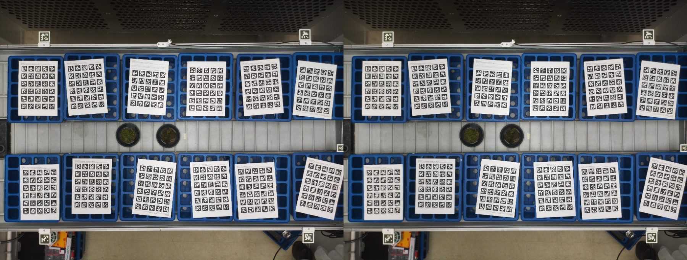

*Figure 8.1-a. The table with the 12 validation sheets in their slots, the photograph of 09:38:07 UTC (left) and of 11:18:32 UTC (right) on 2026-10-06, as compared in run 3d above (sides by the file name; the image carries no labels). Copied into `docs/figures/` on 2026-10-23 from `~/scratch/lens-fix-check-2026-10-06/overview_0938_vs_1118.jpg`, scaled down.*

### 8.2 Camera swap comparison (method written 2026-10-07, before any step runs)

**Labels:** development check for steps 0, 1 and 3 to 6, the overnight run, the packing foam and
the central check; validation for the step 2 session and the validation after the recalibration,
each also marked at its result.

**Why.** The Arducam used since the rebuild may have been damaged (Aaron, 2026-10-07): after a
full-res photo its lens stops following commands (section 8.1, run 3b and the diagnosis), a camera
fault on 2026-10-06 left the central trays about half as sharp, and the 2026-10-07 validation read
about 0.85 points lower than the 2026-10-05 one. A new camera of the same model is fitted and the
key tests are repeated, so each result can be compared with the old camera's. This compares the
two cameras; it does not look for causes.

**Before starting.** Record both cameras' serial numbers and the lens position the new camera is
locked at (the operator's choice). The old camera is kept untouched. Swapping means switching the
Pi off, so the first hour after power-on is a cold start (section 8, table): no step starts until
60 minutes after the Pi is switched on with the new camera. Same printed sheets (30.0 mm tags),
same trays and table, chamber door closed for every photograph, lights on. Raw data:
`/home/pi/scratch/camera-swap-2026-10/`.

**Steps and how each is judged** (limits fixed now; "different" means larger than the old camera
showed with nothing done):

| Step | What | Old camera | Judged |
|---|---|---|---|
| 0 | Swap, square, focus and lock (operator) | lens 6.27 | Recorded only |
| 1 | Calibrate with the wizard | tags found and fit as in section 5 | Recorded and compared; no pass or fail |
| 2 | Validate: 3 rounds, 10 minutes apart, door closed | 2026-10-07 validation above | Per slot: the band and median compared. A slot median differing by more than 0.62 points (the largest slot change with nothing done, run 3j) counts as different, but only if the lens position matches 6.27 within 0.01; otherwise the comparison is reported with the lens difference noted (the central error changes about 1.2 points per 0.1) |
| 3 | Photo-to-photo noise: 10 photos in a row, nothing touched | per-tag standard deviation 0.27 to 0.46 points | Different if the median per-tag standard deviation is outside 0.27 to 0.46 |
| 4 | Stuck lens: `reference/lens-unresponsive-2026-10-diagnose.py`, server stopped | after one photo, lens writes accepted and not followed; follows after a close and reopen | Follows or does not follow (yes or no); tells whether the fault belongs to the old camera or to the model |
| 5 | Restarts: 5 warm restarts, 2 photos each (as run 3i) | median within ±0.05 points, every slot within ±0.39 | Different if a median exceeds ±0.10 or a slot ±0.52 (Control B) |
| 6 | 2 hours unattended: one photo a minute (as run 3j) | a cycle of about 19 minutes, median swing about 0.35 points, largest slot 0.62 | Cycle present if the median's correlation with itself 15 to 25 photos later peaks above 0.5; swing and largest slot compared. Present again means it comes from the chamber, not the camera |

**Optional, only if Aaron asks for them:** a planned cold start (as run 3: Pi off about 30
minutes, photos at +0, +15, +30, +60 minutes), and the two-height test (section 9.1).

Each step's result is added here when it is done, with its date, times (UTC), session or capture
IDs and the raw data path.

**Step 0 result (2026-10-07, recorded only).** Old camera serial SN000 (kept untouched), new
camera serial SN001 (serials as given by Aaron). The Pi was switched on with the new camera at
11:20 UTC, so the cold start ended at 12:20 UTC. The server ran from the m2-camera-swap branch.
Aaron fitted, squared and focused the new camera and first locked it at 6.23. After the cold-start
data below, he unlocked, refocused and locked at **6.16** (between 11:59 and 12:22 UTC, server
log), and confirmed 6.16 as his chosen position for every remaining step. The old camera was at
6.27: a difference of 0.11, which at about 1.2 points of central error per 0.1 (step 2 above) is
about 1.3 points.

*Cold-start data, not used to judge any step:* a calibration made 25 minutes after power-on
(`20261007T114505498348`, 11:45 UTC, residual 0.50%, 30.0 mm tags, lens 6.23) and a validation
of it (session `20261007T114611264170`, rounds at 11:46 and 11:58 UTC). Both started inside the
first hour after power-on, so under the rule above they do not count; step 1 was repeated after
12:20 UTC.

**Step 1 result (2026-10-07, recorded and compared, no pass or fail).** Calibration
`20261007T122200583188`, 12:22 UTC (62 minutes after power-on), lens 6.16, focus locked, 30.0 mm
tags, 50 mm corner tags, table span 1494 x 1171 mm as entered. Calibration files:
`/var/lib/npec-rig/calibration/20261007T122200583188.json` and its `frames/` and `heatmaps/`.

| | Old camera SN000 (`20261005T141101923639`) | New camera SN001 (`20261007T122200583188`) |
|---|---|---|
| Calibration tags found | 355 | 355 |
| Corner tags found | 4 | 4 |
| Scale field residual | 0.52% | 0.49% |
| Holdout coverage error | 0.4% | 0.4% |
| Mean scale | 4.856 px/mm | 4.865 px/mm (+0.17%) |
| Lens position | 6.27 | 6.16 |

The new camera finds the same tags and the plane fits them as well as for the old camera. The
mean scale differs by 0.17%, which is expected when a camera is refitted and squared again; no
limit was set for it. The wizard also reported: scale varies 1% across the calibrated area, worst
top-left, 0.6% higher top-left than bottom-right; area-scale error 0.8% mean over 355 tags; shape
distortion 0.01% mean, worst tag 395 at -0.06%. The 11:45 cold-start calibration at lens 6.23 gave
4.864 px/mm and 0.50%, close to this one.

**Label: validation.**

**Step 2 result (2026-10-07).** Validation session `20261007T122525038952` of calibration
`20261007T122200583188`, lens 6.16 locked, chamber door closed. Rounds at 12:26, 12:38 and
12:51 UTC (24.8 minutes first to last, shortest gap 11.8 minutes); 93%, 93% and 86% of tags
moved; 85 to 90 tags per slot. The rig's checks: validated, no problems, no flagged or
inconsistent slots; the largest move of a slot median between rounds 0.60 points (old camera
1.31). Raw data: `/home/pi/scratch/camera-swap-2026-10/step2/` (`validation_sessions.json`, all
sessions as the server reported them at 12:51 UTC, and `compare.py`, which makes the table below).

| Slot | Band, old | Band, new | Median, old | Median, new | Change |
|---|---|---|---|---|---|
| North 1 | ±3.3% | ±2.7% | -0.90 | +0.88 | +1.78 |
| North 2 | ±2.5% | ±1.7% | -0.80 | +0.51 | +1.31 |
| North 3 | ±2.9% | ±1.7% | -1.36 | -0.22 | +1.14 |
| North 4 | ±2.3% | ±2.1% | -0.25 | -0.38 | -0.13 |
| North 5 | ±2.4% | ±1.8% | -0.71 | -0.50 | +0.21 |
| North 6 | ±3.0% | ±1.9% | -0.91 | +0.33 | +1.24 |
| South 1 | ±2.8% | ±1.9% | -1.33 | -0.05 | +1.28 |
| South 2 | ±2.2% | ±1.3% | -0.76 | +0.22 | +0.98 |
| South 3 | ±1.5% | ±2.0% | -0.16 | -0.05 | +0.11 |
| South 4 | ±1.6% | ±2.5% | +0.11 | -0.58 | -0.69 |
| South 5 | ±3.1% | ±1.7% | -1.20 | -0.34 | +0.86 |
| South 6 | ±2.2% | ±1.9% | -0.37 | +0.64 | +1.01 |

*Against the limit fixed above.* The lens position (6.16) does not match the old camera's (6.27)
within 0.01; it differs by 0.11. So, as fixed beforehand, the 0.62-point limit is not applied and
no slot is called the same or different; the comparison is reported with the lens difference
noted (about 1.3 points of central error at 1.2 points per 0.1). For the record, 9 of 12 slot
medians changed by more than 0.62 points (from -0.69 to +1.78).

*What the comparison does show.* Bands: ±1.3% to ±2.7% on the new camera against ±1.5% to ±3.3%
on the old; 10 of 12 slots narrower, 2 wider (South 3, South 4). Median of the slot medians: -0.05
points against -0.78 (the old camera read +0.07 on 2026-10-05). This compares two cameras at two
lens positions; it does not say which of the two, if either, caused the change.

**Step 3 result (2026-10-07): different, lower.** 10 photos in a row through the app's
`POST /capture`, 12:57:31 to 12:57:58 UTC (2.7 to 2.8 s each), captures `2026-10-07/125733_446195`
to `2026-10-07/125758_010168`, nothing touched, chamber door closed, lens 6.16 locked in every
photo, exposure 3793 µs and gain 1.0 in every photo, calibration `20261007T122200583188`. Method:
each calibration tag matched by ID and position (within 20 px of the first photo); the standard
deviation (n-1) of its area error over the 10 photos; the median over tags. Raw data and scripts:
`/home/pi/scratch/camera-swap-2026-10/step3/` (`step3.py` took the photos, `analyse.py` makes
`results.json`).

| | Old camera SN000 | New camera SN001 |
|---|---|---|
| Median per-tag standard deviation | 0.27 to 0.46 points (2026-10-01; a different statistic, see the note below) | **0.15 points** |
| Tags followed through every photo | | 355 of 355 |
| Per-tag spread, middle half of tags | | 0.12 to 0.19 points |
| Largest tag | | 0.37 points |
| Per-slot medians | | 0.12 to 0.17 points |
| Whole-photo median error, photo to photo | | -0.09 to +0.00 points |

*Against the limit fixed above.* 0.15 is outside 0.27 to 0.46, so the new camera is different: its
photo-to-photo noise is about half the old camera's. One caution about the comparison itself: the
old figure came from the light-level test of 2026-10-01 (`reference/arducam-central-error-2026-10.md`,
test 6), with automatic exposure compensating three light levels, and its record does not give the
number of photos or how the standard deviation was summarised. Today's photos had fixed exposure.

*Note added 2026-10-08.* The old figure's method has since been found (section 8, first row): one
photo per light level, and 0.27 and 0.46 are standard deviations of the difference between two
photos, not of one photo, and each pair also differed in light level. For one photo that is at
most about 0.19 to 0.33 points. The new camera's 0.15 is still lower, but by less than half, and the two tests differ in exposure (automatic over three
light levels against fixed), so the size of the difference is not established.
So the difference may come partly from the conditions, not only from the camera. The limit was
applied as written, not changed.

**Step 4 result (2026-10-07): does not follow, as the old camera.** Server stopped 13:02 UTC,
`reference/lens-unresponsive-2026-10-diagnose.py` run with the camera-swap branch's code, one case
per process (a fresh camera each time), chamber door closed, lights on. Lens positions used: the
persisted 6.16 and 4.66 (1.5 below, chosen only for a large sharpness change). Each write watched
for 90 s: the position the camera reports, frames flowing, and the sharpness of the central third.
Raw data: `/home/pi/scratch/camera-swap-2026-10/step4/` (one `.csv` and `.json` per case).

| Case (UTC start) | Lens write | Reported position | Sharpness | Followed |
|---|---|---|---|---|
| No photo (13:03) | 6.16 to 4.66 | 4.66 in 0.58 s | 1067 to 19 | yes |
| | 4.66 to 6.16 | 6.16 in 0.57 s | 19 to 1103 | yes |
| After 1 full-res photo (13:07) | 6.16 to 4.66 | stayed 6.16 for 90 s | 1105 to 1104 | **no** |
| After 1 photo, camera closed and reopened (13:12) | 6.16 to 4.66 | 4.66 in 0.57 s | 1087 to 19 | yes |
| | 4.66 to 6.16 | 6.16 in 0.58 s | 19 to 1098 | yes |

Frames kept flowing in every case. The write after a photo was accepted without an error and not
followed, and the camera kept reporting the old position, exactly as the old camera did (section
8.1, run 3b and the diagnosis). A close and reopen cures it on both cameras. So the fault is not
peculiar to the old camera: it comes with this camera model or with the software shared by both
setups; this step does not separate those two. The app already works around it (photos do not move
the lens; the camera is reopened before any lens command, TODO "Plan: nothing moves the lens during
an experiment", slice 1). Every case ended with the lens driven back to 6.16. The server was
restarted at 13:18 UTC and reported focus locked at 6.16.

**Step 5 result (2026-10-07): same as the old camera.** As run 3i: 2 reference photos, then 5
times (warm app restart by killing the whole server process family, relaunch from the camera-swap
branch, wait until focus reports locked; 2 photos). 13:21:56 to 13:22:47 UTC, about 3.4 s per
restart (as in run 3i), lens 6.16 and locked after every restart and in every photo, chamber door
closed, calibration `20261007T122200583188`, slots from validation `20261007T122525038952`. Each
calibration tag compared with itself in the first reference photo (matched by ID and within
20 px). Raw data: `/home/pi/scratch/camera-swap-2026-10/step5/` (`step5.sh`, `log.txt`,
`photos.txt`, `analyse.py`, `results.json`).

| Photo | Tags | Median change | Central slots | Largest slot change |
|---|---|---|---|---|
| Reference b | 355 | -0.03 | -0.04 | North 5 -0.15 |
| Restart 1 a / b | 355 / 355 | +0.01 / -0.04 | +0.01 / -0.03 | South 4 -0.11 / North 5 -0.16 |
| Restart 2 a / b | 355 / 355 | +0.02 / -0.01 | +0.05 / +0.02 | North 3 +0.11 / North 6 -0.24 |
| Restart 3 a / b | 355 / 355 | +0.05 / -0.02 | +0.06 / +0.01 | North 3 +0.11 / North 5 -0.16 |
| Restart 4 a / b | 355 / 355 | +0.06 / +0.02 | +0.10 / +0.05 | South 5 +0.18 / North 3 +0.15 |
| Restart 5 a / b | 355 / 355 | +0.05 / -0.00 | +0.09 / +0.06 | North 3 +0.19 / South 5 +0.19 |

*Against the limits fixed above.* Median within -0.04 to +0.06 (limit ±0.10), every slot within
±0.24 (limit ±0.52): not different. The old camera gave a median within ±0.05 and every slot within
±0.39 (run 3i). A warm restart does not change the new camera's readings either.

**Extra check, asked for by Aaron (2026-10-07): is the central low reading there on the new
camera?** Not one of the steps above; no limit set, compared only. *Method (written before it
ran):* the same analysis as `reference/arducam-central-error-2026-10.md` section 4.1, on each
camera's 2026-10-07 validation. Every calibration tag in the 3 validation rounds, its area error
under that camera's own calibration (old: rounds `070505_471367`, `071439_917590`,
`072601_309111` with calibration `20261005T141101923639`; new: `122619_085413`, `123805_311325`,
`125109_812791` with `20261007T122200583188`), grouped by distance from the image centre (4576,
3472 px): median error per band, and the dip (median within 1500 px minus median beyond 2500 px,
as in that record's section 4.3, where the old camera gave about -2.6 points on 2026-10-01).
Saved data only; no photos. Raw data: `/home/pi/scratch/camera-swap-2026-10/centre-check/`.

*Result (run 13:27 UTC):*

| Distance from image centre (px) | Old camera SN000: tags, median error | New camera SN001: tags, median error |
|---|---|---|
| 0 to 1000 | 24, -2.42% | 10, -2.80% |
| 1000 to 1500 | 119, -0.88% | 123, -1.15% |
| 1500 to 2000 | 158, +0.17% | 173, -0.08% |
| 2000 to 2500 | 164, -0.07% | 138, +0.10% |
| 2500 to 3500 | 256, -1.11% | 271, +0.06% |
| 3500 to 4500 | 287, -0.77% | 332, +0.50% |
| 4500 and beyond | 29, -1.44% | 18, -0.55% |
| Dip (within 1500 minus beyond 2500) | -0.27 points | -1.50 points |

The central low reading is present on the new camera: tags within 1000 px of the image centre read
about 2.8% small and the reading returns to about zero beyond 1500 px, the same shape as on the old
camera. So it is not peculiar to the old camera, in line with its record (it belongs to the
Arducam). The old camera's dip on this day is only -0.27 because its outer bands also read low
(-0.77 to -1.44%), the whole-table shift of about -0.85 points noted in section 6; its innermost
band (-2.42%) is close to the new camera's. Cautions: the innermost band holds only 10 and 24
tags; the two cameras were at different lens positions (6.16 and 6.27), and the size of this
error follows the lens position. The North 4 slot median does not stand out on either camera
because only the slot's inner corner lies within 1500 px of the image centre; the per-slot band
from validation includes it.

**Packing foam found on the new camera (2026-10-07, during step 6).** Aaron found packing foam
left on the camera body over the lens, present for every photo since the swap (calibration,
validation, steps 2 to 5 and step 6 photos 0 to 12). He removed it with the door open 13:41 to
13:42 UTC (15:41 to 15:42 local), without touching the lens. Step 6 photos compared with photo 11
(13:40 UTC, the last before the door opened); raw data and script:
`/home/pi/scratch/camera-swap-2026-10/foam-check/` (`analyse.py`, `results.json`).

| Photo (UTC) | Exposure (µs) | Tags | Tag shift, median / largest (px) | Area change, median | Largest slot | North 4 sharpness |
|---|---|---|---|---|---|---|
| 0 (13:29) | 3793 | 355 | 0.97 / 1.64 | +0.19 | North 5 +0.46 | |
| 10 (13:39) | 3793 | 355 | 0.16 / 0.69 | +0.04 | North 5 +0.13 | |
| 13 (13:42, Aaron at the rig) | 3897 | 314 | 0.22 / 3.75 | -0.04 | | |
| 14 (13:43) | 3533 | 355 | 0.89 / 3.07 | -0.53 | North 5 -0.83 | -21.4% |
| 15 (13:44) | 3533 | 355 | 0.94 / 3.72 | -0.52 | North 5 -0.77 | -20.2% |
| 16 (13:45) | 3533 | 355 | 0.86 / 3.36 | -0.47 | North 1 -0.60 | -16.6% |
| 17 (13:46) | 3533 | 355 | 0.78 / 3.55 | -0.43 | North 3 -0.54 | -15.5% |

After the foam was removed, the camera's view moved by under 4 px, the exposure dropped by 7% (more
light reaching the sensor), the readings dropped by about 0.5 points (beyond the step 5 limits of
0.10 for the median and 0.52 for a slot) and the centre lost about a fifth of its sharpness; the
change was getting smaller each minute. Whether the readings return to their earlier level is not
known yet. Until that is known, the step 2 validation is not relied on.

*Later step 6 photos, same comparison (checked 16:30 UTC):*

| Photo (UTC) | Tag shift, median / largest (px) | Area change, median | Largest slot | Least sharp slot |
|---|---|---|---|---|
| 25 (13:54) | 0.94 / 3.19 | -0.62 | North 4 -0.81 | North 4 -25.6% |
| 35 (14:04) | 1.21 / 4.24 | -0.51 | North 4 -0.65 | North 4 -21.5% |
| 50 (14:19) | 1.05 / 3.63 | -0.85 | North 5 -1.17 | South 3 -39.2% |
| 70 (14:39) | 1.07 / 3.42 | -0.93 | North 4 -1.37 | South 3 -41.9% |
| 90 (14:59) | 0.96 / 3.51 | -0.85 | North 5 -1.13 | South 3 -40.0% |
| 105 (15:14) | 0.92 / 3.10 | -0.85 | North 4 -1.14 | South 3 -39.4% |
| 119 (15:28) | 0.91 / 2.86 | -0.69 | North 5 -0.92 | South 3 -31.3% |

The readings did not return within 1 hour 46 minutes. From about 14:19 UTC they settled about 0.7
to 0.9 points below their level before the foam was removed, with single slots up to 1.37 points
below, and the central slots about a third to two fifths less sharp. This is larger than every
change measured with nothing done on either camera (section 8, table). The calibration and the
step 2 validation therefore describe the camera as it was with the foam on, not as it is now. The
overnight run shows whether this changes further. Steps 1 to 5 and the
centre check were all taken with the foam in place; they compare the cameras as they were set up,
foam included. Step 6 is affected from photo 13: its photos 0 to 12 are 13 minutes only, and from
photo 14 on it includes the recovery, so it is reported with that noted.

**Overnight run (method written 2026-10-07 13:50 UTC, before it starts; agreed by Aaron).** Not
one of the steps above; recorded only, no limit. Purpose: does the reading return to its level
before the foam was removed, and does it drift over about 15 hours with nobody at the chamber.
Same script as run 3j (`/home/pi/scratch/camera-swap-2026-10/overnight/overnight.py`), started
automatically when step 6 ends (about 15:29 UTC), 916 photos, one a minute, to about 06:45 UTC on
2026-10-08 (08:45 local). Door closed, lights on (Aaron), lens 6.16 locked. Analysed as step 6:
each tag against itself in a reference photo, median and per-slot change, sharpness per slot;
reported against both step 6 photo 11 (before the foam came off) and the first overnight photo.
Raw data: `/home/pi/scratch/camera-swap-2026-10/overnight/`.
*Start as run:* the automatic start failed (the launcher waited for step 6 by looking for its name
among running processes, and a second waiter of Claude's own carried the same name, so it never
saw step 6 end). Started by hand at 16:26 UTC on Aaron's request, 858 photos to about 06:44 UTC.
No photos were taken from 15:28 to 16:26 UTC (58 minutes).

**Step 6, extra analysis of photos 14 to 119 (method written 2026-10-08 before it ran; agreed by
Aaron; information only, the as-written result stands).** The same analysis and chamber comparison
as step 6, on photos 14 to 119 only (after the foam came off), each tag against itself in photo 14
(`2026-10-07/134311_803312`). Reason: the foam step at photo 13 dominates the as-written series and
could hide a cycle of the old camera's size (0.35 points).

**Step 6 result (2026-10-07, 13:29 to 15:28 UTC, analysed 2026-10-08).** 120 photos, one a minute,
through `POST /capture` (`step6.py`, a copy of run 3j's script), no errors, lens 6.16 locked in
every photo, chamber door closed except 13:41 to 13:42 UTC (foam removal, above). Calibration
`20261007T122200583188`. Chamber record: Aaron's export
`/home/pi/scratch/Aaron-D6-2026.09.08-2026.10.08.csv` (1-minute rows, local time). Raw data and
scripts: `/home/pi/scratch/camera-swap-2026-10/step6/` and the shared `series_analyse.py` and
`chamber_compare.py` in `/home/pi/scratch/camera-swap-2026-10/` (adapted from run 3j's
`analyse.py` and `chamber_compare.py`).

| | Old camera, run 3j | New camera, as written (photos 0 to 119, against photo 0) | New camera, extra (photos 14 to 119, against photo 14) |
|---|---|---|---|
| Median's correlation with itself 15 to 25 photos later, peak | above 0.5, period about 19 | **0.20** (17 photos) | **0.67** (19 to 20 photos) |
| Median swing | about 0.35 points | 1.15 points | 0.57 points |
| Largest slot change | 0.62 | 1.85 (North 5) | 0.74 (North 5) |
| Least sharp slot | no loss | -53% | -31% |
| Chamber air temperature | 19.8 to 20.3 °C, period 19 min, r +0.84 | 19.7 to 20.3 °C, period 19 min, r -0.26 | 19.7 to 20.3 °C, period 19 min, r -0.59 (chamber 5 min ahead) |
| Chamber humidity | 57 to 62%, period 19 min, r -0.76 | 57 to 62%, period 19 min, r +0.33 | 57 to 62%, period 19 min, r -0.73 |

*Against the rule fixed above, as written:* the peak correlation is 0.20, under 0.5, so the cycle
counts as **not present**. This is the official step 6 result. The swing and the largest slot are
dominated by the foam removal and the settling after it, so they do not compare the cameras.

*Extra analysis (information only):* without the foam step, the cycle is there on the new camera:
peak correlation 0.67 at 19 to 20 photos, and the readings follow the chamber's 19-minute
humidity cycle (r -0.73, the same as the old camera's -0.76) and its temperature cycle (r -0.59;
the old camera's was +0.84, opposite in sign). The swing (0.57) still includes some settling after
the foam came off. In the terms of 8.2, a cycle present on both cameras comes from the chamber, not
the camera; this rests on the extra analysis, not on the as-written result. The opposite sign
against temperature is recorded, not explained. The chamber ran the same climate cycle on both
days (19.7 to 20.3 °C, 57 to 62%).

**Overnight run result (2026-10-07 16:26 to 23:14 UTC, analysed 2026-10-08).** 858 photos taken to
06:43 UTC, no errors, lens 6.16 locked in every photo. The chamber lights went off at photo 409
(23:15 UTC; exposure jumped from 3533 to about 66000 µs), so the run is analysed to photo 408:
409 photos, 6.8 hours. Every tag compared with itself in step 6 photo 11 (13:40 UTC, the last
photo before the foam came off). Same scripts as step 6; raw data:
`/home/pi/scratch/camera-swap-2026-10/overnight/` (`analysis_vs_before_foam.json`,
`chamber_compare.json`).

| Hour from (UTC) | Median change, hour median | Lowest / highest photo | Sharpness, median slot |
|---|---|---|---|
| 16:26 | -0.84 | -1.04 / -0.58 | -15.8% |
| 17:26 | -0.78 | -1.01 / -0.55 | -15.0% |
| 18:26 | -0.80 | -1.04 / -0.49 | -15.2% |
| 19:26 | -0.80 | -1.08 / -0.48 | -15.4% |
| 20:26 | -0.78 | -1.04 / -0.54 | -15.2% |
| 21:26 | -0.78 | -1.02 / -0.46 | -15.4% |
| 22:26 | -0.80 | -1.04 / -0.60 | -16.2% |

Largest slot change -1.57 points (North 5); largest swing of one slot 1.06 points. The median's
correlation with itself peaks at 0.83 at 20 photos. Against the chamber record over the same
window: air temperature 19.7 to 20.4 °C, period 20 min, r +0.61 (chamber 2 min behind); humidity
56 to 62%, period 20 min, r -0.86. Light level (CoolWhite) changed from 25.02 to 13 within the
window with no effect on the readings (r +0.04).

What it shows: (1) the readings did not return to their level before the foam came off: they sat
about 0.8 points lower, and the slots about 15% less sharp, for the whole 6.8 hours; so the foam's
removal changed the camera's readings lastingly, and the calibration of 2026-10-07 12:22 UTC and
its validation no longer describe the camera. (2) With nothing done for 6.8 hours, there was no
drift: each hour's median lay within 0.06 points of the others. (3) The 20-minute cycle is present,
swinging about 0.5 to 0.6 points, and follows the chamber's humidity and temperature cycle with the
same signs as the old camera's (humidity negative, temperature positive); the opposite temperature
sign in step 6's extra analysis came during the settling after the foam came off. Present on both
cameras, the cycle comes from the chamber, not the camera.

**Label: validation.**

**Recalibration after the foam came off (2026-10-08).** Before it, Aaron moved the trays slightly,
moved the tray tags to inside each tray's boundary, and refocused: the lens was locked at **6.04**
(the operator's choice) when the calibration ran. Calibration `20261008T081832283098`, 08:18 UTC,
30.0 mm tags, 50 mm corner tags. Validation session `20261008T081846523784`, rounds at 08:20, 08:32
and 08:43 UTC (23.6 minutes first to last, shortest gap 11.8 minutes), 87%, 77% and 74% of tags
moved, 85 to 90 tags per slot, chamber door closed. Raw data: `/home/pi/scratch/camera-swap-2026-10/recal/`
(`validation_sessions.json` as the server reported it, `compare.py`).

| | With foam (step 1 and 2, lens 6.16) | Foam removed (lens 6.04) |
|---|---|---|
| Calibration tags | 355 | 355 |
| Scale field residual | 0.49% | 0.50% |
| Mean scale | 4.865 px/mm | 4.858 px/mm (-0.14%) |
| Validation | validated, no flags | validated, no flags |
| Largest move of a slot median between rounds | 0.60 | 0.76 |
| Bands | ±1.3% to ±2.7% | ±1.3% to ±2.7% |
| Median of the slot medians | -0.05 | -0.14 |

| Slot | Band, foam | Band, no foam | Median, foam | Median, no foam | Change |
|---|---|---|---|---|---|
| North 1 | ±2.7% | ±2.3% | +0.88 | +0.83 | -0.06 |
| North 2 | ±1.7% | ±2.5% | +0.51 | +0.26 | -0.25 |
| North 3 | ±1.7% | ±2.0% | -0.22 | -0.45 | -0.24 |
| North 4 | ±2.1% | ±2.5% | -0.38 | -0.43 | -0.04 |
| North 5 | ±1.8% | ±1.5% | -0.50 | -0.68 | -0.18 |
| North 6 | ±1.9% | ±1.6% | +0.33 | +0.17 | -0.15 |
| South 1 | ±1.9% | ±1.4% | -0.05 | -0.36 | -0.31 |
| South 2 | ±1.3% | ±1.4% | +0.22 | +0.34 | +0.12 |
| South 3 | ±2.0% | ±2.1% | -0.05 | -0.13 | -0.07 |
| South 4 | ±2.5% | ±2.7% | -0.58 | -0.86 | -0.28 |
| South 5 | ±1.7% | ±1.3% | -0.34 | -0.16 | +0.18 |
| South 6 | ±1.9% | ±2.4% | +0.64 | +0.77 | +0.13 |

The lens differs (6.04 against 6.16) and the trays and tray tags were moved, so by the step 2 rule
no slot is called the same or different. For the record, every slot median changed by less than
0.62 points (from -0.31 to +0.18). Compared with the 2026-10-07 calibration as it read after the
foam came off (about 0.8 points low, overnight run), a fresh calibration brings the camera back to
a validation as close to zero as before. This calibration and validation are the current ones for
the new camera and replace those of 2026-10-07.

## 9. M2 physical acceptance tests (2026-10-05)

The four tests PLAN.md lists for M2, run in the chamber on 2026-10-05 (times UTC; the chamber is
UTC+2). The two-baseline test was run earlier (2026-09-25, section 8 table).

| Test | Pass criterion | Result |
|---|---|---|
| 9.1 Two heights | Scale field shapes at two heights agree within the residual | **Pass**: largest difference 0.16%, residuals 0.52% and 1.10% |
| 9.2 Tape measure | App agrees with a tape within 2% | **Pass**: +1.6% to +1.7% (tag to tag), about +1.4% (tape in the photo, after height correction); both read long |
| 9.3 Roll and knock | Roll read correctly; a hard knock gives FAIL | **Pass**: -3.01 deg read against about -3.0 to -3.1 deg measured; knock gave FAIL |
| 9.4 Claimed against actual error | The calibration's claimed uncertainty matches the measured error | **Fail for the claim, which is removed**; no corner pattern |

### 9.1 Two-height test

**Label: development check.** Two calibrations of the rig compared with each other.

**Question.** Does the shape of the scale field (how scale changes across the image) stay the same
at a different height, so one paper calibration covers every tray height?

**Method.** Two calibrations, same camera position, 30.0 mm tags, 355 tags and 4 corner tags each:

| Run | Sheets on | File | Lens | Centre scale | Residual |
|---|---|---|---|---|---|
| A | the table surface | `20261005T140433441775` (14:04), not made current | 6.07 | 4.522 px/mm | 1.10% |
| B | trays at experiment height | `20261005T141101923639` (14:11), current | 6.27 | 4.852 px/mm | 0.52% |

For each run, the scale at each corner of the calibrated area (pixels (1000, 1000), (8150, 1000),
(1000, 5950), (8150, 5950)) is divided by the same run's scale at the image centre (4576, 3472).
This removes the overall change of scale with height and leaves the shape.

| Position | Table | Trays | Difference (points) |
|---|---|---|---|
| Top-left | -1.15% | -1.16% | +0.01 |
| Top-right | -0.82% | -0.66% | -0.15 |
| Bottom-left | +0.83% | +0.67% | +0.16 |
| Bottom-right | +1.18% | +1.19% | -0.01 |

**Result.** The shapes agree within 0.16 points, below both runs' residuals. One paper calibration
covers every tray height: a new tray height needs no new paper calibration for its shape. The
residual on the table (1.10%) is twice that on the trays, possibly because sheets lie less flat on
the table surface; it makes this test less strict, not more.

**Covers.** Table surface to tray top (about 100 mm, derived from the centre scale change, 15.1% in
area, and 0.145% of area per mm, not taped). Lens moved between runs (6.07 and 6.27), as in a real change of height.

### 9.2 Tape-measure check

**Label: reference comparison.** The steel tape does not use the printed tags.

**Question.** The scale rests on the tag size typed in (30.0 mm). If that were wrong, every reading
would be wrong by the same proportion, and validation would not notice, because it checks against
the same number. A tape measure is an independent instrument.

**Instrument.** Steel tape, 1 mm divisions. It reads 180 mm on a sheet's 180 mm scale bar
(callipers 179.93 and 180.03 mm), so it shows no fixed offset and no 1.6% scale error over that
length.

**Method A, tag to tag.** Tape from the western (outer) edge of a tag on the South 1 sheet to the
eastern (outer) edge of a tag on the South 6 sheet, on the tray tops. The app's distance is
computed from the tags' detected corners and the current scale field, integrated along the line.
Tag numbers repeat across sheets, so the tag is identified by position as well as number.

| Tags | Photo | Tape | App | App reads long by |
|---|---|---|---|---|
| 355 (S1) to 329 (S6) | 12:59:40 | 1720 to 1721 mm | 1750.1 mm | 1.7% |
| 380 (S1) to 354 (S6) | 13:07:52 | 1713 mm | 1741.0 mm | 1.6% |

**Method B, tape in the photo** (13:12:53). The tape lay along the north edge of the South trays,
zero at the edge of South 1, and was photographed. The app's distance between the centres of the
red 10 cm boxes printed on the tape (found by colour, about 5 px per mm) was computed with the
scale field:

| Span | Tape | App | App reads long by |
|---|---|---|---|
| 10 to 180 cm | 1700 mm | 1736.7 mm | 2.16% |
| 20 to 170 cm | 1500 mm | 1531.3 mm | 2.09% |
| 30 to 160 cm | 1300 mm | 1325.0 mm | 1.92% |

Near the frame centre, Aaron measured 4.8504 px/mm along the tape in ImageJ; the app's field
gives 4.844 px/mm there (0.1%). Toward both ends of the row the app reads the tape about 3% long
(10 to 50 cm: 2.99%; 140 to 180 cm: 2.92%).

**Height correction.** The tape lay on the tray lips, about 10 mm above the sheets. The height
effect, 0.145% per mm (section 4, derived from the camera height and checked by one test), is for
area; for a length it is half, about 0.072% per mm. 10 mm is
therefore about +0.72% in length, so the full 1700 mm span corrected is about +1.4% (about ±0.15%
for "about 10 mm"; 20 to 170 cm about +1.4%, 30 to 160 cm about +1.2%). Method A needs no
correction: the tags lie on the sheets.

**Result.** Pass against 2% by both methods, which agree within about 0.3 points: over about
1700 mm the app reads distances 1.4% to 1.7% long. The pattern along the tape (centre about -0.6%
after correction, ends about +2.2%) fits the known central error (section 7). **Open point:** in
the same photos the tags at the ends of the row read 29.4 to 30.1 mm, slightly small or correct,
while distances spanning the row read long. The reason is not known.

*Correction, 2026-10-05:* a first version of this section applied the area figure (0.145% per mm)
to lengths, which gave +0.7% and a false 1% disagreement between the two methods. Found in review.

**Covers.** Left to right along the South row only, about 1700 mm, at tray-top height. Not front to
back. Not the North row.

### 9.3 Roll and knock (tripwire)

**Labels:** roll: reference comparison (the table's aluminium rails, fixed to the chamber). Knock:
development check (how the tripwire responds).

**Question.** After calibration, the app compares the 4 corner tags in each photo with the
calibration's (the tripwire). Does it read a camera roll correctly, and does a knock give FAIL?

**Limits** (code, marked provisional): roll DRIFT at 1 deg, FAIL at 10 deg; corner scale DRIFT at
3%, FAIL at 8%; any corner tag missing gives FAIL.

**Independent reference.** The table's aluminium rails, fixed to the chamber. The angle of a rail
edge is fitted with a straight line over x = 1500 to 7600 px (RANSAC, about 1000 edge points),
standard error 0.003 to 0.004 deg per photo. A camera that tips as well as rolls makes lines
above and below the image centre lean in opposite directions, so the top and bottom rails are
both measured and their change interpolated to the image centre.

| Step | App (Check tripwire now) | Photo |
|---|---|---|
| Baseline | OK, roll 0.00 deg | 13:31:08 |
| Knock on the camera mount | FAIL: corner tag 452 missing (pushed to the bottom edge of the frame) | 13:32:54 |
| Camera re-framed by hand | DRIFT: rolled 3.0 deg counterclockwise, near corner tag 455 7% closer (roll -3.01 deg) | 13:35:04 |

| Rail | Before | After | Change |
|---|---|---|---|
| Top (image y about 1100 to 1330) | +0.27 deg | -4.02 deg | -4.28 deg |
| Bottom (image y about 5940 to 6160) | -0.37 deg | -2.05 deg | -1.68 deg |
| Interpolated to the image centre | | | about -3.0 to -3.1 deg |

**Result.** Pass. The app's roll (-3.01 deg) agrees with the rails within 0.06 deg (criterion
0.2 deg, set for this test). The knock gave FAIL, through the lost corner tag; the roll and scale
FAIL limits were not reached by this knock.

**Observation, not acted on.** Each rail edge bends about 0.5 deg between its left and right halves,
in both photos: straight lines near the top and bottom of the frame are slightly curved.

**Covers.** One roll of about 3 deg, not 5 deg. The camera can only be nudged by hand, with no
measure of its own, which is why the rails are the reference.

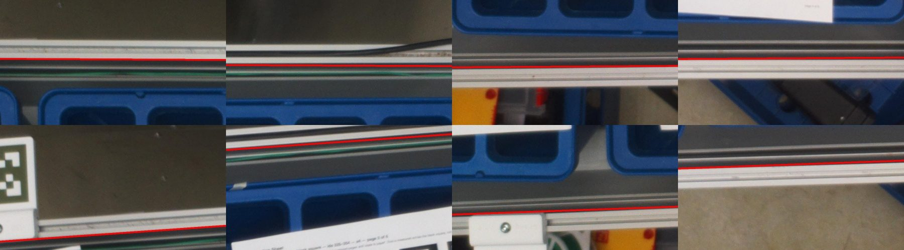

*Figure 9.3-a. The independent reference for roll: 8 crops of the table's aluminium rail edges, with the straight line fitted to each edge drawn in red (RANSAC over x = 1500 to 7600 px, as above). Copied into `docs/figures/` on 2026-10-23 from `~/scratch/roll-rail-lines.jpg` (made 2026-10-05; which photographs the 8 crops come from is not recorded).*

### 9.4 Claimed uncertainty against actual error (honesty plot)

**Label: development check.** The claim is judged against validation tags, not against a second
instrument.

**Question.** The calibration claims an uncertainty at each position: the spread of the 5 nearest
tags about the fitted field. Is that claim honest, that is, does it match the error actually
found on targets it was not fitted to? And is the error worse toward the corners (the evidence
gate for a lens distortion model, section 10)?

**Method.** Instead of 6 positions, all 12 slots, using validation session `20261005T071549445423`
(calibration of 07:11 UTC; 3 counted rounds of moved tags, 85 to 90 tags per slot). Three further
photographs in that session (07:35, 07:49, 08:05) were a lens-drift check with nothing moved and
were not counted. Claimed: the calibration's local uncertainty at the slot centre, a length
percentage. Actual: root mean square of the slot's area errors, halved to give a length
percentage (area error is about twice length error).

| Slot | Claimed | Actual | Slot | Claimed | Actual |
|---|---|---|---|---|---|
| North 1 | 0.36% | 0.52% | South 1 | 0.49% | 0.49% |
| North 2 | 0.56% | 0.55% | South 2 | 0.58% | 0.43% |
| North 3 | 0.52% | 0.66% | South 3 | 0.42% | 0.63% |
| North 4 | 0.50% | 0.84% | South 4 | 0.78% | 0.64% |
| North 5 | 0.31% | 0.38% | South 5 | 0.28% | 0.41% |
| North 6 | 0.32% | 0.61% | South 6 | 0.50% | 0.46% |

**Result.** The claim is lower than the actual error in 7 of 12 slots, about equal in 1, higher in
4; the median slot's actual error is 1.25 times its claim, the worst 1.9 times (North 6). The
claim is overconfident because it is judged against the same tags it was fitted to. **Decision
(Aaron, 2026-10-05):** remove the claimed uncertainty, the confidence heatmap and the honesty-plot
panel from what the operator sees. The validation band is the uncertainty.

**Corners.** The 4 outer corner slots average 0.52% actual error, the 4 central slots 0.69%. The
error is not worse toward the corners; the central excess is the known central error (section 7).
The lens distortion gate stays closed. The trays do not reach the extreme frame corners; plants
only sit on trays.

## 10. Techniques deliberately not used, and what would justify them

| Technique | Adopt when | Evidence so far |
|---|---|---|
| Lens distortion model (intrinsic calibration) | Errors are structured, worse toward the corners, not random | Radial fit R² 0.33 to 0.45 on repeat runs (2026-09-22). 2026-10-05: validation errors are not worse at the corner slots (section 9.4), so the gate stays closed. Rail edges near the frame top and bottom bend about 0.5 deg (section 9.3), noted only |
| Correction for height above the plane | A measured depth source exists | None |
| Orthophoto, second camera | A second viewpoint exists, and in-plane accuracy proves insufficient | Canon used once, as a check only |
| Learned tray identification | Tag identity measurably fails often enough to matter | Not measured |

## 11. Not yet measured, and open inconsistencies

**Not yet measured:** whether driving the lens to both ends of its range before focusing changes
sharpness (run 3b could not test it, section 8.1). The M2 acceptance tests are
done (section 9).

**Open points from the acceptance tests:**

1. Tape check: distances across the South row read 1.4% to 1.7% long by both methods, while the
   tags at its ends read 29.4 to 30.1 mm (section 9.2). Not explained.
2. Tripwire: a knock gave FAIL only through a lost corner tag; the roll (10 deg) and scale (8%)
   FAIL limits are still provisional (section 9.3).
3. Lens control stops responding after a full-res capture (calibration, capture or tripwire
   check) until the app is restarted. Seen twice on 2026-10-05. Lens commands return success while
   the lens does not move. A measurement-relevant risk: the lens position recorded with a capture
   may not be the actual one. Tracked as a bug, not a measurement. Since 2026-10-06 photos do not
   move the lens and the camera is reopened before any lens command. The replacement camera shows
   the same fault (2026-10-07, section 8.2, step 4), so it is not peculiar to one unit.

**Inconsistencies found between project files, to be checked and resolved:**

1. Median-movement limit: 1.5 points in TODO.md, 2.5 in the code.
2. *Resolved 2026-10-08.* Calliper tolerance: "within 0.5 mm" (TODO.md, 2026-09-27) described a
   frame covered with tags, not a calliper tolerance; ±0.1 mm stands. Calliper date: the readings
   were made on or before 2026-09-21; 2026-09-29 is when they were given again (section 3).
3. Camera height: about 1482 mm, measured by Aaron with a tape measure on 2026-10-01 without
   touching the camera (section 4); the "not yet measured" note was written earlier the same
   morning. *Still open:* it is a best estimate, not a precise value, with no stated uncertainty,
   and it has not been re-measured since the camera swap.
4. Tray height: about 100 mm in some notes, a survey of 50 to 56 mm in another (the reference
   point of the survey is not stated). The 2026-10-05 two-height test implies about 100 mm from
   table surface to tray top (derived from scale, not taped), matching the 100 mm notes.
   *Resolved 2026-10-09:* the 4x5 tray's growing medium is 100 mm above the table (callipers) and
   its lip 5 mm higher (105 mm by tape, section 3). The 100 mm notes and the two-height test refer
   to the growing medium. For the other trays the top edge is the growing medium (Aaron, same day).
5. *Resolved 2026-10-08.* Central error size: "up to about 4%" (CLAUDE.md) is the ring 1000 to
   1500 px (-3.63 points at 6.10, the lowest lens position tested); -5.27 is the ring 0 to 1000 px,
   which holds only 5 tags (section 7).
6. Image width: 9152 px (configuration) and 9248 px (hardware probe, sensor size).

## 12. Terms

- **Area error:** (area read − true area) / true area, in percent.
- **Point:** a difference between two percentages (1.00% to 1.03% is 0.03 points).
- **Median:** the middle value when sorted; not pulled by a few odd values.
- **Standard deviation (SD):** how far values typically sit from the middle. About 2 in 3 values
  lie within one SD, about 19 in 20 within two.
- **95th percentile, band:** the distance from the true value that 95% of tags fall within.
- **Lens position:** the focus setting reported by the camera (dioptres).
- **Root mean square (RMS):** the square root of the average squared error; a typical size of the
  error, sign ignored. About 2 in 3 values lie within it.
- **Roll:** rotation of the camera about its viewing direction, seen as the whole image turning.
- **Tripwire:** the check of the 4 corner tags against the calibration, giving OK, DRIFT or FAIL.
- **Labels.** Each result carries one, saying what kind of evidence it is (decided 2026-10-16,
  issues #157 and #176):
  - **Validation:** the routine printed-target check per slot (section 6).
  - **Reference comparison:** a check against an independent measurement of the same real thing,
    one that does not pass through the printed tags' size, such as the steel tape or the table
    rails. A wrongly printed sheet would show up in it. Where the reference depends on printed
    tags in part, the label line says so (15.5b).
  - **Development check:** any other check made while building the rig. It shows that the rig
    agrees with itself or with a model, not that its areas are right.

  Calliper and tape readings of the sheets, trays, camera height and benchmark are the reference
  measurements the rig is checked against; they carry no label. Neither do camera details (serial
  number, image size), decisions, method text and the summary tables (the table at the top of section 9, sections 13 and 14.7), which repeat
  results labelled where they are given.

## 13. Which results cover the current camera (SN001)

The camera was replaced on 2026-10-07 (section 8.2). Most tests were run on the old camera SN000.
This table says, for each result, whether it has been repeated on SN001.

| Result | Section | SN000 | SN001 |
|---|---|---|---|
| Tag and sheet sizes | 3 | | Property of the printed sheets, not of the camera; applies |
| Camera height, about 1482 mm | 4 | Tape-measure best estimate, not precise | Not re-measured |
| Height effect, 0.145% per mm | 4 | One test, 3 slots | Not repeated. Depends on camera height, not on the camera unit |
| Calibration residual | 5 | 8 calibrations, 0.516% to 0.700% | 3 calibrations, 0.491% to 0.503% |
| Validation bands | 6 | 3 sessions | 8 sessions; repeat on another day passes (14.1); current bands from 2026-10-14, lens 6.05 (14.6) |
| Validation checks and their limits | 6 | Limits set from SN000 sessions | Both SN001 validations passed with no flags; limits not re-derived |
| Central error against lens position | 7 | Sweep, 5 positions, one photo each | Checked once at lens 6.16 with foam on; not against lens position |
| Photo-to-photo noise | 8, 8.2 step 3 | 3 photos at 3 light levels | 10 photos, fixed exposure, foam on |
| Lens moved and driven back | 8 | One run | Not repeated |
| Control (nothing done, 45 to 60 min) | 8 | Two series | Covered by the 6.8 hour overnight run |
| App restart | 8, 8.2 step 5 | 2 attempts, then 5 restarts | 5 restarts, foam on |
| Power cut, cold start | 8 | One run | One run, 14.3: recovered by +15 min |
| One photo a minute, the chamber cycle | 8.1 run 3j, 8.2 | 2 hours | 2 hours (step 6) and 6.8 hours (overnight) |
| Lens ignores commands after a full-resolution photo | 11 | Seen twice | Seen (step 4) |
| Two-height test | 9.1 | Pass | Pass, 14.4 |
| Tape-measure check | 9.2 | Pass | Pass, 14.2 |
| Roll and knock | 9.3 | Pass | Pass (signed off): roll within 0.03 deg; knocks read DRIFT; covered corner tag gave FAIL, 14.5 |
| Claimed uncertainty against actual error | 9.4 | Fail; the claim was removed | Not repeated (the claim is no longer shown) |
| ImageJ area check | 5.1 | One photo, 2026-09-29 | Not repeated |

Removing packing foam from SN001 changed its readings by about 0.8 points (section 8.2), so the
SN001 results taken with the foam on (noise, restarts, the step 2 validation) describe the camera
before that change. The current calibration and bands were made after it.

## 14. M2 acceptance tests on the current camera SN001 (method written 2026-10-09, before any test runs)

**Status:** method agreed with Aaron, 2026-10-09. No test in this section has run yet.

**Why.** The section 9 tests ran on the old camera SN000. Section 13 lists them as not repeated on
SN001, so M2 cannot close on them. PLAN.md's M2 *You verify* also asks for a repeat validation on
another day (added 2026-10-09). This section repeats each section 9 method unchanged, so each
result compares directly with the old camera's.

**Order.** Each test is run before the tests that disturb what it measures:

| Step | Test | Disturbs |
|---|---|---|
| 1 | 14.1 Repeat validation | Nothing |
| 2 | 14.2 Tape measure | Nothing |
| 3 | 14.3 Two calibrations with a cold start between | The whole rig (switched off and on) |
| 4 | 14.4 Two heights | The lens, the sheets |
| 5 | 14.5 Roll and knock | The camera |
| 6 | 14.6 Closing calibration and validation | Leaves the rig with current bands |

**Common conditions.** Camera SN001. Lens wherever Aaron focuses it; the value is recorded, never
chosen by the rig. Same printed sheets (30.0 mm tags), trays and table; chamber door closed for
every photograph; lights on. No step starts within 60 minutes of the Pi being switched on (cold
start, section 8). Camera faults are listed from `camera_events` in `rig.db` for the whole test
period. Raw data and scripts: `/home/pi/scratch/m2-acceptance-2026-10/`.

### 14.1 Repeat validation

**Labels:** validation for each validation session (2026-10-12, 2026-10-13 twice, 2026-10-14);
development check for the repeat test: its pass rule, the SN000 basis table and the comparison
between days.

**Question.** A slot's band is measured in one validation session. Does it still describe the
same calibration on another day?

**Method.** Two complete validation sessions (section 6 rules: 3 counted rounds, at least 20
minutes first to last, at least 10 minutes apart) of the same calibration, on different days.
Between them: no recalibration, no lens move, no cold start, no camera fault. The trays stay in
their slots; the small nudges from moving the sheets are part of every validation and so part of
this test. The first session's bands are the reference; the second session's tag errors are
checked against them.

**Which first session (decision, Aaron 2026-10-09).** A fresh validation on a day with no camera
fault, repeated on a later day. Not the newest complete session, `20261009T073553378279`
(calibration `20261009T073108292325`, lens 6.04, rounds at 07:37, 07:48 and 07:58 UTC, 21.2
minutes, 78% to 83% of tags moved, 85 to 90 tags per slot): that calibration and validation were
run to check interface changes, with nothing physical changed (Aaron), and two camera faults
followed the same day (`capture_full_res` did not finish within 30 s, 08:29 and 09:25 UTC, each
followed by an automatic restart, lens 6.04).

**Pass rule (decision, Aaron 2026-10-09).** At least 90% of all the second session's tags fall
inside their slot's first-session band, and no slot below 75%. Reported in full whatever the
outcome: each slot's fraction inside, and each slot's change in band and median. If it fails, the
bands drift between days by more than they show, and how to include that drift becomes its own
task. Weak point: the basis below is from the old camera, and the conditions between some of its
sessions were not recorded. Why 90% and not 95%: each band is itself estimated from about 90 tags,
so a new session is expected to fall somewhat short of 95% even when the band is right. Basis, measured on the old camera SN000 (pairs of
consecutive complete sessions of the same calibration, read from the stored session files; the
conditions between sessions are not all recorded):

| First session | Second session | Whole table inside | Lowest slot |
|---|---|---|---|
| 2026-09-30 10:02 | 10:11 | 94.1% | 89% |
| 2026-09-30 10:11 | 11:35 | 94.1% | 78% |
| 2026-09-30 11:35 | 14:21 | 84.4% | 56% |
| 2026-09-30 14:21 | 2026-10-01 08:11 | 95.2% | 89% |
| 2026-10-01 08:11 | 08:14 | 86.6% | 59% |
| 2026-10-01 08:14 | 08:20 | 94.0% | 83% |
| 2026-10-01 08:20 | 08:54 | 95.5% | 87% |
| 2026-10-05 14:13 | 2026-10-07 07:04 (cold start, fault and lens tests between) | 89.4% | 76% |

The 2026-09-30 and 10-01 sessions predate the 20-minute rule. Under this rule 5 of the 8
pass. A rule per slot (at least 90% in at least 11 of 12 slots) would fail 6 of the 8, including
two sessions 3 and 6 minutes apart, so it is not proposed.

**First session, done 2026-10-12.** Pi on since 2026-10-07 (no cold start); app restarted at
06:54 UTC, before the session (a warm restart, section 8); no camera events on 2026-10-12. Lens
locked at 5.97 at 07:05 UTC, a focus point Aaron chose deliberately slightly different from the
previous one (6.04); the images stayed sharp. Calibration `20261012T070607812512` (07:06 UTC, made
current, 30.0 mm tags, all 4 corner tags, residual 0.66%: higher than SN001's previous four,
0.49% to 0.54%, inside SN000's 0.52% to 0.70%). Validation session `20261012T070703613469`: rounds
at 07:08, 07:18 and 07:29 UTC, 21.0 minutes first to last, shortest gap 10.1 minutes, door closed;
93.5%, 96.9% and 79.2% of tags moved; 85 to 90 tags per slot.

| Slot | Band | Median error | Slot | Band | Median error |
|---|---|---|---|---|---|
| North 1 | ±2.9% | +0.67 | South 1 | ±1.4% | -0.07 |
| North 2 | ±1.5% | -0.03 | South 2 | ±3.0% | +0.52 |
| North 3 | ±2.7% | -0.58 | South 3 | ±2.8% | -0.42 |
| North 4 | ±2.4% | -0.40 | South 4 | ±3.4% | -0.95 |
| North 5 | ±1.4% | -0.31 | South 5 | ±1.3% | +0.15 |
| North 6 | ±1.8% | +0.12 | South 6 | ±2.6% | +1.14 |

Median of the slot medians -0.05 points. These are the reference bands for the second session.

**Between the sessions.** Camera events: the camera failed to open twice, 2026-10-12 08:27 and
08:28 UTC ("Camera __init__ sequence did not complete"), and opened at 08:29. Whether an app
restart caused the failed opens is not recorded. Warm app restarts known (app only, page-only
code): 2026-10-12 13:40, 14:07, 14:27 and 19:09 UTC, and 2026-10-13 07:42 UTC (the last four
reported on #116 by the tasks that borrowed the hardware label, each with focus locked at 5.97
after it). No lens move, no recalibration, no cold start
(Pi on since 2026-10-07). Trays and sheets were nudged and the tape measure removed (allowed).

**Second session, 2026-10-13: recorded two ways (decision, Aaron 2026-10-13).** Because of the
failed camera opens, the "no camera fault" condition was not met. The session is therefore (1) the
repeat of the 2026-10-12 session, with that deviation stated, and (2) the first session of a
clean pair, repeated on 2026-10-14 before any test that disturbs the rig.

Session `20261013T074951947771`, same calibration `20261012T070607812512`, lens 5.97 locked; rounds
at 07:54, 08:04 and 08:15 UTC, 21.2 minutes first to last, shortest gap 10.1 minutes, door closed;
92.7%, 85.6% and 51.5% of tags moved; 85 to 90 tags per slot.

| Slot | 10-12 band | Inside it on 10-13 | 10-13 band | 10-12 median | 10-13 median |
|---|---|---|---|---|---|
| North 1 | ±2.9% | 98% (88 of 90) | ±2.4% | +0.67 | +0.64 |
| North 2 | ±1.5% | 96% (86 of 90) | ±1.4% | -0.03 | +0.11 |
| North 3 | ±2.7% | 95% (81 of 85) | ±2.5% | -0.58 | -0.62 |
| North 4 | ±2.4% | 92% (78 of 85) | ±2.9% | -0.40 | -0.62 |
| North 5 | ±1.4% | 88% (79 of 90) | ±3.1% | -0.31 | +0.25 |
| North 6 | ±1.8% | 88% (79 of 90) | ±2.1% | +0.12 | +0.36 |
| South 1 | ±1.4% | 99% (89 of 90) | ±1.2% | -0.07 | +0.19 |
| South 2 | ±3.0% | 98% (88 of 90) | ±1.9% | +0.52 | +0.58 |
| South 3 | ±2.8% | 97% (87 of 90) | ±2.4% | -0.42 | -0.22 |
| South 4 | ±3.4% | 96% (82 of 85) | ±3.0% | -0.95 | -0.86 |
| South 5 | ±1.3% | 97% (87 of 90) | ±1.1% | +0.15 | +0.22 |
| South 6 | ±2.6% | 82% (74 of 90) | ±5.7% | +1.14 | +1.29 |

Median of the slot medians +0.21 points (2026-10-12: -0.05).

**Result as the repeat: pass, with the deviation above.** 93.7% of the whole table (998 of 1065
tags) fell inside the first session's bands (rule: at least 90%); lowest slot South 6, 82% (rule:
no slot below 75%). Bands changed by -1.1 to +3.1 points.

**South 6 and North 5, observed.** South 6's wider band comes from round 1 alone (photo
`rig/2026-10-13/075436_099643`): 6 of its 30 tags read +5.6% to +9.4%, all in the sheet's
south-east corner, growing down the last column (tags 329 to 354: 0.0, +0.3, +2.1, +5.6, +7.9,
+9.4%). That corner looks less sharp than the rest of the sheet, which fits a sheet not lying flat
there; a scrap of tape sits on the tray edge beside it. Rounds 2 and 3 in that slot stayed within
2.8%. North 5's wider band comes from round 2 (5 tags at +3.3% to +4.3%). Neither was flagged by
the validation checks (section 6). Script: `/home/pi/scratch/m2-acceptance-2026-10/slot_tags.py`.

**Change of reference for the clean pair (decision, Aaron 2026-10-13, written at 08:19 UTC,
before the session it names exists).** In round 1 of `20261013T074951947771` the South 6 sheet
was not lying flat (confirmed by Aaron), which widened that slot's band to ±5.7%, so it is not a
fair reference. A third session of the same calibration is run on 2026-10-13 after it, with every
sheet pressed flat and the tape scrap removed from the South 6 tray edge. That third session is
the first session of the clean pair; its repeat on 2026-10-14 is judged against its bands with the
same rule. It is also compared with `20261013T074951947771` as a same-day pair, for information.
The morning session stays the repeat of 2026-10-12, with its deviation.

**Third session, 2026-10-13: the first session of the clean pair.** Session
`20261013T081945572660`, same calibration, lens 5.97 locked; every sheet pressed flat and its
corners checked, tape scrap removed; rounds at 08:22, 08:32 and 08:50 UTC, 28.1 minutes first to
last, shortest gap 10.6 minutes, door closed; 100%, 90.4% and 69.0% of tags moved; 85 to 90 tags
per slot. No camera events since the morning session.

| Slot | Band | Median error | Slot | Band | Median error |
|---|---|---|---|---|---|
| North 1 | ±2.8% | +0.73 | South 1 | ±1.5% | +0.01 |
| North 2 | ±1.5% | -0.03 | South 2 | ±2.0% | +0.58 |
| North 3 | ±2.6% | -0.47 | South 3 | ±2.6% | -0.24 |
| North 4 | ±2.6% | -0.34 | South 4 | ±3.3% | -1.21 |
| North 5 | ±1.2% | +0.00 | South 5 | ±1.1% | +0.27 |
| North 6 | ±2.1% | +0.42 | South 6 | ±2.7% | +1.36 |

Median of the slot medians 0.00 points. These are the reference bands for the 2026-10-14 repeat.

Checked round by round before the session was closed (Aaron asked whether any round should be
redone): none. South 4 in round 1 read lower than in rounds 2 and 3 (median -1.81 against -0.90
and -0.89, 7 tags beyond 3%), but its tags read smoothly lower toward the image centre (from about
0% at the sheet's far corner to -4.8% at the corner nearest the centre), the known central error
(section 7) with the sheet sitting nearer the centre than usual, not a sheet off the tray.

**Same-day pair, for information** (this session against the morning session's bands, the same
rule): 93.6% of the whole table (997 of 1065) inside; lowest slot South 1, 86%. It would pass. The
morning bands of North 5 (±3.1%) and South 6 (±5.7%) were widened by single rounds, so those two
slots hold 100% here and say little.

**Clean repeat, 2026-10-14: pass.** Between the reference session (ended 2026-10-13 08:52 UTC)
and this one: no camera events; no lens move, recalibration or cold start (Pi on since
2026-10-07); warm app restarts, all reported on #116 with focus locked at 5.97 after each:
2026-10-13 11:49, 11:51 and later during the #139 loan (shutdown change only), 12:04 (main pulled
to `1df69c7`), 13:05, 13:52 and 14:12 UTC (#134 loans, page and plot code only). A second server
from another task ran on port 8134 with the synthetic camera and its own data folders; it did not
hold the camera.

Session `20261014T070107213176`, same calibration `20261012T070607812512`, lens 5.97 locked; sheets
pressed flat; rounds at 07:05, 07:16 and 07:27 UTC, 22.6 minutes first to last, shortest gap 11.0
minutes, door closed; 97.7%, 77.7% and 74.4% of tags moved; 85 to 90 tags per slot.

| Slot | Reference band (10-13) | Inside it on 10-14 | 10-14 band | 10-13 median | 10-14 median |
|---|---|---|---|---|---|
| North 1 | ±2.8% | 99% (84 of 85) | ±2.3% | +0.73 | +0.46 |
| North 2 | ±1.5% | 97% (87 of 90) | ±1.3% | -0.03 | -0.19 |
| North 3 | ±2.6% | 97% (87 of 90) | ±2.1% | -0.47 | -0.66 |
| North 4 | ±2.6% | 98% (88 of 90) | ±2.1% | -0.34 | -0.42 |
| North 5 | ±1.2% | 81% (73 of 90) | ±1.4% | +0.00 | -0.38 |
| North 6 | ±2.1% | 100% (90 of 90) | ±1.6% | +0.42 | +0.30 |
| South 1 | ±1.5% | 93% (79 of 85) | ±1.8% | +0.01 | -0.22 |
| South 2 | ±2.0% | 95% (81 of 85) | ±1.9% | +0.58 | +0.45 |
| South 3 | ±2.6% | 96% (86 of 90) | ±2.2% | -0.24 | -0.12 |
| South 4 | ±3.3% | 97% (87 of 90) | ±3.1% | -1.21 | -0.81 |
| South 5 | ±1.1% | 82% (74 of 90) | ±1.2% | +0.27 | -0.01 |
| South 6 | ±2.7% | 96% (86 of 90) | ±2.6% | +1.36 | +1.32 |

**Result: pass.** 94.1% of the whole table (1002 of 1065 tags) fell inside the reference bands
(rule: at least 90%); lowest slot North 5, 81% (rule: no slot below 75%). Median of the slot
medians -0.16 points (reference 0.00). Bands changed by -0.5 to +0.3 points. A slot's band
measured on one day still described the same calibration on the next day.

The two narrowest slots, North 5 (±1.2%) and South 5 (±1.1%), had the lowest fractions inside
(81%, 82%): a narrow band leaves little room for a day-to-day shift of a few tenths of a point
(North 5's median moved -0.38). Each slot's band comes from about 90 tags, so the narrowest ones
are the least certain; this is the kind of result the per-slot floor (75%) was set to allow.

**South 6, observed again.** In round 3 (photo `rig/2026-10-14/072749_451484`) three tags at the
sheet corner in the south-east of the slot read +3.4%, +4.1% and +6.8%; the rest of the sheet read
-0.0% to +2.6%. It was a different sheet from 2026-10-13's, at the same spot, so the tray may be
lifting sheets there (not checked). It did not change the result: South 6 kept 96% inside.

### 14.2 Tape measure

**Label: reference comparison.** The steel tape, as in 9.2.

Section 9.2 method A unchanged: steel tape from the outer edge of a tag on the South 1 sheet to the
outer edge of a tag on the South 6 sheet, two tag pairs, against the app's distance along the same
line. **Pass:** the app agrees with the tape within 2% (PLAN.md). Optional, to close a gap in 9.2:
the same along the North row, and one span front to back.

**As run (Aaron, 2026-10-12, written before the run).** The sheets are placed for convenience and
the western-most and eastern-most sheets are taped down at their edges (no tag covered) so laying
the measuring tape does not move them. The steel tape runs from the outer edge of the
eastern-most tag to the outer edge of the western-most tag in one row, read looking straight down
at each edge, and is left in place, as close to the tag edges as it lies, for one photograph. The
tape sits a few mm above the sheets (the tray construction); Aaron measures that height, ±2 mm.
The same photograph also gives section 9.2 method B (the tape's own marks read in the photo, with
the height correction of 0.072% of length per mm, so ±2 mm is about ±0.15%).

**Result, 2026-10-12: pass by both methods.** Calibration `20261012T070607812512`, lens 5.97
locked. The sheets were placed for convenience, so they do not sit in their validation slots; the
end sheets were taped down. Photos (full resolution, saved in the test experiment's folder
`experiments/2026-10-09_68cdf210/stills/2026-10-12/`): `074846_006450` with the tape in place,
`075738_490795` with the tape lifted. Scripts: `/home/pi/scratch/m2-acceptance-2026-10/tape_a.py`
and `tape_b.py`.

*Method A* (photo 07:57:38 UTC, tape lifted; with the tape in place the tape hid the west end tag
and its row). Tag 325, top row of the western-most sheet, to tag 359, same row of the
eastern-most sheet (centres 20 px apart in height over 8400 px), outer edge to outer edge:

| Tape | App | App reads long by | Old camera (9.2) |
|---|---|---|---|
| 1736 mm | 1759.0 mm | **1.3%** | 1.6% and 1.7% |

*Method B* (photo 07:48:46 UTC). The tape's red boxes at 10 to 170 cm were found by colour (the
180 cm box is next to the tape case and was not found). The tape is curved across its width; its
marks lie about 3 to 5 mm (centre line) to 10 to 12 mm (edges) above the tray top, so 3 to 12 mm
is used (Aaron; the centre could not be measured directly). The height correction is therefore
0.22% to 0.86% of length; the middle, 0.54%, is applied, with ±0.32%.

| Span | Tape | App as read | Corrected |
|---|---|---|---|
| 10 to 170 cm | 1600 mm | +1.82% | **+1.3%** (+1.0% to +1.6%) |
| 20 to 160 cm | 1400 mm | +1.70% | +1.2% |
| 30 to 150 cm | 1200 mm | +1.54% | +1.0% |

Each 10 cm step, as read, west to east: +3.0, +3.2, +2.6, +2.7, +2.4, +1.7, +1.2, +0.3, -0.3,
+0.1, +0.6, +2.4, +2.6, +1.9, +2.2, +2.3% (subtract about 0.54 for height). Near the centre the
app reads about 0.5% short to correct, toward both ends about 2% long: the known central error
(section 7), as on the old camera.

The two methods agree within 0.1 points: over about 1600 to 1740 mm the app reads distances about
1.3% long on SN001 (old camera SN000: 1.4% to 1.7%). The open point of 9.2 remains: measured by
the app, the end tags themselves read 29.87 mm (west) and 30.85 mm (east), while the distance
across the row reads long.

**Covers.** The South row only, west to east, at tray-top height. The North row and a span front
to back cannot be reached without moving the table (Aaron, 2026-10-12), so they are not covered,
as on the old camera.

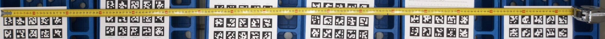

*Figure 14.2-a. A strip of photo `074846_006450` (2026-10-12, 07:48:46 UTC), the tape measure lying across the sheets of the South row, as used by method B above. Copied into `docs/figures/` on 2026-10-23 from `~/scratch/m2-acceptance-2026-10/tape_strip_0748.jpg`.*

### 14.3 Two calibrations with a cold start between

**Label: development check**, both parts: readings after a cold start against the same tags before
it, and two calibrations compared with each other.

**Question.** Two independent calibrations of the same unmoved table: how far apart are their
scale fields, compared with the validation bands? And, in the same hour, how do readings change
after a cold start on SN001?

**Method (decision, Aaron 2026-10-09: cold start, as PLAN.md asks, run while Aaron is at the
chamber, weekdays 8:30 to 16:30 local).** The sheets lie on the trays and are not touched from
calibration A to calibration B; the chamber stays closed.

1. Calibration A, with "Set as current" off.
2. Reference photograph (section 8.1, step 2).
3. Pi shut down and left off about 30 minutes to cool (as run 3, section 8.1), then switched on.
4. Settling-hour photographs at +0, +15, +30 and +60 minutes after the app opens the camera
   (section 8.1, steps 4 and 5), compared with the reference. This repeats the power-cut test on
   SN001 and measures the 60-minute cold-start window, which is a placeholder until then
   (section 8, *Cold-start window*).
5. Calibration B, at least 60 minutes after power-on, with "Set as current" off.

*Photo method as run (written 2026-10-14 before the run).* The reference and settling-hour photos
are full-resolution photos taken through the app (`POST /capture`, the same `take_photo` path as a
validation round) instead of validation rounds, because no validation session is open across a
power cut. The settling photos are taken by
`/home/pi/scratch/m2-acceptance-2026-10/settling_photos.sh`, started by Aaron once the server is up
after power-on (nothing starts the server automatically); it takes the +0 photo as soon as the
server answers and the others 15, 30 and 60 minutes after it, and logs the times, focus status
and Pi uptime to `settling_log.txt`. The comparison is section 8.1 step 5 (each calibration tag
matched to itself in the reference photo, same ID within 20 px), with the sheets untouched from
the reference photo to the +60 photo.

**Pass (calibrations):** at each of the 12 slot centres, the difference between the two fields'
scales, doubled to give area (area error is about twice length error), is smaller than that slot's
band from 14.1. **Settling hour:** no pass or fail; the result is compared with the old camera's
run 3 (section 8 table), and says when the readings return to within the control range.

**Run, 2026-10-14 (part A, before the power cut).** Calibration A `20261014T073752589144`
(07:38 UTC, "Set as current" off, lens 5.97 locked, 30.0 mm tags, residual 0.55%); the current
calibration stayed `20261012T070607812512`. Reference photo 07:39:09 UTC,
`experiments/2026-10-12_631bb6b5/stills/2026-10-14/073909_652339` (saved in a test experiment's
folder), no flags; Pi up 591512 s. Sheets pressed flat and not touched from calibration A on.

**Run, parts B and C.** Pi shut down by Aaron after the reference photo and unplugged, off about
30 minutes (Aaron); table untouched. The app's own record gives 2132 s (35.5 min) from its last run
before the shutdown to its next start. Power on: Pi booted 08:17:19 UTC (boot
`de439e0f-5bb8-4db1-8348-efad2a5a7513`). Nothing started automatically; at 08:18:50 UTC the server
(the usual command) and `settling_photos.sh` were started from this session. The +0 photo was
taken at 08:18:59 UTC, Pi up 99 s, app up 5 s, lens check passed (reported 5.97, locked 5.97),
photo flagged "inside the 60 min cold-start window". No camera events. Photos are saved in the
test experiment's folder `experiments/2026-10-12_631bb6b5/stills/2026-10-14/`. Comparison script:
`/home/pi/scratch/m2-acceptance-2026-10/settling_compare.py` (area errors with calibration A's
scale field; slot boxes from session `20261014T070107213176`; calibration sheet tags only).

| Photo | Time (UTC) | Tags found, matched (of 359 in the reference) | Median change | Spread (SD) | Ring 1000 to 1500 px | Largest slot median |
|---|---|---|---|---|---|---|
| +0 | 08:18:59 | 331, 331 | -2.73 | 1.03 | -1.80 | -3.69 (North 1, North 5) |
| +15 | 08:34:03 | 359, 359 | +0.08 | 0.22 | +0.10 | +0.31 (South 1) |
| +30 | 08:49:06 | 359, 359 | +0.10 | 0.25 | +0.00 | +0.28 (South 1) |
| +60 | 09:19:05 | 359, 359 | +0.07 | 0.25 | -0.01 | +0.27 (South 1) |

Focus read locked at 5.97 at every photo; no camera events in the hour.

**Settling hour result.** Right after the cold start the readings were 2.73 points low on average
(every slot low, -1.02 to -3.69), and 28 of 359 tags were not found. By +15 minutes they were back:
median +0.08, every slot within 0.31 of the reference, all tags found; +30 and +60 stayed there
(medians +0.10 and +0.07, slots within 0.28). From +15 on the changes are inside the range of
undisturbed photos (old camera control B: median within ±0.10, slots up to 0.52; new camera, 5 app
restarts: largest slot 0.29, section 8). Against the old camera's run 3 (+0 -1.73, +15 -0.41,
+30 -0.38, +60 -0.14), SN001 starts lower and recovers sooner. One run.

For the 60-minute cold-start window (section 8, *Cold-start window*, a placeholder from one old
camera run): on SN001 the readings had recovered somewhere between +0 (100 s after power-on) and
+15 minutes; this run does not say exactly when within that time. The 60-minute window covers it
with room to spare. Whether to shorten it is a decision, not made here.


**Calibration B and the comparison.** Calibration B `20261014T092907984792` (09:29 UTC, 70 minutes
after power-on, "Set as current" off, lens 5.97 locked, 30.0 mm tags, residual 0.58%; A 0.55%);
the current calibration stayed `20261012T070607812512`. Sheets untouched since calibration A.
Script: `/home/pi/scratch/m2-acceptance-2026-10/two_cal.py`. Difference in area (B against A,
twice the scale difference) at each slot centre, against the clean pair's reference bands
(session `20261013T081945572660`):

| Slot | B against A | Band | Slot | B against A | Band |
|---|---|---|---|---|---|
| North 1 | +0.19 | ±2.8% | South 1 | +0.06 | ±1.5% |
| North 2 | +0.17 | ±1.5% | South 2 | +0.04 | ±2.0% |
| North 3 | +0.13 | ±2.6% | South 3 | -0.00 | ±2.6% |
| North 4 | +0.11 | ±2.6% | South 4 | -0.02 | ±3.3% |
| North 5 | +0.09 | ±1.2% | South 5 | -0.05 | ±1.1% |
| North 6 | +0.06 | ±2.1% | South 6 | -0.08 | ±2.7% |

**Result: pass.** Every slot's difference is smaller than its band; the largest is about 0.11 of
its band (North 2, 0.17 against ±1.5%). Two calibrations of the same table with a cold start
between them agree far inside the validation bands, so the bands are not too narrow on this
account. Old camera, 2026-09-25, without a cold start: 0.02% to 0.16% (section 8 table).

### 14.4 Two heights

**Label: development check**, as 9.1.

Section 9.1 unchanged: one calibration with the sheets on the table surface, one on the trays at
experiment height, lens refocused by Aaron for each. **Pass:** the scale-field shape (each corner's
scale divided by the centre scale) differs between the two by less than both runs' residuals.

**Result, 2026-10-14: pass.** Two calibrations, same camera position, 30.0 mm tags, 359
calibration tags and 4 corner tags each; lens focused and locked by Aaron for each height:

| Run | Sheets on | Calibration | Lens | Centre scale | Residual |
|---|---|---|---|---|---|
| A | the table surface (trays moved as needed) | `20261014T094151646606` (09:41 UTC), not made current | 5.99 | 4.535 px/mm | 0.66% |
| B | trays at experiment height, pressed flat | `20261014T095016381511` (09:50 UTC), made current | 6.05 | 4.859 px/mm | 0.50% |

Each run's scale at the corners of the calibrated area divided by its own scale at the image centre
(points and method as section 9.1; script `/home/pi/scratch/m2-acceptance-2026-10/two_heights.py`):

| Position | Table | Trays | Difference (points) |
|---|---|---|---|
| Top-left | +0.70% | +0.30% | +0.39 |
| Top-right | -0.26% | -0.30% | +0.03 |
| Bottom-left | +0.27% | +0.30% | -0.04 |
| Bottom-right | -0.69% | -0.30% | -0.39 |

The largest difference (0.39 points, top-left and bottom-right) is below both residuals (0.50%
and 0.66%): one paper calibration's shape covers the tray height. Less margin than the old camera
(largest 0.16). The centre scale changed by 7.14% in length, 14.78% in area (old camera 15.1%),
about 100 mm of height at 0.145% per mm (derived, not taped). The lens moved between runs (5.99,
6.05), as in a real change of height. Run B is the tripwire baseline for 14.5.

### 14.5 Roll and knock

**Labels:** roll: reference comparison (the table rails, as in 9.3). Knocks and the covered corner
tag: development check.

Section 9.3 unchanged: tripwire baseline, a knock on the camera mount, then the camera rolled by
hand, measured against the table rails. To reach the camera Aaron climbs on the table, so contact with
the table is expected (Aaron, 2026-10-14, written before the run). Disturbed sheets and trays do
not matter for this test; a shifted table or corner tag would show as a disagreement between the
app's roll and the rails', and is then written up as a disturbed run.

**Run, 2026-10-14.** Baseline: calibration `20261014T095016381511` (14.4 run B, current, lens
6.05). The app returns the verdict to the browser and saves only the photo, so each verdict is
recomputed from the saved photo with the app's own `check_tripwire`
(`/home/pi/scratch/m2-acceptance-2026-10/tripwire_replay.py`).

| Step | Photo (UTC) | Verdict | Roll | Corner scale changes |
|---|---|---|---|---|
| Baseline | `rig/2026-10-14/095152_652234`, 09:51:52 | OK, "no significant drift detected" | 0.00 deg | -0.06% to +0.05% |
| Knock on the camera mount (one firm knock by hand) | `rig/2026-10-14/095420_606701`, 09:54:20 | DRIFT, "rolled 5.9 deg clockwise" | 5.86 deg | -0.46% to +0.44% |
| Second, harder knock (Aaron) | `rig/2026-10-14/095610_032904`, 09:56:10 | DRIFT, "rolled 6.9 deg clockwise" | 6.85 deg | -1.35% to +1.21% |

Each knock rolled the camera; neither moved a corner tag out of view. The FAIL limits (roll 10 deg,
corner scale 8%, a missing corner tag) were not reached, so both knocks read DRIFT. Aaron decided
to stop there rather than knock harder (risk to the mount) and to use the two knock photos as the
roll test, which PLAN.md sets at about 5 deg (2026-10-14).

Rail angles (script `/home/pi/scratch/m2-acceptance-2026-10/rail_angles.py`: the strongest
near-horizontal edge in each rail's region found by a Hough search, then fitted by least squares
to its edge points over x = 1500 to 7600 px, about 3800 to 4300 points per rail, standard error
0.0004 to 0.0007 deg; top and bottom rails interpolated to the image centre as in section 9.3):

| Photo | Top rail | Bottom rail | At the image centre | Change from baseline | App's roll | Difference |
|---|---|---|---|---|---|---|
| Baseline | +0.228 deg | -0.396 deg | -0.082 deg | | 0.00 deg | |
| First knock | +6.007 deg | +5.539 deg | +5.773 deg | +5.86 deg | 5.86 deg | 0.00 deg |
| Second knock | +6.919 deg | +6.563 deg | +6.734 deg | +6.82 deg | 6.85 deg | 0.03 deg |

**Result.** Roll: **pass**, the app's roll agrees with the rails within 0.03 deg at about 5.9 and
6.9 deg (criterion 0.2 deg). Knock: **detected, but not FAIL**: both knocks were flagged DRIFT and
neither was passed as OK; PLAN.md's wording asks for FAIL, which the tripwire gives only at a 10
deg roll, an 8% corner scale change or a missing corner tag. On the old camera FAIL came from a
corner tag pushed out of view. Whether a knock of this size should read FAIL is a question about
the tripwire's provisional limits, not about the camera, and is not decided.

**Missing corner tag, checked after the closing calibration (Aaron, 2026-10-14).** Against
calibration `20261014T111147292361`, verdicts recomputed as above:

| Step | Photo (UTC) | Verdict |
|---|---|---|
| Baseline | `rig/2026-10-14/115539_140848`, 11:55:39 | OK, roll 0.00 deg |
| Corner tag 455 covered by hand | `rig/2026-10-14/115707_089824`, 11:57:07 | FAIL, "corner tag(s) [455] present at calibration are missing now" |
| Tag uncovered | `rig/2026-10-14/115721_414161`, 11:57:21 | OK, roll 0.00 deg |

**Decision (Aaron, 2026-10-14): roll and knock signed off.** The knocks were detected (DRIFT) and
the missing-corner-tag path gives FAIL; a harder knock was not tried, being costly and a risk to
the mount. PLAN.md's M2 line was changed to match: a hard knock is flagged (DRIFT or FAIL, never
OK), and a missing corner tag gives FAIL.

**Covers.** Rolls of about 5.9 and 6.9 deg, both clockwise, produced by knocks. No table contact
was reported.
 PLAN.md asks for about 5 deg (section 9.3 reached about
3). **Pass:** the app's roll agrees with the rails within 0.2 deg, and the knock gives FAIL.

### 14.6 Closing calibration and validation

**Labels:** validation for the validation session; development check for the closing calibration.

After 14.5 the camera has moved. A new calibration at experiment height, made current, and a
complete validation give the bands the rig then runs with. Not a pass or fail test.

**Run, 2026-10-14.** Aaron turned the camera back by hand after 14.5; the rails then read +0.64 deg
at the image centre, against -0.08 deg at the 14.5 baseline, so the camera ended about 0.7 deg from
its morning position (a new calibration follows, so this does not matter). Lens 6.05, Aaron's
choice. Calibration `20261014T111147292361` (11:11 UTC, made current, 30.0 mm tags, residual
0.48%). Validation session `20261014T111253582634`: counted rounds at 11:14, 11:35 and 11:47 UTC,
33.5 minutes first to last, shortest gap 12.7 minutes; a round at 11:45 was not counted (49.6% of
tags moved, under the 50% rule); 84.2%, 75.8% and 63.9% of tags moved in the counted rounds; 85 to
90 tags per slot; no camera events.

| Slot | Band | Median error | Slot | Band | Median error |
|---|---|---|---|---|---|
| North 1 | ±2.5% | +0.05 | South 1 | ±1.8% | +0.42 |
| North 2 | ±1.6% | +0.56 | South 2 | ±1.5% | +0.13 |
| North 3 | ±2.0% | -0.22 | South 3 | ±2.1% | -0.09 |
| North 4 | ±2.6% | -0.62 | South 4 | ±2.6% | -0.55 |
| North 5 | ±1.3% | -0.04 | South 5 | ±1.5% | -0.51 |
| North 6 | ±1.9% | +0.40 | South 6 | ±2.2% | +0.90 |

Median of the slot medians 0.00 points. **These are the current bands of SN001** (lens 6.05). Two
small groups of high readings look like sheet corners not lying flat: North 1 in round 1 (2 tags,
up to +6.1%) and South 6 in round 3 (3 tags, up to +5.5%, the third time at that slot in three
days). Neither was flagged by the validation checks, and neither widened its slot's band much.
The tray at South 6 has not been checked.

### 14.7 Summary

| Test | Pass criterion | Result on SN001 | SN000 (section 9) |
|---|---|---|---|
| 14.1 Repeat validation | Whole table at least 90% inside the first day's bands, no slot below 75% | **Pass**: 94.1%, lowest slot 81% (clean pair, 2026-10-13 and 10-14); also 93.7%, lowest 82% with a stated deviation (10-12 and 10-13) | Not run |
| 14.2 Tape measure | App within 2% of the tape | **Pass**: about 1.3% long, both methods | Pass: 1.4% to 1.7% long |
| 14.3 Two calibrations, cold start between | Difference at every slot centre smaller than its band | **Pass**: -0.08 to +0.19 points, at most 0.11 of a band | 0.02% to 0.16%, no cold start |
| 14.3 Settling hour | None (measurement) | -2.73 points at +0, back within 0.31 by +15 min | -1.73 at +0, -0.41 at +15, -0.14 at +60 |
| 14.4 Two heights | Shape difference below both residuals | **Pass**: 0.39 points against 0.50% and 0.66% | Pass: 0.16 |
| 14.5 Roll | App within 0.2 deg of the rails | **Pass**: within 0.03 deg at 5.9 and 6.9 deg | Pass: 0.06 deg at 3.0 deg |
| 14.5 Knock | A hard knock is flagged (PLAN.md as changed 2026-10-14; was "gives FAIL") | **Signed off**: both knocks read DRIFT (rolls of 5.9 and 6.9 deg); a covered corner tag gave FAIL | FAIL, through a corner tag pushed out of view |
| 14.6 Closing calibration and validation | None | Bands ±1.3% to ±2.6%, lens 6.05 | |

Every result that has a pass criterion passed. The knock read DRIFT, not FAIL; Aaron signed it off
on 2026-10-14 with the covered-corner-tag check, and PLAN.md's wording was changed to match.

## 15. CRISP-DM round 1: trays, tags and green area on the benchmark (method written 2026-10-15, before the photo session)

**Status:** method agreed with Aaron, 2026-10-15. The 15 October photo session ran on 15 October (15.3a to 15.3d).
Issue #153. The plan behind the rounds is summarised in issue #153 and in PLAN.md, *Rounds*.

**Why.** The academic supervisor recommended running the whole loop (photo, segmentation, area,
review) early, with loose targets, so problems with the setup and the expectations show up early
(CRISP-DM). PLAN.md expects segmentation to be the largest error source, and it has not been
measured. This round is the first look.

**Bar for this round (decision, Aaron 2026-10-14).** The pipeline runs end to end and gives a
number per tray. Everything is recorded; nothing is judged against a target yet. Targets for
round 2 are set in the round 1 review at the end of this section.

### 15.1 The benchmark "Benchy Yellow-4"

A 3D-printed plant benchmark. Its design file is not available, so its true leaf area is not
known. Measured by Aaron on 2026-10-15 with vernier callipers (not trusted beyond 0.1 mm).
Number of readings per figure (Aaron, 2026-10-16): the rosette figures were measured twice, every
other figure once. Heights were taken with the callipers' depth rod
from the surface of the yellow base; the base is 4.27 mm thick and sits on the blue tray top, so
height above the tray = h + 4.27 mm.

| Feature | Colour | Measured | Area seen from above (computed) | Height above tray |
|---|---|---|---|---|
| Circle, embedded, NE corner | red | ⌀ 10 mm, h 0 | 78.5 mm² | 4.27 mm |
| Sphere, SE corner | red | ⌀ 8.85 mm, h 6.78 mm | 61.5 mm² | widest outline about 6.6 mm |
| Cylinder, SW corner | red | ⌀ 8.39 mm, h 7.73 mm | 55.3 mm² | 12.00 mm |
| Rectangular prism, NW corner | red | 6.34 x 8.14 mm, h 10.77 mm | 51.6 mm² | 15.04 mm |
| Rosette NW | green | h-max 21.88, h-centre 14.12, ⌀-max 50.87 mm | at most 2032 mm² | top 26.15 mm |
| Rosette NE | green | h-max 28.00, h-centre at least 19.05, ⌀-max 67.20 mm | at most 3547 mm² | top 32.27 mm |
| Rosette SW | green | h-max 19.35, h-centre 12.78, ⌀-max 38.68 mm | at most 1175 mm² | top 23.62 mm |
| Rosette SE | green | h-max 24.21, h-centre at least 15.41, ⌀-max 59.64 mm | at most 2794 mm² | top 28.48 mm |

The solid areas are computed from the calliper dimensions (π r² for the round solids, X x Y for the
prism). The sphere's outline seen from above is its widest circle, at h minus the radius. The
rosette limits are a full circle of the widest diameter; the leaves cover less, so these are upper
limits, not areas.

*Correction, 2026-10-15:* the SE and SW rosette diameters were first written the wrong way round; the stills showed it and Aaron confirmed (SW 38.68 mm, SE 59.64 mm; the table above is corrected). The rosette diameters are vernier calliper estimates with no check of their accuracy (Aaron), so the upper limits made from them are estimates too.

**What it can and cannot show.** The red solids are known areas at known heights, but small: at 50
to 80 mm² most of their pixels lie near an edge, so edge pixels will dominate their error. The
rosettes show repeatability (the same object in every slot and rotation should read the same) and
plant-like colour on a blue tray, not accuracy. Plastic is shinier and a different green than
leaves. Expected effect of height alone (0.145% of area per mm, section 4): 0.6% to 2.2% on the
solids, 3.4% to 4.7% at the rosette tops.

### 15.2 Data

- 39 gallery stills of the benchmark taken on 15 October (12 and 27, from two experiments), moved
  through the frame and rotated on each tray. Capture names recorded with the results. The
  benchmark analysis (15.5) used these and the 53 photo session stills, 92 in all.
- The 15 October photo session (15.3).
- Tray tag designs in the chamber, all 36h11, IDs 1 to 12 (the 4x5 series; IDs 1 to 3 are the 20 mm tags by their size in the image), tag in cell A1 of a 4x5 tray, trays at mixed
  orientations: 3 x 30 mm black on white paper extending past the tray corner, 3 x 20 mm black on
  white paper extending past the tray corner, 6 x 30 mm green 3D-printed on white inside the tray.

Photos in `/var/lib/npec-rig/rig/`; scripts in `experiments/round1/`. Calibration, validation and
lens position of every still are read from `rig.db` and recorded with the results.

### 15.3 The 15 October photo session

Aaron is in the chamber on 15 October only, so every photo that needs a move is taken then. Door
closed and lights on for every photograph. In this order:

| Step | Stills | What | Taken (record step, stills) |
|---|---|---|---|
| a | 10 | Nothing moved (repeatability of tag detection and area); taken 07:57 to 07:58 UTC, experiment "tag-testing" | 1, 10 |
| b1 | 1 | Every tray turned 180° in its own slot (trays fit their slots at 0° or 180° only) | 2, 4 |
| b2 | 1 | Trays swapped between the North and South rows, orientation kept from b1 (optional) | 3, 3 |
| b3 | 1 | Trays moved to other slots in their row, so each tag design reaches the frame centre and both ends (optional) | 4, 3 |
| c | 1 | Trays pushed as close together as they go (worst case for splitting trays) | 5, 2 |
| d | up to 12 | Benchmark on each slot, filling slots the gallery stills miss, frame centre and corners at least | 6, 12 (one per slot) |
| e | 5 | Benchmark on one slot, nothing moved (area repeatability) | dropped (15.3a) |
| f | 1 | Trays without the benchmark (background) | dropped (15.3a) |

*Taken column added 2026-10-16* from the record file `experiments/round1/session-2026-10-15.csv`,
which numbers the steps 1 to 6; the planned columns are left as written before the session. After
step 6 the record continues with R2-1 to R2-4, the second tag round (19 stills, 15.3a and 15.3b),
and R3, the one-hour run (123 stills, 15.3d).

### 15.3a Session 1 outcome and the second tag round (method written 2026-10-15, before the second round)

**Label: development check** for the session 1 tag counts: tags found or missed, with no true
area.

**Calibration, validation and lens of every tag still (read 2026-10-16).** From the `capture` table of
`rig.db`, matched by still name to `experiments/round1/session-2026-10-15.csv`: all 34 session 1
stills, all 19 round 2 stills (15.3b) and all 123 stills of the one-hour run (15.3d) were taken under
calibration `20261014T111147292361` and validation `20261014T111253582634`, at lens position 6.05,
with no capture flags. These are the same as the benchmark stills (15.5).

**Session 1 (steps 1 to 6, 34 stills, record in `experiments/round1/session-2026-10-15.csv`).**
Steps 7 (benchmark repeated on one slot) and 8 (trays without the benchmark) were dropped: step 1
already repeats the benchmark on one slot 10 times, and in every still 11 of 12 trays carry no
benchmark (Aaron). Tray tags found: 399 of 408 sightings. Misses: tag 1 (20 mm paper) 5 of 34,
tag 2 (20 mm paper) 3 of 34, tag 5 (30 mm green) 1 of 34. Tag 1 was prepared without an adequate
quiet zone (Aaron) and is replaced.

**Why a second round.** The final tray tags must be about 20 mm, 3D printed, on the outside edge
of the tray: the hard clearance at the tray side is 27 mm, and 30 mm edge tags collide with
equipment elsewhere in the lab (Aaron, 2026-10-15). Three 20 mm tags, one badly prepared and all
on the right half of the frame when missed, are too few to judge the size. The supervisor is open
to changing the design given good evidence of a problem.

**Design (paired).** Each of the 6 green-tag trays keeps its 30 mm green tag and gains a 20 mm
paper tag on its outside edge, IDs 13 and up (one ID per tag, never a duplicate in the frame).
Pairs recorded by Aaron before the photos (green 30 mm : 20 mm paper): 4:0, 5:14, 6:16, 7:17, 8:13, 11:15. So the green 30 mm tags are 4, 5, 6, 7, 8 and 11; the black 30 mm reference tags are 9, 10 and 12; the 20 mm tags are 0, 1, 2, 3, 13, 14, 15, 16 and 17. Tag 1 is replaced by a properly
prepared print with the same ID; the old print leaves the chamber. The 3 black 30 mm trays stay
as a reference. Steps, stills taken by the agent through the rig's capture API: nothing moved
(10), North and South rows swapped (3), trays swapped within rows (3), trays pushed together (3).

**Decision rule (accepted by Aaron, 2026-10-15, before the photos).** A *pair* is the 20 mm and the
30 mm tag on the same tray in the same still; a *position* is one layout step of at least 3 stills
with nothing moved. 20 mm has a problem if either:

- **A. Persistent miss (main rule).** A properly prepared 20 mm tag is missed in every still of a
  position while the 30 mm tag on the same tray is read in at least one of them.
- **B. Higher miss rate (supporting rule).** In at least 5% of pairs the 20 mm tag is missed while
  its partner is read, and the reverse happens less than a fifth as often.

Otherwise: no problem shown. The 5% and the fifth are decisions, not measurements. Every miss is
listed with its still name and position. A tag found badly prepared afterwards is reported
separately with the reason, never dropped. Limit: paper tags, not 3D prints; the 3D-printed tag
needs its own check (issue #70).

### 15.3b Result of the paired 20 mm round (2026-10-15, 09:06 to 09:28 UTC)

**Label: development check.** Tags found or missed, with no true area.

19 stills, experiment "tag-testing", steps R2-1 to R2-4 in `experiments/round1/session-2026-10-15.csv`:
nothing moved (10), North and South rows swapped (3), trays swapped within rows (3), trays pushed
together (3). Detector: `npec_rig.tags.detect_tags`, unchanged. Stills taken through `POST /capture`;
no lens flag on any.

**Rule A (persistent miss): met, 4 cases.** A 20 mm tag missed in every still of a position while its
30 mm partner on the same tray was read:

| Step | 20 mm tag | 30 mm partner | Stills |
|---|---|---|---|
| R2-1 nothing moved | 14 | 5 | 10 |
| R2-2 rows swapped | 0 | 4 | 3 |
| R2-3 swapped within rows | 14 | 5 | 3 |
| R2-3 swapped within rows | 15 | 11 | 3 |

**Rule B (miss rate): met.** In 40 of 114 pairs (35%) the 20 mm tag was missed while its partner was
read; the reverse happened 0 times.

**Misses per tag in 19 stills.** 20 mm: tag 0 11, tag 1 (new print) 0, tag 2 5, tag 3 1, tag 13 1,
tag 14 15, tag 15 7, tag 16 0, tag 17 7. 30 mm: tag 5 1, all others 0. So 48 misses in 171 20 mm
sightings against 1 in 171 30 mm sightings.

**What it does and does not show.** Under the rule agreed before the photos, 20 mm paper tags have a
problem on this rig: some are missed persistently at positions where a 30 mm tag on the same tray is
read. Every tag that was missed persistently was read at some other position (tag 14 in R2-2, tag 0 in
R2-3 and R2-4, tag 15 in R2-2 and R2-4), so the prints are readable and the misses depend on where the
tag sits. The tags were prepared that morning by Aaron; no tag has been found badly prepared. Not
shown: the cause (position in the frame, light, how the paper lies, or detector settings), or how
3D-printed 20 mm tags behave (issue #70).

### 15.3c Detector settings on the same 19 stills (2026-10-15, from saved photos)

**Label: development check.** Tags found or missed, with no true area.

**Question.** Are the 20 mm misses in 15.3b caused by the tags, or by the detector settings? The
rig's settings (`npec_rig.tags._detector_parameters`) were tuned for calibration tags and are
frozen; this test ran a copy with one change at a time, in a scratch script, without changing
`tags.py`. Same 19 stills, OpenCV 4.10.0 ArUco detector, AprilTag 36h11, images read as grayscale
by OpenCV. Also counted: any tag ID that is not on the table (IDs other than 0 to 17 and the corner
tags 450 to 499), since looser settings can report tags that are not there.

| Setting | 20 mm missed (of 171) | 30 mm missed (of 171) | Persistent misses (rule A) | IDs not on the table |
|---|---|---|---|---|
| A the rig's settings | 50 | 0 | 4 | none |
| B error correction rate 1.0 | 50 | 0 | 4 | none |
| C bit sampling 8 px per cell, ignored margin 0.2 | **0** | **0** | **0** | none |
| D threshold windows 3 to 53 px, constant 5 | 39 | 0 | 3 | none |
| E polygon accuracy 0.05 | 50 | 0 | 4 | none |
| F B, C, D and E together | 0 | 1 | 0 | none |

Setting A gives 50 and 0 here against 48 and 1 in 15.3b: 15.3b converted colour to grey with the
rig's own conversion (`camera.to_grayscale`), this test with OpenCV's. The difference is 3
sightings in 342.

**What it shows.** On these 19 stills the 20 mm paper tag misses come from how the detector reads
the tag's pattern (OpenCV's default reads each pattern square from 4 x 4 pixels after removing
perspective; setting C uses 8 x 8 and ignores more of each square's edge), not from the tag size.
With setting C, rules A and B of 15.3a are not met.

**What it does not show.** Whether setting C changes the calibration corner positions (it should
not: it affects only how the pattern is read, but that is not measured, so the calibration keeps
its frozen settings); whether it holds on other stills (session 1, calibration frames) and on
3D-printed 20 mm tags (issue #70).

### 15.3d One-hour unattended run (method written 2026-10-15, before the run)

**Label: development check.** Tags found or missed and the steadiness of the stills, with no true
area.

**Question.** With nothing moved for an hour, how steady are tag detection and the benchmark's
green and red areas from one still to the next, and does anything drift? **Setup.** The layout of
round 2 step 4 (trays pushed together, 20 mm tags on the 6 green trays, benchmark on its tray), door
closed, nobody in the chamber (Aaron at lunch). **Method.** One still every 15 seconds, start to
start, for 60 minutes, about 240 stills, taken by the agent through `POST /capture` into experiment
"tag-testing", step R3 in `experiments/round1/session-2026-10-15.csv`. Every sidecar records lens
position, exposure and colour gains, so drift in those is read from the stills. **Analysed:**
tag detection per still with the rig's settings and with setting C (15.3c); benchmark areas through
issue #154's method. Not covered: the chamber light cycle (the run is shorter than it).

**As run.** Stopped early by decision (Aaron back early; 30 minutes judged enough for round 1): 123 stills, 10:01:50 to 10:32:19 UTC, no capture error, no lens flag.

**Results.** Script `experiments/round1/run_analysis.py`, per still in `experiments/round1/run-2026-10-15-tags.csv`. Grey from the rig's own conversion (`camera.to_grayscale`); setting A is the rig's detector, setting C is A with finer bit sampling (15.3c).

| | Setting A (rig) | Setting C |
|---|---|---|
| 20 mm tags missed (9 tags x 123 stills) | 165 of 1107 (14.9%): tag 14 55, tag 2 46, tag 3 42, tag 15 22 | 0 of 1107 |
| 30 mm tags missed | 1 of 1107 (tag 11, once) | 1 of 1107 (the same) |
| Detection time per still, mean (SD), min to max | 4.20 s (0.23), 3.99 to 6.33 | 4.17 s (0.11), 3.86 to 4.57 |

With nothing moved, the rig's settings missed 4 of the 9 20 mm tags in many stills, tag 14 in 55 of 123; setting C missed none. Detection time is the same within its spread, so setting C costs no measurable time (one pass per still on the Pi 5, grey image already made; issue #156 repeats the timing).

**Steadiness over the 30 minutes.** Exposure 6651 microseconds, analogue gain 1.0 and lens 6.05 did not change in any still. The colour gains moved slightly: red 1.994 to 2.012 (0.9%), blue 1.620 to 1.633 (0.8%). Their effect on the green and red areas is not measured here.

**A tag that was not a tray tag.** Both settings read ID 29, which is in the tray ID range, in 3 (A) and 4 (C) stills. It is a real printed tag: an offcut of a tag sheet in a yellow waste bin at the bottom edge of the frame (about x 7047, y 6688). So a tag print lying anywhere in view is read as a tray. Discarded prints must leave the chamber, or the app must ignore tags outside the table.

### 15.3e Tray tag detector check: timing, all 53 stills, calibration unchanged (issue #156, method written 2026-10-16, before the analysis)

**Label: development check** for parts 1 and 2 (tags found or missed, with no true area). Part 3 is a
**measurement** of corner positions in pixels, from saved photos.

**Question.** 15.3c and 15.3d found that setting C (setting A, the rig's detector, with
`perspectiveRemovePixelPerCell = 8` and `perspectiveRemoveIgnoredMarginPerCell = 0.2`) reads every
20 mm paper tray tag the rig's settings miss. Before tray tags get their own detector settings:
what does it cost in time, does it hold on all 53 tag-test stills, and does it leave calibration
tags and corner tags exactly as they were?

**Common to all parts.** Saved photos only, no camera. Each JPEG is decoded with Pillow to RGB and
turned to grey with the rig's own `camera.to_grayscale`, as `tags.detect_tags` does. OpenCV
4.10.0 ArUco detector, AprilTag 36h11. Setting A is `tags._detector_parameters()` unchanged;
setting C is a copy with the two changes above. Script `experiments/round1/tag_detector_check.py`,
results per still in CSV files beside it. Commit id, OpenCV version, OpenCV thread count and the
Pi's load average are recorded with the results.

**Part 1. Timing.** On the 19 round 2 stills (R2-1 to R2-4) and the 7 calibration stills of part 3:
for each still, one grey image, then A, C, A, C, A, C in turn (3 runs each, interleaved so a change
in load affects both settings alike). Reported: time per still for A, for C, and for A followed by
C (two passes, which is the cost if calibration keeps setting A and tray tags use C on the same
photo), as mean, standard deviation, minimum and maximum, plus the paired per-still difference C
minus A. Only the detector call is timed; decoding and grey conversion are not. Whether the time
found is acceptable is a decision, not a measurement, and is labelled as one.

**Part 2. All 53 stills.** Setting A and setting C on each still. Expected tags:

- Session 1 (steps 1 to 6, 34 stills): tags 1 to 12. 20 mm paper: 1, 2, 3. 30 mm: 4 to 12. Tag 1
  is the old print, badly prepared (15.3a); its misses are reported separately, never dropped.
- Round 2 (R2-1 to R2-4, 19 stills): tags 0 to 17 as in 15.3a; 20 mm 0, 1, 2, 3, 13 to 17; 30 mm 4 to
  12. Pairs as recorded in 15.3a.

Reported for each setting: misses per tag and step; rule A and rule B of 15.3a on round 2. Session 1
had no 20 mm and 30 mm pairs on one tray, so for session 1 rule A is read as: a 20 mm tag missed in
every still of a step while the 30 mm tags in those stills are read. Step 5 has 2 stills, fewer
than the 3 that 15.3a requires for a position, and is reported but flagged. Any ID found that is
not an expected tag and not a corner tag (450 to 499) is listed with its still and position, then
checked on the photo: a real printed tag in view (such as ID 29 in 15.3d) is reported as such, and
an ID with no tag at that place is an invented tag.

**Part 3. Calibration unchanged.** Every still in `/var/lib/npec-rig/rig/*/` whose sidecar says
`"purpose": "calibration"`: 7 stills, 2026-10-09 to 2026-10-14. (The old `calibration/frames/`
folder stops at 2026-10-08 and is not used.) For calibration tags (300 to 449) and corner tags
(450 to 499), compared between A and C: the set of IDs found, and, matched by ID, the largest
absolute difference of any corner coordinate in pixels, per still and overall. Expected: the same
IDs and a difference of 0.0 px, because C changes only how the pattern inside a tag is read, after
the corners are found. Measured, not assumed: any difference larger than 0.0 is reported with its
tag and still.

**Decision rule (written before the analysis).** Tray tags (IDs 0 to 299) get their own detector
settings in `tags.py`, with calibration and corner tags still read with setting A, only if all three
hold: (1) the time is judged acceptable by Aaron from the numbers of part 1; (2) on all 53 stills,
setting C misses no more tray tag sightings than setting A, meets neither rule A nor rule B, and
finds no invented tag; (3) part 3 finds the same IDs and 0.0 px corner difference on all 7 stills.
If any fails, `tags.py` stays as it is and the result is written up here.

**Covers and does not cover.** Paper 20 mm tags on the 15 October layouts, one lighting setting,
one lens position per photo set. Not covered: 3D-printed 20 mm tags (issue #70), other lighting,
and calibration stills taken after 2026-10-14. Seven calibration stills are all that exist.

**As run.** 2026-10-16, 09:26:33 to 09:43:41 UTC, OpenCV 4.10.0 with 4 threads. The method was
committed in `55d27a2` before the run; the script as run was committed with the results in
`971c49d` (`tag-detector-run.json` records `55d27a2`, the commit checked out while the script was
still uncommitted). A later commit changed only how the corners file is laid out (one line per
still); its data were checked equal to the file as first written. Load average (1 minute) 2.36 at the start, from other work on the Pi,
then 2.5 to 4.4 while the script itself ran. Every timed run of a still found the same IDs as its
other runs. Raw data: `experiments/round1/tag-detector-stills.csv` (IDs found and each timed run,
per still), `tag-detector-corners.json` (corners of tags 300 to 499 for both settings, per
calibration still), `tag-detector-run.json`; summary printed by `tag_detector_summary.py`.

**Part 1 result: timing.** Seconds for one detector pass on a 64 MP still (mean of 3 runs per still,
then mean (SD), minimum to maximum over stills):

| Stills | Setting A | Setting C | A then C (two passes) | C minus A, per still |
|---|---|---|---|---|
| Round 2 (19) | 4.02 (0.38), 3.79 to 5.55 | 4.01 (0.33), 3.82 to 5.33 | 8.03 (0.71), 7.61 to 10.87 | -0.00 (0.08), -0.22 to 0.13 |
| Calibration (7) | 4.65 (0.12), 4.38 to 4.72 | 4.67 (0.11), 4.44 to 4.74 | 9.32 (0.23), 8.81 to 9.45 | +0.02 (0.03), -0.03 to 0.06 |
| All 26 | 4.19 (0.44), 3.79 to 5.55 | 4.19 (0.41), 3.82 to 5.33 | 8.38 (0.85), 7.61 to 10.87 | 0.00 (0.07), -0.22 to 0.13 |

Run-to-run spread on one still (median standard deviation of its 3 runs): A 0.05 s, C 0.04 s. So
setting C takes the same time as setting A, as 15.3d found on 123 stills. Running both on one photo
costs a second pass, about 4.2 s more per photo.

**Part 2 result: all 53 stills.**

| | Setting A | Setting C |
|---|---|---|
| Session 1, 20 mm missed (3 tags x 34 stills) | 8 of 102: tag 1 (old print) 5, tag 2 3 | 0 of 102 |
| Session 1, 30 mm missed (9 x 34) | 1 of 306 (tag 5, step 1) | 1 of 306 (the same) |
| Round 2, 20 mm missed (9 x 19) | 47 of 171: tag 14 15, tag 0 11, tag 15 7, tag 17 7, tag 2 5, tag 3 1, tag 13 1 | 0 of 171 |
| Round 2, 30 mm missed (9 x 19) | 1 of 171 (tag 5, R2-1) | 1 of 171 (the same) |
| Rule A, persistent misses | Round 2: tag 14 in R2-1 and R2-3, tag 0 in R2-2, tag 15 in R2-3. Session 1: tag 1 (old print) in step 3; tags 1 and 2 in step 5 (2 stills, flagged) | none |
| Rule B, 20 mm missed with partner read (round 2) | 40 of 114 pairs; reverse 0 | 0 of 114; reverse 1 (tag 5 missed, tag 14 read) |
| IDs not on the table | none | none |

The old, badly prepared print of tag 1 (15.3a) is read in all 34 session 1 stills with setting C.
Round 2 setting A gives 47 misses here, against 48 in 15.3b and 50 in 15.3c: those used OpenCV's JPEG
decoder, this check uses Pillow's as the rig does (`images.py`), and 15.3c also OpenCV's grey
conversion. The one 30 mm miss is the same tag in the same still with both settings.

**Part 3 result: calibration unchanged (measurement).** All 7 calibration stills: 145 calibration
tags and corner tags 450, 451, 452 and 455 found by both settings, the same IDs in every still, and
the largest corner coordinate difference between A and C is 0.000000 px in every still (1043 tags
compared). Setting C changes which tags are read, not where their corners are, on these stills.

**Against the decision rule.** (2) holds: setting C misses 0 tray tag sightings against 55 for
setting A, meets neither rule, and finds no invented tag. (3) holds: same IDs, 0.0 px. (1) is a
decision for Aaron from the time above.

**Outcome (Aaron, 2026-10-16).** On this evidence the final tray tags will be 3D-printed 20 mm tags.
The detector is not changed in this issue: `tags.py` keeps its frozen settings for every tag. If tray
tags later get setting C, the preferred design is two passes (calibration and corner tags with the
frozen settings, tray tags with C, about 8.4 s instead of 4.2 s per 64 MP still); one pass with C for
every tag remains possible after a check on more calibration stills.

**Done in issue #192 (2026-10-16).** Tray tags (0 to 299) are now read with setting C in a second
pass (`tags._tray_detector_parameters`); calibration and corner tags keep the frozen settings.
`images.TAG_DETECTOR_VERSION` is 2. Tags stored by version 1 are still used when their photo is no
longer in the photos folder (776 of 804 stored searches on 2026-10-16, photos in the old
`captures/` folder): they cannot be searched again, and calibration and corner tags are identical
between the versions (part 3).

**Why this is not yet proof for 3D-printed tags.** (1) Every 20 mm tag here was paper; the
3D-printed tag needs its own test (issue #70). (2) Setting C was chosen on the round 2 stills
(15.3c); the stills not used to choose it are session 1 (20 mm tags 1 to 3 only) and the one-hour
run (15.3d, the layout of round 2 step 4). (3) Stills taken with nothing moved repeat one test, so
the number of independent cases is the number of layouts times tags, about 70, not 1380 sightings.
(4) One day, one lighting setting, no plants near the tags, no weeks of dust or condensation. A
defensible check of the printed tags needs new layouts, setting C fixed in advance and a pass rule
written before the photos.

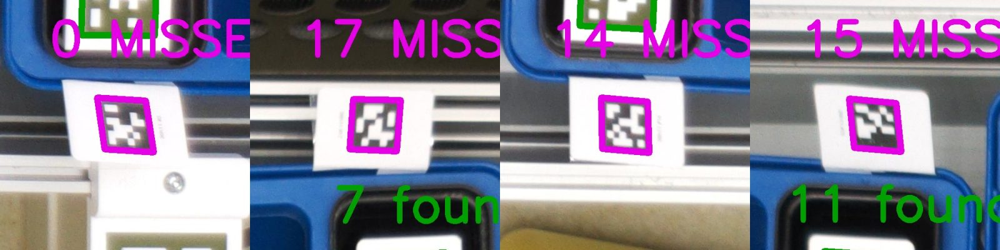

*Figure 15.3e-a. Still `090640_702608` (step R2-1): 20 mm tags 0, 17, 14 and 15 on the tray edge, each outlined where it lies and marked MISSED by the frozen detector settings, although each is in view; slightly soft at this size. Copied into `docs/figures/` on 2026-10-23 from `~/scratch/156-tray-tags/step-R2-1_090640_702608_missed-tags-closeup.jpg`.*

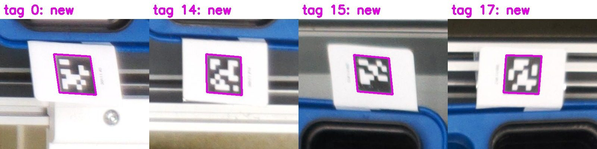

*Figure 15.3e-b. The same still and tags, all four found with the finer bit sampling adopted for tray tags (`tags._tray_detector_parameters`). Copied into `docs/figures/` on 2026-10-23 from `~/scratch/192-tray-tags/step-R2-1_090640_702608_new-tags.jpg`.*

### 15.4 What is measured

Each tray is one region; tags give identity only (decision, Aaron 2026-10-14). Trays are found by
their blue, the benchmark's leaves by a green threshold (excess green), its solids by a red
threshold; tag areas are masked out from the detected tag corners. Pixel areas become mm² through
the calibration homography. Recorded:

- per tag design: detected or not, per slot and rotation, with the detector's confidence margin
- trays separated and matched to a tag: how many of 12, per still
- green area per tray, in mm²
- red solids: area per still against the computed area above
- rosettes: area per slot and rotation, the spread, and that it stays below each upper limit

*Added 2026-10-16.* Trays separated and matched to a tag are counted in 15.5c: 2085 of 2112 trays
right on 176 stills (98.7%), 163 of 176 stills passing all 3 rules. The trays were split with
FastSAM on the Hailo-8, not the blue threshold planned above, because the blue threshold does not
split touching trays (15.5c). Whether that rate is good enough is decided by Aaron after tray
tracking (15.5d).

### 15.5 Results: red and green area on the benchmark (issue #154)

**Labels:** red solids: reference comparison (their known areas come from calliper readings of
the solids themselves, not from the printed tags). Rosettes: development check (their true area
is not known, so this is repeatability only).

From the #154 session; full record in `experiments/round1-benchy/NOTES.md` and `results.csv` (main, commit 68ea0ad, PR #155), script `experiments/round1-benchy/benchy.py`.

**Data.** 92 stills of the benchmark, 15 October: experiment `2026-10-12_631bb6b5` (12),
`2026-10-15_83acd97d` (27), `2026-10-15_44a9e96e` tag-testing (53, session 1 and the second tag
round). All under calibration `20261014T111147292361`, validation `20261014T111253582634`, lens
6.05, no capture flags. The benchmark is in all 92. Leaving out the 19 second tag round stills
changes the rosette means by at most 3.5 mm² and the mean solid errors by at most 1.7 points.

**Method.** Fixed thresholds, nothing trained, picked on one probe still and not tuned against
the results (decisions): red in HSV (hue 0 to 8 or 170 to 180, saturation at least 120, value at
least 80), green by normalised excess green above 0.1 with green above red. Only colour inside
the benchmark's yellow base (its hull grown by 20 px) counts; tray tags masked from
`detect_tags` corners. Orientation from the largest rosette (NE); pieces go to their nearest
corner. Area = pixel count over the square of the calibration scale field's local px/mm at the
piece's centre (as `certainty_map.py`); the app has no pixel to mm homography. No height
correction.

**Raw data.** Stills, read only: `/var/lib/npec-rig/experiments/<experiment>/stills/2026-10-15/`
for the three experiments named above. Capture rows (calibration, validation, lens, flags) from
`rig.db` table `capture`. The overlays (one half size crop per still with the masks drawn) are not
kept in the repo; `benchy.py` makes them again from the stills. Analysis run 2026-10-15.

**Decisions in the method.** The thresholds were picked by looking at one probe still,
`2026-10-15_83acd97d` `065407_243036`. A still counts as a repeat of the one before it (same
experiment, "nothing moved") when the base centre moved less than 20 px (about 4 mm at
4.85 px/mm) and its turn changed less than 1 degree. Red and green pieces under 300 px are
dropped (at most 345 px of green in any still). All of these are decisions, not measurements.

**Coverage.** Stills per slot: North 1 4, North 2 9, North 3 10, North 4 4, North 5 7, North 6 7,
South 1 4, South 2 21, South 3 4, South 4 4, South 5 4, South 6 14. South 1 was seen at one
quarter turn only; every other slot at 2 or 3 of the 4. 57 distinct positions: 47 single stills
and 10 groups with nothing moved.

**Rosettes.** Spread across all 92 stills (all slots and turns), SD as a share of the mean:
NE 1.5% (mean 1823.8 mm²), SE 1.9% (1123.6), NW 3.2% (619.4), SW 3.6% (298.2). Within 9 groups of
3 to 11 stills with nothing moved: 0.02% to 0.79%. Between slot means: NE 3.8%, SE 5.7%, NW 9.8%,
SW 13.1% (lowest to highest slot, as a share of the mean). All 4 below their upper limits in all
92 stills (they cover 25% to 51% of them). The true leaf area is not known, so this is
repeatability, not accuracy.

The widest outline measured in the stills (smallest circle around all the green of a rosette)
against the calliper ⌀-max: NE 68.0 to 72.0 mm (calliper 67.20), SE 58.9 to 63.4 (59.64), NW
49.5 to 54.2 (50.87), SW 41.2 to 43.6 (38.68). Height alone predicts the outline 1.7% to 2.3%
larger in diameter (half the 3.4% to 4.7% area effect at the rosette tops, 15.1); SW reads 6.5%
to 12.7% larger, which height does not explain. The calliper values are estimates (15.1).

**Red solids** (known area, mean error, range over 92 stills): prism 51.6 mm², +39.4%, -14.7% to
+83.2%; circle 78.5 mm², -20.7%, -32.1% to -11.5%; sphere 61.5 mm², -16.4%, -23.0% to -9.4%;
cylinder 55.3 mm², +18.6%, -22.3% to +44.4%. Prism and cylinder are close in the middle slots
(North 3, North 4, South 3, South 4: -6.8% to +20.2%) and up to +75.5% at the row ends, where
their sides are seen as well as their tops; height alone predicts 1.7% to 2.2%. The flat circle
and the sphere read small in every slot. Likely cause, not measured: the red threshold leaves out
the blurred edge (cut-off hue 8, solids at hue 4, base at 27). Per slot table in NOTES.md.
Within the 9 groups with nothing moved, the SD of each solid's area is 0.07 to 0.83 mm², so the
spread across stills comes from moving the benchmark, not from repeating the photo.

**Problems found in the method and how they were handled.**
- Orientation. The first run named the corners from the least round red piece, meant to be the
  prism. In 6 of 92 stills the cylinder, seen from the side, was less round, and every name in
  those stills was a quarter turn off. Orienting from the largest rosette (NE) fixed all 6. As a
  recorded cross-check, the least round red piece is in NW in 86 stills and in SW (the cylinder)
  in 6.
- Turned base. In 3 stills (tag-testing step 4) the base was turned about 18 degrees from square
  and was not found until the squareness test used the turned rectangle instead of the upright
  box.
- The SW rosette comes apart. Its thin leaves break into 2 or 3 green pieces in 82 of 92 stills.
  The pieces in each corner are merged into one rosette; before merging, SW read 34.3 mm across
  instead of about 42 mm.
- Tags. A tray tag was in the crop in 5 stills (IDs 8, 10, 12), always outside the base region:
  0 tag pixels were inside it, so no tag was counted as plant.
- The white centre beads of the rosettes are not green and are not counted.

**Visual check.** Aaron looked at all 92 overlays on 2026-10-15: masks, outlines and corner names
correct in every one. One person, one pass; confirms what was found and named, not the areas.

**Covers / does not cover.** The plastic benchmark on blue trays at tray-top height, one
calibration, one lens position, one day. Not real leaves, not other lighting, not the accuracy of
the rosette areas. The red solid errors mix edge pixels, sides seen at an angle and height, which
this round does not separate.

### 15.5b Real leaves of known area on the trays (issue #162, method written 2026-10-15 11:53 UTC, before the photos)

**Label: reference comparison.** The scan's scale comes from printed tags, so a wrongly printed
sheet would affect both the scan and the rig.

From the #162 session; full record in `experiments/round1-leaves/NOTES.md`, `results.csv` and
`scan_areas.csv`, scripts `scan_area.py` and `leaves.py`.

**Method (written before the photos).** 3 garden leaves, labelled on the underside by Aaron
(L001 to L003), scanned on an Epson flatbed (300 dpi) with a 180 mm scale and 5 x 30 mm
AprilTags, before and after the photos. Known area = leaf pixels in the scan (the round 1 green
test) over the scan's px/mm measured from the tags along each scanner axis. The leaves laid
loose on the trays, door closed, lights on, focus as set; Aaron recorded the positions. Rig area
= the round 1 green test unchanged, tags masked, through the calibration scale field at the
leaf's centre, no height correction. Rig area against scan area, per leaf and position. Round 1
bar: record everything, judge nothing.

**Data.** Scans 11:49 to 11:51 UTC (before) and 12:05 to 12:07 UTC (after), `L00n.jpg` and
`L00n_after.jpg` in `experiments/round1-leaves/scans/` and, read only, in
`/var/lib/npec-rig/scans/2026-10-15_leaves/` (both with `SHA256SUMS`; times in `scan_times.csv`). 32 stills by Aaron, 11:54 to 12:03 UTC, experiment `2026-10-15_44a9e96e`,
calibration `20261014T111147292361`: 10 with the 3 leaves in a line on the blue trays moving one
slot per still; 11 with the 3 leaves together on a black sheet, one slot per still (North 3, the
benchmark, skipped); 11 the same with the leaves turned over. Positions as recorded by Aaron:
blue, still k, L001 on the k-th slot of South 1 to South 6 then North 6 to North 1, L002 on the
next, L003 on the one after (Aaron recalled 12 stills; there are 10, ending on North 3, North 2,
North 1); black sheet, 003 north west, 001 north east, 002 south. The black sheet was used to
lay the leaves flat; all experimental trays are blue (Aaron). **The black sheet lifted the
leaves about 3 to 10 mm above the blue tray top** (Aaron's estimate, not measured). At 0.145% of
area per mm (section 4) that adds about 0.4% to 1.5% to the black sheet readings.

**Decisions in the method.** Only the two tray rows count, across the full image width (the
aisle with the moss pots and the floor are left out; a first run that used the end slots' boxes
cut the black sheet at South 1 and South 6 and was replaced). The benchmark's base and a small
margin are left out. On a 1/8 decode, pieces of one leaf are joined across gaps up to 4 px for
grouping only (pale midribs split leaves), and a piece joins a leaf only within about 65 mm of
it. Pieces under 40 px on the 1/8 decode (about 100 mm²) are dropped. The 3 leaves on the black
sheet lie almost touching and are measured together, against the sum of their known areas.

**Scan scale and known areas.** Tag scale 11.643 to 11.663 px/mm across the scanner and 11.777 to
11.790 px/mm along it (the axes differ by 1.1%; nominal 300 dpi is 11.811), per-tag spread 0.46%
to 0.61%. Areas before / after: L001 7331.3 / 6779.9 mm² (-7.5%), L002 7448.4 / 7081.0 (-4.9%),
L003 7898.5 / 7532.8 (-4.6%). The leaves shrank 4.6% to 7.5% in 16 minutes. The known area at
each photo is read off a straight line between the two scans (an assumption; results are also
given against each scan).

**Results.** Error = rig area against the known area at the photo.
- Blue trays, each leaf on its own, 27 readings (3 more lay against the benchmark and are listed
  apart): mean -2.49%, SD 3.15, range -9.10% to +3.43%; against the before scan -4.44%, against
  the after scan +1.33%. Per leaf: L001 -3.07% (SD 2.29), L002 -4.58% (2.67), L003 +0.17% (2.57).
- Against the benchmark (North 3): -5.42%, -10.4% and -15.89%; the benchmark's base is left out
  and part of each leaf lay on or next to it.
- Black sheet, the 3 leaves together (they lie almost touching and are not split), 11 slots:
  top side mean +2.99% (SD 2.26, -0.02% to +6.90%), underside +2.45% (SD 2.47, -1.19% to +7.05%).
  The east end (South 5, South 6, North 6) reads +3.2% to +7.1%, the other slots -1.2% to +4.5%.
  Per slot, top / underside: South 1 +1.6 / +0.4, South 2 +1.2 / -1.2, South 3 0.0 / -0.3,
  South 4 +1.8 / +1.5, South 5 +4.6 / +3.2, South 6 +6.8 / +5.2, North 6 +6.9 / +7.1, North 5
  +3.3 / +2.6, North 4 +1.7 / +1.3, North 2 +1.9 / +2.8, North 1 +3.1 / +4.5.
- Leaf identity from Aaron's record; a shape match against the scans (`cv2.matchShapes`) agrees
  in 26 of 30. The 4 that differ are stills 7 and 8, where it swaps two leaves; the record gives
  the smaller errors there, so the record is used.
- Against the validation bands (session `20261014T111253582634`, p95 of |tag area error| per
  slot, 1.26% to 2.55%, nothing corrected): blue trays 8 of 27 within the band, 22 of 27 when the
  range between the before and after scans is allowed for; black sheet 5 of 11 (top) and 5 of 11
  (underside), 9 and 10 of 11 with that range. A band holds 95% of tag readings, but the known
  area's uncertainty (4.6% to 7.5% shrink between scans) is larger than the bands, so this does
  not settle whether the bands cover leaves. The 5 blue readings outside even the scan range:
  L001 in still 2, L002 in stills 4, 8 and 10, L003 in still 5.

**Observations, not measured causes.** The same leaves read about 2.5% small on blue and about
2.5% to 3% large on black, a gap of about 5 to 5.5 points. The 3 to 10 mm lift of the black sheet
explains about 0.4 to 1.5 of them; the rest is not explained (one possibility: how edge pixels,
part leaf and part background, pass the green test on each background). L002 reads -1.0% to -5.8% in stills 1 to 6 and -4.3% to -9.1% later,
which fits a leaf curling as it dries (the scanner glass flattens it, the tray does not). Pale
midribs fail the green test in scans and stills alike. A first run cut the black sheet at the
end slots; fixed before the results above.

**Proof of concept: what it tells us (Aaron, 2026-10-15: a proof of concept test, not to be run
to ground).**
1. The whole chain works on real leaves: photo, green threshold, pixels to mm², comparison with a
   known area, end to end on 32 stills with no failures.
2. The answer is in the right range: flat leaves read within a few percent of their scanned area
   (2.5% small on average), across all 12 slots.
3. The round 1 thresholds carry over from the plastic benchmark to real leaves unchanged. What
   breaks them is the setup, not the threshold: leaves that touch merge, a leaf next to another
   green object loses area, pale midribs are missed.
4. What lies under the leaf matters: the same leaves read about 5 points higher on the black
   sheet (used only to lay them flat, 3 to 10 mm above the tray) than on the blue trays.
   Experiments use blue trays only, so the blue result (about 2.5% small) is the one that applies.

In one sentence: leaf area from this rig is workable, and the open questions are about the setup
(touching leaves, what lies under them), not the camera.

**Covers / does not cover.** 3 leaves of one plant, flat or nearly flat at tray-top height, one
calibration and lens position, about 10 minutes of photos. Not leaves standing above the tray,
not other plants, not overlapping leaves. The true error lies between the "against before" and
"against after" figures, since the shrinking between scans is not measured.

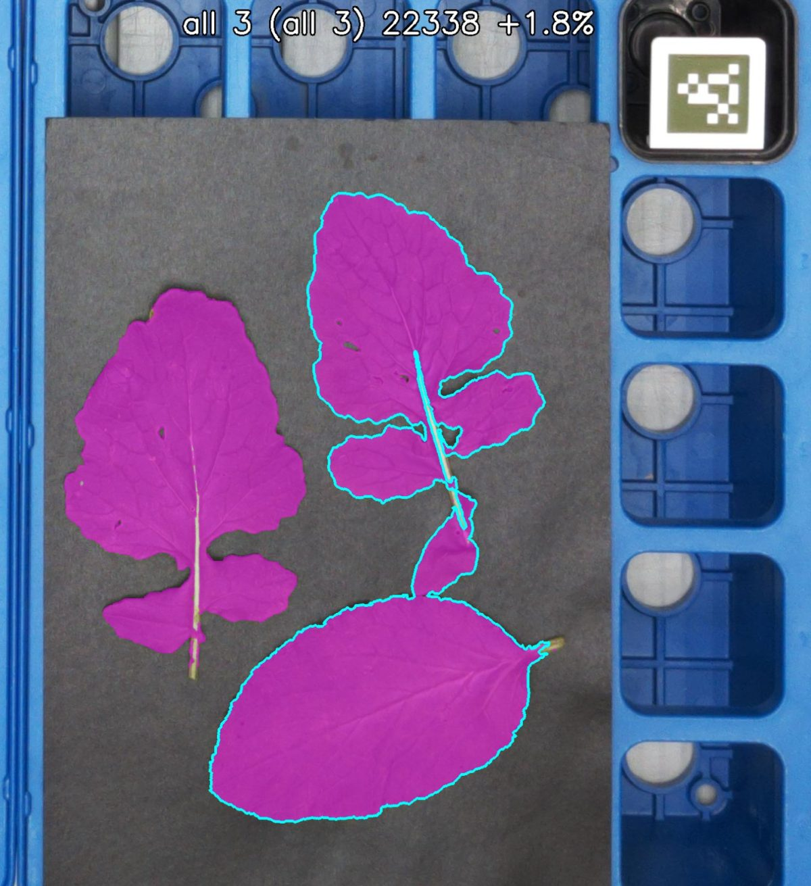

*Figure 15.5b-a. Still `115925_456242`: 3 real leaves on grey board on a tray, the area the rig measured shaded magenta and outlined in cyan; the label gives the value printed by the analysis (22338) and +1.8% against the leaves' scanned area. Copied into `docs/figures/` on 2026-10-23 from `~/scratch/leaves/overlays/14_115925_456242.jpg`, scaled down.*

### 15.5c Tray splitting and tray ID (issue #164, method written 2026-10-15, before the analysis)

**Label: development check.** Trays found and matched to tags, with no true area. The tray
measurements in the first table are reference measurements and carry no label (section 12).

The tray facts used here (size, configurations, tag positions, layout rules) are collected in
`reference/trays.md`.

Answers the open item in 15.4, "trays separated and matched to a tag: how many of 12, per still",
which nothing had measured. Reads the 15 October stills only; nothing is photographed and nothing
is written into the experiment folder or `rig.db`. Record in `experiments/round1-trays/`
(`NOTES.md`, `results.csv`); overlay pictures in `~/scratch/round1-trays/`, not in the repo.

**Tray measurements (Aaron, 2026-10-15, one tray).** Number of readings per value not recorded.

| What | Value | Instrument |
|---|---|---|
| Outside size, lip included, east-west (short side, tray in portrait) | 305.0 mm | tape measure |
| Outside size, lip included, north-south (long side) | 366.0 mm | tape measure |
| Height of the grid surface (cell openings) above the gray table | 99.89 mm | tape measure |
| Height of the top of the lip above the gray table | 104.78 mm | tape measure |
| Cell opening, both directions | 59.5 mm | callipers |
| Wall between cells | 10.1 to 10.3 mm | callipers |
| Outer grid wall at the lip, on the edges running north-south (west, east) | 13 mm | callipers |
| Outer grid wall at the lip, on the edges running east-west (north, south) | 11 mm | callipers |

Cells are not all the same size and the wall width varies a little (Aaron). Derived, not
measured: cell centres about 69.7 mm apart (59.5 + 10.2); the grid sums to 294.6 mm east-west and
360.3 mm north-south, so the lip reaches about 5.2 mm beyond the grid on each side east-west and
2.9 mm north-south. The tape measure is the weakest of the two instruments, so the outside size is
checked against the photos (method B) and the difference is reported, not used to correct it.
The lip is 4.89 mm above the grid surface; at 0.145% of area per mm (section 4) the lip outline
reads about 0.35% larger in length, about 1 mm on 305 mm. The calibration's scale field
(`20261014T111147292361`) gives 4.83 to 4.89 px/mm across the frame, so a tray is about
1,480 x 1,780 px at full resolution and 185 x 220 px on the 1/8 decode used for finding shapes,
where one pixel is about 1.65 mm. The lip's 1 mm is below that.

**Tray layout (Aaron, 2026-10-15).** A tray has columns A to D and rows 1 to 5; seen from above in
portrait, A1 is the south-west corner. The 30 mm tray tag sits in cell A1. Six trays also carry a
20 mm tag on the tray edge (pairs in 15.3a). With 12 trays, trays are always portrait in two rows,
North 1 to 6 and South 1 to 6, at 0 or 180 degrees, so A1 is at the south-west or the north-east
corner. Researchers will not reliably leave gaps between trays.

**Data.** Experiment `2026-10-15_44a9e96e`, steps from `experiments/round1/session-2026-10-15.csv`.
The calibration and lens position of each still are read from `rig.db` (read only) and recorded
with the results.

- **Gaps, 33 stills:** steps 1 (10), 2 (4), 3 (3), R2-1 (10), R2-2 (3), R2-3 (3). R2-3 has the trays
  "fairly well split, not perfect", which Aaron calls typical of what the scientists do.
- **Touching, 143 stills:** steps 5 (2), 4 (3), 6 (12), R2-4 (3), R3 (123). Steps 4 and 6 were taken
  after step 5 with the trays left pushed together; the record file titles do not say so.

The sort was made by eye from reduced copies, one still per step, and confirmed by Aaron for R2-3.

**Tag detection.** The 36h11 detector with the 20 mm setting C from #156 (finer bit sampling,
171 of 171 20 mm sightings against 121 of 171), inside the experiment script only. Tray IDs are
0 to 299; other IDs are ignored. A tag's rotation comes from its corner order.

**Methods, simplest first.** Each runs on the gap set first, then on the touching set.

- **A. Tag only.** Each tray tag's centre is put on a slot with the slot boxes of the still's
  calibration (`certainty_map.sheets_by_slot`, which refuses a tag more than half a slot spacing
  from a slot centre). No outline. This is the reference for slots.
- **B. Blue threshold.** Blue pixels on a 1/8 decode, shapes found as connected regions, each fitted
  with a rotated rectangle and linked to the tray tags whose centres fall inside it. On the gap
  set, the fitted size through the scale field at the shape's centre is the photo measurement of
  the tray's outside size.
- **C. Tag placement.** From the 30 mm tag's centre and rotation, place cell A1 and from it the
  whole outside outline (305.0 x 366.0 mm, grid position from the measurements above), converted to pixels
  with the scale field at the tag. Assumes every 30 mm tag is stuck on the same way relative to its
  tray; step 2 (every tray turned 180 degrees in its slot) tests that assumption.
- **D. Splitting.** Shapes from B that hold more than one tray, split along the borders that C
  predicts between them, with the tags inside each shape.
- **E. Edge refinement.** Only if D fails: the tray edges searched at full resolution in a narrow
  band around the edges C predicts. At the 1/8 decode the seam between two touching trays is about
  one pixel wide.

**What is recorded, per method and per still.**

- Trays found as separate shapes, of the trays in the still.
- Shapes holding exactly one tray: one 30 mm tag, or one 30 mm and 20 mm pair from the same tray
  (pairs from 15.3a). A shape with tags of two trays, or a tray split over two shapes, is a failure.
- Slot of each tray, against method A, and against the known moves of steps 2, 3, 4, R2-2 and R2-3.
- Outline corners: spread across the repeated stills of one layout (step 1: 10, R2-1: 10, R3: 123),
  in mm through the scale field.
- B only: fitted outside size against the tape measure.

**Decision rule (proposed, a decision not a measurement; for Aaron to accept before the analysis).**
A method *works* on a set when, in every still of that set, every tray is one shape holding
exactly one tray, and every slot agrees with method A. Anything less is recorded with the count of
stills and trays that failed, and the method is not dropped for it. No threshold is set for the
corner spread in round 1: it is recorded, not judged.

**Decision rule accepted** (Aaron, 2026-10-15, before the analysis). The rule above is used to
count. Whether a method that is right most of the time (for example 80% to 95% of trays) is
good enough is decided after the results of the methods are seen, not now.

**Changes to the method, made before the first count (2026-10-15).**

- Method A uses the nearest slot centre, not `certainty_map.sheets_by_slot`. The slot centres are
  the calibration sheets' centres, and a tray tag in cell A1 lies about 170 mm or more from the
  middle of its tray, more than the half slot spacing (about 152 mm) that `sheets_by_slot` allows,
  so it would refuse every tray tag. The distance to the nearest and to the second-nearest slot
  centre is recorded.
- A tag belongs to a shape when its centre is inside the shape or within 15 mm of it (decision):
  the 30 mm and 20 mm paper tags extend past the tray corner (15.2), so their centres can lie
  outside the blue.
- Blue threshold (decision, from one probe still `075756_789328`): OpenCV hue 100 to 118,
  saturation at least 100, value at least 50, on the 1/8 decode; a 3 px opening; holes filled;
  shapes smaller than a quarter of one tray dropped. Method B's slot is the slot centre nearest
  the shape's centre, so it can be checked against method A.
- A shape is one tray only when its area is 0.85 to 1.15 trays (decision) and it holds the tags of
  one tray. A shape larger than that is several trays even when only one tray's tag is linked to
  it. (A first count judged by tags alone and counted two- and three-tray shapes with one tag as
  found, 84 of 396; replaced before the result was reported.)

**Result, methods A and B on the gap set (2026-10-15, 33 stills).** Script
`experiments/round1-trays/trays.py`, per still `results-gaps.csv`, per shape `shapes-gaps.csv`,
overlays in `~/scratch/round1-trays/gaps/`. Every still: calibration `20261014T111147292361`,
validation `20261014T111253582634`, lens 6.05. All 12 A1 tags were found in all 33 stills.

| | Result |
|---|---|
| A: each tray on its own slot | 6 of 33 stills |
| A: distance from tag to nearest slot centre, largest per still | 238.6 to 278.6 mm |
| A: nearest against second-nearest slot, smallest margin per still | 1.3 to 17.8 mm |
| B: stills passing the rule | 0 of 33 |
| B: trays that are one shape of one tray's size, holding only their own tags | 40 of 396 (10%), 1 or 2 per still |
| B: one-tray shapes with no tray tag linked | 26 |
| B: trays split over two shapes | 0 |
| B: shapes by size in trays (from area) | 66 of one tray, 76 of two, 46 of three, 10 of four |
| B: single-tray shapes, east-west | mean 306.0 mm, SD 1.4, 304.0 to 308.3 (tape 305.0) |
| B: single-tray shapes, north-south | mean 373.6 mm, SD 1.3, 371.4 to 376.6 (tape 366.0) |

The single-tray shapes are 66 sightings of 14 tray positions, so the SD is mostly repeat
sightings, not 66 independent trays.

**What this shows.**

- **Method A cannot be the reference for slots.** The tag sits at a tray corner, and the slot
  centres come from wherever the calibration sheets lay, so the nearest slot centre is often a
  neighbour: two trays named the same slot in 27 of 33 stills. Rule 3 (slot agrees with method A)
  needs a different reference.
- **In the gap set the trays still touch in places.** Lips touch or nearly touch between
  neighbours (for example North 1 and North 2, South 1 to 3 in step 1), and one touch merges two
  shapes. Thresholding alone does not separate trays as the scientists place them.
- **Where a tray stands clear, the blue outline is repeatable to about 1.4 mm** and matches the
  tape measure east-west (306.0 against 305.0 mm). North-south it reads 7.6 mm (2%) larger than
  the tape measure; not explained, recorded.
- **Some trays carry no tag inside their shape.** Paper tags that lie more than 15 mm from the
  blue (for example tag 3 in step 1) leave their tray as "no tray".

What it does not cover: the touching set, and methods C to E.

**Method F, added 2026-10-15 after A and B: FastSAM on the Hailo-8 (Aaron asked for a Hailo model).**
No precompiled Hailo-8 model has a tray class (research 2026-10-15); FastSAM outlines any object
without class names. `fast_sam_s.hef`, Hailo Model Zoo v2.17.0 for Hailo-8 (the release for
HailoRT 4.23), downloaded to `~/scratch/round1-trays/hailo/`, SHA-256
`361cb280a2be5d2b9b12a65848b2d288e0b0a37db03a77d0490c5f307fbfcd9a`. `hailortcli parse-hef`: one
input 640 x 640 x 3, and the YOLOv8 instance segmentation outputs: on 80, 40 and 20 cell grids a box
(4 x 16 distance bins), a score and 32 mask coefficients; 32 base masks of 160 x 160. Decoded in
`experiments/round1-trays/fastsam.py`; no Hailo decoding code is used.

- Crops: from the A1 tags, each row is cut into 3 tiles of 2 neighbouring trays, reaching 0.75 of a
  tray past the outer tags on every side (a tag is at the south-west or north-east corner), padded
  to a square and resized to 640 x 640: about 1 px per mm.
- Decisions: score at least 0.25 and duplicates removed above 0.7 overlap (FastSAM's usual
  defaults); a mask is a tray when it is 0.8 to 1.2 trays in area, fills at least 0.85 of its
  rotated rectangle, and its north-south over east-west extent is 366/305 within 15%; tags link
  to it as in method B (inside or within 15 mm).

**First result, 2 stills (2026-10-15).** Record `fastsam-masks.csv`, overlays in
`~/scratch/round1-trays/fastsam/`. Each tile gives 108 to 352 masks, mostly cells and parts of the
background; the tray-shaped ones are kept.

| Still | Tray-shaped masks | Linked to one tray | No tag linked |
|---|---|---|---|
| R2-4 `092731_168752` (touching) | 11 of 12 (none for tray 4) | 6 (trays 3, 5, 6, 7, 8, 11) | 5 |
| Step 1 `075756_789328` (gaps) | 12 of 12 | 11 | 1 (tray 10) |

- **FastSAM separates touching trays** where thresholding cannot: in R2-4, South 3 and South 4
  touch and come out as two masks of 307 x 372 and 307 x 375 mm.
- **The failures are tag linking, not outlines.** Every tray whose tag is the green 30 mm tag
  inside cell A1 links. The paper tags (1, 2, 9, 10, 12) stick out past the tray corner, more than
  15 mm from the mask when the trays are pushed together.
- Tray-shaped masks measure 272 to 324 mm east-west and 328 to 386 mm north-south across both
  stills; some are cut by the tile edge. Not yet compared with B or the tape measure per tray.

Two stills only; not a count against the decision rule.

**Method F with tag linking, 20 stills (2026-10-15).** Changes before the run (decisions): tray
masks from all 6 tiles of a still are pooled, and masks whose centres lie within 100 mm are one
tray (the best filled stays). Each tray tag links to the nearest tray mask (distance to its
outline, 0 inside) within 60 mm, unless the second-nearest is less than 20 mm further (then it is
left ambiguous). Record `fastsam-small20.csv` (per still, with stage times) and
`fastsam-small20-masks.csv`; whole-still overlays in `~/scratch/round1-trays/fastsam-stills/`.
Stills: touching, steps 5 (2), 4 (3), R2-4 (3), 6 (2); gaps, steps 1 (2), 2 (2), 3 (2), R2-1 (1),
R2-2 (2), R2-3 (1).

| Set | Stills | Trays one mask, own tags only | Trays with no tray mask | Masks with tags of 2 or more trays | Stills 12 of 12 |
|---|---|---|---|---|---|
| Touching | 10 | 59 of 120 (49%) | 29 | 14 | 0 |
| Gaps | 10 | 89 of 120 (74%) | 25 | 3 | 2 |

Per still the count ranges from 2 of 12 (step 6) to 12 of 12 (step 1); no tag was left ambiguous,
and no tray mask was left without a tag. Against method B on the gap set (40 of 396, 10%), F finds
far more trays, including touching ones.

- **The limit now is that FastSAM does not give a whole-tray mask for every tray**: 29 and 25 trays
  had none. In step 6 (`082328_270773`), 5 of 12 trays have no mask.
- **The "several trays" masks are mostly undersized masks** (for example 310 x 328 and
  283 x 322 mm against 305 x 366) that pass the 0.8 tray area limit and then take a neighbour's
  tag, because the neighbour has no mask of its own.
- Not yet looked at: why the missing masks are missing (score below 0.25, removed as duplicates of
  a larger mask, or failing the fill and shape tests), and whether overlapping or single-tray tiles
  fill them in.

**Time per still** (Raspberry Pi 5, Hailo-8, mean of the 20; 9 with tag detection, 11 with tags
read from the cache):

| Stage | Mean |
|---|---|
| Read the 64 MP JPEG | 0.37 s |
| Tag detection, full resolution, setting C | 4.54 s |
| FastSAM on the Hailo-8, 6 tiles | 0.16 s (about 27 ms per tile) |
| Decoding the masks and choosing the trays (Python, CPU) | 4.1 s |
| **Total per still, with tag detection** | **9.2 s** |
| Total per still, tags cached | 4.6 s |

The Hailo-8 is 2% of the time. Mask decoding builds a full 640 x 640 mask for each of the 108 to
352 candidates per tile; most are cells and are thrown away.

**Why trays had no mask (2026-10-15, `diagnose.py`, record `diagnose-fastsam-small20.csv`).** For
each of the 54 trays without a tray mask in the 20-still run, every raw FastSAM candidate box of
about tray size (250 to 360 mm east-west, 300 to 430 mm north-south; decision for the diagnosis)
within 60 mm of the tray's tag was followed through the stages, and the furthest stage reached is counted.

| Furthest stage | Trays | Touching | Gaps |
|---|---|---|---|
| Cut by the tile edge (FastSAM saw only part of the tray) | 27 | 17 | 10 |
| Score below 0.25 | 14 | 8 | 6 |
| Removed as a duplicate of an overlapping box | 6 | 1 | 5 |
| No tray-sized box proposed | 5 | 2 | 3 |
| Mask failed the shape test | 2 | 1 | 1 |

The tiles were the main cause, a fault in the crop design: a tag sits at a tray corner, so the tray
reaches a whole tray past its tag, and the crops reached only 0.75 of a tray past the outer tags.

**Two crop designs on the same 20 stills (2026-10-15).** Both with masks built only for candidate
boxes of about tray size (230 to 400 mm east-west, 280 to 460 mm north-south; decision), which left
the counts unchanged and cut the decoding time.

- **Tag tiles, margin 1.15:** as before, 2 trays per tile, reaching 1.15 trays past the outer tags
  (decision). Record `fastsam-small20-m1.15.csv`, overlays `~/scratch/round1-trays/fastsam-stills-m1.15/`.
- **Overlapping grid:** 3000 px square tiles every 1000 px over the full width and the rows between
  the calibration's corner tags, 32 tiles per still; any tray smaller than 2000 px (a tray is about
  1780 px north-south) lies wholly in one tile (unit tested). Uses no tray tag position. Record
  `fastsam-small20-grid.csv`, overlays `~/scratch/round1-trays/fastsam-stills-grid/`.

| Crops | Touching: trays right | Gaps: trays right | Stills 12 of 12 (touching, gaps) | Time per still, with tag detection |
|---|---|---|---|---|
| Tag tiles, margin 0.75 (first run) | 59 of 120 (49%) | 89 of 120 (74%) | 0, 2 | 9.2 s |
| Tag tiles, margin 1.15 | 108 of 120 (90%) | 120 of 120 (100%) | 5, 10 | 5.8 s |
| Overlapping grid | 104 of 120 (87%) | 114 of 120 (95%) | 2, 5 | 8.1 s |

Times: mean of the 20 stills without tag detection (tag tiles 1.27 s, of which Hailo 0.16 s;
grid 3.56 s, of which Hailo 0.87 s), plus the mean full-resolution tag detection of 4.54 s
measured on 9 stills in the first run. The tags must be detected in any case, to name the trays.

Twenty stills, not the full sets; not yet a count against the decision rule.

**Fallback around failed trays (2026-10-15, built at Aaron's request).** After the first pass (tag
tiles, margin 1.15), every A1 tag whose tray is not one mask holding only its own tags gets a
second search; masks holding several trays are dropped first. Decisions:

- The trays already found are painted grey (with a 5 mm border) so their masks cannot be found
  again or take a neighbour's tag.
- Around the failed tag, the tray must lie within 1.15 trays in every direction. Windows of 2600 px
  (about 1.2 px per mm at 640) are spaced so a tray with its lip (1650 x 1950 px) lies wholly in at
  least one window (unit tested): 8 windows when nothing is cut by the frame edge.
- Score cut-off 0.05 in the windows instead of 0.25; the same tray tests as the first pass.
- The tray-shaped mask nearest the tag (within 60 mm) is taken. Then all tags are linked again over
  the final set: right first-pass trays, fallback trays, and first-pass masks with no tag that are
  not one of those.

Record `fastsam-small20-m1.15-fb.csv` and `-masks.csv` (column `source`: first or fallback),
overlays `~/scratch/round1-trays/fastsam-stills-m1.15-fb/` (fallback trays drawn thicker and
labelled "(fallback)").

| Same 20 stills | Touching: trays right | Gaps: trays right | Stills 12 of 12 | Time per still, tags cached |
|---|---|---|---|---|
| First pass only | 108 of 120 (90%) | 120 of 120 | 15 of 20 | 1.27 s |
| With the fallback | **120 of 120** | **120 of 120** | **20 of 20** | 1.60 s (fallback 1.38 s mean, 2.22 s at most, on the 5 stills that needed it) |

12 trays went to the fallback (on 5 stills) and all 12 were found, in 74 windows. Every pick scored
at least 0.365, so the windows and the grey-out found them, not the lower cut-off. Add about 4.5 s
per still for tag detection.

**"Right" means the tray tag links to exactly one tray-shaped mask; the outline itself is rougher.**
Checked by eye on `081433_159359` (4 fallback trays): each fallback mask is on the right tray, but
some run into the aisle or the rail below.

| Masks | Number | East-west, mean (SD), range | North-south, mean (SD), range |
|---|---|---|---|
| First pass | 228 | 306.5 mm (10.8), 273 to 328 | 376.3 mm (5.4), 366 to 409 |
| Fallback | 12 | 311.1 mm (15.2), 287 to 342 | 391.4 mm (13.7), 372 to 411 |
| Method B, stand-alone trays (gap set) | 66 | 306.0 mm (1.4) | 373.6 mm (1.3) |
| Tape measure | | 305.0 mm | 366.0 mm |

So FastSAM names the trays, but its outlines vary about 8 times more than the blue threshold's
where a tray stands clear. Whether the outline is good enough depends on what it is used for
(tray identity and slot only, or the region in which canopy area is counted); not decided.

Twenty stills, not the full sets; not yet a count against the decision rule.

**Full run: all 176 stills against the decision rule (2026-10-15).** Tag tiles at margin 1.15 with
the fallback, the method above unchanged. Record `fastsam-full176.csv`, `fastsam-full176-masks.csv`,
per still against the rule `summary-full176.csv` (script `summarise.py`), overlays
`~/scratch/round1-trays/fastsam-stills-m1.15-fb/`. Every still: calibration
`20261014T111147292361`, validation `20261014T111253582634`, lens 6.05; all 12 A1 tags found in
every still. **Rule 3 uses a provisional slot reference**, row and order (a tray's mask centre and
its A1 tag centre must give the same row, North or South, and the same place 1 to 6 from the west),
not yet chosen by Aaron.

| Set | Stills | Stills passing all 3 rules | Trays right | First pass alone | Fallback: found / needed |
|---|---|---|---|---|---|
| Gaps (steps 1, 2, 3, R2-1, R2-2, R2-3) | 33 | **33 (100%)** | 396 of 396 | 396 | 0 / 0 |
| Touching, steps 5, 4, 6, R2-4 | 20 | **20 (100%)** | 240 of 240 | 228 | 12 / 12 |
| Touching, R3 (one hour, nothing moved) | 123 | **110 (89%)** | 1449 of 1476 (98.2%) | 1363 | 99 / 113 |
| All | 176 | 163 (93%) | 2085 of 2112 (98.7%) | 1987 | 111 / 125 |

In every failing still, rule 2 failed (one mask holds the tags of two trays) and rule 3 failed with
it, since a merged mask leaves fewer than 12 trays to number; rule 1 failed in 1 still. The 13
failing stills are all in R3, so the same layout passes in 110 stills and fails in 13: the result
for one layout is not fully repeatable from one still to the next.

**What fails.** 12 of the 13 failures are the same: the tray on North 3 carries the benchmark,
FastSAM gives it no tray mask in the first pass or the fallback, and its tag 4 sits at its
south-west corner on the seam with North 2, within 60 mm of North 2's mask, so it links there
(seen on `101419_730536`). The 13th is tags 5 and 9 on one first-pass mask (`101019_729462`).
*Added 2026-10-16:* tracking (15.5d) finds 7 more trays counted right here whose fallback mask
lies 52 to 225 mm from the tray; counted as wrong, 2078 of 2112 trays and 159 of 176 stills.
The fallback found 111 of the 125 trays sent to it.

- So the trays that remain hard are trays with something large on them (the benchmark covers part
  of the tray's top; not measured how much), next to a neighbour, with the tag on the shared edge.
- The 60 mm link distance lets a tag on a seam link to the neighbour when its own tray has no mask.
  Not changed here; options for the next round: green tags inside cell A1 must lie inside their
  mask, or a tag left over after linking marks its neighbour's mask as doubtful instead of merged.
- A tag was left ambiguous (two masks within 20 mm of each other) 24 times over the 176 stills:
  tag 15 16 times, 17 4 times, 16 3 times (20 mm edge tags of round 2) and tag 3 (the A1 tag of
  its tray) once. Not checked which of these cost a tray.

**Time per still** (Raspberry Pi 5, Hailo-8): 5.76 s with full-resolution tag detection (mean of
133 stills detected in this run), 1.37 s with the tags read from the cache (43 stills).

Round 1 bar: recorded, not judged. Whether 89% to 100% of stills, or 98.7% of trays, is good
enough is decided by Aaron now that the results are in (decision rule, above).

**Success rate: not decided (Aaron, 2026-10-16).** No pass rate is fixed after the full run. Aaron
first wants to see how tray tracking across the photos of an experiment performs (15.5d), then
judge how good or bad the result is.

**20 mm edge tags against their 30 mm partner (2026-10-16, issue #192).** **Label: development
check.** Tags linked to trays, with no true area. **Written after the analysis was run, not
before:** a check asked for by Aaron on the records of the full run above, so no decision rule was
set in advance and none is applied.

*Question.* The final tray tags are 20 mm and sit on the tray's outside edge (15.3a). In the full
run above a tray's ID came from its 30 mm tag in cell A1. Does the 20 mm edge tag on the same tray
land on that same tray?

*Method.* No photo decoded and nothing run again. For every round 2 still (R2-1 to R2-4, 19) and
every one-hour-run still (R3, 123), each of the 6 edge tags (pairs of 15.3a: 0:4, 14:5, 16:6, 17:7,
13:8, 15:11, edge : A1) is classed from the full run's mask record (`fastsam-full176-masks.csv`,
tag IDs inside each mask) and its cached tag detections (setting C): right tray (the edge tag is in
one mask, a one-tray mask holding its A1 partner and no other tag); right tray but merged (in the
partner's mask, which also holds another tray's tag); linked to no tray (on no mask, which is what
the linking does when the tag is within 20 mm of two masks: ambiguous); wrong tray (in a mask
without its partner); not read. Script `experiments/round1-trays/edge_tag_check.py`, one row per
sighting in `edge-tags.csv`.

*Result.*

| Outcome | Round 2 (19 stills) | One hour (123 stills) | All |
|---|---|---|---|
| Right tray | 113 of 114 | 691 of 738 | **804 of 852 (94.4%)** |
| Right tray, outline merged with a neighbour | 0 | 25 | 25 (2.9%) |
| Linked to no tray (ambiguous) | 1 | 22 | 23 (2.7%): tag 15 16 times, 17 4, 16 3 |
| Wrong tray | 0 | 0 | **0** |
| Not read | 0 | 0 | 0 |

The merged cases are tags 14 and 0, on the trays of the known one-hour failures above (the tray
carrying the benchmark, and tags 5 and 9 on one mask).

*What it shows.* On these stills a 20 mm edge tag never named the wrong tray. About 1 sighting in 37
named no tray: an edge tag sits on the gap between two trays, so the 20 mm ambiguity test of the
linking leaves it undecided. *What it does not show.* Trays named by the 20 mm tag alone (identity
still came from the A1 tags; this checks where the edge tags land); 3D-printed tags (issue #70); trays
with plants; more than one day and one layout family. The edge tags here are paper. Cached tag
detections: `~/scratch/round1-trays/tags/` (not in the repository); they differ from the rig's own
grey conversion in 3 of 53 stills compared (tag 5 twice and the offcut tag 29 once found only in the
cache).

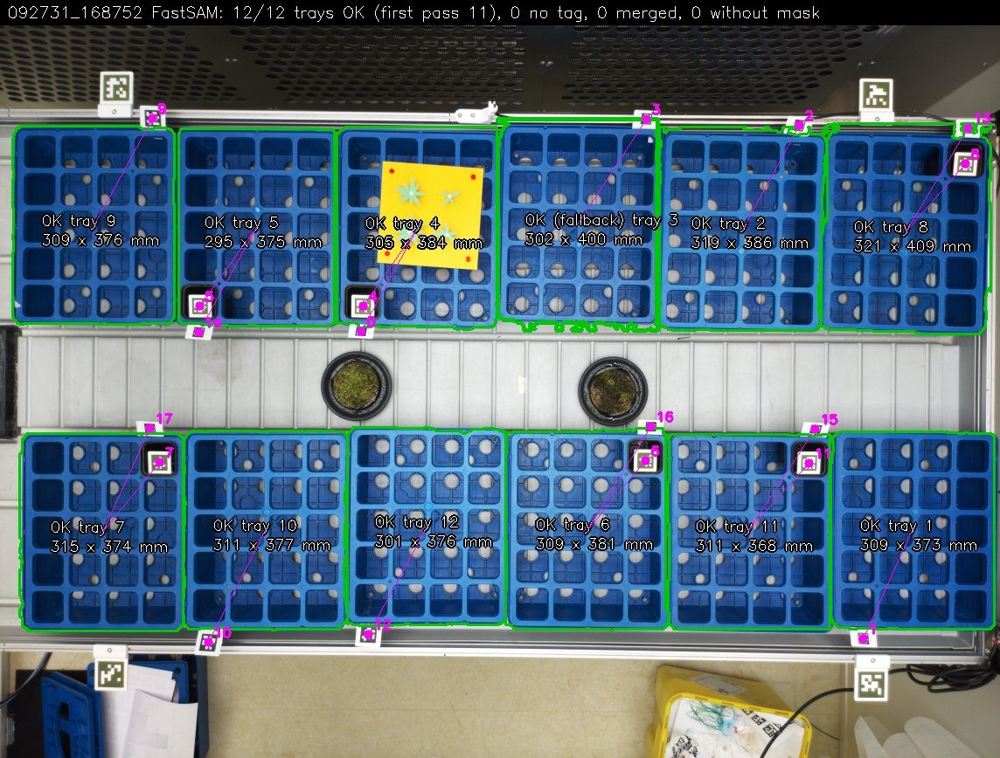

*Figure 15.5c-a. Still `092731_168752` (R2-4, trays touching): FastSAM tray outlines (green) with each tray ID and outline size in mm, 12 of 12 trays OK (11 on the first pass, tray 3 by the fallback). Copied into `docs/figures/` on 2026-10-23 from `~/scratch/194-tray-view-evidence/overlays/2-touching_R2-4_092731_168752.jpg`.*

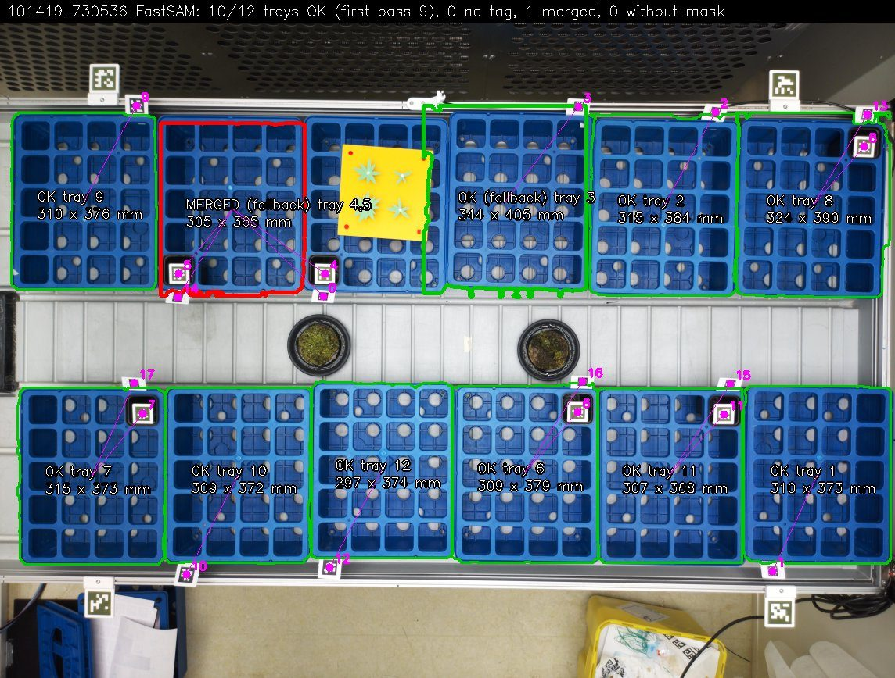

*Figure 15.5c-b. Still `101419_730536`: the typical failure, trays 4 and 5 in one outline (red, MERGED), 10 of 12 OK. Copied into `docs/figures/` on 2026-10-23 from `~/scratch/194-tray-view-evidence/overlays/3-failure-merged_R3_101419_730536.jpg`.*

### 15.5d Tray tracking over time (issue #171, planned under #164, method written 2026-10-16, before the analysis)

**Question.** Followed through the 15 October stills in time order, does the tray splitting of
15.5c (FastSAM, tag tiles at margin 1.15, fallback) report each tray's position and the moves that
were made, and no others? And how much do two patches for missed trays add?

**Data.** The 176 stills of the full run in 15.5c, ordered by `taken_at` (UTC) from `rig.db`;
results already in `experiments/round1-trays/fastsam-full176.csv` and `-masks.csv`, tags in the
scratch cache. No new Hailo run, no new photos. Script `experiments/round1-trays/track.py` (to be
written), record `track-full176.csv`, plots and overlays in `~/scratch/round1-trays/track/`.

**Known moves** (from `experiments/round1/session-2026-10-15.csv` and 15.3 to 15.3d), the
reference the tracker is checked against:

| Between | What moved |
|---|---|
| step 1 to 2 | every tray turned 180 degrees in its slot (position about the same, tag heading flips) |
| step 2 to 3 | North and South rows swapped |
| step 3 to 5 | trays pushed together (step 5 was taken before step 4) |
| step 5 to 4 | trays swapped within rows, still pushed together |
| step 4 to 6, within 6 | only the benchmark moves, one slot per still; no tray moves |
| step 6 to R2-1 | trays re-tagged (20 mm tags added), layout reset with gaps |
| R2-1 to R2-2 | rows swapped |
| R2-2 to R2-3 | trays swapped within rows |
| R2-3 to R2-4 | trays pushed together |
| R2-4 to R3, within R3 | nothing moved |

**Measures.**

- Position of each tray in each still: its mask centre, in mm on the table through the scale
  field. A *move* is a change of more than 50 mm in centre or a flip of the tag heading between
  two consecutive stills (decision).
- Moves found against the known moves: per step boundary, trays reported as moved and not moved;
  moves reported inside a step where nothing moved (false moves), and known moves missed.
- Position spread of each tray inside a step where nothing moved (step 1, R2-1, R3), in mm.
- Trays right per still (the rule of 15.5c) before and after each patch, counted separately.

**Patches (each labelled in the record and counted apart from measured trays; never shown as
measured).**

1. **Elimination:** in a still with exactly one A1 tag not linked to a tray and exactly one
   tray-shaped mask with no tag, that mask is given that tray, labelled "inferred by elimination".
2. **Two tags on one mask:** when a mask holds the tags of two trays and one of them lies inside
   it while the other lies outside, the outside tag is unlinked and its tray sent to patch 1 or 3,
   labelled "tag moved to unresolved". (This is the failure in 12 of the 13 failing R3 stills.)
3. **Filled from neighbouring stills:** a tray missing or wrong in a still is given its position
   from the stills before and after, labelled "filled from neighbours", only when all hold:
   - the gap is at most 3 consecutive stills (decision);
   - the positions just before and just after agree within 20 mm and the same tag heading
     (decision);
   - no other tray's mask covers that position in the gap stills;
   - the gap is not at the start or end of the sequence and does not cross a step boundary
     (so a move or a removal is never filled over).

**Results reported.** Raw, after patch 1 and 2, after patch 3: trays right of 2112 and stills
passing of 176, for gaps and touching; the number of trays patched by each kind; false and missed
moves. A timeline per tray (position against time, steps marked) as a picture in scratch.

**What it does not cover.** Trays removed from the chamber or added during a sequence (none on
15 October), any angle other than 0 and 180 degrees, fewer than 12 trays, pots or plants in the
wells. Round 1 bar: recorded, then judged by Aaron.

**Amendments (2026-10-16, issue #171, written before the first run of `track.py`).** Found while
reading the saved results. Each changes how a measure above is taken, not what is decided.

- *Mask outline.* The full run kept each mask's centre and its east-west and north-south extent,
  not its outline, and a new Hailo run is out of scope. Patch 2's "inside" therefore means inside
  the mask's axis-aligned box widened by 15 mm (the tag tolerance of 15.5b, as paper tags extend
  past the tray lip). Trays sit at 0 or 180 degrees, so the box is close to the outline.
- *Millimetres.* The calibration gives a local scale (pixels per mm at a point), not a table
  frame in mm. A distance between two positions is the pixel distance divided by the scale at
  their midpoint. Timeline positions and the spread figures are pixels divided by the scale at
  the image centre, good to a few percent; every 50 mm test uses the local scale.
- *Reference per tray.* The step table above says what moved at each boundary, not which tray.
  Each tray's own reference is its A1 tag: moved when the tag centre shifts more than 50 mm, or
  when its heading changes by more than 90 degrees. The tag result is checked against the step
  table; where the two disagree it is reported, not adjusted.
- *Heading apart from position.* The heading comes only from the tag, so a turn found by heading
  says nothing about the masks. Mask-centre moves (more than 50 mm) and heading flips are counted
  and reported separately. In a 180 degree turn the tag crosses the tray (corner to corner) while
  the tray centre stays, so a turn is a tag move but not a mask move.
- *Positions counted.* A tray in a mask holding two trays has no measured position. Patched and
  filled positions are never used in the position spread.
- *Twelfth tray.* All 176 stills hold 12 A1 tags, so patch 1 never meets a tray whose tag was not
  found.

**Results, first slice (2026-10-16): raw tracking, patches 1 and 2.**
`experiments/round1-trays/track.py` on the 176 stills in time order, record
`track-full176.csv` (one row per tray per still) and `track-full176-moves.csv` (one row per tray
per pair of consecutive stills), timeline `~/scratch/round1-trays/track/timeline-full176.png`.
The raw count reproduces 15.5c: 2085 of 2112 trays right, 163 of 176 stills passing.

| | Trays right, of 2112 | Stills passing, of 176 |
|---|---|---|
| Raw (15.5c) | 2085 | 163 |
| After patches 1 and 2 | 2098 (13 kept by patch 2) | 163 |

(Both rows count by the 15.5c rule; the final table below counts the off positions as wrong.)

- *Patch 2* fired in all 13 failing stills, not the 12 expected: in the 12 benchmark stills it
  kept tray 5 (North 2) and sent tray 4 (North 3, under the benchmark) to unresolved; in
  `101019_729462` it kept tray 9 and sent tray 5 to unresolved. No still passes after it, since
  the unresolved tray has no position.
- *Patch 1* never fired: no failing still held a tray-shaped mask without a tag.

Moves between consecutive stills, mask centre against the A1 tag reference (trays):

| Pair | Pairs of stills | Tag turned | Move found | Missed | False | Still, agreed | Not judged |
|---|---|---|---|---|---|---|---|
| 1 to 2 (turned 180) | 1 | 12 | 0 | 0 | 0 | 0 | 12 |
| 2 to 3 (rows swapped) | 1 | 0 | 12 | 0 | 0 | 0 | 0 |
| 3 to 5 (pushed together) | 1 | 0 | 0 | 1 | 0 | 11 | 0 |
| 5 to 4 (swapped in rows) | 1 | 0 | 12 | 0 | 0 | 0 | 0 |
| 4 to 6 | 1 | 0 | 0 | 0 | 0 | 12 | 0 |
| 6 to R2-1 (re-tagged, reset) | 1 | 2 | 0 | 0 | 0 | 10 | 2 |
| R2-1 to R2-2 (rows swapped) | 1 | 0 | 12 | 0 | 0 | 0 | 0 |
| R2-2 to R2-3 (swapped in rows) | 1 | 0 | 12 | 0 | 0 | 0 | 0 |
| R2-3 to R2-4 (pushed together) | 1 | 0 | 1 | 1 | 0 | 10 | 0 |
| R2-4 to R3 | 1 | 0 | 0 | 0 | 0 | 12 | 0 |
| Within steps 1 to R2-4 | 43 | 0 | 0 | 0 | 0 | 516 | 0 |
| Within R3 (one hour) | 122 | 0 | 0 | 0 | 11 | 1401 | 52 |

- Every swap of rows or of trays within rows is found, 48 of 48, with no false move outside R3.
  This is not independent evidence of tracking: a mask gets its tray from the tag linked to it
  within 60 mm, so a mask follows its tag through a swap almost by construction. The independent
  signals are the false moves and the position spread below.
- The 2 missed moves are pushes near the 50 mm line: tag 59.9 mm and mask 49.5 mm (tray 9, 3 to
  5); tag 58.4 mm and mask 42.3 mm (tray 10, R2-3 to R2-4). Pushing the trays together moved most
  of them less than 50 mm, so the step table's "pushed together" is not a move by the 50 mm rule.
- At the 180 degree turns the mask centre moved at most 30.5 mm (14 trays), as expected for a
  turn in place. Two trays' tags turned between step 6 and R2-1, when the trays were re-tagged.
- The 11 false moves in R3 come from 7 measured positions far from the tray's median position in
  R3, all of them fallback masks (15.5c, score floor 0.05): tray 5 in `100634_758061`,
  `101034_733642`, `101904_723909` and `102904_742544`, 218 to 225 mm off; tray 4 in
  `100634_758061`, `101904_723909` and `102904_742544`, 52 to 62 mm off (local scale). Tray 5's
  lie across the seam south of its tray (`100634_758061`: centre about 1000 px south of the other
  North masks), still linked to tag 5 within 60 mm. Tray 4's are masks of 1.12 to 1.17 trays on
  the benchmark tray. **15.5c counted all 7 as right**: the row-and-order slot rule does not see a
  mask 220 mm off while it stays in its row. Counted as wrong, the raw result is 2078 of 2112
  trays and 159 of 176 stills.
- Patch 2 cross-check: each position it kept lies 11.0 to 20.3 mm from tray 5's R3 median (12
  stills) and 1.4 mm from tray 9's, so it kept the right tray each time. In `101019_729462` tag 9
  lies about 2 mm inside the widened box (985 px from the mask centre against a half height of
  about 996 px); without the 15 mm widening patch 2 would not have fired there.
- *Added after the first run, not in the plan:* the distance of each position from its tray's
  median (the 50 mm count above) and the mask shift at the turns. Both explain results of the
  planned measures; neither changes them.
- Position spread of measured masks where nothing moved (distance from the tray's mean, by the
  scale at the image centre): step 1 rms 1.8 mm, max 6.3 (120 positions); R2-1 rms 3.6, max 13.0
  (120); R3 rms 12.3, max 215.7 (1449, including the 7 above).

**Decision (Aaron, 2026-10-16).** A measured position more than 50 mm from its tray's median in a
step where nothing moved counts as wrong: for trays right, and as a gap that patch 3 may fill.
This changes the decision rule of 15.5c for these stills. It can only be applied where nothing
moved; during an experiment a position would be judged wrong by its mask jumping while its tag
stays still, not yet written.

**Results, second slice (2026-10-16): patch 3.** Same script and record. Gaps eligible for
patch 3: trays with no position and the wrong positions above. The positions before and after a
gap are measured positions not counted wrong; a position kept by patch 1 or 2 is neither filled
nor used as a neighbour (decision). "Another tray's mask" means a mask linked to at least one
other tray's tag; a mask with no tag belongs to no tray. This reading was settled after the first
run of patch 3, which had counted tagless masks and so refused tray 3 in `101549_732631`, where
the tagless mask is tray 3's own, unlinked outline. Per-still counts (measured, kept by patch 2,
inferred, filled, wrong, no position, passing) are in `track-full176-stills.csv`. Every still with a patched, filled or wrong tray is drawn in
`~/scratch/round1-trays/track/evidence/` (17 stills): the 15.5c overlay with each final position
as a tray-sized box labelled FILLED, KEPT BY PATCH 2, or WRONG with its distance.

| Trays right, stills passing | All 176 stills | Gaps, 33 | Touching, 143 |
|---|---|---|---|
| Raw, 15.5c rule | 2085 of 2112, 163 | 396, 33 | 1689 of 1716, 130 |
| Raw, wrong positions counted wrong | 2078, 159 | 396, 33 | 1682, 126 |
| After patches 1 and 2 | 2091, 159 | 396, 33 | 1695, 126 |
| After patch 3 | **2078 measured + 31 patched = 2109 of 2112; 173 of 176** | 396, 33 | 1713, 140 |

Measured and patched are counted apart: 2078 trays (98.4%) were measured right, and 31 (1.5%)
have a position from a patch (13 kept by patch 2, 18 filled from neighbours).

- Patch 3 filled 18 tray positions: 12 of the 13 sent to unresolved by patch 2 (tray 4 in 11
  stills, tray 5 in `101019_729462`), 5 of the 7 wrong positions (tray 5: 3, tray 4: 2), and
  tray 3 in `101549_732631`.
- Consistency check: every filled position lies 0.7 to 11.6 mm from its tray's R3 median (tray
  4: 13 filled, mean 2.2 mm; tray 5: 4, at most 1.5 mm; tray 3: 1, 0.7 mm; scale 4.85 px/mm).
  The median comes from the same tray's masks, so this shows the fills agree with the other
  stills, not that those are right; that the trays did not move is known from their tags (no tag
  moved more than 0.3 mm within R3).
- Moves after all patches, within R3: 0 false moves, 1458 still and agreed, 6 not judged (the
  3 positions left without a right position).
- 3 trays are left without a right position, all in R3. Tray 4 in `100634_758061` and
  `102104_724310`: refused because the positions before and after differ by more than 20 mm (tray
  4 carries the benchmark and its masks vary). Tray 5 in `102904_742544`: the next still's
  position was kept by patch 2, so there is no measured neighbour after it.
- 31 of the 2112 tray positions (1.5%) are patched (13 by patch 2, 18 by patch 3), all in R3 and
  none in the gaps set. They belong to 4 trays: 3, 4 and 5 on North 4, 3 and 2 around the
  benchmark, and 9 on North 1.
- Position spread of measured masks not counted wrong (distance from the tray's mean, scale at the
  image centre): step 1 rms 1.8 mm, max 6.3 (120); R2-1 rms 3.6, max 13.0 (120); R3 rms 4.0, max
  48.8 (1442). The R3 maximum is below 50 mm because positions over 50 mm from the median were
  removed as wrong; the raw figures are in the first slice above.

**What it does not cover.** As above, plus: all patching happened in one hour-long step, on 4
trays in the North row around one benchmark, so how often the patches are needed or work
elsewhere is not known. The success rate that is good enough is Aaron's to set; the slot
reference is still provisional.

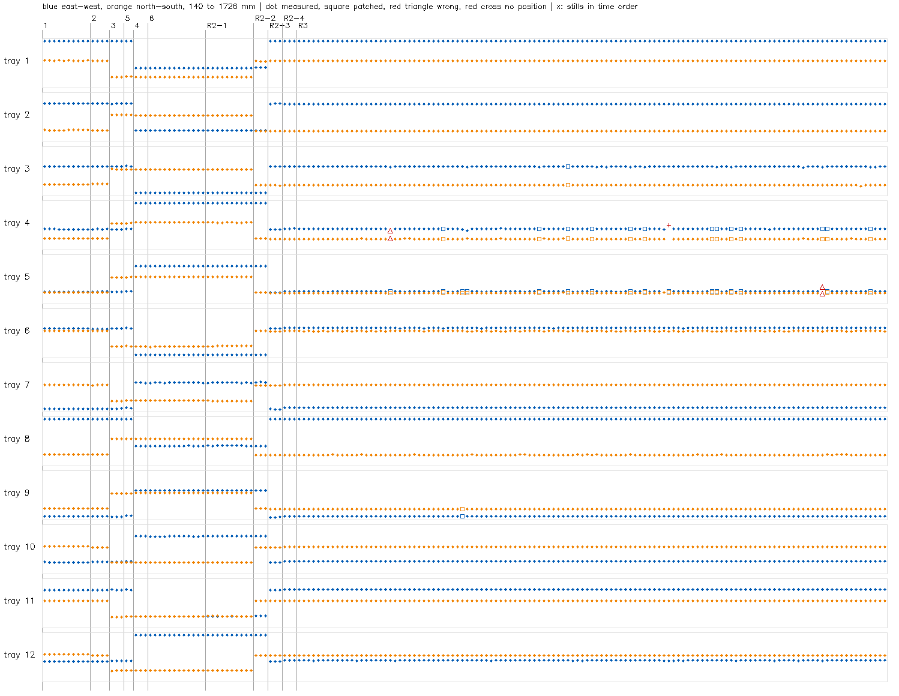

*Figure 15.5d-a. The timeline named above: for each tray, east-west (blue) and north-south (orange) position in every still in time order, steps marked by grey lines; a square is a patched position, a red triangle a wrong one, a red cross no position. Copied into `docs/figures/` on 2026-10-23 from `~/scratch/round1-trays/track/timeline-full176.png`.*

### 15.5e The benchmark from the supervisor's photogrammetry mesh (issue #206, method written 2026-10-16, after the analysis)

**Label: development check.** A second instrument measuring the benchmark of 15.1: one mesh made by
the academic supervisor's iPhone software (time-of-flight depth plus camera, RealityKit Object
Capture 3.9.4, detail level `.mobile`, 25,000 triangles, mean triangle 3.39 mm²). Neither the
USDZ nor the STL stores an area; both hold the same mesh, in metres. Areas are computed from it as
seen from directly above (rays every 0.2 mm, board top fitted as a plane, objects more than 1 to
5 mm above it). Full record, file checksums and tables: `experiments/round1-benchy-mesh/NOTES.md`,
script `mesh_area.py`, output `results.txt`. The mesh files stay outside the repo, in
`~/scratch/`.

**Scale.** Mesh lengths against the callipers: NE and NW widest span and the cylinder diameter
within 0.6%, SE span -2.2%, the 4 rosette heights -4.9% to +2.0%. The base reads 188.3 x 188.3 mm;
no calliper or tape reading of it exists yet. The SW span reads 41.00 mm against the calliper
38.68 mm (+6.0%); the rig's photos also read it large (41.2 to 43.6 mm, 15.5), so two instruments
disagree with that calliper figure, which 15.1 already calls an estimate. Open.

**Rosette areas** (the same at every cut-off): NE 2009.9, SE 1343.7, NW 753.4, SW 413.7 mm². These
are 10.2%, 19.6%, 21.6% and 38.7% above the rig's 15.5 means, and below the 15.1 upper limits.
Neither instrument is known to be right. The mesh counts the white centre beads, which the rig
leaves out; the rig sees the tops 3.4% to 4.7% large from height, which widens the gap; the rig's
thresholds miss blurred edges (15.5). Likely, not measured: the mesh's coarse triangles widen thin
leaves, which fits the largest gap being on the thin-leaved SW.

**Red solids.** Prism 55.1 against 51.6 mm² (+6.8%), cylinder 49.8 against 55.3 (-9.9%), sphere 38.6 to
59.6 depending on the cut-off (61.5 known), the flat circle not found (it has no relief). At this
mesh size they are not a useful area reference.

**Covers / does not cover.** One capture of one benchmark. Usable as a second check of the calliper
lengths and heights. Not yet a reference area for the rosettes; not the repeatability of the
photogrammetry; not plants.

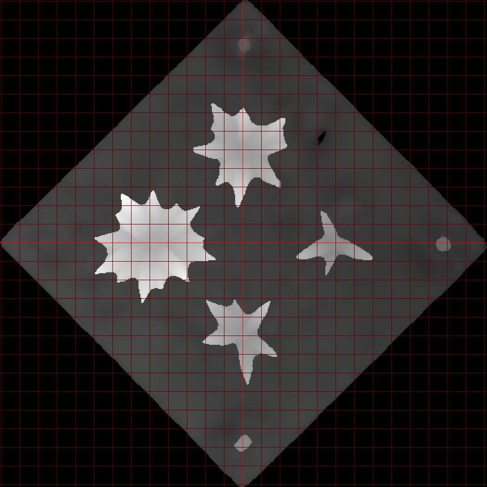

*Figure 15.5e-a. Height map of the benchmark made from the supervisor's photogrammetry mesh, seen from above, base turned 45 deg: the 4 rosettes light (higher), the base grey, with a red grid. Copied into `docs/figures/` on 2026-10-23 from `~/scratch/rosette-mesh/heightmap.png`.*

### 15.5f Trays with pots in the wells (issue #213, method written 2026-10-17, before the session)

**Label: development check.** Whether trays are split and followed, with no true area.

**Question.** With black pots in the wells and the benchmark left out, do the tray splitting of
15.5c and the tracking of 15.5d find each tray, name it by its tag and report the known moves, as
well as they did for the 8 trays that had no problems on 15 October? (Every problem in 15.5d was on
trays 3, 4, 5 and 9: the benchmark tray, its two neighbours and North 1.)

**Why.** Real experiments have pots in the wells. The benchmark does not stand for what will be
measured (Aaron, 2026-10-16), so it is left out.

**Setup** (Aaron, Monday 19 October 2026, in the chamber):

- 12 trays, portrait, two rows (North 1 to 6, South 1 to 6), with gaps, as on 15 October.
- 8 black pots per tray, no soil, in the same 8 cells on every tray: A2, A4, B1, B5, C4, D1, D3
  and D5 (drawing below). 96 pots of about 100. A1 is empty on every tray. The cell grid stays
  visible.
- One 20 mm tag per tray, IDs 13 to 24, from a new print, outside the tray on the narrow edge at
  the A1 corner (Aaron, 2026-10-17). No tag inside a cell. All 30 mm tray tags and the 15 October
  20 mm tags are taken off. IDs 13 to 17 were also used on 15 October as 20 mm paper edge tags, so
  an old tag left on a tray or in the chamber would read as one of this session's trays and cannot
  be told apart: every 15 October tag must leave the chamber.
- Every tag print not on a tray leaves the chamber (15.3d: an offcut in a waste bin read as tag 29).
- Door closed, lights on, focus as set. The lens is not moved during the session.

Pot cells (confirmed by Aaron, 2026-10-17), one tray in portrait, north up, A1 at the lower left
(SW). P is a pot, `.` an empty cell:

```
          A   B   C   D
  row 5   .   P   .   P      north (narrow edge)
  row 4   P   .   P   .
  row 3   .   .   .   P
  row 2   P   .   .   .
  row 1   .   P   .   P      south (narrow edge); the tag sits outside this edge at the A1 corner
```

Why these cells (decision, not a measurement): a pot on every one of the four edges and in two
corners, so the tray outline is crossed by pots on all sides; A1's two neighbours (A2, B1) hold
pots, so the tag corner has black pots near it as it will in a full tray; and empty cells stay
between the pots, so the grid can still be seen.

**Tag print, measured before the session.** Each new 20 mm tag is measured with the NEIKO
callipers, X and Y, 3 readings each, as in section 3, and the readings are written here before the
photos. The sheet is printed at 100% scale and checked against its scale bar if it has one.

*Result* (Aaron, 19 October 2026, before the photos). NEIKO callipers, readings taken across the
20 mm A1 corner tags of the trays, 3 readings in X and 3 in Y:

| Axis | Readings (mm) | Mean (mm) | Range (mm) |
|---|---|---|---|
| X | 19.96, 20.10, 20.02 | 20.03 | 0.14 |
| Y | 20.11, 20.04, 20.14 | 20.10 | 0.10 |

Mean of all 6 readings 20.06 mm, 0.3% above the nominal 20 mm. Every reading is within 0.14 mm of
20 mm, about the callipers' 0.1 mm limit (section 3), so the print is taken as 20.0 mm with no
correction. This differs from the method above: 3 readings per axis in all, not 3 for each of the
12 tags, and which tags were read is not recorded. A single tag printed off-size would not
necessarily show here. Tray tags name and place trays in this session; no area is computed from
their size.

**Tag table, before the photos.** For each tray: tag ID, tray number and starting slot. Read by the agent from the first still and confirmed by
Aaron in a comment on #213. The tray is named by its tag from then on.

**Steps.** Stills taken by the agent through `POST /capture` under the `hardware` label. Stills
go into the experiment that is running, so a new experiment ("pots-2026-10-19") is started first
and "tag-testing" stopped, keeping the 15 October record apart. Every still ID is recorded per step
in `experiments/round1-trays/session-2026-10-19.csv`, in the format of
`experiments/round1/session-2026-10-15.csv`, by `experiments/round1-trays/capture_session.py`,
which writes each row as its still is taken and stops if a still lands outside the new experiment.

| Step | Layout | Stills | Known move from the step before |
|---|---|---|---|
| 1 | Gaps, nothing moved | 10 | (start) |
| 2 | Every tray turned 180 degrees in its slot | 3 | every tray turned, position about the same, tag heading flips |
| 3 | North and South rows swapped | 3 | rows swapped |
| 4 | Trays swapped within rows | 3 | trays swapped within rows |
| 5 | Trays pushed together | 3 | trays pushed together |
| 6 | Pushed together, nobody in the chamber, nothing moved, 30 minutes at one still per 15 s | about 120 | none; within step 6, none |

About 140 stills, about an hour with Aaron present for steps 1 to 5. Steps 1 and 6 are the steps
where nothing moved, used for the position spread and the "wrong position" rule of 15.5d.

**Analysis.** Unchanged from 15.5c and 15.5d: FastSAM on the Hailo-8, tag tiles at margin 1.15
with the fallback; the 15.5c rule per still (every tray one shape, every shape one tray, every slot
right, slot reference row and order, still provisional); tracking with patches 1 to 3 and their
limits as amended in 15.5d; measured and patched counted apart. Also recorded: tag detection per
tag, with the tray tag detector settings (15.3e); time per still;
calibration, validation and lens position of each still from `rig.db`. Nothing is written into
the experiment folder. The counts are reported as they are; Aaron judges them.

**Declared before the session: pots and the mask tests.** FastSAM's tray mask is accepted only
with an area of 0.8 to 1.2 trays and a fill of at least 0.85 of its rotated rectangle, both counted
from the mask's pixels (`fastsam.py`). The 8 pot cells are about 25% of the tray's top (8 cells of
59.5 mm, about 28 300 mm², against 305 x 366 mm). If FastSAM leaves the pots out of the tray
mask, a whole tray could fail these tests for that reason alone. So the first run uses the
rules unchanged, and every tray without a mask is followed through `diagnose.py`. If any tray is
rejected only by the area or fill test, a second run measures area and fill on the mask with its
inner holes filled, everything else unchanged. Both runs are reported, the first as the result.

**Known risk, edge tags.** On 15 October, 23 of 852 edge tag readings (2.7%) were linked to no
tray because two masks were about as close (`edge-tags.csv`, 15.5c). Every tray is now named only
by an edge tag, and on 15 October each of those trays also had a 30 mm tag inside A1, so a missed
link cost nothing. Now a missed link leaves the tray unnamed in that still. The same may happen
when the trays are pushed together (steps 5 and 6). Counted as it is.

**Limits of the evidence.** Black pots without soil or plants; paper tags, not 3D prints (issue
#70); one 12-tray layout in portrait; one lens position; one hour. Not covered: 4 x 4 and 1 x 1
trays, rotations other than 0 and 180 degrees, fewer than 12 trays, soil and plants, the chamber
light cycle.

**Session record, 19 October 2026** (written during the session; times UTC, chamber UTC+2).

- *Rig.* Experiment `pots-2026-10-19` (folder `2026-10-19_17cb7bfb`, tray height 100 mm set on
  it) started 08:06:44; "tag-testing" stopped 08:04:31. Calibration `20261014T111147292361`
  (residual 0.48%), validation `20261014T111253582634`, lens position 6.05 on every still.
- *Check stills, not part of any step* (in the experiment folder, left out of
  `session-2026-10-19.csv`): `080712_753898`, `082042_003216`, `082417_689445`. Each shows tags 13
  to 24 once and no other tray ID. The first showed two round moss pots in the aisle and a pot in C2
  instead of C4 on the five trays turned 0; Aaron removed the moss pots and moved those pots
  (North 2 and 3, then South 3 and 6; South 2 was turned 180 instead). The third shows every tray
  with the cells of the drawing.
- *Tag table* (confirmed by Aaron on #213), North 1 to 6: 19, 20, 22, 23, 21, 13; South 1 to 6:
  18, 17, 16, 24, 15, 14. Trays 19, 23, 21, 13, 18, 17, 24 and 15 start turned 180 (tag at the NE
  corner), 20, 22, 16 and 14 turned 0. The table posted on #213 shows 17 at 0; it was turned before
  step 1.
- *Step 4, the swap within rows.* Not defined in the method. Agreed with Aaron at the step:
  neighbours swapped in pairs in both rows, slot 1 with 2, 3 with 4, 5 with 6, no tray turned.
  Expected after step 4, North 1 to 6: 17, 18, 24, 16, 14, 15; South: 20, 19, 23, 22, 13, 21.
  Written here after the move and before any analysis. (The table shown to Aaron at the step had
  North 3 and 4 the wrong way round; he swapped the real neighbours.)
- *Step 5.* Trays touch within each row; the aisle between the rows stays open. North 5 and 6 sit
  about 15 mm south of the rest of the North row.
- *Quick check at each step* (nearest slot centre to the tag, last still of the step; not the
  analysis): all 12 tags found in every check. A corner tag can sit nearer the next slot's centre
  than its own tray's, so this check misnamed 2 slots in step 2, 1 in step 3 and 1 in step 4.
  Aaron noted (at step 3) that the tag could go at the centre of the short edge, between B5 and
  C5, if that helps tray naming on 4 x 5 trays; not tested (issue #224).

**Results (analysis 19 October 2026).** Scripts and settings as in the method: `fastsam.py
--session 2026-10-19 --margin 1.15` (first run `fastsam-pots19.csv`, second run `--fill-holes`,
`fastsam-pots19-holes.csv`), `diagnose.py`, `track.py` (`track-pots19*.csv`, timeline and evidence
pictures in `~/scratch/round1-trays/track/`), commits cca21dd and after. All 142 stills: calibration
`20261014T111147292361`, validation `20261014T111253582634`, lens 6.05. Tags 13 to 24 were found in
all 142 stills (1704 of 1704), with the tray tag detector settings of 15.3e.

Trays right by the 15.5c rule, first run, raw (no patches), and stills with all 12 right:

| Step | Stills | Trays right | Stills all right | Two-tray masks | Trays with no mask |
|---|---|---|---|---|---|
| 1 gaps, nothing moved | 10 | 120 of 120 | 10 | 0 | 0 |
| 2 turned 180 | 3 | 36 of 36 | 3 | 0 | 0 |
| 3 rows swapped | 3 | 34 of 36 | 1 | 0 | 2 |
| 4 swapped within rows | 3 | 36 of 36 | 3 | 0 | 0 |
| 5 pushed together | 3 | 22 of 36 | 0 | 4 | 6 |
| 6 touching, nothing moved | 120 | 803 of 1440 | 0 | 186 | 265 |

With tracking (15.5d rules and patches):

| | Gaps (steps 1 to 4) | Touching (steps 5, 6) |
|---|---|---|
| Raw, 15.5c rule | 226 of 228 trays, 17 of 19 stills | 825 of 1476 trays (56%), 0 of 123 stills |
| Positions over 50 mm off counted wrong | 226 of 228 | 815 of 1476 |
| After patches 1 and 2 | 227 of 228, 18 of 19 | 1001 of 1476 |
| After patch 3 | 227 of 228, 18 of 19 | 1101 of 1476 (75%), 0 of 123 |

For comparison, 15 October (15.5c, same pipeline, no pots, a 30 mm tag inside A1 of each tray as
well as the edge tags, the benchmark in one tray): 2085 of 2112 trays right raw, 163 of 176 stills,
143 of them touching.

- *Gaps.* Pots in the wells did not stop splitting: 226 of 228 trays right. Moves: the turn is
  seen in every tray's tag (12 of 12); the row swap and the swap within rows are found for 11 of
  11 trays judged each, with no false move. Position spread with nothing moved, step 1: rms 2.1
  mm, max 9.9 mm (120 positions).
- *Touching.* No still has all 12 trays right. Step 6 (nothing moved, 119 pairs of stills): 16
  false moves, 566 trays agreed still, 846 not judged; position spread of measured positions not
  counted wrong rms 8.3 mm, max 35.5 mm (793); 10 positions 50 to 342 mm from the tray's median.
  On 15 October the hour with nothing moved (R3) had 11 false moves and 1401 agreed of 122 pairs.
- *Second run, holes filled.* 1053 of 1704 trays right raw against 1051; touching 1106 of 1476
  after patch 3 against 1101. Reported as declared; the first run is the result. Filling the
  holes left by the pots changes almost nothing, because the masks are not being rejected by the
  area or fill test (next point).
- *Why trays have no mask* (`diagnose-fastsam-pots19.csv`, 273 trays with no mask, 265 in step 6):
  furthest stage "passed" 174, low score 90, never proposed 6, duplicate 1, cut by the tile 1,
  mask test 1 (tray 24, fill 0.84 against 0.85). Trays 16 and 24 (North 4 and North 3 from step 4
  on) are 221 of the 273. **"Passed" is not reliable for touching trays**: `diagnose.py` takes any
  tray-sized box within 60 mm of the tag as a candidate for that tray, and with trays touching the
  neighbour's box falls within that distance (tag 16 lies about 50 mm from North 5's box). So most
  of the 174 are the neighbour's good mask, not the tray's own.
- *Trace of trays 16 and 24* (development check, 2 stills of step 5 and 6, `083840_426657` and
  `085249_313204`, the North 3-4 tile; every box scoring 0.10 or more listed, and every link of
  `link_tags` logged on 5 stills). FastSAM's best boxes of tray height in that tile are 905 to
  913 mm wide, centred on North 3, scores 0.45 to 0.49: North 2, 3 and 4 as one object. No box of
  one tray's width is centred on North 3 at any score down to 0.10; North 4 alone appears only at
  0.10 to 0.20, below SCORE_MIN 0.25. The three-tray box fails the size test, so North 3 and 4
  get no mask, and their corner tags then link to a neighbour's mask (that neighbour reads as two
  trays) or to none. The same pattern (a tag linked to its neighbour's mask, e.g. tags 19 and 23
  on one mask) is seen in the South row on the 5 traced stills; not traced further.
- *Time per still* (first run, tags not cached): median 5.8 s (step 1) to 9.1 s (step 6), max 11.6
  s, of which tag detection about 4.4 s. Slower when touching because of the fallback.

**What this shows.** With gaps, tray splitting and tracking work with pots in the wells as they did
on 15 October. With trays touching they do not: 56% of trays right before patches, 75% after, no
still fully right. The one cause traced is FastSAM taking three touching trays as one object. Why
this happened on 19 October and not on 15 October is not known; the days differ in the pots, in
the tags (edge tags only now, a 30 mm tag inside A1 then), and in which trays touched where. Not
shown: that the South row fails for the same reason; whether a different tile (one tray per tile,
or tiles centred on the seams) would separate them.

**Limits of the evidence.** As declared above, plus: the trace covers 2 stills and one tile; the
diagnosis stage "passed" over-counts for touching trays; one session of one hour.

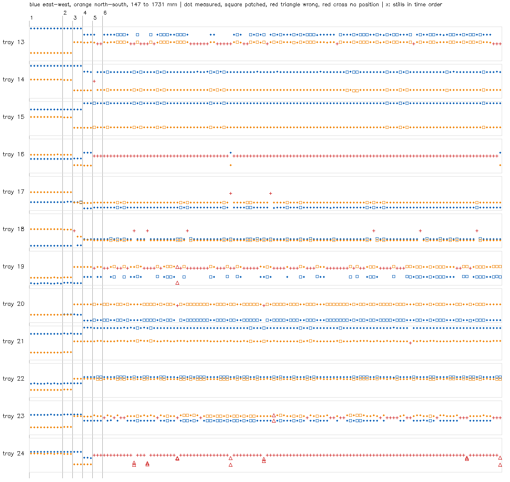

*Figure 15.5f-a. The same kind of timeline as Figure 15.5d-a, trays 13 to 24 with pots in the wells: many red crosses (no position) and wrong positions; trays 16 and 24 almost never placed from step 5 on. Copied into `docs/figures/` on 2026-10-23 from `~/scratch/round1-trays/track/timeline-pots19-holes.png`.*

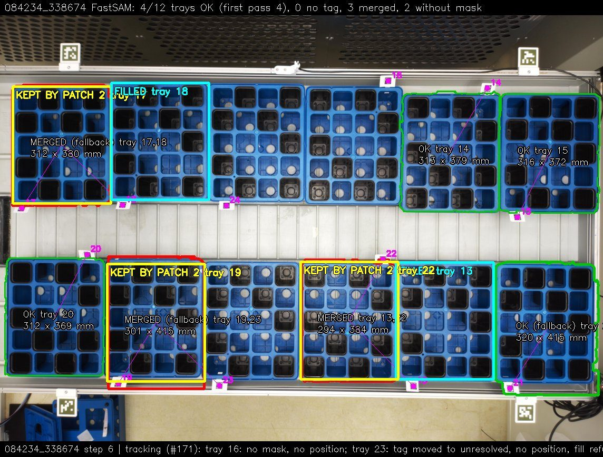

*Figure 15.5f-b. Still `084234_338674` (step 6, pots in the wells): FastSAM finds 4 of 12 trays (green); red outlines are merged trays, yellow are trays kept by the patch, cyan filled; tray 16 has no mask. The kind of still behind the red in Figure 15.5f-a. Copied into `docs/figures/` on 2026-10-23 from `~/scratch/round1-trays/track/evidence-pots19/6_084234_338674.jpg`.*

### 15.5g Tray footprint from the tag (issue #213, method written 2026-10-19, before the analysis)

**Label: development check.** No new photos; the 142 stills of 15.5f.

**Question.** Does a tray's tag fix where the tray is? If the tag is fixed to the tray, its centre
and heading give the tray's centre: one offset per tray, in the tag's own frame, learned once at
the start (Aaron, 2026-10-19). Then touching trays would not need to be split by FastSAM at all.

**Why.** 15.5f: with trays touching, FastSAM takes three trays as one object, and 25% of trays are
not placed right even after patches.

**Method.** From `track-pots19.csv` (first run, 15.5f), positions labelled "measured" and not more
than 50 mm from the tray's median where nothing moved. For each such position: the vector from the
tag centre to the FastSAM mask centre, in mm by the calibration's scale at the tag, turned into the
tag's frame by the tag heading (so it is the same vector whichever way the tray is turned).

1. *Learn.* Each tray's offset is the median vector over the 10 stills of step 1 (gaps, nothing
   moved).
2. *Hold-out with gaps.* Steps 2 to 4 (turned, rows swapped, swapped within rows): for each
   measured position, the distance between the mask centre and the centre predicted from the
   tag and the step 1 offset.
3. *Touching.* Steps 5 and 6: the same distance, for every measured position there (the masks
   FastSAM did get right).
4. *Single offset.* The spread of the 12 trays' step 1 offsets: whether one offset fits every
   tray (tags placed the same way on every tray) or each tray needs its own.
5. *Picture.* Predicted tray outlines (305 x 366 mm, turned by the tag heading) drawn on 2
   touching stills from step 6, for Aaron to look at, including trays 16 and 24.

Reported as they are, as distances in mm (median, 95th percentile, max, count). No pass mark is
set: Aaron judges. For scale: neighbouring trays' centres are about 305 mm apart, and step 1's
position spread with nothing moved is rms 2.1 mm.

**What it does not cover.** The predicted centre is checked only against FastSAM masks, so only
for trays FastSAM placed right; trays 16 and 24 in steps 5 and 6 are seen only in the picture.
The heading's accuracy limits the tilt: 1 degree moves a tray's far end about 6 mm. Paper tags,
which can shift on a tray; one session. The mask centre is the centre of FastSAM's mask, not a
measured tray position.

**Results (19 October 2026).** `footprint.py --session 2026-10-19 track-pots19.csv`, output
`footprint-pots19.csv`, pictures in `~/scratch/round1-trays/footprint/`.

1. *Learn.* Within step 1 each tray's offset varies by at most 1.6 to 10.4 mm (10 stills).
2. *Hold-out with gaps* (steps 2 to 4, 106 positions): predicted centre to mask centre median 20.8
   mm, 95th percentile 62.0, max 170.2.
3. *Touching* (steps 5 and 6, 815 positions): median 23.1 mm, 95th percentile 61.7, max 65.0.
4. *Single offset.* The 12 trays' offsets lie a median 6.7 mm from their common median, max 49.7
   mm (tray 14). Tags were not placed the same way on every tray.
5. *Pictures* (`085249_313204`, `090504_356551`, step 6). The predicted outlines lie on the trays
   for 11 of 12, judged by eye, including trays 24 and 16, which FastSAM did not place (15.5f).
   Tray 14's outline is turned about 10 degrees off its tray.

- The error is per tray, not random: each tray's median is about the same with gaps and touching
  (for example tray 14: 61 and 61 mm; tray 23: 7 and 8 mm). By tray, medians with gaps: 7 to 11 mm
  for trays 16, 22, 23 and 24, 16 to 39 mm for the other 7 learned trays, 61 mm for tray 14.
- *Tray 14.* Its tag heading was 100.8 degrees in step 1 and 282.9 in step 2 (the same tilt after
  the turn), then 271.5 in step 3 and 270.0 to 271.1 after: the paper tag turned by about 11
  degrees on its tray between steps 2 and 3, when the rows were swapped. With the step 1 offset
  that gives about 61 mm of error from step 3 on. A tag that shifts on its tray breaks the
  footprint; this is the case for fixed tags (issue #70).
- *Tray 18, step 3.* The 2 positions 168.6 and 170.2 mm off are masks labelled measured; not
  looked at further.
- Why the other trays are 16 to 39 mm off is not known. The four trays with errors of 7 to 11 mm
  (16, 22, 23, 24) were in slot 3 or 4, the middle of a row, in every step. That would fit an error that
  grows away from the image centre, either in the mask centre or in the tag, but this was not
  tested. The pictures show outlines that lie on the trays; a difference of 20 mm is about a third
  of one cell (59.5 mm).

**What this shows.** Placed from its tag and one offset learned at the start, the tray outline
lands on the tray in the two pictures, for 11 of 12 trays, including the two trays FastSAM could
not split. Against FastSAM's masks the predicted centre is a median 21 to 23 mm off, the same with
gaps and touching. It fails where the tag moved on its tray (tray 14, about 11 degrees). Not
shown: how far off the predicted outline is from the real tray edge (no measured outline); that the
tilt from the tag heading is right; any tray type other than 4 x 5 in portrait.

### 15.5h Tag in cell A1 against tag on the edge, same stills (issue #213, method written 2026-10-19, before the photos)

**Label: development check.** Whether trays are split and followed, with no true area.

**Question.** With pots in the wells, does naming each tray by a tag inside cell A1 split and
follow touching trays better than naming it by the 20 mm edge tag of 15.5f?

**Why.** Tags cannot be placed on the tray edge repeatably; a tag inside a cell is held by the
cell walls (Aaron, 2026-10-19). On 15 October, with 30 mm tags in A1, touching trays were split
(15.5c); on 19 October, with edge tags only, they were not (15.5f). The days differ in more than
the tag, so this session puts both tags on the same trays in the same stills.

**Setup** (Aaron, 19 October 2026, after 15.5f): as 15.5f, plus tags 1 to 12 (30 mm, 36h11) lying
in cell A1 of the 12 trays (A1 is empty on every tray). The edge tags 13 to 24 stay on. Whether
these are the 15 October sheets (30.0 mm, section 3) is not recorded; tag size is not used here.

**Steps.** Stills by the agent under the `hardware` label, into the running experiment
"pots-2026-10-19", recorded in `experiments/round1-trays/session-2026-10-19-cell.csv` by
`capture_session.py --record`:

| Step | Layout | Stills |
|---|---|---|
| 1 | Gaps, nothing moved | 10 |
| 2 | Every tray turned 180 degrees in its slot | 3 |
| 3 | North and South rows swapped | 3 |
| 4 | Neighbours swapped in pairs within rows (1-2, 3-4, 5-6) | 3 |
| 5 | Pushed together within rows | 3 |
| 6 | Pushed together, nobody in the chamber, nothing moved, 10 minutes, one still per 15 s | 40 |

**Analysis.** As 15.5f (first run only, no holes-filled run), done twice on the same stills, with
two session files that differ only in which tag names and places each tray: `2026-10-19-cell`
(the A1 tag first) and `2026-10-19-edge` (the edge tag first). Both files list both tags for each
tray. Reported for each, side by side: trays right raw and after patches, gaps and touching;
stills all right; false moves in step 6; tag detection per tag. The tag table is read from the
first still and confirmed by Aaron, as in 15.5f. Counts reported as they are; Aaron judges.

**Changed before the step 5 stills (Aaron, 2026-10-19, for time):** step 6 is dropped, and the
analysis is run only with the cell tags naming the trays (`2026-10-19-cell`). The edge-tag
comparison is 15.5f's result on its own stills, not a run on these stills. The false moves of a
step with nothing moved while touching are not measured here.

**What it does not cover.** Tag size differs as well as position (30 mm in the cell, 20 mm on
the edge), so a difference cannot be put on position alone. The pipeline builds its tiles from
the naming tags, so the comparison is of the whole pipeline, not of the tag link alone. One
session, 62 stills, paper tags, the pot cells of 15.5f with A1 empty; in an experiment A1 may
hold a plant.

**Results (19 October 2026).** 22 stills, `105128_023792` to `110420_651055`, record
`session-2026-10-19-cell.csv`; check stills `104544_103703` (tag 1 found twice, tag 9 missing: two
prints of tag 1; Aaron replaced the one on South 4 with tag 9) and `104959_856024` (tags 1 to 24
once each). Tag table confirmed by Aaron. Tags 1 to 24 found once in every still. Calibration,
validation and lens as 15.5f. `fastsam.py --session 2026-10-19-cell --name cell19 --margin 1.15`,
`track.py`; outputs `fastsam-cell19*.csv`, `track-cell19*.csv`.

| | Gaps (steps 1 to 4) | Touching (step 5) |
|---|---|---|
| Raw, 15.5c rule | 222 of 228 trays, 16 of 19 stills | 19 of 36 (53%), 0 of 3 stills |
| After patches | 225 of 228 | 27 of 36 (75%) |
| Edge tags, 15.5f (other stills) | 226 of 228 raw | 825 of 1476 raw (56%), 1101 (75%) after |

- Step 3 (rows swapped): 10 of 12 right in each still, one two-tray mask per still. Steps 1, 2
  and 4: every tray right in every still.
- Touching: 2 to 3 two-tray masks per still, as with the edge tags. **Naming trays by a tag in
  A1 does not make FastSAM split touching trays with pots in the wells.** The 15 October success
  with touching trays is therefore not explained by the tag; the remaining known difference is the
  empty trays (no pots) on 15 October. Not tested.

*Added after the results, not in the method: the footprint of 15.5g on these stills*
(`footprint.py --session 2026-10-19-cell track-cell19.csv --pictures 110420_651055`, output
`footprint-cell19.csv`). Offsets learned from step 1 vary within step 1 by at most 1.7 to 11.0 mm.
The 12 trays' offsets lie a median 10.0 mm, max 18.1 mm, from their common median (edge tags: max
49.7 mm). Predicted centre to mask centre with gaps (steps 2 to 4, 102 positions): median 18.5
mm, 95th percentile 31.5, max 41.7 (edge tags: 20.8, 62.0, 170.2). Touching (19 positions):
median 20.4 mm, max 291.1 (one mask labelled measured, not looked at). In the touching picture
`110420_651055` all 12 predicted outlines lie on their trays by eye, including the 5 trays FastSAM
did not place; trays 1, 2 and 11 are drawn turned a few degrees from their trays (a tag can turn
inside its cell).

*Added after the results, at Aaron's request: placement from the cell tag alone* (`footprint.py
--common`, output `footprint-cell19-common.csv`, pictures `~/scratch/round1-trays/footprint/`,
sheet `cell-tag-only-steps.jpg`). Every tray is placed by the same offset (the median of the 12
trays' step 1 offsets, (-107.8, -149.1) mm in the tag's frame), turned by the tag heading, its
tilt taken as the heading's difference from the nearest right angle; nothing is learned per
tray. All 264 tray positions of the 22 stills are placed (every cell tag is found in every still).
Against FastSAM's measured masks: gaps (steps 2 to 4, 102 positions) median 8.4 mm, 95th
percentile 17.3, max 32.3; touching (step 5, 19 positions) median 11.4 mm, with one at 294.3 mm
(tray 5 in `110417_886593`, where FastSAM's mask is one tray to the east) and one at 41.4 mm.
In one picture per step (5 stills), every outline lies on its tray by eye, touching included.
The common offset is closer to FastSAM's masks than each tray's own step 1 offset (median 8.4
against 18.5 mm with gaps); why is not known.

**What this shows.** With pots, FastSAM splits trays with gaps and fails on touching trays,
whichever tag names them. A tag in cell A1 sits more repeatably on its tray than a hand-placed edge
tag (offsets within 18 mm of one common offset, against 50 mm), so one offset for every tray,
with no learning per tray, places the tray outline from the tag alone. Not shown: the outline
against a measured tray edge; the tilt; replacement of a tag mid-experiment (expected to need no
relearning while the tag stays in A1, not tested).

**Conclusion of 15.5f to 15.5h (19 October 2026).** With black pots in the wells, the method
that placed every tray in every still is placing each tray from a 30 mm tag lying flat in the
empty cell A1, by one offset common to every tray: 264 of 264 tray positions in 22 stills, gaps
and touching. FastSAM tray splitting works with gaps (222 to 226 of 228 trays) and fails with trays
touching (53 to 56% raw), with either tag. The edge tag cannot be placed repeatably on the tray
(Aaron) and its offset varies by up to 50 mm between trays; the cell tag's by up to 18 mm. This
is the method taken forward to the shuffling test (15.5i). It rests on one session of 22 stills,
no ruler check of the outline, the tag lying the same way round in A1, and A1 kept free of plants.

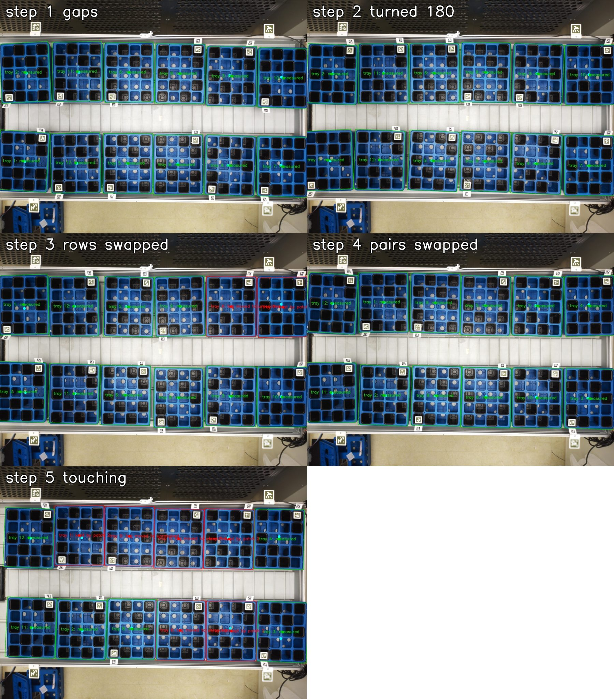

*Figure 15.5h-a. The sheet named above (`cell-tag-only-steps.jpg`): one still per step (gaps, turned 180, rows swapped, pairs swapped, touching), each tray outline placed from its cell A1 tag; outlines and labels in red where the tray was not measured. Copied into `docs/figures/` on 2026-10-23 from `~/scratch/round1-trays/footprint/cell-tag-only-steps.jpg`, scaled down.*

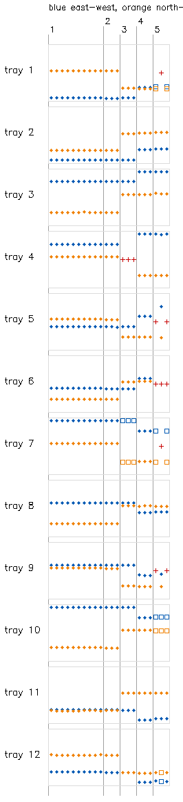

*Figure 15.5h-b. The same kind of timeline as Figure 15.5d-a for the cell-tag stills of 19 October (`track-cell19.csv` in `experiments/round1-trays/`), steps 1 to 5; red crosses (no position) and patched squares appear from step 3. Copied into `docs/figures/` on 2026-10-23 from `~/scratch/round1-trays/track/timeline-cell19.png`.*

### 15.5i Shuffling rounds, trays placed from the cell tag only (issue #213, method written 2026-10-19, before the photos)

**Label: development check.** Proof of concept for tracking trays through repeated moves.

**Question.** Placing each tray only from its tag in cell A1 (15.5h, one common offset), is every
tray found in the slot and turn it was moved to, in every still, over several rounds of
shuffling, with gaps and touching?

**Setup** (Aaron): the 12 trays and pots of 15.5h, tags 1 to 12 flat in cell A1, the same way round
as in 15.5h. Every paper edge tag (13 to 24) taken off and out of the chamber. No FastSAM.

**The shuffles are the known answer.** Before each round the agent draws the next layout at
random (`shuffle.py plan`, seed written in the plan file): which tray goes to which of the 12
slots, and whether it is turned 0 or 180 degrees. The plan is posted on #213 as a table before
Aaron moves the trays, so the expected result is fixed before the stills.

| Round | Layout | Stills |
|---|---|---|
| 0 | Starting layout as found, gaps | 3 |
| 1 | Shuffled, gaps | 3 |
| 2 | Shuffled, touching within rows | 3 |
| 3 | Shuffled, gaps | 3 |
| 4 | Shuffled, touching within rows | 3 |
| 5 | Nothing moved; the tags of 3 trays named in the plan lifted out and dropped back into A1 | 3 |

Round 0's layout is read from its stills and confirmed by Aaron; it is the start, not a test.

**Analysis** (`shuffle.py check`, reads the record, the stills, rig.db and the calibration's slot
layout; writes nothing to the experiment folder): for every tray in every still, the tray centre
placed from its tag (15.5h `--common` offset, learned in 15.5h, not refitted), its slot (the
slot centre nearest the placed tray centre, not the tag) and its turn (from the tag heading).
Reported: trays in the planned slot and turn, of 12, per still and per round; trays not found;
how far the placed centre moved between rounds 4 and 5 for the 3 replaced tags (mm) against the
other 9. Pictures of the placed outlines, one still per round. Declared before the photos: the
proof of concept holds if every tray is in its planned slot and turn in every still; anything less
is reported as it is and Aaron judges.

**What it does not cover.** As 15.5h: no ruler check of the outline; tags placed the same way
round; A1 empty; 4 x 5 trays in portrait; one lens position. The slot rule needs trays near their
slots: a layout far from the slot grid is not tested. Tag placement error inside A1 adds to the
outline position.

**Changed before the photos (Aaron, 2026-10-19):** Aaron took the stills himself, in a new
experiment "simple segmentation test" (folder `2026-10-19_ad4876e5`); five shuffles from the
posted maps (#213, seed 20261019), no round 0 and no tag lift. Round 2 was run twice: first with
gaps, then pushed together (Aaron). Stills are split into rounds by time gaps over 60 s and each
group assigned to its round by `--rounds 1 2 3 4 5 2`; the assignment was found by matching each
group against all five maps (each group matched one map for 10 or 11 of 12 trays, every other map
for 0 or 1).

**Results (19 October 2026).** `shuffle.py --experiment "simple segmentation test" --rounds 1 2 3
4 5 2`, commit after 18ca714, output `shuffle-2026-10-19_ad4876e5.csv`, pictures in
`~/scratch/round1-trays/shuffle/`. 18 stills, 6 groups of 3, lens and calibration as 15.5f.

| Group | Round | Layout | Trays in the planned slot and corner | Wrong | Tag not found |
|---|---|---|---|---|---|
| 0 | 1 | gaps | 33 of 36 | 3 | 0 |
| 1 | 2 | gaps (first run) | 33 of 36 | 3 | 0 |
| 2 | 3 | gaps | 33 of 36 | 3 | 0 |
| 3 | 4 | touching | 33 of 36 | 3 | 0 |
| 4 | 5 | gaps | 33 of 36 | 3 | 0 |
| 5 | 2 | touching (second run) | 32 of 36 | 3 | 1 |

- All 18 wrong positions are tray 6, in every still: found one slot over, with the corner the
  wrong way (for example round 1: found South 6 SW, planned South 5 NE). In the picture of round
  1 tray 6 stands in South 5 with A1 at NE as planned, and tag 6 lies in A1 turned 180 degrees
  from the other tags (heading 184 against about 0 for the other NE trays). The rule assumes every
  tag lies the same way round in its cell; tag 6 did not, so its offset pointed the wrong way.
- Tag 1 was not found in 1 of 18 stills (`121700_460965`); found in the other 17.
- Without tray 6: 197 of 198 tray positions right, the one miss being the tag not found.
  **The proof of concept as declared (every tray right in every still) does not hold**: one tag
  lying the other way round moves its tray to the next slot in every still.

**What this shows.** Placing trays from a cell tag tracks 11 of 12 trays through five random
shuffles, with gaps and touching, with no tray splitting. It depends on each tag lying the same
way round in its cell: one tag turned 180 put its tray in the wrong slot every time, silently.
Not shown: a tag found in the wrong orientation being detected as such.

### 15.5j Trays placed from the cell tag in any rotation, same 18 stills (issue #217, method written 2026-10-19, before the analysis)

**Label: development check.** Re-analysis of the 18 stills of 15.5i; no new photos.

**Question.** If the tag's heading is not used to tell which way a tray faces, is every tray in
its planned slot and turn in the 18 stills, tray 6 included?

**Why.** In 15.5i the tray's turn came from the tag heading, so a tag lying 180 degrees round
put tray 6 one slot over in every still, with no warning. AprilTags read in any rotation, and
operators will not follow a rule on which way round a tag lies (Aaron, 2026-10-19). With 12 trays
every tray is turned 0 or 180 degrees, so A1 is at the south-west or the north-east corner.

**Method** (`shuffle.py --any-rotation`, otherwise as 15.5i, same `--rounds 1 2 3 4 5 2`):

1. The tray's small tilt is the tag heading's difference from the nearest right angle, as in
   15.5i. This is the same whichever way round the tag lies.
2. Two candidate tray centres are placed from the tag centre: A1 at the south-west (the 15.5h
   common offset, turned by the tilt only) and A1 at the north-east (the same offset reversed).
3. The candidate whose nearest slot centre is closer is taken; its slot and corner are the result.
   Reported for every tray: the distance of each candidate to its nearest slot centre, and the
   margin between them (mm, scale at the tag), so a close call shows.
4. Also reported: each tag's heading off the 15.5h heading for its corner (0, 90, 180 or 270
   degrees), to show how many tags lay a different way round.

The offset is not refitted. Declared before the analysis: the method works on these stills if
every found tray is in its planned slot and turn; anything less is reported as it is.

**What it does not cover.** The same 18 stills; only tray 6 lay a different way round, so one
tag tests the rotation. Fewer than 12 trays, where any turn is allowed and step 3 cannot choose
between more than two candidates. A tray far from the slot grid. New stills with tags lying in
several rotations, offered by Aaron, test it further.

**Results (19 October 2026).** `shuffle.py --experiment "simple segmentation test" --rounds 1 2 3
4 5 2 --any-rotation`, commit 81c86ff, run before the 15.5k stills existed; to rebuild it now, add
`--before 2026-10-19T12:18` (checked identical, byte for byte, on 2026-10-19). Output `shuffle-2026-10-19_ad4876e5-any.csv`, pictures
`~/scratch/round1-trays/shuffle/*-any.jpg`. Same 18 stills and cached tags as 15.5i.

| | 15.5i (turn from the tag heading) | 15.5j (turn from the slot grid) |
|---|---|---|
| Trays in the planned slot and corner | 197 of 216 | **215 of 216** |
| Wrong | 18 (tray 6 in every still) | **0** |
| Tag not found | 1 (tag 1, `121700_460965`) | 1 (the same) |

- Distance from the chosen candidate to its nearest slot centre: median 59.4 mm, max 97.4 mm
  (215 trays). The other candidate was further by at least 152.4 mm (median 274.1 mm), so no
  tray was a close call.
- Tags lying a different way round from the 15.5h heading for their corner: tray 6, 180 degrees,
  in 18 of 18 stills; every other tag 0 degrees. Tray 6 is now placed in its planned slot and
  corner in every still.
- In the picture of round 4 (`121231_081714`) every outline lies on its tray by eye.
- *Observation, by eye, not a measurement:* the one miss, tag 1 in `121700_460965`, was compared
  with the still taken 4 s before it, where it was found (crops 1000 px square around the tag,
  `~/scratch/tag1-found-vs-missed.jpg`). The tag looks the same in both: sharp, whole, in the same
  place. In both the card does not lie flat in its cell (its lower edge sits higher than its upper
  edge). Why it was missed in one still is not known; the detector was not run on the crop.

**What this shows.** On these 18 stills the tray's slot and turn come out right without using
which way round the tag lies: 215 of 216, the one miss being a tag not found, which the rig can
report. Not shown: tags lying 90 or 270 degrees round (none here; the method expects them to work,
since only the tilt is taken from the heading); more than one tag lying a different way; fewer
than 12 trays; the outline against a measured tray edge.

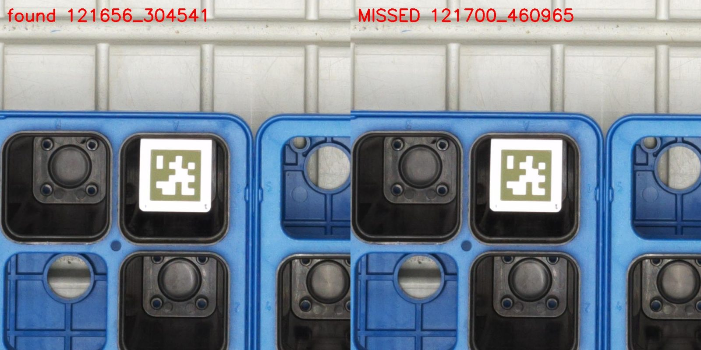

*Figure 15.5j-a. Tag 1 in cell A1, found in `121656_304541` (left) and not found in `121700_460965` 4 s later (right), looking the same: the observation above. Copied into `docs/figures/` on 2026-10-23 from `~/scratch/tag1-found-vs-missed.jpg`.*

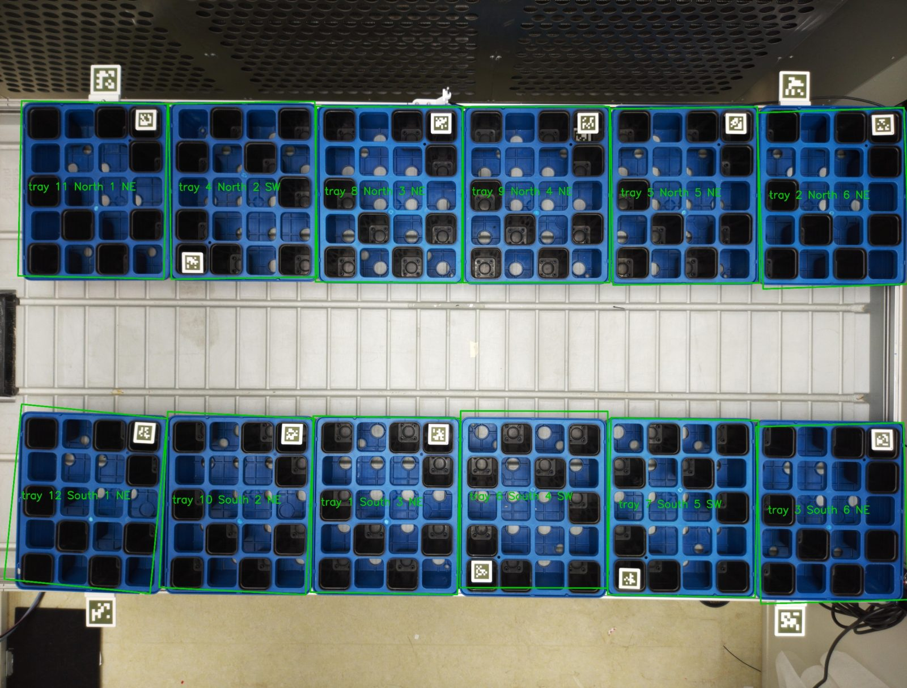

*Figure 15.5j-b. Still `121656_304541`, one shuffled layout placed by the any-rotation rule: each tray outlined (green) and labelled with its tray, slot and A1 corner. Copied into `docs/figures/` on 2026-10-23 from `~/scratch/round1-trays/shuffle/group5-round2-121656_304541-any.jpg`, scaled down.*

### 15.5k Tags in four rotations, trays turned, pushed together and shuffled (issue #217, method written 2026-10-19, before the analysis)

**Label: development check.** Whether trays are placed in the right slot and turn, with no true
area.

**Question.** With tags lying 0, 90, 180 and 270 degrees round in cell A1, trays turned, pushed
together and shuffled, does the 15.5j rule put every tray in the slot and corner it is in?

**Setup** (Aaron, 19 October 2026, after 15.5j): the 12 trays and tags 1 to 12 of 15.5i, moved,
turned and pushed together by Aaron, tags turned in their cells. 24 stills, `125916_775000` to
`130451_467380`, experiment "simple segmentation test" (`2026-10-19_ad4876e5`). No plan was drawn
before the moves, so there is no known answer fixed in advance.

**Analysis.** `shuffle.py --any-rotation` as 15.5j, every still on its own (`--gap 0`, no plan).
Reported per still: trays found, each tray's slot, corner, and the tag's turn off the 15.5h
heading for its corner (0, 90, 180, 270); the margin between the two candidates. A picture of every
still with the placed outlines and labels. The known answer is Aaron's check of the pictures
against what he did; any tray he finds in the wrong slot or corner is counted wrong.

**What it does not cover.** As 15.5j. The answer is checked after the analysis, by eye, not fixed
before it.

**Results (19 October 2026), before Aaron's check.** `shuffle.py --experiment "simple segmentation
test" --after 2026-10-19T12:18 --gap 0 --rounds` followed by 24 zeros `--any-rotation --name
rotations` (the options were added after the first run, which filtered the stills the same way in
an uncommitted call; the rebuilt file is identical, byte for byte). Output
`shuffle-2026-10-19_ad4876e5-rotations.csv`, pictures
`~/scratch/round1-trays/shuffle/group*-round0-*-rotations.jpg`, one sheet of the first still of
each layout `~/scratch/rotations-8-layouts.jpg`. The 24 stills are 8 layouts of 3 stills.

- All 12 tags found in all 24 stills (288 of 288); no two trays placed in the same slot.
- Tag turns off the 15.5h heading: 0 degrees 39, 90 degrees 90, 180 degrees 69, 270 degrees 90
  (tray positions).
- Within each layout of 3 stills every tray has the same slot, corner and tag turn.
- Margin between the two candidates: at least 157 mm in every still; the chosen candidate at most
  106 mm from its slot centre.
- By eye on the sheet, every outline lies on a tray.

**Aaron's check (2026-10-19).** Aaron compared the sheet with what he did and found it accurate:
288 of 288 tray positions in the slot and corner he set, 0 wrong.

**What this shows.** With tags lying in all four rotations, trays turned, pushed together and
shuffled, the 15.5j rule placed every tray in every still. Taken forward into the app (#220).
Not shown: the outline against a measured tray edge; fewer than 12 trays; the 40 mm tag (offset
learned with 30 mm tags); trays with plants, and A1 holding anything but the tag. The answer was
checked by eye after the analysis, not fixed before it.

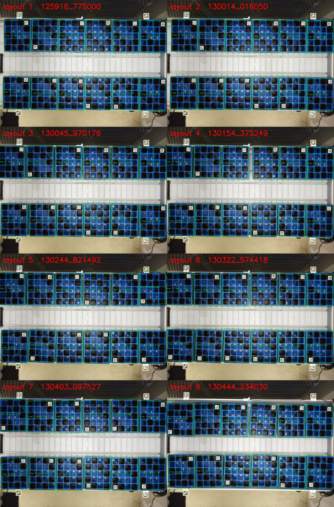

*Figure 15.5k-a. The sheet named above: the first still of each of the 8 layouts, each tray outlined and labelled with its tray, slot and A1 corner. Copied into `docs/figures/` on 2026-10-23 from `~/scratch/rotations-8-layouts.jpg`, scaled down.*

### 15.5l Shuffles through a day with scheduled capture (method written 2026-10-19, before the photos; results in round 2)

**Label: development check.** Whether trays are placed in their planned slot and corner over many
shuffles, and how steady placement is between them, with no true area.

**Question.** With trays placed from the cell A1 tag by the rule of 15.5j, unchanged, is every
tray in its planned slot and corner in every settled still through up to 21 shuffles on one day,
with photos taken by the scheduler (#60)? And how far does each placed tray centre move between
stills when nothing is moved?

**Setup** (Aaron, Tuesday 20 October 2026): the 12 trays and pots of 15.5i, tags 1 to 12 in cell
A1, lying any way round; the benchmark taped to tray 1. If the 30 mm tags are used, the 15.5h
common offset is used unchanged. If the 40 mm tags are used, the offset is learned first from one
still with gaps, as in 15.5h, and written up here before the first shuffle. The scheduler interval
is Aaron's choice and is recorded from the stills.

**The known answer, fixed before the moves.** 21 layouts drawn by `shuffle_maps.py` (seed
20261020), committed as `sessions/shuffle-maps-2026-10-20.json` in 64ba49e before any tray was
moved, and printed for Aaron (`~/Documents/shuffle-maps-2026-10-20.pdf`, 3 per page). Shuffles are
done in the order printed, 1 to 3 per hour, between 09:30 and 16:10 chamber time (07:30 to 14:10
UTC). Aaron gives the start time of each shuffle he did; the sheets, with his marks, are
photographed and kept with the raw data. A shuffle skipped or done out of order is recorded as such.

**Analysis** (`shuffle.py --any-rotation`, the 15.5j rule, offset not refitted):

1. Stills from the start of shuffle N to the start of shuffle N + 1 belong to layout N (the last
   layout runs to the end of the experiment's stills that day).
2. A still is *settled* when every tag found in it lies within 5 mm of its position in the next
   still (a decision, not a measurement: tags moved less than 0.3 mm with nothing moved in 15.5d).
   Stills that are not settled are counted as moving and left out of the placement count.
3. Reported per layout and in total: settled stills; trays in the planned slot and corner; wrong;
   tag not found; the smallest margin between the two candidates.
4. Steadiness: for each tray and layout, the spread of the placed centre over the settled stills
   (rms and max, mm). Stills in the quiet window (17:00 to 23:00 chamber time) and in the dark
   (23:00 to 09:30) are reported apart.

**Declared before the photos.** Against round 2 target 1 (15.6b): no tray in a wrong slot or
corner, and at least 95% of tray positions in settled stills placed. Anything less is reported as
it is.

**What it does not cover.** As 15.5k. One day; trays with pots and no plants; the outline against
a measured tray edge; fewer than 12 trays. Where a still is judged moving depends on the 5 mm
rule above.

**Decided on the day, before any still after layout 1 was looked at** (Aaron, 2026-10-20, issue
#236):

- **Experiment and stills.** "tray tracking 26.10.20" (folder `2026-10-20_57f74959`), restarted by
  Aaron at 07:52 UTC. Stills every 5 minutes from 07:53:07 UTC, every minute from 07:56:57 UTC.
- **Tags.** 40 mm tags 1 to 12 (36h11) in cell A1. Check still `075307_250557`: tags 1 to 12 found
  once each, no other tray ID, sides 39.4 to 40.5 mm at the calibration scale. Callipers (Aaron,
  2026-10-20): 39.95 mm across the black square, quiet zone excluded; how many tags and readings
  is not recorded. Tag size is not used by the placement rule. Calibration
  `20261014T111147292361`, lens 6.05.
- **Record of the shuffles.** Aaron writes down the time he leaves the chamber after each shuffle
  (the layout is then in place) and whether it has gaps, in a table, kept in his own log and copied
  to `shuffle-times-2026-10-20.csv`. The marked sheets are not photographed (Aaron, 2026-10-20);
  the table replaces them.
- **Offset.** Layout 1 (gaps) was already in place at the first still, so the 40 mm offset is
  learned from the layout 1 stills, as in 15.5h (FastSAM mask centres, `footprint.py --common`),
  and fixed before any later still is looked at. **Layout 1 is the learning layout and is left out
  of the placement count; shuffles 2 to 21 are the test.**
- **Gaps and touching.** Odd shuffles with gaps between the trays, even shuffles pushed together
  within rows. Every count in step 3 of the analysis is reported for each condition apart.
- **Timing.** Shuffles about every 10 minutes, as Aaron's other work allows; not all 21 may be
  done. Layout boundaries are found from the stills (where the tags move); Aaron's start times are
  a cross-check, and a disagreement is reported.
- **Missing tags.** Every still with a tag missing that is found in the stills around it is looked
  at and labelled *person in frame* (something visibly covers the tag) or *not found, nothing in the
  way*. Only the second counts against the 95% target; the first is counted apart. The 5 mm rule
  is unchanged; a tag missing from a still or from the next still is left out of that comparison
  (decided before the first run of `shuffle_day.py`). Layout N runs from Aaron's leave time after
  shuffle N to his leave time after shuffle N + 1; the stills of a move fall at the end of the
  layout before it and drop out as not settled. How often and for how long a person hides tags, and whether a missing tag ever
  led to a wrong placement, is reported for the app port (#220).

**The 40 mm offset, learned before the first shuffle was looked at.** Layout 1 is the 6 stills
`075307_250557` to `080057_595732` (07:53 to 08:01 UTC; every tag within 0.2 mm of the first still;
the next still, `080157_571787`, has 8 tags and moved). Session file `sessions/2026-10-20.json`,
record `session-2026-10-20.csv`. `fastsam.py --session 2026-10-20 --name oct20-learn --margin
1.15` placed 12 of 12 trays in all 6 stills (one still needed the fallback for 2 trays);
`track.py`; then `learn_offset.py track-oct20-learn.csv`. For each tray, the tag-to-mask-centre
vector is put in the frame `place_any_rotation` uses (A1 at SW, turned by the tilt only, reversed
where layout 1 has A1 at NE). The corner is taken from the shuffle map, the known answer for
layout 1. Three tags do not lie the 30 mm way round (trays 2 and 9 turned 180, tag 8 turned 90).

| | Offset (right, up), mm | Trays from it, mm |
|---|---|---|
| 40 mm, 20 October (12 trays, 6 stills) | (-104.0, -141.6) | median 4.4, max 9.6 (tray 9) |
| 30 mm, 15.5h, for comparison | (-107.8, -149.1) | max 18 |

Within layout 1, each tray's offset spreads at most 1.0 to 7.9 mm across the 6 stills, except tray 1
(19.5 mm; it carries the benchmark, not looked at). The offset is fixed as tray type
`4x5 40 mm tag in A1` in `shuffle.py` and is not refitted.

**Anomaly: a capture record with no image.** `rig.db` holds capture 725, taken_at
2026-10-20T11:00:48.405213 UTC, in this experiment, path `.../110048_405213`, with lens position 1.0,
exposure 20000 us, no calibration, no validation, flags "focus not locked" and "no calibration". No
image or sidecar file exists, and the gallery does not show it. The scheduled stills either side
(`105957_604718`, `110057_592292`) are normal (lens 6.05, focus locked). Its source is not known
(Aaron, 2026-10-20: possibly the scheduler). Left out of the analysis; nothing in the experiment
folder or `rig.db` was changed.

*Cause, found 2026-10-22 (#241).* The record was written by a unit test, not by the rig. A
scheduler thread started by a test outlived it and wrote into the live `rig.db` (#253, fixed by PR
#254, merged 2026-10-21 13:17 UTC). The evidence, read from `rig.db` without changing it:
lens 1.0 and exposure 20000 us are the synthetic camera's defaults (`camera.py`); `camera_events`
logs "synthetic camera could not be opened (test switch)" 1.5 s before the record; no
`scheduled_photo` slot points to it. The leaked thread saved its image in the test's temporary
folder, which is why no file exists. The rig saves the image before it writes the record, so a
failed save in real use leaves no record. Six records carry these values (captures 517, 536, 725,
912, 1933, 1935), all from before the fix; they are the only 6 of 2080 with no image on disk. They
are bogus and are left in `rig.db`, to be ignored by any analysis (Aaron, 2026-10-22). No guard is
built.

**Changed after the first two runs of `shuffle_day.py`, before the results below.** Run 1 split
layouts at Aaron's leave minute and put 3 stills, taken 2 to 3 s before the minute he wrote,
into the layout before; run 2 matched each move to the nearest leave time within 180 s and missed
shuffle 14 (its move ended 238 s after the time written). As run, each shuffle in order takes the
unused move (a run of stills not settled) whose end is nearest its leave time, within 600 s; a
move no shuffle takes starts no layout. The placement rule, offset and settled rule did not change.

**Results (20 October 2026), before Aaron's check of layouts 3, 11 and 12.** `shuffle_day.py
--experiment "tray tracking 26.10.20" --until 2026-10-20T13:31:00`: 336 stills, `075307_250557` to
`133057_624157` (one record with no image left out, above). Output
`shuffle-day-2026-10-20_57f74959.csv`, printout `~/scratch/round2-shuffles/run3.txt`, a picture of
the first settled still of each layout `~/scratch/round2-shuffles/layout*.jpg`, a crop of every
missing tag `missing-*.jpg`. 20 shuffles were done (21 not); every one was found in the stills, the
layout in place 2 s before to 4 minutes after the time Aaron wrote, except 20b (9 minutes before:
Aaron's note says it was started 15:20 and completed 15:30). One move matched no shuffle
(`123257_585386`, 1 still, during layout 19; not looked at).

| Counted layouts (2 to 19, 20b) | Gaps (9 layouts) | Touching (10 layouts) | All |
|---|---|---|---|
| Tray positions in settled stills | 1884 | 1344 | 3228 |
| In the planned slot and corner | 1767 | 1275 | 3042 |
| Wrong against the map | 76 (layouts 3, 11) | 63 (layout 12) | 139 |
| Tag not found: person in frame | 41 | 3 | 44 |
| Tag not found: nothing in the way | 0 | 3 | 3 |
| Smallest margin between the two candidates | 184.0 mm | 103.4 mm | 103.4 mm |

Layout 20a (not as planned, counted apart): 15 positions in 3 settled stills, 15 as the map, 21 not.

- **Wrong against the map.** Each holds in every settled still of its layout with a margin of at
  least 186 mm. Layout 3: trays 1 and 10 exchanged (North 4 and 5); tray 1 carries the benchmark,
  which the picture shows in North 4, where the rig placed it. Layout 11: trays 4 and 10 exchanged
  (South 5 and 6), the tray in South 6 with A1 at NE, not SW. Layout 12: 7 trays in their planned
  slots turned 180 from the map. In all three pictures each tag lies where the rig places it.
  Whether the trays were laid out as the map is not recorded (Aaron records times and gaps only);
  Aaron's check of the pictures is below.
- **Missing tags.** 47 of 3228 positions. 44 are covered: an arm or head, the clipboard, a tablet,
  a phone and a blue folder laid on trays 1 and 3 for 17 to 18 stills in layout 19 (Aaron's
  supervisor in the chamber). 3 (trays 3, 5 and 7 in `115457_578163`, layout 18) are uncovered but
  blurred by movement: Aaron is in the frame and the trays moved during the exposure, less than
  5 mm between the stills either side. Counted as *not found, nothing in the way*, as declared;
  in that still Aaron is in the chamber, fully blocking several trays (Aaron, 2026-10-20), so it is
  a poor example of a tag missed with nothing in the way.
- **Placed.** Of the 3184 positions not covered, 3181 placed (99.9%), 3 not found.
- **Steadiness** (228 tray layouts, settled stills, all daytime with people in and out): rms of the
  placed centre median 0.27 mm, max 2.0 mm; largest single distance from a tray's mean 5.0 mm
  (layout 18, tray 6). No quiet or dark window was photographed.

**Against round 2 target 1, as declared.** At least 95% placed: met (99.9%). No tray in a wrong
slot or corner: not met against the map (139 positions in 3 layouts), pending Aaron's check.

**Aaron's check (2026-10-20).** Aaron looked at the pictures of layouts 3, 11 and 12 and recorded
what was laid out (`shuffle-times-2026-10-20.csv`, notes): layout 3, tray 1 was in North 4, not
North 5; layout 11, trays 4 and 10 were exchanged (tray 4 in South 6, tray 10 in South 5); layout
12, trays in the planned slots, trays 1, 4, 6, 8 and 10 with A1 at NE instead of SW and trays 9 and
11 at SW instead of NE. Each is what the rig found, tray by tray. Against what was laid out: 3042
+ 139 = 3181 of 3184 uncovered positions in the planned (as laid out) slot and corner, **0 wrong**,
3 not found (blurred by movement).

**What this shows.** Over 19 counted layouts through one day, 9 with gaps and 10 touching, the 15.5j
rule with the 40 mm offset learned once from layout 1 put every found tray in the slot and corner it
was in, in every settled still, including the 3 layouts that differed from the map, which it
caught. Each placed centre held within 2.0 mm rms while nothing moved. Hidden tags were all people
or objects in the frame, except 3 blurred by movement. Not shown: night or quiet hours, plants, A1
holding anything but the tag, fewer than 12 trays, the outline against a measured tray edge. The
mismatches were checked by Aaron from the pictures after the analysis, not recorded at the time.

**Quiet and dark windows, planned before the stills (Aaron, 2026-10-20).** The experiment keeps
running overnight unchanged (one still per minute, layout 20b, chamber closed) until 09:30 chamber
time on 21 October, for the steadiness of step 4 in the quiet window (17:00 to 23:00) and the dark
(23:00 to 09:30). Disk before: 843 GB free; the experiment held 1.8 GB in 380 stills (about 4.8 MB
each), so about 1150 more stills need about 5.5 GB. Analysed with `shuffle_day.py`, the stills
after the layout 20b move all belonging to layout 20b unless a move is found; results added here.

*Overnight analysis, decided 2026-10-21 at 06:50 UTC, before any overnight still was looked at*
(only the tag cache was being filled). Stills from the 20b move to 07:30 UTC (09:30 chamber time),
1372 stills in the experiment at 06:47 UTC with no minute missed. Aaron (2026-10-21): the lights
come up from about 09:00 and reach full light about 09:30 chamber time.

- **Windows** (chamber time, UTC+2): *day* to 17:00 on 20 October; *quiet* 17:00 to 23:00;
  *dark* 23:00 to 09:00; *light coming up* 09:00 to 09:30, reported apart from the dark. Each
  still's mean brightness (grey level, 0 to 255) is recorded, so when the lights changed is
  read from the stills, not assumed.
- **Tag detection per window, over every still**, settled or not: stills with all 12 tags, the
  tags found per still (min, median), each tray's misses. A still with no tag found cannot be
  judged settled, so detection is counted over all stills, not only the settled ones.
- **Placement and steadiness per window**, settled stills only, as for the day: right, wrong, not
  found; the rms and max of each tray's placed centre about its mean *within that window*, and
  the largest distance between a tray's mean in one window and in the next.
- Nobody entered the chamber overnight as far as is known; any move found is reported, not
  explained.
- **Ended early** (Aaron, 2026-10-21, before the results): Aaron stopped the experiment at
  07:04:17 UTC (09:04 chamber time) and called the test done; the last still is `070359_857510`.
  The *light coming up* window therefore holds only the few stills from 07:00 UTC to the stop.

**Overnight results (21 October 2026).** `shuffle_day.py --experiment "tray tracking 26.10.20"
--until 2026-10-21T07:05:00` then `overnight.py shuffle-day-2026-10-20_57f74959.csv`; outputs
`shuffle-day-2026-10-20_57f74959.csv` (replacing the day's file; layouts 1 to 20a unchanged,
20b now runs to the stop), `overnight-2026-10-20_57f74959.csv` (one row per still),
printouts `~/scratch/round2-shuffles/run4.txt` and `overnight.txt`, timeline
`overnight-timeline-2026-10-20_57f74959.png`. Layout 20b: 1066 stills, `132057_582161` to
`070359_857510`, one per minute with no gap; two extra stills at 07:03:49 and 07:03:55 UTC, just
before the stop, source not recorded. No move was found in layout 20b.

- **When the lights changed, from the stills.** Mean brightness 105.3 to 105.9 until 23:27:57 UTC,
  falling slightly over the last minutes; 0.2 to 0.3 from 23:28:57 UTC (01:29 chamber time) to
  07:00:59 UTC; 89.4 at 07:01:59 and 104.1 to 104.7 from 07:03:49 UTC (09:02 to 09:04 chamber time).
  The change each way took under a minute, with no stills in between. The chamber's dark period
  is therefore about 01:29 to 09:02 chamber time, not 23:00 to 09:30 as assumed in the method; the
  windows were kept as declared and the times are reported as found.

| Window (chamber time) | Stills | All 12 tags found | No tag found | Settled | Right, wrong, not found |
|---|---|---|---|---|---|
| Day (to 17:00) | 100 | 100 | 0 | 100 | 1200, 0, 0 |
| Quiet (17:00 to 23:00) | 360 | 360 | 0 | 360 | 4320, 0, 0 |
| Dark window (23:00 to 09:00), lights on to 01:29 | 148 | 148 | 0 | 147 | 1764, 0, 0 |
| Dark window, lights off | 452 | 0 | 452 | 0 | (none judged) |
| Light coming up (09:00 to 09:04) | 6 | 5 | 1 (lights still off) | 4 | 48, 0, 0 |

- **Detection.** Every lit still found all 12 tags (613 of 613 in layout 20b after its move);
  every still with the lights off found none (452 of 452). There was no still at an in-between
  light level, so how detection fails as light falls is not measured.
- **Steadiness within each window** (rms of each tray's placed centre about its mean): median 0.27
  mm (day), 0.26 (quiet), 0.25 (lit part of the dark window), 0.28 (light coming up); largest
  single distance 2.38 mm (tray 10, quiet, 360 stills).
- **Between windows** (each tray's mean centre): day to quiet max 0.10 mm, quiet to the lit part of
  the dark window max 0.11 mm; **evening, before the lights went off, to the morning after 7.5
  hours of darkness: median 0.32 mm, max 0.65 mm (tray 9)**, from 4 morning stills.

**What this shows.** Through about 18 hours with nothing moved, including 7.5 hours of darkness,
each tray's placed centre stayed within 0.65 mm of its evening position, and all 12 tags were found
in every lit still. With the lights off the camera sees no tags at all, so night stills carry no
tray data; the app must report them as too dark, not as trays missing. Not shown: an in-between
light level; more than one night; the morning sample is 4 stills.

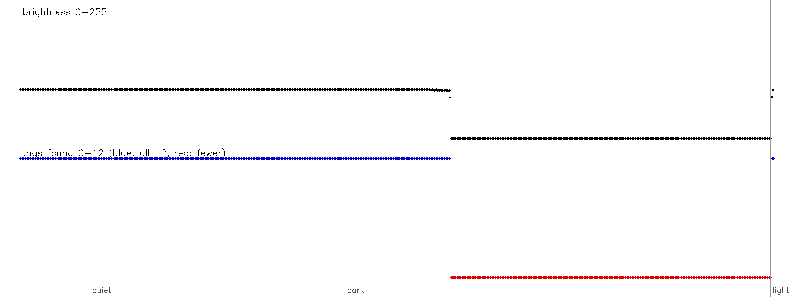

*Figure 15.5l-a. The overnight timeline named above, one point per still from the 20b move to the stop: mean brightness (black, top) and tags found (blue: all 12, red: fewer; here 0 with the lights off), window lines quiet, dark, light. Copied into `docs/figures/` on 2026-10-23 from `~/scratch/round2-shuffles/overnight-timeline-2026-10-20_57f74959.png`.*

### 15.5m Time to read one photo for trays (issue #222, development check, 2026-10-21)

*Development check.* How long the app takes to read one photo for its trays, to decide whether
every photo can be read within the one-minute photo interval.

- **Method.** `tags.detect_tags` timed twice on one still of 20 October with 12 tray tags
  (`experiments/2026-10-20_57f74959/stills/2026-10-21/070359_857510.jpg`), on the rig's Pi 5 with
  nothing else running; then `tray_readings.read_photo` (decode, tag search, placement, database
  write) timed once on each of 24 stills of the same experiment, 07:58 to 08:21 UTC on 20 October,
  against a copy of `rig.db`.
- **Result.** Tag search 8.9 s and 9.0 s, JPEG decode 0.4 s. The whole reading took 9.6 s to
  12.5 s per still over the 24 stills.
- **What it covers.** Tags and tray placement only, with the camera idle. Not covered:
  segmentation (#74), which adds to the time; reading while a photo is being taken. Not measured:
  whether reading delays a scheduled photo taken at the same time (both use the Pi's processor).
  Slowing the schedule when reading falls behind is #251.

### 15.6 Round 1 review

Covers what was found, what surprised us, which phase it sends work back to, and the targets for
round 2. The segmentation part is 15.6a. The trays, tags and tracking part (15.3 to 15.3e, 15.5c,
15.5d, 15.5f to 15.5k) is 15.6b (issue #217). 15.5l is the method of a test run after the review; its results belong to round 2.

### 15.6a Segmentation (issue #161, written 2026-10-16)

From the existing results only (15.5, 15.5b, 15.5e, and the colour gain readings of 15.3d); no
camera, no new analysis. Phase names are the CRISP-DM phases of the round 1 plan (Business
understanding, Data understanding, Data preparation, Modelling, Evaluation, Deployment). The
round 2 targets at the end are Aaron's decisions.

**Accuracy table.**

| What | Label | Result | Raw data | Code |
|---|---|---|---|---|
| Red solids, 4 shapes of 51.6 to 78.5 mm², 92 stills | reference comparison | mean error -20.7% (flat circle) to +39.4% (prism); range -32.1% to +83.2% | stills of experiments `2026-10-12_631bb6b5`, `2026-10-15_83acd97d`, `2026-10-15_44a9e96e`; `experiments/round1-benchy/results.csv` | `benchy.py`, 68ea0ad (#155), record 40c0792 (#160) |
| Rosettes, repeat photos with nothing moved, 9 groups | development check | SD 0.02% to 0.79% of the mean | as above | as above |
| Rosettes, all slots and turns, 92 stills | development check | SD 1.5% (NE) to 3.6% (SW); slot means differ 3.8% (NE) to 13.1% (SW) | as above | as above |
| Rosettes against the photogrammetry mesh | development check | mesh 10.2% (NE) to 38.7% (SW) above the rig; neither known to be right | `experiments/round1-benchy-mesh/` | `mesh_area.py`, 0d6c181 (#208) |
| Real leaves, flat, on blue trays, 27 readings | reference comparison | mean -2.49%, SD 3.15, range -9.10% to +3.43% | `/var/lib/npec-rig/experiments/2026-10-15_44a9e96e/`, scans in `experiments/round1-leaves/scans/` | `leaves.py`, `scan_area.py`, 2b4f8e3 (#163) |
| Real leaves on a black sheet 3 to 10 mm above the tray, 11 slots x 2 sides | reference comparison | top +2.99% (SD 2.26), underside +2.45% (SD 2.47) | as above | as above |

**What was found.**
1. The chain runs end to end on the benchmark and on real leaves: photo, colour threshold,
   pixels to mm², a number per object, with no failed stills (92 benchmark, 32 leaf stills).
2. Flat real leaves on blue trays read 2.49% small on average (SD 3.15). This is the closest
   result to what experiments will measure.
3. Repeating a photo with nothing moved changes the rosette areas by under 0.8%. Moving the
   object to another slot changes them by 3.8% to 13.1%. Position, not the photo, sets the spread.
4. Small flat red shapes read small in every slot (circle -20.7%, sphere -16.4% on average).
   Likely cause, not measured: the threshold leaves out the blurred edge, and at 50 to 80 mm²
   most pixels are edge pixels (expected in 15.1).
5. Rosette height alone makes their tops read 3.4% to 4.7% large (0.145% per mm, section 4). That
   is close to the 5% final target before any segmentation error is added.

**What surprised us, and which phase it sends work back to.**

| Surprise | Numbers | Back to |
|---|---|---|
| Tall objects show their sides toward the row ends | prism up to +75.5%, cylinder up to +44.4%; height alone predicts 1.7% to 2.2% | Business understanding: what the area of a tall plant means when its sides are seen (plant height is a stretch goal, Phase 1). Parallax correction stays deferred: no measured depth source (CLAUDE.md evidence gates) |
| The SW rosette is wider than its calliper diameter on two instruments | calliper 38.68 mm; rig 41.2 to 43.6 mm; mesh 41.00 mm | Data understanding: the reference figure, not segmentation, is the suspect. Re-measure with several readings |
| The rosettes' true area is unknown and the two instruments differ widely | mesh 10.2% to 38.7% above the rig | Data understanding: the benchmark has no reference area for its leaves |
| The background under a leaf changes its area | same leaves about 2.5% small on blue, 2.5% to 3% large on black; lift explains 0.4 to 1.5 of the 5 to 5.5 points | Modelling (how edge pixels pass the green test). Experiments use blue trays only, so this does not apply to them |
| Leaves shrink while being measured | 4.6% to 7.5% in 16 minutes between scans | Data understanding: the known area of a cut leaf is not stable; the reference must be taken closer in time to the photo |
| The white balance gains drift with nothing moved | red 1.994 to 2.012 (0.9%), blue 1.620 to 1.633 (0.8%) in 30 minutes; exposure, gain and lens unchanged | Data preparation: the colour going into the threshold is not fixed. Effect on area not measured |
| Setup, not threshold, breaks the leaf count | touching leaves merge; a leaf next to the benchmark lost 5.4% to 15.9%; pale midribs missed | Data preparation: how leaves are split between trays and objects |

**Methods dropped, with their numbers.**
- Naming the benchmark corners from the least round red piece: wrong by a quarter turn in 6 of
  92 stills. Replaced by orienting from the largest rosette (0 wrong).
- The threshold check (recomputing the benchmark areas at other colour cut-offs): dropped
  (Aaron, 2026-10-15), since real leaves read about 2.5% small with the round 1 threshold.
- Leaf identity by shape match against the scans: agrees with Aaron's record in 26 of 30; the
  record is used.
- The first leaf run, which used the end slots' boxes: cut the black sheet at South 1 and
  South 6; replaced before the results.

**Targets for round 2 (Aaron decides).**

1. **Real leaf area: every flat leaf reading on a blue tray within 10% of its known area**
   (Aaron, 2026-10-16). Round 1 met this in 27 of 27 readings of leaves lying on their own
   (range -9.10% to +3.43%), against the known area read off the line between the two scans
   (15.5b, an assumption; against the before scan the readings are about 2 points lower). The 3
   readings beside the benchmark on North 3 (-5.42%, -10.4%, -15.89%) are left out; 2 of them
   miss 10%. How round 2 checks this target is not yet decided. The final 5% target is taken up
   in round 3 with the per-slot bands on plant area.
2. **White balance: measure first** (Aaron, 2026-10-16). Benchmark green and red area against
   the red and blue colour gains on the 123 saved stills of the unattended run (15.3d), no camera
   needed. Fixing the colour balance for an experiment, the way focus is fixed, is decided from
   that result. *Replaced 2026-10-19 (Aaron):* no separate white balance study. The round 2 run
   measures area jumps between photos with nothing moved (#223), which include any effect of the
   gain drift; every photo records its gains, so they are checked against the jumps only if the
   run shows jumps.
3. **Benchmark plants of known area** (Aaron, 2026-10-16). Aaron gets benchmark plants with known
   surface areas from the supervisor, from the week of 19 October; round 2 measures them on the
   rig against those areas. To check when they arrive: whether the known figure is the area seen
   from above (what the rig measures) or the full leaf surface, which is larger for any leaf not
   lying flat. The current benchmark's rosettes stay a repeatability check; the SW calliper
   diameter stays open.
4. **Tall objects at the row ends: left for later** (Aaron, 2026-10-16). No round 2 work and no
   target. Recorded as open; parallax correction stays deferred until a measured depth source
   exists.

Not made round 2 targets, recorded as open: the edge loss on small flat shapes, the blue against
black background gap (experiments use blue trays only), the shrinking of cut leaves between
scans, and leaves that touch or lie next to another green object (part of tray splitting, 15.5c).

### 15.6b Trays, tags and tracking (issue #217, written 2026-10-19)

From the existing results only (15.3 to 15.3e, 15.5c, 15.5d, 15.5f to 15.5k); no camera, no new
analysis. Phase names as in 15.6a. The round 2 targets at the end are Aaron's decisions. Every
result here is a *development check*: trays and tags found, placed or followed, with no true
area. The known answers are the recorded moves (15.3, 15.5f, 15.5h) and the shuffle maps posted
on #213 before the stills (15.5i), not an independent measurement. All stills: calibration
`20261014T111147292361`, validation `20261014T111253582634`, lens 6.05.

**Accuracy table.** Raw data files are in `experiments/round1/` and `experiments/round1-trays/`;
the stills are in the rig's photo folders under `/var/lib/npec-rig/`.

| What | Result | Raw data | Code |
|---|---|---|---|
| 20 mm paper tray tags, the rig's frozen detector settings (15.3b, 15.3d, 15.3e) | missed 8 of 102 sightings (session 1), 47 of 171 (round 2), 165 of 1107 (one hour, nothing moved); 30 mm tags missed 1 of 171 and 1 of 1107 | experiment "tag-testing"; `tag-detector-stills.csv`, `run-2026-10-15-tags.csv` | `tag_detector_check.py`, `run_analysis.py`, 830e4da (#156) |
| The same tags, finer bit sampling (setting C, 15.3c to 15.3e) | missed 0 of 102, 0 of 171 and 0 of 1107; same time per still (4.19 s); calibration and corner tag corners 0.000000 px from the frozen settings (1043 tags, 7 stills) | as above, `tag-detector-corners.json` | as above; adopted for tray tags in a6588c8 (#192) |
| FastSAM tray splitting on the Hailo-8, empty trays, 15 October (15.5c, 15.5d) | 2078 of 2112 trays measured right (98.4%), 31 more patched; 159 of 176 stills all right; gaps 396 of 396 | `fastsam-full176*.csv`, `track-full176*.csv` | `fastsam.py`, `track.py`, 2e532a9 (#164), e523a45 (#171) |
| Tray position spread with nothing moved, 15 October (15.5d) | step 1 rms 1.8 mm, max 6.3 (120); one hour rms 4.0 mm, max 48.8 (1442, after removing 7 positions over 50 mm off) | `track-full176.csv` | `track.py`, e523a45 |
| 20 mm edge tag lands on its own tray (15.5c) | 804 of 852 (94.4%) right, 25 right but merged, 23 on no tray, 0 on the wrong tray | `edge-tags.csv` | `edge_tag_check.py`, a6588c8 |
| FastSAM with pots in the wells, edge tags naming trays, 19 October (15.5f) | gaps 226 of 228 trays; touching 825 of 1476 (56%) raw, 1101 (75%) after patches, 0 of 123 stills all right | experiment "pots-2026-10-19"; `fastsam-pots19*.csv`, `track-pots19*.csv` | `fastsam.py`, `track.py`, a9f9d7b (#213) |
| FastSAM with pots, cell A1 tags naming trays (15.5h) | gaps 222 of 228; touching 19 of 36 (53%) raw, 27 of 36 after patches | `fastsam-cell19*.csv`, `track-cell19*.csv` | as above |
| Tray placed from its tag, one offset per tray, against FastSAM's mask centre (15.5g, 15.5h) | edge tags: median 20.8 mm with gaps, 23.1 touching, max 170.2; cell tags: median 18.5 with gaps | `footprint-pots19.csv`, `footprint-cell19.csv` | `footprint.py`, a9f9d7b |
| Tray placed from its cell A1 tag, one common offset for every tray (15.5h) | all 264 tray positions placed in 22 stills; against FastSAM's mask centre median 8.4 mm with gaps (95th percentile 17.3, max 32.3, 102 positions), 11.4 mm touching (19) | `footprint-cell19-common.csv` | `footprint.py --common`, a9f9d7b |
| The same, through 5 random shuffles plus one repeat, turn from the tag heading (15.5i) | 197 of 216 tray positions in the planned slot and turn: tray 6 wrong in 18 of 18 stills (its tag lay 180 degrees round), tag 1 not found once | experiment "simple segmentation test" (`2026-10-19_ad4876e5`); `shuffle-2026-10-19_ad4876e5.csv` | `shuffle.py`, a9f9d7b |
| The same stills, turn from the slot grid, tag in any rotation (15.5j) | 215 of 216 right, 0 wrong, tag 1 not found once; the other candidate at least 152.4 mm further from a slot | `shuffle-2026-10-19_ad4876e5-any.csv` | `shuffle.py --any-rotation`, 81c86ff (#217) |
| The same rule, tags in 0, 90, 180 and 270 degree rotations, trays turned, pushed together and shuffled, 8 layouts (15.5k) | 288 of 288 tray positions in the slot and corner Aaron set (checked by Aaron after the analysis); candidates at least 157 mm apart | `shuffle-2026-10-19_ad4876e5-rotations.csv` | as above |

**What was found.**
1. The chain from photo to a named tray in a slot runs end to end on 176 stills of empty trays
   and on 182 stills of trays with pots, on the Pi 5 and Hailo-8, with no failed stills.
2. 20 mm paper tags are read reliably once the detector samples each pattern square more finely
   (setting C): 0 misses in 1380 sightings against 220 with the frozen settings, at the same time
   per still, with the calibration corners unchanged. Tray tags now use it (#192).
3. With gaps between trays, FastSAM splits them with or without pots (396 of 396 trays right
   empty, 222 to 226 of 228 with pots). With trays touching it splits empty trays (15 October) but not trays
   with pots (19 October, 53% to 56% raw).
4. A 30 mm tag lying flat in the empty cell A1 places its tray with no splitting at all: one
   offset common to every tray puts the outline on the tray in every still checked by eye,
   touching or not. Taking the tray's turn from the slot grid rather than the tag heading, it
   placed 215 of 216 tray positions through five random shuffles (15.5j), and 288 of 288 with
   tags in all four rotations, trays turned, pushed together and shuffled (15.5k).
5. Where nothing moves, a tray's position repeats to about 2 mm rms (empty trays and pots, gaps).

**What surprised us, and which phase it sends work back to.**

| Surprise | Numbers | Back to |
|---|---|---|
| The tag design taken forward is not the one decided | decided: 20 mm, 3D printed, on the tray's outside edge (Aaron, 2026-10-15); taken forward: a 30 mm tag lying in cell A1, which keeps A1 free of plants | Business understanding: where the tray tag sits, its size, and whether one cell per tray can stay empty |
| Pots in the wells stopped FastSAM splitting touching trays, and the tag was ruled out as the cause | touching, raw: 98% of trays right empty (15 October), 56% with pots and edge tags, 53% with pots and cell tags | Modelling: why FastSAM sees three touching trays with pots as one object (traced on 2 stills only) |
| One tag lying the other way round in its cell moved its tray one slot, with no warning | tray 6 wrong in 18 of 18 stills; nothing in the result marked it | Modelling: operators will not follow a rule on which way round a tag lies (Aaron). Fixed in 15.5j by taking the turn from the slot grid: 215 of 216, 0 wrong |
| A paper edge tag turned on its tray between steps | tray 14's tag turned about 11 degrees; its placement then about 61 mm off | Data preparation: tags must be fixed to the tray (3D-printed tags, #70) |
| A tag print lying anywhere in view is read as a tray | ID 29, an offcut in a waste bin at the frame edge, read in 3 to 4 of 123 stills | Deployment: discarded prints leave the chamber, or tags outside the table are ignored |
| Swaps were found by construction, not as evidence | 48 of 48 swaps found; a mask takes its tray from the tag within 60 mm, so it follows its tag | Evaluation: tracking is judged by false moves and position spread, not by swaps found |
| One common offset sits closer to FastSAM's masks than each tray's own learned offset | median 8.4 against 18.5 mm with gaps | Evaluation: not explained. Neither is checked against a measured tray edge |
| The tray outline from the blue threshold reads 2% long north to south | 373.6 mm against 366.0 by tape; east to west 306.0 against 305.0 | Data understanding: not explained, recorded (15.5c) |

**Methods dropped, with their numbers.**
- Slot from the tag alone, nearest slot centre (15.5c method A): each tray on its own slot in 6
  of 33 stills; the slot centres come from where the calibration sheets lay, not from the trays.
- Blue threshold (15.5c method B): 0 of 33 stills passed; 40 of 396 trays were one shape of one
  tray. Methods C to E (built on B) were not run; FastSAM (F) was added instead.
- FastSAM tray splitting (15.5c to 15.5h): 53% to 56% of touching trays right with pots, raw.
  Dropped for placement from the cell tag (15.5h). With it go the three patches of 15.5d and the
  open question of 15.5d's slot reference, both of which existed only for FastSAM.
- Edge tags for placing a tray (15.5g): offsets up to 49.7 mm apart between trays, and a paper tag
  that turned about 11 degrees. The cell tag's offsets lie within 18.1 mm.
- One learned offset per tray (15.5g, 15.5h): replaced by one common offset (median 8.4 against
  18.5 mm from FastSAM's masks with gaps).
- The tray's turn from the tag heading (15.5i): 18 of 216 wrong, all from one tag lying 180
  degrees round. Replaced by the turn from the slot grid (15.5j, 0 wrong).
- The 20 mm paper tag with the frozen detector settings: 220 misses in 1380 sightings; replaced by
  setting C for tray tags (#192).

**Targets for round 2 (Aaron decides).**

1. **Tray placement: no tray in a wrong slot without a warning, and at least 95% of tray
   positions placed** (Aaron, 2026-10-19). A tray that is not placed is shown as not placed.
   Checked on the round 2 multi-day run. Round 1, cell tag: 197 of 216 with the turn from the
   tag heading (15.5i, 18 wrong with no warning); 215 of 216 with the turn from the slot grid
   (15.5j, 0 wrong, 1 tag not found), which meets both parts on those 18 stills. This is the
   success rate left open in 15.5c and 15.5d (moved here from #171).

2. **Tray tag: about 40 mm, lying roughly centred in cell A1** (Aaron, 2026-10-19, being prepared).
   Replaces the 20 mm edge tag for round 2; A1 holds no plant. Not yet tested: each print is
   measured with callipers, and the common offset of 15.5h (learned with 30 mm tags) is learned
   again for the new tag before it is used.

3. **Tags in any rotation** (Aaron, 2026-10-19): placement must work with the tag lying any way
   round, A1 at the south-west or north-east, since operators will not follow a positioning rule.
   Done for 12 trays: 15.5j, and 15.5k with tags in all four rotations (288 of 288).

Still to be decided at the review: the outline against a measured tray edge.

## 16. Round 2 run: the potato experiment (issue #221, method written 2026-10-22, after the run started, before any analysis)

**Label: development check.** How steady each tray's readings are from one photo to the next over
several days, how often each tray's tag is found, and whether the rig follows the trays through
shuffles, with no true area. The results are written up under issue #223.

**When this was written.** The run is the experiment "Potato Plants v001", which started at
08:40:51 UTC on 22 October 2026 (Aaron decided that morning that it is the Round 2 run). This
method was written later the same day, from the first photos' records only: no result of the run
had been looked at. An earlier draft (2026-10-19, two parts, no plants, 20 mm edge tags) is replaced
by this one.

**Questions.**
1. **Steadiness.** With nothing moved, how much does each tray's reading change from one photo to
   the next? Today the reading is the tray's placed centre; area is added when the green-area
   segmenter (issue #74) exists.
2. **Tag detection.** In what share of photos is each tray's tag found, per tray, per day and per
   window of the day?
3. **Tray tracking.** After each shuffle, is every tray read in the slot and A1 corner its shuffle
   map gives?

### 16.1 Setup

- **Experiment** "Potato Plants v001" (id 18, folder `experiments/2026-10-22_df206967`), one photo
  every 60 s from 08:40:51 UTC on 22 October. Calibration `20261022T072523939958`, validation
  `20261022T072759980696` (Validated 2026-10-22), lens position 6.05, all as recorded in each
  photo's `capture` row.
- **Trays.** 12 trays of 4 x 5 cells in portrait, one 40 mm tag in cell A1 each (IDs 1 to 12),
  in any rotation. Trays 1 to 7 hold potato plants, for the collaborator's own experiment. Trays 8
  to 12 hold black pots and no plants (Aaron, 2026-10-22). The plastic benchmark "Benchy Yellow-4"
  is taped to tray 8 for the run, from a time to be noted in the events log.
- **The still scene** is trays 8 to 12: nothing in them grows, so a change in their reading
  between two undisturbed photos is the rig's own error. Trays 1 to 7 are reported apart: their
  change includes growth and leaf movement, which nothing in this run measures apart.
- **The rule of the run:** the lens is not moved, and calibration and validation are not redone
  while it runs (operator guide; a run that needs either is stopped and the change noted).
- **Disk.** The stills average 5.6 MB (22 stills, 22 October). At one a minute that is about 8.1
  GB a day; 838 GB were free, so the disk lasts about 100 days.

### 16.2 Shuffles and the events log

- **Shuffle maps.** `experiments/round2-run/shuffle_maps.py` draws 12 maps from seed 20261022
  (`sessions/shuffle-maps-2026-10-22.json`, committed before any tray was moved). Each puts trays 1
  to 7 in 7 of the 8 middle slots (North and South 2 to 5), as the collaborator's experiment
  prefers, and trays 8 to 12 in the others, with cell A1 at the south-west or north-east corner;
  no tray stays in its slot from one map to the next. **Map 0** is the layout at the start, not
  drawn but read by the rig (tray readings) from the still of 09:11:53 UTC: every one of the run's
  32 photos from 08:41:20 had the trays in those slots, one (08:55:53) missing tray 2. Printed in
  black and white, one per page;
  the PDF that was printed is committed beside the JSON (`sessions/shuffle-maps-2026-10-22.pdf`).
  Running the script again refuses to change the committed answer: it only writes the PDF again,
  and stops if its layouts differ from the JSON.
- **Who and when.** The collaborator shuffles about 3 times a week, within the shuffling window
  (PLAN.md, Round 2): 09:30 to 16:10 chamber time. Each tray is ticked on the map when it is in
  place; the date and the times the shuffle started and finished are written at the top (Aaron,
  2026-10-22: no time per tray). The maps come back to Aaron, who posts the times on #221; the agent
  converts chamber time to UTC (UTC+2 to 24 October, UTC+1 from 25 October).
  Each post is copied as written into `sessions/chamber-times-2026-10-22.csv` (chamber time);
  `chamber_times.py` makes the UTC shuffles and events files from it, and stops, naming the row,
  on a finish before its start, a shuffle time outside 09:30 to 17:00, an unknown map, a map used
  twice, or shuffles out of order or overlapping (added 2026-10-22, before the first shuffle).
- **Events log.** Anything else that happens in the chamber (door opened, a tray moved or watered
  outside a map, the benchmark taped on) is posted on #221 with the local time.
- The collaborator is named in no record of this run (Aaron, 2026-10-22).

### 16.3 Light, movement and undisturbed pairs

- **Light is read from the photos, not the clock.** A photo is *dark* when no tag of any kind is
  found in it (status `no tags found`), *lit* otherwise. 15.5l measured the lights off from about
  01:29 to 09:02 chamber time, not 23:00 to 09:30 as PLAN.md assumed, so a clock window would
  count lit photos as dark. Dark photos are kept and counted apart.
- **Movement is by the clock.** Trays may be moved from 09:30 to 17:00 chamber time (the shuffling
  window, 09:30 to 16:10, and the 50 minutes after it). From 17:00 to 09:30 nothing is moved. Every
  photo is in exactly one of the two. Results for questions 1 and 2 are reported per movement
  window and per lit or dark.

A pair of consecutive photos is **undisturbed** when all of these hold:

1. No shuffle and no events log entry falls between the two photos.
2. Both have the same calibration and lens position, and neither has a flag (the `flags` list of
   its `capture` row, for example a lens check or a cold start).
3. Both were read with the status `read` (tags found and trays placed).
4. They are at most 2 intervals (120 s) apart: no missed photos between them.
5. No app start and no camera event falls between them: the later photo's app uptime is longer
   than the time between the two, and `camera_events` has no row between them. Cold starts and
   camera faults were measured to shift readings (6 October, lens landing).

Only undisturbed pairs are used for question 1. Other pairs are counted, with the reason.

*Changed 2026-10-22, from the code review of #265, after the first tables of the run (to about
11:00 UTC, check-in 1) had been shown to Aaron; the changes come from the review, not from those
tables, and none changes them (no pair there was 120 to 150 s apart or lacked an uptime, and no
placement was marked).* Rule 4 is
applied as at most 150 s (2.5 intervals): photos come 59.4 to 60.9 s apart, so a pair with one
photo missed between them is 119 to 122 s apart, and an exact 120 s limit kept or dropped it by
chance. Rule 5: a photo whose app uptime is not recorded leaves its pair out with the reason "app
uptime unknown", not as a restart. Question 3: a tray whose placement the app marked other than
"placed" ("close call", "two trays in one slot") is counted as *doubtful*, apart from right and
wrong, and listed.

### 16.4 Analysis

- **Data.** The rig's own tray readings (`tray_read`, `tray_reading`, issue #222), read from a copy
  of `rig.db`; scripts and results in `experiments/round2-run/`. Nothing is written into the
  experiment folder or the live `rig.db` by analysis.
- **Question 1.** For each tray and each undisturbed pair, the change in the placed centre, in mm
  (pixels over the calibration's scale at that point). Reported per tray and per window: number of
  pairs, the root mean square change and the largest. Area changes the same way, as a percentage,
  once area exists. Still scene (trays 8 to 12) and plant trays (1 to 7) in separate tables.
- **Question 2.** For each tray, per day and window: photos read, photos with its tag found, and the
  share. Photos with no tag at all (dark) are counted apart. Each photo where one tray was missed
  while others were found is listed by its time, to be looked at. For check-ins (added 2026-10-23, Aaron):
  `misses_chart.py` gives a table per tray and bar charts of the misses outside shuffles by tray ID
  and by the slot the rig last read that tray in (the tray's own slot cannot be read when its tag
  is missed; a tray moved without being seen would be counted under its old slot).
- **Question 3.** For each shuffle, every photo from its finish time to the next shuffle's start: for each tray, right (slot and corner as the map), wrong, or not found. Reported per
  shuffle; every wrong reading is listed.
- No threshold is set for what size of change matters. Results are reported as measured; any
  target is Aaron's decision, labelled as one.

### 16.5 Length, and what is still open

- **Length** (Aaron, 2026-10-22): until 5 November, the end of Round 2, with the option to extend:
  the plants will likely stay in the chamber. The Round 2 results use the photos up to the end of
  5 November (chamber time); photos after it are reported apart if the run is extended. 12 maps at
  about 3 a week last to about 19 November; the disk lasts about 100 days (16.1).
- **Benchmark time** (found 2026-10-23, Aaron confirmed): the benchmark was put on tray 8 between
  the photos of 09:32:53 UTC (black pots, no benchmark) and 09:33:53 UTC on 22 October (benchmark
  on its card, the pots taken out, a person at the frame's edge and a pot on the table), 11:33
  chamber time. Found from the green-pixel count of every photo from 09:30 to 09:59 UTC (190 to
  265 before, 972 to 1145 after, at 800 px wide) and checked by eye
  (`~/scratch/benchmark_time_check.jpg`). Aaron's own record said 11:53; the photos show no change
  then. Posted to the events log on #221.

### 16.6 Limits of the evidence (as planned)

One chamber, one camera, one lens position, one calibration. 12 trays of one kind (4 x 5, portrait),
40 mm paper tags. The still scene is 5 trays of black pots; plant growth and leaf movement are not
separated from the rig's error in trays 1 to 7. Shuffles only in the middle and end slots the maps
give, with plant trays always in the middle. Not covered: 4 x 4 and 1 x 1 trays, fewer than 12
trays, a lens moved, other chambers.

The method was written after the run started (see above), which is against this log's rule that
a method comes before its test. What that means: no result had been looked at, so the questions,
pairs and tables were not chosen from the data; but the run itself (trays, interval, positions)
was set before the method existed, so nothing in it was designed for these questions. The results
are development checks and are to be read that way.

### 16.7 The analysis checked on the 20 October capture (issue #223, method written 2026-10-22, before the full check)

**Label: development check.** Whether the analysis of 16.4, fed the app's own tray readings,
gives what 15.5l found on the same photos. It checks the analysis and the app's readings, not the
rig: 15.5l is the known answer.

**Data.** Experiment 16, "tray tracking 26.10.20" (folder `2026-10-20_57f74959`), 1391 photo
records. `experiments/round2-run/read_photos.py` copies `rig.db` (sqlite backup from a read-only
connection) and the calibration folder to `~/scratch/223-analysis/exp16/`, and reads every photo
with `tray_readings.read_photo` (#222) into the copy. The live `rig.db` and the experiment folder
are only read. About 13 s per photo, at low priority while the potato run's reader runs.

**Compared** (`check_oct20.py`, against 15.5l's output files in `experiments/round1-trays/`):

1. **Still by still, tray by tray** (`shuffle-day-2026-10-20_57f74959.csv`): tag found or not,
   slot, A1 corner, and the placed centre within 1 mm (a decision; the CSV rounds centres to the
   pixel, about 0.1 mm).
2. **Lit and dark** (`overnight-2026-10-20_57f74959.csv`): each still with all 12 tags should be
   status `read` with 12 trays; each still with no tag, status `no tags found`. 15.5l: 613 and 452.
3. **Tracking against the layouts as laid out** (`sessions/as-laid-out-2026-10-20.json`): the 20
   October maps with layouts 3, 11 and 12 changed to what Aaron recorded from the pictures. His
   notes for layouts 3 and 11 give slots only; the A1 corner of those 4 trays is the one the rig
   found, which 15.5l says Aaron confirmed tray by tray. 15.5l: 0 wrong.

**Not the same numbers as 15.5l, and why.** 15.5l split layouts where the tags moved, counted only
*settled* stills (its 5 mm rule), and gave steadiness as the spread about each layout's mean. 16.4
counts every read photo between a shuffle's finish and the next start, and gives steadiness as the
change between undisturbed pairs. 20 October has Aaron's leave times only, no start times, so each
layout's finish is its first settled still in 15.5l and the next shuffle starts 1 s after the last
still before the trays moved. The tracking counts and the steadiness of 16.4 are therefore new
numbers on these photos, not a repeat of 15.5l's tables. Every difference in comparisons 1 and 2
is listed, not tuned away.

**Before the full check** (2026-10-22, on the photos read by then, to test the scripts): 424 of
424 tray positions compared had the same slot and corner as 15.5l, centres at most 0.27 mm apart.

### 16.8 Observations during the run: tray tags missed with nothing in the way (issue #223, 2026-10-22)

**Label: development check.** Looked at because tray 2 was missed twice (the trigger on #223).

From the analysis to about 11:00 UTC (16.4, question 2), 3 photos each missed one tray while
the other 11 tray tags were found: capture 1972 (08:55:53 UTC, tray 2), 2007 (09:30:53, tray 2) and
2039 (10:02:53, tray 6). Map 0 throughout, trays 2 and 6 are plant trays.

- **The tag looks the same.** A crop around the tag in each missed photo and in the photos either
  side (`~/scratch/223-analysis/misses/`) shows no leaf, hand or object over it, and no blur.
  Mean grey level of the crop: 112.7 to 112.9 for tray 2 and 137.4 for tray 6, the same in all 3
  photos of each group. Sharpness (variance of the Laplacian): 57.5 to 63.1 and 100.3 to 101.5, the
  missed photo inside the range of its neighbours.
- **The miss is in the detector's choice between candidates, not in the tag.** Running the
  detector again (OpenCV 4.10 ArUco, the tray settings of `tags.detect_tags`) on the full photo
  repeats the miss every time. On a crop around the tag (900 x 900 px up to 4768 x 4221 px) the
  same photo finds the tag, with all 28 border bits and all 36 code bits right. The tag's square
  is 192 to 198 px across (about 0.2 mm per pixel).
- **What takes its place.** In each missed photo the detector rejects a larger four-sided shape
  around the tag, sides 308 to 399 px, lying on the dark edge around the white tag tile (seen in
  the crops). In the photo before (092953, measured), no such shape is among the rejected ones. The average distance between that shape's
  corners and the tag's is 101 px (2 photos measured). OpenCV puts two candidates in one group
  when that distance is under `minMarkerDistanceRate` (default 0.125) times the smaller one's
  perimeter, here 0.125 x 792 px = 99 px, keeps the largest of each group, and tries the others
  only when their corners lie close to the largest one's (OpenCV 4.10 source,
  `ArucoDetectorImpl::filterTooCloseCandidates` and `identifyCandidates`). The rim shape is the
  largest, cannot be read, and the tag is dropped with it. The one shape reported lies at 101 px,
  just over 99 px; the detector runs 9 threshold window sizes and may form a slightly different
  shape at each (not checked), and the grouping depends on the order candidates are visited, so
  this is the likely mechanism, supported by the tests below, not proven step by step.
- **Tests that support it.** Full photo, tray settings with one change each:
  - one threshold window size alone (each of 11, 21 to 91): tag 2 found in 085553 at every size;
  - grey over the right part (x from 4768 px) or the top part (y under 3723 px), far from the
    tag: found, so content far from the tag changes the grouping;
  - `minMarkerDistanceRate` 0.10: found in 2 of the 3 missed photos (085553, 100253), not in
    093053; 0.08 and 0.05: found in 085553 and 093053 (100253 not run at these). The photos
    before still found their tag: 085453 at 0.10 (all 12 tray tags), 092953 at 0.08 and 0.05.

**Not known.** Why the rim forms a closed four-sided shape in some photos and not in others that
look the same, and why crops do not form or group it the same way. How often it happens over the
run: 3 of about 1660 tray-tag reads to 11:00 UTC. Whether a smaller `minMarkerDistanceRate` for
tray tags changes anything else: not tested on the 15.3e stills or the 20 October photos. No code
was changed.

### 16.7 results: the check on 20 October (2026-10-23)

`read_photos.py ~/scratch/223-analysis/exp16 --experiment 16` read 1390 photo records (1 was
already read in the live `rig.db` and came with the copy) from 10:41 to 14:51 UTC on 22 October;
2 had no image (below). Then `check_oct20.py` (23 October); printout
`~/scratch/223-analysis/out/oct20.txt`, tables `oct20-*.csv`; misses chart, Figure 16.7a.

| Compared with 15.5l | 15.5l | The app's readings, this analysis |
|---|---|---|
| Tray positions, tag found or not (1391 stills x 12) | 16692 | 16692 the same, 0 different |
| Of those found, same slot and A1 corner | 11113 | 11113 the same, 0 different |
| Placed centre within 1 mm | | 11113, largest difference 0.29 mm |
| Lit stills with all 12 tags | 613 | 613 read with 12 trays |
| Stills with no tag | 452 dark + 1 light coming up | 453 `no tags found` |

**Tracking against the layouts as laid out** (16.4, question 3; every read photo from a layout's
first settled still to the next move, not only settled ones):

| Layouts | Read photos | Right | Wrong | Doubtful | Not found | Not read |
|---|---|---|---|---|---|---|
| 2 to 19 (the day's shuffles) | 278 | 3285 | 0 | 0 | 51 | 1 |
| 2 to 19 and 20b (to the stop next morning) | 891 | 10641 | 0 | 0 | 51 | 455 |
| 1 (learning layout, apart) | 6 | 72 | 0 | 0 | 0 | 0 |
| 20a (not as planned, apart) | 4 | 20 | 28 | 0 | 0 | 0 |

The 51 not found are more than 15.5l's 47 because photos 15.5l left out as not settled are
counted here; the 455 not read are the 453 dark stills and the 2 records with no image. The 28
wrong in 20a are 7 trays turned from the map in 4 photos, as 15.5l found (3 settled stills there).

**Steadiness** (16.4, question 1; a new number on these photos, change between undisturbed
pairs, not 15.5l's spread about a layout's mean). Pairs: 876 undisturbed; 57 across a shuffle;
454 next to a photo not read (the 453 dark stills); 4 next to the 2 records with no image (no
calibration); 1 with photos missed (07:53 to 07:56, the interval change). The camera event of
11:00:46 UTC was written by a unit test (#241) and is not counted as one.

| Window | Pairs per tray | rms change per tray | Largest single change |
|---|---|---|---|
| Nothing moved (17:00 to 09:30, lit photos only) | 512 | 0.13 to 0.78 mm | 2.46 mm (tray 10) |
| Trays may move (09:30 to 17:00, people in and out) | 344 to 364 | 0.27 to 0.71 mm | 10.17 mm (tray 6) |

**Two records without an image.** Capture 725 (11:00:48 UTC) and capture 912 (14:06:48 UTC), both
lens position 1.0, exposure 20000 us, no calibration and no image, came with the copy and were
counted as not read. Both were written by unit tests into the live `rig.db` (cause found under
#241, written up in 15.5l above); they are 2 of the 6 such records, to be ignored by any analysis.

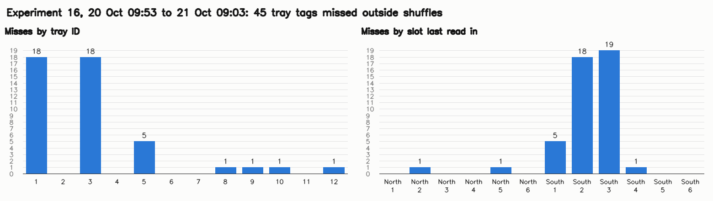

*Figure 16.7a. 20 October, misses outside the moves 15.5l found, by tray ID and by the slot the
rig last read the tray in: 45, of which 36 are trays 1 and 3 in South 3 and South 2 in layout 19,
most likely the folder and phone laid on them then (15.5l; not checked crop by crop here). Outside
a move is not the same as nothing in the way: only a crop tells them apart. Made with
`misses_chart.py ~/scratch/223-analysis/exp16 --experiment 16 --shuffles
~/scratch/223-analysis/out/oct20-shuffles.csv` (the shuffles file made from 15.5l's moves, as
`check_oct20.py` does).*

**What this shows.** Fed the app's own readings of the 20 October photos, the analysis gives
15.5l's answers tray by tray and still by still: the same tags found, the same slot and corner for
every one, centres within 0.29 mm, the same lit and dark stills, and against what was laid out
no tray in a wrong slot or corner. So the app's readings (#222) and this analysis can stand in
for 15.5l's scripts on the potato run. **Not shown:** that the analysis is right where 15.5l was
not checked (steadiness between pairs, the clock windows, doubtful placements: none occurred);
plants; more than one calibration in an experiment.

**All misses of the run's first day, the same test** (2026-10-23, before #264's test). The 12
misses with the lights on from 08:55:53 UTC on 22 October to 07:01 UTC on 23 October (13 in
all; the 13th, 07:00:53 UTC, is the lights coming on and is left out). For each: the full photo
with the tray settings, then `minMarkerDistanceRate` 0.08 and 0.05; the tag's corners from the
photo before. Script `experiments/round2-run/miss_grouping.py`; printout
`~/scratch/223-analysis/misses/run168.txt`.

| Time (UTC) | Tray | Larger rejected shape near the tag: average corner distance | Threshold 0.125 x perimeter | Found at 0.08 | Found at 0.05 |
|---|---|---|---|---|---|
| 08:55:53 | 2 | 101.6 px | 99.1 px | yes | yes |
| 09:30:53 | 2 | 101.1 | 99.1 | yes | yes |
| 10:02:53 | 6 | 72.7 | 96.7 | yes | yes |
| 11:23:55 | 10 | 95.8 | 97.6 | yes | yes |
| 13:33:54 | 8 | 84.6 | 98.7 | yes | yes |
| 13:53:55 | 12 | 82.5 | 97.8 | yes | yes |
| 14:12:55 | 8 | 84.7 | 98.7 | yes | yes |
| 17:20:53 | 8 | 84.0 | 98.8 | no | yes |
| 18:49:53 | 8 | 83.9 | 98.8 | no | yes |
| 20:05:53 | 10 | 95.9 | 97.6 | no | yes |
| 20:17:53 | 8 | 85.3 | 98.8 | yes | yes |
| 22:50:53 | 7 | 104.6 | 97.7 | yes | no |

- **Every miss has the larger shape.** In all 12, exactly one larger four-sided shape is
  rejected within 150 px of the tag's centre, 72.7 to 104.6 px from its corners on average.
- **A smaller setting finds them, but not always the same one.** 0.08 found 9 of 12, 0.05 found
  11 of 12; each was found by one of the two. 22:50:53 is found at 0.08 and missed at 0.05, so a
  smaller value is not simply better: the grouping depends on more than the distance (16.8
  above). Choosing a value is #264.
- **Nothing else changed in these photos.** At 0.05, each photo found the same tray tag IDs as
  with the tray settings, plus the missed one; no other ID appeared.
- **Where.** Tray 8 has 6 of the 12, all in South 6 (the slot it was last read in); trays 2 and
  10 two each (South 2, North 2); trays 6, 7 and 12 one each.

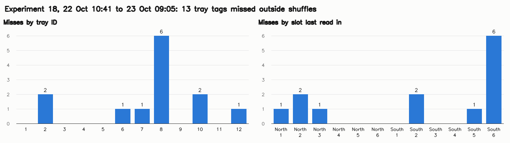

*Figure 16.8a. The potato run's misses outside shuffles (there was none yet), 22 October 10:41
to 23 October 09:05 chamber time, 895 lit photos: by tray ID (left) and by the slot the rig last
read the tray in (right), 13 in all including the lights coming on at 07:00:53 UTC. Made with
`misses_chart.py ~/scratch/223-analysis/exp18 --experiment 18 --shuffles
sessions/shuffles-2026-10-22.csv` from a copy of `rig.db` made on 23 October.*

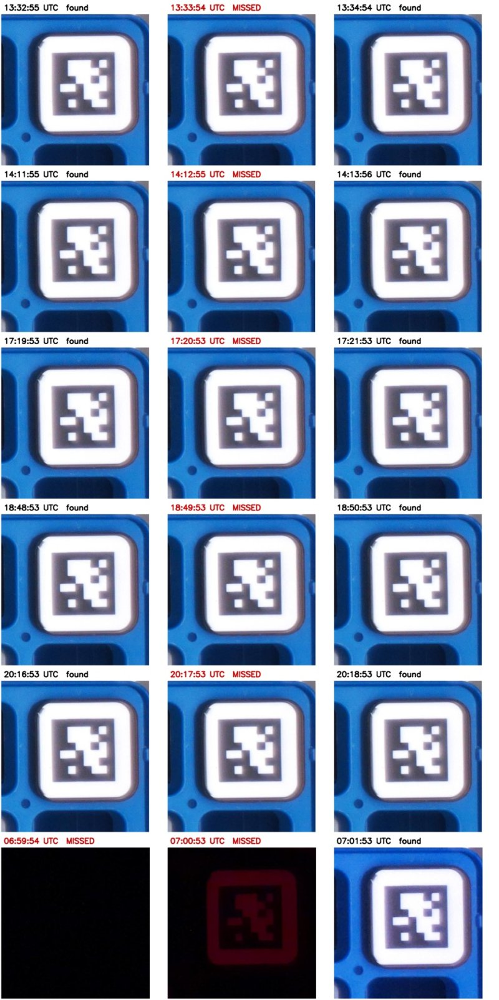

*Figure 16.8b. Tray 8, the 6 misses: each row is the photo before, the missed photo and the photo
after, cropped around the tag (520 x 520 px, scaled down). Rows 1 to 5 look the same as their
neighbours (mean grey 125.1 to 125.9, sharpness 39.8 to 45.0). Row 6 is the lights coming on
(07:00:53 UTC): the photo before is dark, the missed one dim and red. Cropped from the stills of
`experiments/2026-10-22_df206967`.*

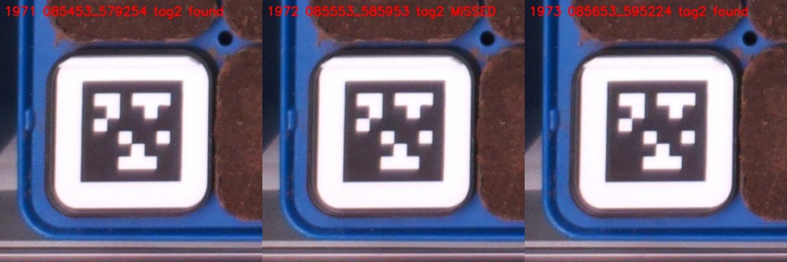

*Figure 16.8c. Tray 2 at 08:55:53 UTC, the first miss of the run (#223 observation 1), with the
photos either side; no difference to be seen. Tray 6 at 10:02:53 UTC looks the same way
(`figures/16.8/tray6-miss-100253.jpg`).*

## 17. Plant area per tray on the potato run (issues #74, #75, method written 2026-10-23, before the analysis)

**Label: development check.** What the rig's plant area per tray reads on the Round 2 run (section
16), how often it fails, how far it moves with nothing changed, and how much an empty tray reads.
No true area is known for any tray, so nothing here says how close an area is to the truth.

**When this was written.** The green threshold went into the app on 23 October (#280), and plant
area per tray at 11:24 UTC the same day (#281). At 12:40 UTC every photo of the run was queued to be
read again with areas (Reprocess, #75 part 2). This section was written while that ran, before any
area series of the run was looked at. What had been seen by then is listed in 17.1, each from one
photo or a handful; the questions in 17.2 were written knowing those figures.

### 17.1 Observations before the review (23 October)

Each is a development check from the photos named, on the rig's Pi 5 with the live server running
(the camera taking one photo a minute). Calibration `20261022T072523939958` throughout.

- **The method.** A pixel is plant when its normalised excess green (2g - r - b) / (r + g + b) is
  above 0.1 and green is above red (`segmentation.ExGSegmenter`), round 1's threshold (15.5,
  15.6a), not tuned for this run. It is applied to the full-size 9152 x 6944 photo. A tray's area
  is its plant pixels inside the tray outline (tray placement, 15.5g), each weighted by the scale
  field at its 64 px block. Each reading also stores the pixel count, their centre and the
  calibration used (#75 part 2), so another calibration can be applied later.
- **Colours used in the tests.** Mean RGB of 12 x 12 px patches of the still of 08:35:53 UTC
  (`experiments/2026-10-22_df206967/stills/2026-10-23/083553_637710.jpg`): benchmark mint leaf
  156, 228, 188 (passes); dark soil 95, 58, 55; pale soil 146, 95, 88; blue tray 39, 88, 159 and in
  shade 14, 49, 101; black pot 11, 10, 15; yellow benchmark card 254, 224, 54; grey table 235, 227,
  240 (all fail). One patch each, one photo.
- **The potato sprouts fail the threshold on 23 October.** In the same still a sprout is a few
  pixels across; its 12 greenest pixels average 112, 110, 64 (spread about 10 per channel), blurred
  with the soil, and fail "green above red". Whole-frame tint image `~/scratch/seg74_green_overlay.jpg`:
  the benchmark rosettes on tray 8 taken in full, the sprouts not. One photo, one sprout sampled.
- **Dark pixels with a green cast.** In the same still at full size, 4458 of 139,983 plant pixels
  have an RGB sum below 60, nearly all along the chamber's back wall above the table; inside the
  band of rows holding the trays (y 1258 to 5950), 98 of 126,038 (0.08%). No brightness floor was
  added: it would be a chosen number (#75 comment, 2026-10-23).
- **Areas in one photo.** 11:24:55 UTC (the first with areas): tray 8 (benchmark) 4,578 mm²; trays
  9 to 12 (black pots only) 25 to 109 mm²; potato trays 1 to 7, 48 to 109 mm², the same range as the
  empty trays, so the sprouts could not be told from what empty trays read. 11:26:53 UTC: trays 1 to
  6, 19 to 115 mm². Two photos.
- **Outlines past the photo edge, and overlapping.** In the stills 113453_600583 and 113553_609273,
  the outlines of trays 8, 9 and 12 reach 12 to 44 px (about 2 to 9 mm at 4.86 px/mm) beyond the
  photo, into the tray's outer wall; the outlines of trays 5 and 7 share 2,249 and 2,932 px. Where
  outlines overlap, each pixel will count only for the tray whose centre is nearer (Aaron,
  2026-10-23, #282); until then, plant pixels in the overlap count in both.
- **Time.** On one full-size still: decode 0.6 s, threshold 1.1 s, mask saved 0.3 s (42 kB, 1 bit
  per pixel), one tray's area 0.01 s. Reprocess, reading each photo again with stored tags: 17
  photos in about 160 s from its start at 12:40 UTC (about 9 s a photo), alongside the live reader.
  Where the rest of the 9 s goes is not measured.

### 17.2 Questions for the review, and method

**Data.** A copy of `rig.db` taken after Reprocess of experiment 18 finishes (Reprocess's own
count of photos done and failed is noted with it), and the saved masks. Scripts and results in
`experiments/round2-area/` (using the undisturbed-pair code of `experiments/round2-run/`). Nothing is written into the experiment folder, the masks folder or the
live `rig.db`. Lit and dark photos, movement windows and undisturbed pairs as 16.3. Photos up to
the copy; the run continues.

1. **Failures.** Photos of the run read and not read; photos whose reading failed (status `read
   failed`, and Reprocess's failed count, with the reasons from the server log); lit photos with
   trays placed but no area (segmentation failed). Counted per day and lit or dark, each failure
   listed by time.
2. **Benchmark repeatability.** Tray 8's area in lit photos from 09:34:53 UTC on 22 October, the
   first photo after the benchmark was put on (16.5; the 09:33:53 photo was taken while it was
   being put on, Aaron, 2026-10-23).
   Reported: (a) for undisturbed pairs, the change from one photo to the next as a percentage, its
   root mean square and its largest; (b) over each lit period, the mean, standard deviation,
   smallest and largest; (c) the same for the plant pixel count, to separate the threshold from the
   scale (the scale is fixed within a calibration, so the two should move together).
3. **What an empty tray reads.** Trays 9 to 12 in lit photos: per tray and per day, the median, the
   95th percentile and the largest area, and the share of photos above 0. Tray 8 is not used here:
   the benchmark on it is not masked out.
4. **The plant trays.** Trays 1 to 7: area against time in lit photos, per tray, beside the empty
   trays' 95th percentile from question 3. Reported as plotted, with the first time each tray's area
   stays above the empty trays' largest for a whole lit period. Growth, leaf movement and the
   threshold's error are not separated.
5. **Time of day.** For trays 8 to 12, area against time of day in lit photos, to see whether light
   through the day moves the area. Reported as plotted; no test is set.

No threshold is set for what size of change or floor matters. Results are reported as measured;
any target is Aaron's decision, labelled as one.

### 17.3 Limits of the evidence (as planned)

All of 16.6. One segmenter (green threshold 0.1), not tuned; no true area for any tray, plant or
benchmark (the benchmark's known area waits on #228). Tray 8's benchmark is a flat plastic piece
on a card, not a plant. The empty trays hold black pots on blue trays: soil without plants is not
in the run, so what bare soil reads is not covered. Areas of photos taken before 11:24 UTC on 23
October come from Reprocess, the same code, read hours to a day after the photo. Area uncertainty
per reading (#76) is not part of this review.

### 17.4 Results of the review (2026-10-23)

**Data.** Reprocess of experiment 18 ran from 12:40 to 13:30:25 UTC on 23 October: 1,680 of 1,680
photos, 0 failed. Copy of `rig.db` at 13:31 UTC (`~/scratch/area-review/rig.db`, schema version 9):
1,731 photos from 08:41:20 UTC on 22 October to 13:30:53 UTC on 23 October. `experiments/round2-area/
review.py ~/scratch/area-review/rig.db --experiment 18 --out ~/scratch/area-review --break
2026-10-23T08:43:00+00:00 2026-10-23T08:56:00+00:00` (shuffle 1, below); tables, CSVs and charts in
`~/scratch/area-review/review.html`. Two outputs were added after the first run and say so in the
script: the median and 95th percentile of the pair changes, and the benchmark split by slot.

**Shuffle 1** (map 1) was not in the shuffles file when the review first ran. The photos show it:
trays went missing from 08:43:53 UTC on 23 October, and from 08:55:53 all 12 trays read in map 1's
slots and corners. Aaron gave the finish as 10:56 chamber time (08:56 UTC); no start is recorded,
so 08:43 UTC is taken from the photos. Posted to #221.

| Question | Result |
|---|---|
| 1. Failures | 0 photos `read failed`; 0 of 15,329 placed trays without an area. 800 lit photos on 22 October; on 23 October 480 lit, 451 dark |
| 2. Benchmark, pairs | 1,184 undisturbed pairs: change median 1.64%, 95th percentile 5.35%, RMS 4.34%, largest 99.99% (lights off). Pixel count the same to 0.01%: the scale does not move, the threshold does |
| 2. Benchmark, by slot | South 6, 22 October: 741 photos, mean 4,997 mm², SD 3.8%. North 6, 23 October after shuffle 1 (turned 180°): 274 photos, mean 4,475 mm², SD 6.4%, 10% lower |
| 3. Empty trays (9 to 12) | Above 0 in 99.8 to 100% of lit photos. Median per tray and day 27 to 78 mm², each tray steady at its own level; largest 98 mm² outside shuffle 1, 630 mm² inside it |
| 4. Plant trays (1 to 7) | None yet above the empty trays' largest for a whole lit period; latest 20 to 137 mm² |
| 5. Time of day | Plotted only. The benchmark in North 6 rose from about 4,200 to 5,000 mm² over the afternoon of 23 October; not separated from light or exposure |

**Failure modes, each discussed with Aaron on 2026-10-23.**

1. **Photo-to-photo scatter with nothing moved** (question 2): 1.6% typical, 5.4% for 1 pair in 20,
   against under 0.8% in round 1. Exposure, gain and colour balance are automatic; across the run
   the benchmark's area follows the colour gains (correlation about 0.44, which includes the shuffle,
   so not shown to be the cause). *Decision (Aaron):* nothing on the rig changes during the run; the
   scatter is a stated limit of one photo's area; growth is reported over many photos (an hourly or
   daily median); the cause is looked for in the existing photos first (area against the recorded
   gains within undisturbed stretches); fixed colour gains and exposure are tried only on a separate
   run, measured before and after; raw images not now.
2. **Slot.** The benchmark read 10% lower in North 6 than in South 6. Round 1 saw 3.8% to 13.1%
   between slots. Aaron: the lamps are evenly spread over the ceiling; light differs at the table's
   edges because the back, front and side walls reflect differently and the side walls are at a
   different distance; tall objects read most distorted in N/S 1 and N/S 6, where more of their side
   is seen. South 6 and North 6 are about the same distance from the image centre (about 4,150 and
   4,060 px), but the benchmark was turned 180°, so a different side faced the camera. Light and the
   side seen are mixed in this one move. The plant trays already stay in the 8 middle slots. *Next:*
   a table of the benchmark by slot from the planned shuffles; growth compared within the stretches
   between shuffles; a flat target to separate light from the side seen (17.5), which led to 17.6.
3. **Lights fading.** The lights fade rather than switch. Exposure leaves its lit value (5,248 µs) at
   23:05:53 UTC, 24 minutes before the first dark photo (23:29:53), and comes back at 07:24:53, 24
   minutes after the first lit one (07:00:53), with gain rising to 4. Photos in the fades still find
   tags, so they count as lit; the last before dark read the benchmark as 0.4 mm², the first after
   it 2,951 mm². *Decision (Aaron, 2026-10-23 and 10-25):* photos taken while the light is changing
   are left out by rule. The light schedule (fades, their length, several light levels, or none) is
   the researcher's choice for each experiment, so the rule depends on no schedule, fade length or
   "normal" light level: a photo is left out when its exposure or gain differs from the photo
   before or after it by more than a set amount, meaning the camera was still adjusting. A steady
   light level, bright or dim, is kept; a fade is left out however long it lasts; an experiment
   without fades loses nothing. The set amount is a decision, to be chosen from this run's fades
   and labelled as one. Replaced: a 10-minute window around dark photos (proposed before the fades
   were measured, it kept most of them), a 25-minute window, and exposure above a factor of the lit
   median (both assume one schedule or one light level). *Limit:* areas read under a different
   steady light level are not known to match those under the normal one (the threshold depends on
   colour, and this run has one lit level); stated until an experiment with two levels shows it.
4. **People in the frame.** During shuffle 1 single photos gave tray 4 2,117 mm², tray 7 2,034, tray
   6 820 and tray 11 630 (normal under 140), with only 8 to 11 trays found. *Decision (Aaron):* both
   the events log and a rule from the photos: a large area jump that falls back within a few
   photos, together with trays missing or moving, marks a visit, whether logged or not (in practice
   visits will not be logged). Its sizes and times are to be set from shuffle 1 and labelled as
   decisions.
5. **What an empty tray reads.** 85% to 99% of each empty tray's false plant pixels are one piece: a
   round light-blue mark where cell walls meet, 32 to 38 mm from the tray's centre on its long axis,
   about RGB 40, 173, 229 (6 photos of 22 October, trays 9 to 12; `~/scratch/area-review/floor/`).
   Cyan passes the threshold, which asks only for green above red. Without that piece an empty tray
   reads about 1 to 4 mm². The dark pixels of 17.1 are 0.3% to 15% of the rest. *Decision (Aaron):*
   the floor is reported with each area, not subtracted. Whether to change the threshold (for example
   also green above blue) is not decided: it would also change leaf edges against the blue trays,
   which must be measured first.

**Limits.** All of 17.3. One shuffle so far. The benchmark's slot change was also a 180° turn. The
review's lit and dark come from tags found, which the light fades show is not enough.

### 17.5 A flat green target on tray 10 (method written 2026-10-23, before the target was put in)

**Label: development check.** Two of the failure modes the review found (17.4) are: the benchmark's
area changes from one photo to the next with nothing moved, and it read 10% lower after shuffle 1
moved it from South 6 to North 6 and turned it. The benchmark is a 3D-printed piece with height,
so light across the table and the side the camera sees at the table's ends are mixed in its
readings. A flat target has almost no side, so what changes in its area from slot to slot is
light and colour, and the difference from the benchmark is the side seen. Its size is measured, so
it also shows how close the green threshold comes to a known area on a flat green object.

**Questions.**
1. **Accuracy on a flat target.** In each slot, how far is the target's area from its calliper area?
2. **Slot and light.** How much does the target's area change from slot to slot, and between the two
   orientations (A1 at south-west or north-east)?
3. **Side view.** In the slots both the target and the benchmark visit, how much more does the
   benchmark's area change from slot to slot than the target's?
4. **Photo to photo.** For the target, the change between undisturbed pairs (16.3), as for the
   benchmark in 17.2: if a flat target scatters as much, the scatter is not caused by height.

**Target.** A 3D-printed green square, nominally 150.0 x 150.0 mm (Aaron), with two red specks near
its centre, each under 1 mm², which the threshold will not count (under 0.01% of its area together).
Before it goes in: both sides measured with the NEIKO callipers, 3 readings each, and its thickness,
recorded here with the date. The calliper area is the product of the two mean sides; the callipers
are not trusted beyond 0.1 mm (section 3), so about 0.13% in area.

*Measured 2026-10-23 by Aaron, NEIKO callipers, 4 readings each (one more than planned):*

| | Readings (mm) | Mean | SD | Range |
|---|---|---|---|---|
| Side X | 150.31, 149.93, 150.42, 149.92 | 150.145 | 0.258 | 0.50 |
| Side Y | 149.80, 149.78, 150.08, 150.18 | 149.960 | 0.201 | 0.40 |
| Thickness | 0.58, 0.58, 0.57, 0.54 | 0.568 | 0.019 | 0.04 |

**Calliper area 22,515.7 mm²** (150.145 x 149.960). The readings spread by 0.4 to 0.5 mm, more than
the callipers' 0.1 mm, so the print's sides are not perfectly straight or even; the standard error
of the two means gives about 0.11% in area. Its thickness raises its top 0.57 mm above the tray,
about +0.08% in area (0.145% per mm), smaller than that uncertainty and not corrected. Where along
each side the readings were taken was not recorded.

**Placement.** Taped flat on tray 10 (black pots, a still tray, 16.1), clear of cell A1 so the tray
tag stays visible, inside the tray's edges. The chamber time it went in is posted to the events
log on #221. Tray 10 then leaves question 3 of 17.2 (3 empty trays remain). Pairs across the time it
was put in are disturbed (16.3, rule 1).

**Slots it will visit.** The shuffle maps were drawn before the target existed (16.2), so nothing
about them was chosen for this test. From map 2 on:

| Map | 2 | 3 | 4 | 5 | 6 | 7 | 8 | 9 | 10 | 11 | 12 |
|---|---|---|---|---|---|---|---|---|---|---|---|
| Tray 10 (target) | N6 NE | S1 SW | N6 SW | S6 NE | S5 NE | N6 NE | S6 SW | N4 SW | N6 SW | N1 SW | S1 SW |
| Tray 8 (benchmark) | N1 NE | N6 NE | S5 NE | S2 SW | S1 NE | N1 SW | S5 NE | N6 SW | S1 SW | S4 NE | S6 SW |

(Slot and the corner A1 is at.) Before map 2, tray 10 stays in North 1 with A1 at the south-west.
Slots both visit: N6, S1, S5, S6 (and N1, the target only before map 2).

**Analysis.** From the rig's own readings in a copy of `rig.db`, with `experiments/round2-area/`,
lit photos only, photos inside a shuffle or event left out (16.3). Per slot and orientation, for
the target and the benchmark: photos, median area, standard deviation, and for the target the
difference from the calliper area in percent. Question 3 compares each slot's median with the same
object's median over all its slots. No threshold is set for what difference matters; results are
reported as measured.

**Limits (as planned).** One flat target of one green (printed plastic, not leaf), at tray-top height
plus its thickness, which adds a little side at the ends of the table and raises it above tray-top
height (about 0.145% of area per mm, *The height test*). Only the slots the maps give: mostly the end
slots, two middle slots. Slot, orientation and time of day are mixed: each visit is at a different
time, with automatic exposure and colour balance (17.4). One camera, one lens position, one
calibration.

### 17.6 Tag edges read short against tag spacing (issue to follow, development check, 2026-10-23)

**Label: development check.** Found while checking the flat target of 17.5. Written the same day,
after the measurements below, so this is a finding, not a planned test.

**How it was found.** The flat green target (17.5, 149.9 x 149.8 mm by callipers, re-measured by
Aaron 2026-10-23, 3 readings per side at different places along each edge: east-west 149.80,
150.01, 149.85; north-south 149.94, 149.85, 149.71) was taped flat on tray 10 in North 1 at 14:02
UTC. Its area read 23,788 to 23,817 mm² (3 photos), 5.8% above its calliper area. The mask was the
target (557,224 px, its width times height 751 x 743 px), so the threshold was not the cause. At
14:16 UTC Aaron laid two measured 30 mm calibration sheets in the chamber, a trimmed one flat on the
tray top beside the target (tray 10) and one on the pots of tray 12 (the calibration height). Against
the calibration, their tags read -0.83% to -0.87% in length on the tray top (9 tags; expected about
-0.65%, 8.9 mm below the calibration height) and -0.22% to -0.28% on the pots (30 tags). So the
calibration agrees with the tags, and measured against those tags the target is 156.4 x 154.6 mm.

**The measurement.** Each tag's scale measured two ways in the same photo (14:16:53 and 14:17:53 UTC):
from its edges (mean side in pixels over 30 mm, as `calibration.py` builds the scale field, line
339, and as validation checks it, line 465) and from the distance between the centres of tags on
the same printed page, over their designed spacing (`reference/calibration-sheets/` manifest:
37.5 mm across, 41.1 mm down; the page's 180 mm bar measured 179.93 mm, section 3, so the print is
true to about 0.05%). Centres do not depend on where an edge is found.

| Sheet | Tags, pairs | Scale from edges | Scale from centre spacing | Edges / centres |
|---|---|---|---|---|
| Tray 10, tray top, North 1, 14:16:53 | 9, 16 | 4.807 px/mm | 4.928 px/mm | 0.975 |
| Tray 10, tray top, North 1, 14:17:53 | 9, 16 | 4.809 | 4.928 | 0.976 |
| Tray 12, on pots, South 1, 14:16:53 | 30, 346 | 4.863 | 4.964 | 0.980 |
| Tray 12, on pots, South 1, 14:17:53 | 30, 346 | 4.860 | 4.964 | 0.979 |
| Calibration photo `20261022T072523939958` (stored tags) | 361, 1791 | | | median 0.986, middle half 0.982 to 0.990 |

(Pairs 30 to 90 mm apart on one page, and on the calibration photo only pairs whose two scales agree
within 15%: several sheets there carry the same IDs, so a pair could join two sheets.)

**What it means, if it holds.** Measured by their edges, the tags look 1.4% (22 October) to 2.5%
(today) smaller than their spacing says. The scale field is built from edges, so it is that much too
low in length, and every area reads about 2 x that too high: about 2.9% for the 22 October
calibration, more under today's light. Validation uses the same edges, so it cannot see it. A likely
cause, not tested: blur and the bright paper spreading into the black border, so the corner finder
places corners inside it; that would depend on exposure and focus. With the scale from spacing, the
target is 152.6 x 150.8 mm, +1.8% and +0.6%, which fits the mask taking one or two edge pixels.

**What it does not cover.** Two photos and one calibration photo, two slots (North 1, and South 1 for tray 12), one
lens position, one exposure each. The paper's flatness: a curled sheet would make spacing read
shorter, so it cannot cause this direction. Not checked: other calibrations, the old rig's data, how
the bias changes with exposure and across the frame. Nothing in the code was changed.

### 17.7 Dark photos and the floor: two starting values (decisions, #288, 2026-10-26)

**Label: decision, not a measurement.** Two values chosen by Aaron on 2026-10-26 to start the
rules of #288 (failure modes 3 and 5 of 17.4); both are to be checked against a later run in #293.

**Dark limit: exposure times gain of at least 200,000.** A photo whose exposure (µs) times analogue
gain is at least 200,000 is marked "dark, no data" and its areas are left out. Dark is decided
from the photo's own exposure and gain, never from the time of day, because the light program is
the researcher's choice. What the value rests on, read from `rig.db` (read-only, 2026-10-26 about
14:00 UTC), exposure times gain per photo:

| Experiment | Photos | Under 6,000 | 6,000 to 10,000 | 10,000 to 30,000 | 30,000 to 200,000 | 200,000 or more (dark, about 64,000 µs at gain 4.0) |
|---|---|---|---|---|---|---|
| 16, potato run, 20 to 21 October | 1,393 | 39 | 873 | 17 | 8 | 456 |
| 18, Round 2, 22 to 26 October | 6,067 | 4,008 | 80 | 76 | 27 | 1,876 |

The usual lit level is 6,000 to 10,000 on the potato run and under 6,000 in Round 2.

All 7,460 photos have both values recorded. Dark photos sit at the auto-exposure ceiling, about
256,000; 35 photos (8 and 27) lie between 30,000 and 200,000. The photos between 10,000 and 200,000 are taken to be the fades (not checked one by one), left to the light
changing rule of #288's second part. *Limits:* with auto-exposure off the ceiling is never
reached, so a dark photo is not marked; two experiments, one light program.

**Floor: 100 mm² per tray with the green threshold (`green threshold, 0.1`).** An area below it
is shown as "under 100" in the gallery. Reported with each area, never subtracted (Aaron). From 17.4:
empty trays read 27 to 78 mm² (median per tray and day) and at most 98 mm² outside shuffle 1.
*Limits:* one run, trays 9 to 12; one value for every tray and slot.

### 17.8 Light exclusions: how far the light moves (method written 2026-10-26, before the data was read)

**Label: development check.** #288 part 2 leaves out the plant areas of photos taken while the
light is changing, briefly disturbed, or steady at a level away from the experiment's norm
(exclusions, `GLOSSARY.md`). Three values are open: how far from the norm counts as off norm,
how large a step from one photo to the next counts as the light changing, and how many photos
still count as a short run. This section sets out how they are chosen from photos already taken.

**Data.** `rig.db`, read-only, the photos taken as captures of experiments 16 (potato run, 20 to
21 October) and 18 (Round 2, from 22 October). For each photo: its time, exposure (µs) and
analogue gain, and their product E (exposure times gain), which the camera's auto-exposure raises
as the light falls. Photos with E of 200,000 or more are lights off (17.7) and are not used.
Script `experiments/round2-light/light_review.py`; its per-photo values go to `docs/figures/17.8/`.

**Questions.**

1. *Steady light.* In each experiment's first full 24 hours, outside the fades, how far does E
   move from one photo to the next, and how far from its median (the norm)? Reported as the
   ratio to the previous photo and to the median, median and 99th percentile and largest.
2. *Fades.* In every fade of both experiments (the stretches either side of lights off where E
   leaves its steady range): how long they last, how many photos, and the step from one photo to
   the next. The steps of question 1 against these show whether one value separates them.
3. *Shuffle 1* (23 October 08:43 to 08:56 UTC, people at the table, 17.4): does E move, by how
   much, and for how many photos? If it does not move, people at the table are left to the
   visits rule (#288 part 3), not to the light rules.
4. *Lit levels.* How many steady lit levels each experiment has. With one level only, no photo
   shows what a different steady level does, and the off norm value has no data behind it.

**How the values are chosen.** Shown to Aaron as tables before any value is fixed, then written
here as decisions with the numbers they rest on. A value with no data behind it is left out of
the rules, and that is said here.

**Limits, as planned.** Two experiments, one chamber, one light program with fades. E is what
the camera did, not a light measurement: a change in E is the camera adjusting, whatever the
cause. Nothing here shows that areas read under a different steady level match the norm's.

**Results (2026-10-26, about 15:00 UTC).** `python3 experiments/round2-light/light_review.py
/var/lib/npec-rig/rig.db --experiment 16 18 --out docs/figures/17.8` (read-only); the per-photo
values are `docs/figures/17.8/light-e16.csv` and `light-e18.csv`. One photo a minute in both. E is
exposure times gain; the norm is the median of the first day's steady photos (lit, more than 60
minutes from any lights-off photo).

| Question | Experiment 18 (Round 2) |
|---|---|
| 1. Steady light, first 24 h | 868 photos, norm E 5,248 (5,248 µs at gain 1.0). Off the norm: 99% within 3.0%, largest 6.9%. From one photo to the next: 99% within 3.1%, largest 5.9% |
| 2. Fades | 10 fades, 20 to 26 photos and 19 to 25 minutes each, E up to about 20 times the norm. From one photo to the next: median 7.4% to 8.4%, largest 63% to 73% |
| 3. Shuffle 1 | E moved: 8% to 11% low, in runs of 1 to 3 photos, steps 8% to 12% |
| 4. Lit levels | One level on the first day. From 08:25 UTC on 26 October, after sheets and squares were put on the pots (18.4, 18.5), E has been 9% to 27% low and steady for 397 photos so far |

Experiment 16 (potato run) is not usable for question 1: its first day already holds 5 levels of E
(bands of 25%), with 99% of steady photos within 107% of the norm.

What this shows. A fade's steps are larger than the steps of people at the table, so step size
alone does not separate them; how long the light stays off the norm, and whether it reaches lights
off, does. People at the table move E by little more than steady light does, so visits are left
to the visits rule (#288 part 3). E follows what is on the table as well as the lamps: the sheets
and squares lowered it by up to 27% with the lamps unchanged.

**Decisions (Aaron, 2026-10-26).** These are decisions, not measurements; revisited in #296.

- *Off norm:* a lit photo whose E differs from the norm by more than 3 times the first day's
  largest steady swing (for experiment 18, 3 x 6.9%, about 21%). The limit comes from each
  experiment's own first day, so a noisier experiment gets a wider one; only the factor 3 is
  fixed. Chosen over a fixed 10%, which would sit just above experiment 18's steady swing and
  could not adapt to another experiment (Aaron: "I'm scared that we hard-code in a value that
  will bite us later").
- *Steady photos on the first day:* lit and more than 60 minutes from any lights-off photo; all
  lit photos when the first day has no lights-off photo.
- *Short run:* 3 photos or fewer off the norm, returning to it: "light disturbed", no warning.
- *Changing:* an off-norm stretch that reaches lights off, or in which E keeps moving: "light
  changing", no warning. A longer steady stretch is "light off norm" and counts toward the warning.
- Each exclusion stores the norm and limit it used, and all of an experiment's exclusions are
  worked out again whenever a photo is read, so a changed rule corrects older photos.
- *Warning:* more than 2 hours of "light off norm" within any 24 hours. Each photo off norm
  counts from its own time to the next photo's, at most the experiment's usual gap between
  photos (the median), so a pause is not counted. The researcher can dismiss it after a
  confirmation; the dismissal is stored with its time and the end of the hours it covered, and
  later hours raise it again, also in a stretch still going on (Aaron, 2026-10-23 and 10-27,
  #288 part 2 PR 2, review of #300).
  A decision, not a measurement. Experiment 18's one off-norm stretch, the sheets on the pots on
  26 October, lasted 1.9 hours, so it raises no warning.

*Limits.* One usable experiment, one light program, one lit level. A ramp program with no lights
off makes a wide limit and may leave dim photos in. Whether areas read under a steady level away
from the norm are wrong is not known.

### 17.9 Visits: people at the table (method written 2026-10-27, before the data was read)

**Label: development check.** #288 part 2 leaves out the plant areas of photos taken while
someone is at the table: handling a tray, taking one away or putting it back, blocking it for a
moment, or wearing green gloves or a green sweater. Such a photo gets the exclusion "visit"
(`GLOSSARY.md`), is left out of averages and exports, and raises no warning. The whole photo is
left out, not only the trays that changed: at one photo a minute a visit costs a few minutes of
photos, and one exclusion per photo is what the rig already stores (Aaron, 2026-10-27). When a
photo is both a light exclusion and a visit, it keeps the light one.

What the rig sees in the photos, by kind (Aaron, 2026-10-27):

1. *A short disturbance that returns.* A tray found before and after is missing for a few
   photos, or a tray's plant area jumps up or down and comes back. These are visits.
2. *A tray taken away.* The photos of its going and of its return, if it returns, are a visit.
   While it is away it has no area and the other trays are not affected. A tray that never
   returns is already shown as "not found since" (`database.tray_readings`).
3. *A change that stays.* A green notebook or target left on a tray, a tray swapped, a plant
   cut back: the area steps and does not come back. The rig cannot tell such a step from a real
   change. Not part of this rule; counted here only to size a later issue.

Two values are open: how large a jump in a tray's area counts, and within how many photos it
must come back. This section sets out how they are chosen from photos already taken.

**Data.** `rig.db`, read-only: the photos taken as captures of experiment 18 (Round 2, from 22
October), each tray's saved area (`tray_reading`, green threshold) and the trays found, and each
photo's light exclusion (17.8). Photos with a light exclusion are not used. Script
`experiments/round2-visits/visit_review.py`; its per-photo values go to `docs/figures/17.9/`.

**Known visits.** The times written in this log before the data is read: shuffle 1, 23 October
08:43 to 08:56 UTC (17.4); the green target put on tray 10, 23 October about 14:02 UTC (17.5,
kind 3 after it is down); sheets and squares put on the pots from 26 October 08:25 UTC, and a
tray moved about 10:30 UTC (17.8). Reported by Aaron on 2026-10-27, before the analysis, in
Dutch local time and given here in UTC: 23 October 10:56 CEST (08:56 UTC, the end of shuffle 1);
26 October 11:35 CET (10:35 UTC, near the tray move); 27 October 09:45 CET (08:45 UTC) and 10:49
CET (09:49 UTC). Aaron was also in the chamber several times on Monday 26 October at times not
noted, so that whole UTC day is left out of the photos taken as no one at the table, and its
marks are reported apart. Every other photo is taken as no one at the table, which is not known
for certain: an unlogged visit would show as a false mark.

**Questions.**

1. *Jumps.* For each tray in each photo: its area against its usual level, the median of the
   same tray's areas in the 10 photos before. Reported in mm² and as a ratio, up and down, for
   photos away from known visits (median, 99th percentile and largest) and at each known visit.
   The plants are small Arabidopsis: a ratio alone can be large for a tray near the
   floor of 100 mm² (17.7), so both are shown.
2. *Missing trays.* How often a tray found in the photos before and after is missing from one
   photo, away from known visits (tag reads that fail with no one there) and at each known visit.
3. *Length.* How many photos each known visit lasts, from the first photo that differs to the
   first photo back to how it was. This sets how many photos still count as "comes back".
4. *Steps that stay.* How many times a tray's area steps by more than the chosen jump and does not
   come back within that many photos (kind 3).

**How the values are chosen.** The smallest jump that marks every known visit, if one exists
that marks few other photos; the number of photos from the longest known visit. Shown to Aaron
as tables before any value is fixed, then written here as decisions with the numbers they rest
on.

**Limits, as planned.** One experiment, one chamber, a handful of known visits, all by people
who know the rig. Areas are the green threshold's; a person in dark clothes with bare hands may
change no area and hide no tag, and is not seen. Nothing here shows that areas between visits
are free of people.

## 18. Tag edges against tag spacing in the stored photos (issue #286, method written 2026-10-25, before the analysis)

**Label: development check.** Step 1 of the plan in issue #286: section 17.6 found the scale from
tag edges 1.4 to 2.5% below the scale from tag spacing in three photos. This section measures the
same thing in every stored photo that shows calibration sheets, with no new photos and no camera.

**Question.** Is the edges/spacing ratio the same in every photo, or does it change with exposure
time, gain, lens position, slot or distance from the image centre? A constant ratio could be
corrected once; a changing one could not.

**Photos.** Read only, nothing under `/var/lib/npec-rig/` is written:

1. The 22 October calibration (`20261022T072523939958`) and the rounds of its validation
   (`20261022T072759980696`, sheets in all 12 slots).
2. The two photos of 23 October 14:16:53 and 14:17:53 UTC (17.6, two sheets).
3. Every other calibration and validation photo still on disk: 16 calibration and 31 validation
   photos in `rig/`, and 88 calibration photos from before #103 in `calibration/frames/`.

**Tags.** The tag corners stored with each photo in `rig.db` (`capture_analysis`, kind `tags`,
version 2), opened read-only. Where none are stored, tags are detected again with
`tags.detect_tags`, the rig's detector, and the table says which. Only calibration sheet tags (IDs
300 to 449) are used.

**Sheets and slots.** Tags are grouped into printed sheets with the rig's own grouping
(`certainty_map.group_sheets`, with the scale field of the calibration the photo belongs to), and
each sheet is named by its slot with `certainty_map.sheets_by_slot` and the saved slot layout of
that calibration. A photo the grouping refuses (two sheets touching) or one without a slot layout
is listed with the reason; its sheets are still measured, by image position.

**The measurement, per pair of tags.** For two tags of one sheet that lie on the same page of the
sheet manifest (`reference/calibration-sheets/apriltags-36h11-30mm-a4-300-449.manifest.json`) and
whose designed centres are 30 to 90 mm apart:

- edge scale = mean side of the two tags in pixels / 30.0 mm (the calliper value, CLAUDE.md
  Facts; the rig uses the same mean side, `calibration.py:339`);
- spacing scale = distance between the two tag centres in pixels / designed distance in mm. A
  tag's centre is the mean of its four corners (`tags.py:139`), so a shift of all four corners
  toward the middle of the tag does not move it;
- ratio = edge scale / spacing scale. Below 1 means edges read short.

Both scales are taken at the same place in the same photo, so the ratio does not depend on the
scale field, the camera height or the print scale (the 180 mm bars agree with the design within
0.05%, section 3). Per sheet: the median ratio of its pairs and their middle half, and the ratio
also split into pairs across the page (37.5 mm) and down it (41.1 mm). The shortfall is also
given in pixels per edge, (30.0 mm x spacing scale - mean side) / 2: a corner finder that sits a
fixed number of pixels inside the black square gives the same pixels per edge at every scale.

**Recorded with each sheet:** photo, kind (calibration or validation), calibration, slot, sheet
centre and its distance from the image centre (4576, 3472), tags and pairs, exposure time,
analogue gain, colour gains and lens position (from the photo's sidecar, or for the older
calibration photos the lens position in the calibration file only), the calibration's
`calibration_tag_size_mm`, and where the tags came from.

**Check before the full run.** On `20261022T072523939958` the script must give the 17.6 result:
median 0.986, middle half 0.982 to 0.990. If it does not, the difference is found before any other
photo is measured.

**Output.** One table (one row per photo and sheet) and charts of the ratio by slot, against
distance from the image centre, and against exposure time. Script:
`experiments/round2-tagedge/`.

**Limits of the evidence (as planned).** The photos were taken for calibration and validation, not
for this question: exposure and lens position were not varied on purpose, and may change together.
The sheets lay where trays put them, at pot or tray-top height. A ratio that differs between
photos taken at different exposures shows that something changed between them, not that exposure
caused it. The older calibration photos may come from before the rig was rebuilt; the ratio does
not depend on the rig's geometry, but their sheets may be other prints.

### 18.1 Results (2026-10-25)

**Changes to the method while running it.** Six calibration files of an older format (21 and 22
September) no longer load in the rig; the script reads only their scale field, lens position and
tag size from them. Three calibration photos with no saved calibration (16 October 14:05 and
14:07, 23 October 09:14) were grouped with the calibration before them; none of them had a sheet
with pairs. The two 17.6 photos are experiment stills, read from the experiment folder; the second
had no stored tags and was detected again. In two validation photos a sheet lay off its slot, so the rig's slot
naming refused the photo; their sheets are measured but carry no slot name. The calibration files store the tag size the operator
entered: 30.0 or 30.02 mm, and 29.3106 mm (the previous rig's size, entered by mistake) for five
photos of 21 September whose sheets were the current 30 mm prints (section 3). The ratio uses
30.0 mm for every photo, so this entry does not affect it.

**Check.** On the 22 October calibration the script gives a median of 0.9857 over its 12 sheets
(1,781 pairs), against 0.986 in 17.6; on the two 17.6 stills 0.977 to 0.979 per sheet, against
0.975 to 0.980 in 17.6 (there a ratio of mean scales, here the median of pairs).

| Photos | Photos, sheets, pairs | Edges / spacing, median per photo | Inset per edge, px |
|---|---|---|---|
| Calibration and validation photos, 8 to 21 October | 38, 456 | 0.9857 to 0.9889, median 0.9875 | 0.8 to 1.1 |
| The same, 22 October (calibration 07:25 and its 3 validation rounds, a validation round at 07:17) | 6, 72 | 0.9807 to 0.9866 | 1.0 to 1.4 |
| Experiment 18 stills, 23 October 14:16 and 14:17 (17.6) | 2, 4 | 0.9776 to 0.9779 | 1.6 to 1.7 |
| Calibration photos before #103, 21 September to 8 October (73 of 88 with sheets in pairs) | 73, 935 | 0.9582 to 0.9886, median 0.9784 | 0.8 to 3.0 |

All 1,467 sheets in 119 photos read below 1: no photo has tag edges as long as their spacing says.

**Not constant.** From 8 to 21 October, 38 photos at exposures 2,338 to 4,001 µs agree within
0.003 (0.9857 to 0.9889). The 22 October photos are lower, and the 23 October stills lower again.
Within one photo the pairs spread more than that: the middle half of a sheet's pairs is about
0.008 wide.

**Exposure.** Not shown to be the cause. The same exposure, 4,001 µs, gave 0.9870 on 9 October and
0.9807 on 22 October 07:17. Exposure was never varied on purpose; the stills of 23 October were at
4,988 µs, the highest of the set.

**The edges move, the spacing does not.** Slot by slot from the 22 October calibration to its
validation rounds and the 23 October stills, the spacing scale stays within about 0.5% (sheets
were moved and laid on different trays between photos), while the edge scale of North 1 went from
4.849 px/mm (calibration) to 4.815 (07:17 the same morning) and 4.811 (23 October, tray top). In the
South 1 sheet on the pots of tray 12 on 23 October the spacing scale was 4.965 px/mm against 4.945
at the calibration, +0.4%: either the magnification changed after the calibration or that sheet
lay about 3 mm higher than the calibration's. These data cannot tell the two apart.

**Older photos.** The calibration photos from before #103 read lower and spread more (0.958 to
0.989). Those before 29 September have tags 131 to 136 px across against 145 to 147 px since, so
they come from an earlier geometry of the rig; they have no exposure record; their lens positions
(6.04 to 6.38) changed together with the date and the setup. A trend with lens position is visible
(about 0.987 at 6.04 to 6.16, about 0.975 at 6.30 to 6.38) but cannot be separated from those.

**Across the frame.** Against each photo's own median, slots North 5 and South 5 read 0.004 to
0.005 lower in every photo since 8 October; the other 10 slots lie within 0.002. There is no
pattern with distance from the image centre beyond that. Pairs across the page (37.5 mm) and down
it (41.1 mm) give the same median (0.9866, 0.9868).

**What it means for areas.** The rig measures areas with the scale field fitted to the tag edges
of the calibration photo (`calibration.py:339`), a smooth plane over all 12 sheets, not with each
sheet's own edges. Compared at each sheet's centre with that sheet's spacing scale, the field of
the calibration in use since 22 October is low by 0.6% to 2.0% in length, so areas read high by:

| Slot | N1 | N2 | N3 | N4 | N5 | N6 | S1 | S2 | S3 | S4 | S5 | S6 |
|---|---|---|---|---|---|---|---|---|---|---|---|---|
| Area read high, % | +3.9 | +4.1 | +2.5 | +1.4 | +3.6 | +3.6 | +2.9 | +3.5 | +1.1 | +1.7 | +3.6 | +2.8 |

(`experiments/round2-tagedge/field_vs_spacing.py docs/figures/18/sheets.csv 20261022T072523939958
2026-10-22/072523_939958`). This is in every photo measured with that calibration, with no
warning; validation measures with tag edges and cannot see it. The difference between slots is
larger than the slots' own edge ratios suggest, because the plane does not follow each sheet.
These are the spacing scales of the sheets in the calibration photo, at their heights then. Because
the edge ratio changes between photos, one correction factor taken from the calibration photo would
not hold for later photos; scale from spacing does not depend on where an edge is found.

**Edge inset in pixels.** The shortfall is about 1 px per tag edge in the photos since 8
October and up to 3 px in the older ones. A fixed inset in pixels is what a corner finder placed
a little inside a blurred black square would give; it is consistent with blur, but blur was not
measured, so this is not shown to be the cause.

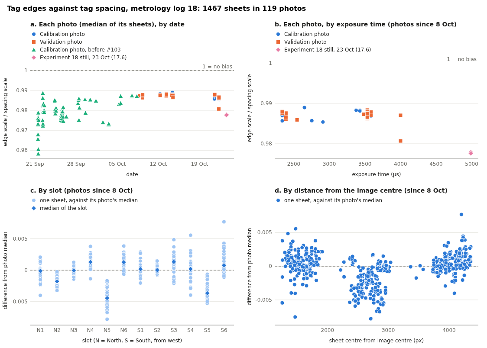

*Figure 18a. Edge scale over spacing scale. (a) Each photo's median over its sheets, by date. (b)
The photos since 8 October by exposure time. (c) Each sheet since 8 October against its photo's
median, by slot. (d) The same against the sheet's distance from the image centre. Made with
`experiments/round2-tagedge/measure.py` and `chart.py` (commands in their docstrings); the table is
`docs/figures/18/sheets.csv`.*

### 18.2 The flat green target over two days (2026-10-25)

**Label: development check.** The target of 17.5 has lain on tray 10 (North 1) since 23 October
14:02 UTC. The rig reads it in every experiment still as tray 10's green area, so its history
needs no new photo. Read from `rig.db` (`tray_reading`, tray 10, read-only), 2,307 stills from
23 October 14:05 to 25 October 20:39 UTC, with the calibration of 22 October.

| Exposure | Stills | Area read, mm² (median, range) | Against callipers (22,455 mm², the re-measurement of 17.6) |
|---|---|---|---|
| 4,832 to 5,300 µs, gain 1.0 (lights on, steady) | 2,198 | 23,815 (23,724 to 23,889) | +6.1% (+5.7% to +6.4%) |
| 5,404 to 29,932 µs, gain 1.0 to 1.5 (lights changing) | 95 | 23,773 (23,585 to 23,856) | +5.0% to +6.2% |
| 30,036 to 50,771 µs, gain 2.0 | 8 | 23,621 (23,606 to 23,681) | +5.1% to +5.5% |

The first calliper measurement (17.5, 22,515.7 mm²) is 0.3% larger and would give +5.8% under steady light. Under steady light the area repeats within 0.7% (range), over two days. While the lights change it
reads up to about 1% lower. Six dark photos (gain 4) find no target or part of it and are left out.

**Where the 6% comes from, in the 23 October 14:16 still.** Two measured parts, no model:

- **Mask edge, +2.2%.** Against the spacing scale of the 9 tags lying beside the target at the
  same height (4.923 px/mm), the target's calliper side (149.85 mm) is 737.7 px. Its mask is
  748.6 px across west to east and 743.3 px north to south (the mean over the middle 200 rows or
  columns), +10.9 and +5.6 px.
- **Scale, +3.5%.** The 22 October calibration's scale field at the target's centre is 4.840
  px/mm, against 4.923 from the tags beside it: 1.7% low in length.

Together +5.8%, against +6.0% read in that still (23,800 mm²) and +6.1% over two days. Height is
inside the scale part: the tags beside the target lie at its height.

**The mask edge.** Across the middle of each edge, the mask ends 0.5 to 4.7 px outside the point
where the green channel is half way between tray and target. The target lies on the blue tray;
the green index (`segmentation.py`) is a ratio of colours, so at a blurred edge where the target's
green mixes with the darker blue it stays above the threshold for some pixels beyond the half-way
point. On soil or black pots the mixture is different, so this result does not give the edge error
for plants: in round 1, small red shapes read 16% to 21% small with a different threshold (15.5).

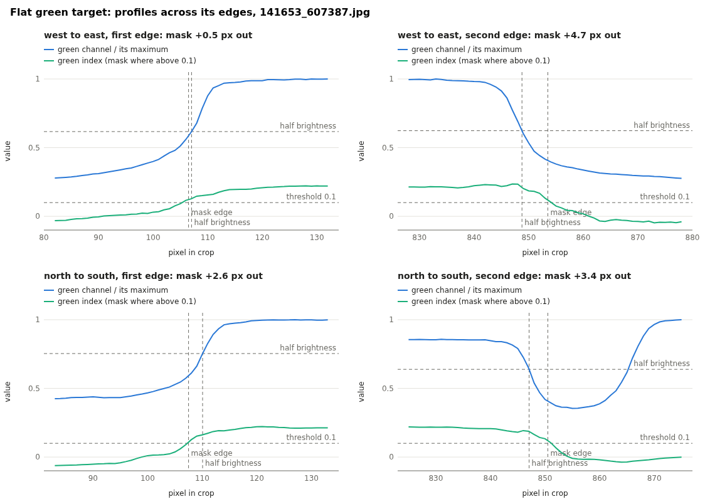

*Figure 18b. The flat green target in still 141653_607387 (23 October 14:16:53 UTC): the green
channel and the green index across the middle 200 px of each edge, the mask edge (orange) and the
half-brightness point. On the north to south second edge a white calibration sheet lies a few
millimetres south of the target, which raises the green channel there. Made with `experiments/round2-tagedge/target_edges.py`
(command in its docstring).*

### 18.3 Limits of the evidence

- The photos were taken for calibration and validation; exposure, lens position and the sheets'
  heights were not varied on purpose, and changed together with the date.
- The cause of the shortfall is not shown. It changes between photos taken minutes apart (22
  October 07:17 against 07:25) and between days.
- The spacing is trusted from the print: the 180 mm bars agree with the design within 0.05%
  (section 3). Paper that curls would make spacing read short, the other direction.
- The target's mask edge was measured on one still, on the blue tray. Not on soil, pots or leaves
  (on the pots: 18.4).
- Nothing in the rig's code was changed.

### 18.4 Sheets on the pots through a lights ramp, and the target raised (2026-10-26)

**Label: development check.** Planned in issue #286 on 25 October, before the sheets went in: no
camera setting was changed, so the chamber's own lights ramp is the only change in exposure.
Before the first still of 26 October 07:44 UTC (lights off), Aaron put measured 30 mm sheets on the
pots of trays 9, 11 and 12 (South 1, South 4, South 6 that day), moved the partial sheet of tray 10
(North 1) from the tray top onto the pots, and moved the green target of 17.5 onto the pots too.
Measured with `measure.py --stills` from the stored tags of every still, 26 October 00:00 to 08:22
UTC, and for comparison 25 October 07:00 to 08:59 and 12:00 to 12:59 (the tray 10 sheet alone, on
the tray top). Calibration of 22 October. Tables: `figures/18/sheets-2026-10-25.csv` and
`sheets-2026-10-26.csv`.

**Exposure.** Per sheet, the edge to spacing ratio:

| Sheet | Lights on, 08:01 to 08:09 (11 to 61 ms, gain 1.5 to 4) | 08:12 to 08:22 (5 to 10 ms, gain 1.0) | Spacing scale over the ramp, px/mm |
|---|---|---|---|
| North 1 (pots) | 0.9725 to 0.9747 | 0.9750 to 0.9768 | 4.952 to 4.961 |
| South 1 | 0.9758 to 0.9776 | 0.9781 to 0.9796 | 4.958 to 4.961 |
| South 4 | 0.9822 to 0.9832 | 0.9825 to 0.9834 | 4.944 to 4.946 |
| South 6 | 0.9842 to 0.9861 | 0.9861 to 0.9872 | 5.004 to 5.007 |

On 25 October the tray 10 sheet gave 0.9715 to 0.9731 at 11 to 31 ms and 0.9756 to 0.9780 under
steady light (4,988 µs, gain 1.0), with a spacing scale of 4.924 to 4.933 px/mm all day. So over a
ramp the edges change by 0.1% to 0.5% in length while the spacing holds within 0.2%. Exposure moves
the edge shortfall a little, but it does not explain most of it, and the sheets differ more from
each other (0.975 to 0.987) than any one changes with exposure. In the stills with the lights off
(66 ms, gain 4) the ratio is 0.986 to 0.995: the edges read close to the spacing in a dark photo.

**The calibration against the sheets on the pots**, still 082253_610657, area read high from
scale alone (`field_vs_spacing.py`): North 1 +4.5%, South 1 +3.6%, South 4 +1.6%, South 6 +3.4%.
The values of 18.2's slot table for the same slots are +3.9%, +2.9%, +1.7% and +2.8%, taken from
other sheets in other places within each slot.

**The target raised onto the pots.** Tray 10's green pixel count went from 558,496 (median of 60
stills, 25 October 12:00 UTC) to 570,067 (10 stills, 26 October 08:10 to 08:19 UTC), +2.1%. The tags
of the North 1 sheet moved from 4.927 to 4.956 px/mm, which predicts +1.2% for the same move. Its
area now reads 24,341 mm², +8.4% against the calliper area of 17.6:

- **Scale, +4.9%.** The calibration's field at the target's centre is 4.839 px/mm, against 4.956
  from the tags on the pots beside it. On the tray top the height difference had hidden part of
  this (18.2: +3.5%).
- **Mask edge, +3.4%.** At 4.956 px/mm the calliper side (149.86 mm) is 742.7 px. Across the middle
  200 rows or columns the mask is 763.4 px west to east and 750.2 px north to south (+20.7 and +7.5
  px). The mask ends 10.6 and 10.4 px outside the half-brightness point on the west and east edges
  and 3.4 and 4.8 px on the north and south edges (figure 18c). On the west and east edges the green
  channel rises slowly over about 10 px outside the target before its sharp edge.

So the same target, moved about 9 mm up and onto another background, gained 1.2 points of mask
edge error. The mask edge depends on what lies around and under an object, not only on the object.

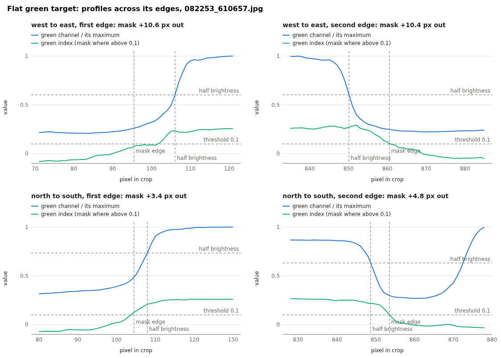

*Figure 18c. The green target on the pots of tray 10 in still 082253_610657 (26 October 08:22:53
UTC), as figure 18b. Made with `experiments/round2-tagedge/target_edges.py PHOTO 795 2041 OUT 742.7`.*

**Limits.** One ramp, with the lights; exposure and light level change together. The sheets were
not in the same places as in the calibration photo. The target's edges were measured on one still.
Why the green channel rises outside the west and east edges is not shown.

### 18.5 Green test squares on the pots: the mask edge by size (method written 2026-10-26, before the session)

**Label: development check.** Purpose: measure how much the green mask adds at the edge of a flat
green object, by object size, with the scale error removed. The result becomes a rule in the error
band (issue #286, agreed 2026-10-26). A one-time measurement by us; researchers need no green test
squares.

**Objects.** Twelve green test squares, 3D printed by Aaron in the green of the 150 mm target (17.5),
measured by Aaron on 2026-10-26 with the NEIKO callipers, 3 readings per side and, for six of them,
3 of the thickness. Square C's second Y reading was first written as 0.03 and corrected by Aaron to
9.93.

| Square | Size | X mean (mm) | X range | Y mean (mm) | Y range | Thickness mean (mm) | Calliper area (mm²) |
|---|---|---|---|---|---|---|---|
| A | 10 mm | 9.953 | 0.04 | 9.907 | 0.01 | 0.650 | 98.60 |
| B | 10 mm | 9.953 | 0.04 | 9.943 | 0.06 | not measured | 98.97 |
| C | 10 mm | 9.947 | 0.03 | 9.940 | 0.05 | 0.650 | 98.87 |
| D | 10 mm | 9.910 | 0.05 | 9.983 | 0.03 | not measured | 98.93 |
| H | 20 mm | 19.950 | 0.12 | 19.920 | 0.06 | 0.657 | 397.40 |
| E | 20 mm | 19.953 | 0.03 | 19.933 | 0.02 | not measured | 397.74 |
| F | 20 mm | 20.007 | 0.04 | 19.957 | 0.03 | 0.640 | 399.27 |
| G | 20 mm | 19.957 | 0.08 | 19.983 | 0.06 | not measured | 398.80 |
| K | 40 mm | 40.007 | 0.07 | 39.990 | 0.08 | 0.647 | 1,599.87 |
| L | 40 mm | 39.970 | 0.06 | 39.930 | 0.07 | not measured | 1,596.00 |
| I | 55 mm | 54.957 | 0.04 | 54.930 | 0.09 | 0.657 | 3,018.77 |
| J | 55 mm | 54.973 | 0.09 | 54.993 | 0.07 | not measured | 3,023.17 |

The callipers are not trusted beyond 0.1 mm (section 3): about ±2% in area on a 10 mm square, ±1% on
20 mm, ±0.5% on 40 mm and ±0.4% on 55 mm. The repeat readings spread by 0.01 to 0.12 mm. Thickness
(about 0.65 mm) raises a square's top about +0.09% in area (0.145% per mm), not corrected.

**Placement.** One square per pot on the pot tops of trays that carry a tag sheet on their pots
(trays 9 to 12, 18.4), at least 10 mm from each other and from the tag sheet, taped underneath only.
Aaron records the tray and cell of each square; cell A1 holds the tray tag. The 150 mm target stays on
the pots of tray 10.

**Session.** 60 to 90 minutes of the experiment's own stills (one per minute) under steady light,
no camera setting changed. Stills during a lights ramp are left out.

**Analysis** (read-only, a script in `experiments/round2-tagedge/`):

1. In each still, the green threshold's mask (`segmentation.py`, threshold 0.1), split into
   connected pieces. Each square is the piece inside its recorded cell.
2. The scale beside it: the tag spacing of the tag sheet on the same tray (median over its pairs,
   `measure.py`), at the same height. Not the calibration's scale field.
3. Per square and still: area read = pixels / scale²; error = area read / calliper area - 1.
4. The edge width: (area read - calliper area) / perimeter, in mm, and in px at that scale. If the
   mask adds a fixed width at the edge, this width is the same for every size and the error falls
   as 1 / size. That is the rule to check. If the width changes with size, the rule is a table by
   size instead.
5. Spread: per square over the stills, and between the copies of one size.

**What it covers and does not.** Flat green squares at pot height, on black pot tops, under the
chamber lights at their steady level, with the threshold of 17.5. Not soil, not leaves, not plant
shapes: a rosette has more edge per area than a square of the same area, which the width (step 4)
is meant to carry over, but that is not shown here.

**Results (2026-10-26).** Placed 10:42 UTC on the pot tops of trays 7 to 12, cells as Aaron
recorded them (G on tray 7, which has plants and no tag sheet, and D on tray 8, which has no tag
sheet: both take the median tag spacing scale of the tag sheets in the photo, less certain, about
±0.8% in length). Three backgrounds, one after the other, each read with
`experiments/round2-tagedge/squares.py` (each square matched by size and by its cell's distance
from the tray tag; every match checked by eye on crops):

1. **Open pot tops**, 10:45 to 11:58 UTC, 66 to 73 stills per square. Some squares lie over the
   dark pot opening, some on the light plastic rim.
2. **A dark layer under the squares**, laid by Aaron at 12:00 UTC, the plastic rims still in view;
   12:05 to 13:15 UTC, about 69 stills (the last few while Aaron changed the layout; without the stills
   after 13:10 every median moves by 0.2 points or less).
3. **Black paper only** (0.33 mm thick), no plastic in view, from 13:19 UTC; 13:22 to 13:48 UTC,
   26 stills.

| Square | Size | Open pot tops | Dark layer | Black paper | Edge width on black paper (mm) |
|---|---|---|---|---|---|
| A | 10 mm | +16.8% | +34.2% | +28.5% | 0.71 |
| B | 10 mm | +28.6% | +40.6% | +31.8% | 0.80 |
| C | 10 mm | -27.1% | -18.0% | +9.0% | 0.22 |
| D | 10 mm | +18.8% | +28.3% | +30.1% | 0.75 |
| H | 20 mm | +23.1% | +24.3% | +18.2% | 0.91 |
| E | 20 mm | +18.1% | +21.4% | +14.6% | 0.73 |
| F | 20 mm | +4.4% | +7.5% | +9.2% | 0.46 |
| G | 20 mm | -5.4% | -1.3% | -1.0% | -0.05 |
| K | 40 mm | +11.2% | +9.7% | +8.0% | 0.79 |
| L | 40 mm | +7.9% | +9.1% | +6.0% | 0.60 |
| I | 55 mm | +4.2% | -1.9% | +6.5% | 0.89 |
| J | 55 mm | +5.1% | +5.3% | +7.7% | 1.06 |

Medians over the stills. Within one background each square repeats within ±3 points from still
to still. Tables: `figures/18/squares-open.csv`, `squares-darklayer.csv`, `squares-paper.csv`.

- **The background decides the sign and size of the error.** Over a dark opening the mask grows:
  just outside the edge the pixels are dark (20 to 50 of 255) with green 5 to 20 counts above red
  and blue, fading over about 12 px; the index divides by brightness, so these pass the threshold.
  On a bright white rim the mask shrinks: square C read -27% there (figure 18d).
- **On black paper every square but G reads high**, and the mask adds a strip 0 to 1.1 mm wide
  (0.2 to 1.1 mm for all but G) at every edge: up to +32% on 10 mm squares, +18% on 20 mm, +8% on
  40 and 55 mm. C and G looked paler, more brightly lit, than the others (figure 18e).

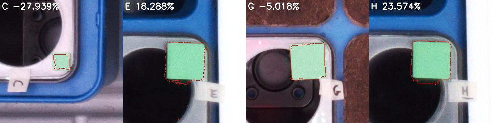

*Figure 18d. Squares C, E, G and H in still 105253_615512 (26 October 10:52:53 UTC), the mask
outline in red. Made with `squares.py` and the crop code of this section.*

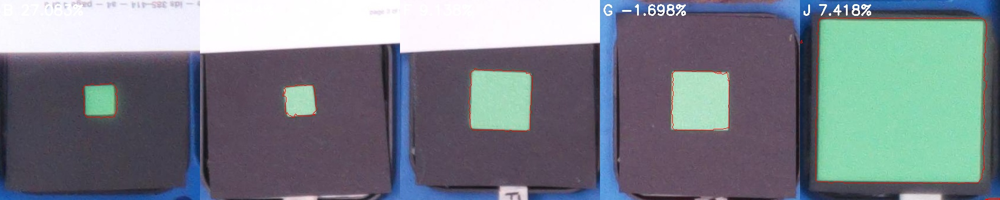

*Figure 18e. Squares B, C, F, G and J on black paper in still 134753_674253 (13:47:53 UTC).*

**What this does and does not show.** It shows how the green threshold treats the edge of a flat,
uniformly green object on these backgrounds. It does not give the segmentation error for plants:
leaves are not flat or of one colour, and soil is neither black paper nor a pot opening. No error
band for plant segmentation is derived from it (Aaron, 2026-10-26).

### 18.6 The scale from tag spacing, checked on the stored photos (2026-10-26)

**Label: development check.** The fix of #286 step 4 (branch `286-spacing-scale`): the scale field
fitted to tag spacing instead of tag edges, and validation scored by tag spacing. Run read-only on
stored tags with that branch's code:

- The 22 October calibration (`20261022T072523939958`, photo `rig/2026-10-22/072523_939958`, 345
  tags, 1,791 pairs) refitted: residual 0.66% (edges: 0.58%).
- Against the tag sheets on the pots on 26 October 08:22 UTC (18.4), area read from scale alone:
  **-1.6% to +1.5%** with the refitted scale, **+1.0% to +4.8%** with the scale in use (13 groups
  of tags, 1 to 20 tags each).
- The three stored validation rounds of 22 October, scored against the refitted scale by tag
  spacing: table median +0.1%, +0.1% and +0.6% (limit 2.5%); slots -1.5% to +1.2%.

### 18.7 The squares split into scale and mask edge, against validation (2026-10-26)

**Label: development check.** After the fix was applied on the live rig (26 October 15:32 UTC: the
22 October calibration rebuilt as twin `20261026T153214381640`, its validation scored again as
session `20261026T153214526314`, experiment 18 reprocessed), the squares of 18.5 on black paper read
from 13:22 to 18:56 UTC: 334 stills per square, all twelve found in every one (table:
`figures/18/squares-paper-long.csv`).

**Steady over time.** Each square's hourly median stays within 1 point over the 5.5 hours, except B
(+30.9% falling to +26.9%). From still to still a 10 mm square varies by about ±6 points, a 20 mm by
±3, 40 and 55 mm by ±1. Between squares of one size the spread stays: 10 mm +3% to +41% in single
stills (medians +9.7% to +29.9%), 20 mm -5% to +22% (-1.0% to +16.9%), 40 mm +5% to +9%, 55 mm +6%
to +9%.

**The split.** Each square's error read with the twin's scale field (what the rig reports) is the
sum of two parts: the scale error at the square, (tag spacing of the tag sheet on its tray / the
twin's scale there)^2 - 1, and the mask edge, measured against that tag spacing (18.5). The scale
part set against the rescored validation median of the square's slot:

| Square | Slot (tray) | Scale error at the square | Validation median, slot | Total | Mask edge |
|---|---|---|---|---|---|
| A, 10 mm | South 1 (9) | +0.26% | +0.22% | +28.8% | +28.5% |
| K, 40 mm | South 1 (9) | +0.18% | +0.22% | +8.1% | +7.9% |
| I, 55 mm | South 1 (9) | -0.15% | +0.22% | +6.3% | +6.5% |
| B, 10 mm | South 6 (11) | +0.36% | +0.63% | +29.2% | +28.7% |
| H, 20 mm | South 6 (11) | +0.66% | +0.63% | +17.6% | +16.9% |
| E, 20 mm | South 6 (11) | +0.90% | +0.63% | +14.0% | +13.0% |
| C, 10 mm | North 2 (12) | +0.37% | +0.77% | +10.1% | +9.7% |
| F, 20 mm | North 2 (12) | +0.45% | +0.77% | +9.6% | +9.1% |
| L, 40 mm | North 2 (12) | +0.86% | +0.77% | +6.9% | +6.0% |
| J, 55 mm | North 6 (10) | +0.45% | -0.03% | +7.9% | +7.4% |

Medians over the 334 stills. D (North 1, tray 8) and G (South 4, tray 7) have no tag sheet on their
tray; their scale comes from the other trays' sheets and is left out of the comparison.

- **The scale part agrees with validation**: within 0.5 points of the slot's median in every slot,
  inside the slot bands (95% at ±1.2% to ±1.7%). The bands are right for what they measure.
- **The mask edge is 6 to 30 times the scale part**, and no band covers it: validation's tag
  sheets have no green.
- **The mask edge follows the slot.** All three squares in North 2 read low for their size (10 mm
  +9.7% where the others read +28% to +30%, 20 mm +9.1% where the others read +13% to +17%), and G
  in South 4 lowest. Within one size, brighter paper goes with a smaller error (mean grey of the
  paper just outside each square in the 18:55:53 still): 10 mm, C 90 at +9.7% against A, B, D 57
  to 73 at +28% to +30%; 20 mm, G 92 at -1.0%, F 87 at +9.1%, E 89 at +13.0%, H 81 at +16.9%. Not
  for every square: L in North 2 sits on paper of 73. The index divides by brightness, so the same
  faint green tint passes on darker paper and not on brighter. Whether the tint is light reflected
  from the square or blur is not separated.

Not covered: plants, soil, the lights' other levels, and any slot without a square.

### 18.8 Four green thresholds from the literature, tried on the squares (2026-10-26)

**Label: development check.** The comment on #286 of 26 October 14:03 UTC lists the published ways
to pick out green pixels. Aaron agreed in the session of 26 October to try them offline on the
stored stills of 18.5 and 18.7. The method was agreed in that session and not written here before
the run.

**Method.** The same stills, read-only from `rig.db` and the photo files; nothing on the rig
written. Each still was decoded once, and all four methods read the same tray crops. The scale is
the tag spacing of the tag sheet on the square's tray, as in 18.5, so the error is the mask edge
plus the scale part of 18.7 (under 1 point). The squares were found and matched the same way for
every method (size, shape and distance from the tray tag, `squares.py`). The thresholds are the
published values, not tuned on these squares:

| Method | Rule | Source |
|---|---|---|
| exg (in use) | 2g - r - b above 0.1 and G above R, on r = R / (R + G + B) and so on | Woebbecke et al., 1995 |
| canopeo | 2G - R - B above 20 on 8-bit values, R/G and B/G below 0.95 | Patrignani and Ochsner, 2015 (rule as reimplemented) |
| exg_exr | (2g - r - b) - (1.4r - g) above 0 | Meyer and Camargo Neto, 2008 |
| exg_otsu | 2g - r - b above an Otsu threshold chosen per tray crop, and G above R | common practice |

Stills: pot tops 10:45 to 11:58 UTC (73), dark layer 12:05 to 13:10 (65), black paper 13:22 to
18:55 (333, the 18.7 set without its last still, 18:55:53), all at steady exposure. Code: `experiments/round2-tagedge/methods.py`, summary by
`methods_summary.py`. Table per method, background and size: `figures/18/methods.csv`.

**Results.** Edge width is the extra strip at every edge, (area - calliper area) / perimeter.
Ranges are over single stills and all three backgrounds.

| Method | Edge width, median by size | 10 mm squares | 20 mm squares | 55 mm squares | Squares found |
|---|---|---|---|---|---|
| exg (in use) | 0.56 to 0.90 mm | -33.8% to +45.9% | -6.9% to +26.3% | -2.3% to +8.6% | 97 to 100% |
| canopeo | 0.61 to 0.99 mm | -9.7% to +42.6% | +0.3% to +25.4% | -1.3% to +9.1% | 99 to 100% |
| exg_exr | 0.64 to 0.97 mm | -17.9% to +59.7% | -3.7% to +33.3% | -1.4% to +9.8% | 49 to 100% |
| exg_otsu | 0.87 to 1.18 mm | +10.5% to +47.9% | +5.5% to +59.8% | -1.2% to +9.0% | 25 to 100% |

- **None of the four removes the mask edge.** Every method reads the squares large by a strip of
  about 0.6 to 1.0 mm at each edge (median), on every background.
- **canopeo** finds every square and has fewer low readings on 10 mm squares (lowest -9.7% against
  -33.8%), but its medians are no smaller than those of exg (10 mm on black paper +29.2% against
  +28.1%).
- **exg_exr and exg_otsu** miss up to half of the squares on some backgrounds, and exg_otsu reads
  larger than exg.
- **Decision (Aaron, 2026-10-26): the green threshold in use (exg, 0.1) stays for the moment.** No
  other colour rule narrows the strip; the edge methods of 18.9 are compared on plants in #297.

**What the strip means for small areas.** A strip of fixed width is a larger share of a small
object: a square of side s gains about 4 x 0.7 / s of its area. Measured: 10 mm squares read
+17.7% to +31.5% (median by background), 55 mm squares +4.5% to +7.1%. Below 10 mm nothing was
measured. Extended to smaller squares with the same strip (an extrapolation, not a measurement), 5
mm would read about +56% and 3 mm about +93%, and a leaf has more edge for its area than a square.
For plants below the 10 mm squares, such as the young plants of the potato run, the areas are
therefore not measured, and the early part of a growth curve reads flatter than the plant grows,
because the strip's share falls as the plant grows.

**Agreed with Aaron (2026-10-26):** a green object below 100 mm² (a 10 mm square) has no measured
error; one of about 100 mm² reads about 28% high on black paper (18.7). The floor of 17.7 (100 mm²
per tray) was set from empty trays and is not an accuracy limit: 100 mm² on a tray may be several
plants, each smaller.

**Limits of the evidence.** Flat paper squares, not leaves or soil; three backgrounds and one
light level; one camera position and focus; published thresholds only, none tuned. Why the strip
is there (blur, reflected light or the JPEG's colour detail) is not separated. A trained model
(the second literature comment on #286) was not tried.

### 18.9 Edge methods on the squares (method written 2026-10-26, before the run)

**Label: development check.** The comment on #286 of 26 October 20:26 UTC lists methods that find
an object's edge instead of judging each pixel's colour. Aaron asked on 26 October to try the ones
that work on stored stills and compare them with 18.8.

**Tried on the stored stills of 18.8** (same 471 stills, same squares, same scale from the tag
sheet on each tray, read-only). Each square is first found by the threshold in use (exg, 0.1);
then, in a box 30 px larger on every side:

- **half way, linear**: the JPEG values are converted back to linear light (the sRGB curve), and
  each pixel's green is taken as 2G - R - B in linear light. The square's level is the median inside
  the exg mask shrunk by 8 px, the background's the median of a ring 20 to 30 px outside it. A pixel
  counts when it is above half way between the two, and the area is the connected piece holding
  the square's centre (Burns, 2000, the ISO 12233 idea of an edge on linear data).
- **partial area, linear**: each pixel in the box counts as the fraction (green - background) /
  (square - background), clipped to 0 to 1, summed over the pixels within 15 px of the exg mask.
  An edge pixel that is part square, part background then counts as that part (after
  Trujillo-Pino et al., 2013, simplified: no subpixel edge fit).
- **GrabCut**: OpenCV's `grabCut` (Rother et al., 2004) on the box, started from the exg mask
  shrunk by 8 px as certain square, the mask itself as probable square, the ring of 15 px around
  it as probable background and the rest as background; 5 iterations, no border matting (not in
  OpenCV).

Compared with exg from 18.8 on the same stills, by error against the calliper area and by edge
width. **Not tried:** Chan and Vese (2001), which needs a library the rig does not have; points 1
and 2 of the comment (JPEG colour detail, colour denoise, glare), which need new stills with other
camera settings.

**Results (2026-10-26).** All 471 stills; every square found by exg was read by every method. Error
against the calliper area, all three backgrounds together; ranges over single stills; edge width as
in 18.8. Table per method, background and size: `figures/18/edges.csv` (exg rows repeat 18.8).

| Method | 10 mm, median (single stills) | 20 mm | 40 mm | 55 mm | Edge width, median by size and background |
|---|---|---|---|---|---|
| exg (in use, 18.8) | +27.8% (-33.8% to +45.9%) | +11.3% (-6.9% to +26.3%) | +7.8% (+5.5% to +12.3%) | +6.5% (-2.3% to +8.6%) | 0.44 to 1.0 mm (18.8: 0.56 to 0.90 mm, by size only) |
| half way, linear | -2.9% (-8.6% to +6.6%) | +1.1% (-4.9% to +3.6%) | +0.4% (-1.5% to +1.2%) | +1.3% (-3.3% to +3.1%) | -0.09 to +0.27 mm |
| partial area, linear | +2.0% (-7.0% to +11.3%) | +2.2% (-4.8% to +10.2%) | +0.7% (-1.4% to +3.5%) | +1.3% (-4.5% to +4.1%) | -0.00 to +0.28 mm |
| GrabCut | +4.7% (-23.3% to +25.7%) | +3.1% (-3.5% to +25.0%) | +2.5% (-0.5% to +5.3%) | +3.6% (-2.8% to +12.0%) | 0.05 to 0.53 mm |

- **Half way, linear removes most of the strip.** Median error within 3 points at every size and on
  every background (10 mm: -3.6% to -1.6% by background, against +17.7% to +31.5% for exg); single
  10 mm stills within -8.6% to +6.6%, about a fifth of the exg spread. It reads 10 mm squares
  slightly small and 55 mm squares slightly large (+0.9% to +2.0% by background).
- **Partial area, linear** is close: medians +2% or less except 20 mm (+1.9% to +4.5%), with a wider
  spread on small squares (10 mm up to +11.3%).
- **GrabCut** is better than exg but has single stills off by up to 26% on small squares and keeps
  a strip of 0.3 to 0.5 mm on the large ones.
- The scale part of 18.7 (under 1 point) is still in every figure.

**Limits of the evidence.** Squares, not leaves: each square has a solid middle (8 px inside) and
clear background 20 to 30 px around it, which half way needs and plants may not have (thin leaves,
touching leaves and plants). Each square was first found by exg, so a method's result starts from
exg's object. One light level, three backgrounds, one camera position and focus. Not a band for
plants: plants are compared in #297.
