# Daylight Growth Chamber Hardware Installation Instructions <!-- omit in toc -->

- [Conventions](#conventions)
- [Raspberry Pi 5 Preparation](#raspberry-pi-5-preparation)
- [Camera Mount Installation](#camera-mount-installation)
- [Calibration and Setup](#calibration-and-setup)

## Conventions

Standing in the chamber door way, with the control panel to the right, the following conventions are used to define the chamber layout.

- Left side: West
- Right side: East
- Front (closest to door): South
- Back (farthest from door): North

When using this camera system, a maximum of 12 trays can be effectively captured. Trays are expected to be placed in two rows of six each. With the long edge oriented north/south. Other orientations are possible and should work, but the area around the drain cannot be effectively used and should be excluded.

**Top View**

```text
     NW                    North            NE
     ┌───────────────────────────────────────┐
     │ D                                     │
     │ R                   │                 │
West │ A ────────equator───+──equator─────── │ East
     │ I                   │                 │
     │ N                                     │
     └───────────────────────────────────────┘
     SW                   South             SE


    │
> ──+── < Geographic center of the table excluding the drain width
    │

```

**Front View**

```text
                    Top Support
    ┌───────────────────────────────────────┐
    │                                       │
    │                                       │
    │                                       │
    │                                       │
    ├───────────────────────────────────────┤
    │                 Table                 │
    ├───────────────────────────────────────┤
    │                                       │
    │                                       │
    │                                       │
```

## Raspberry Pi 5 Preparation

This section prepares a Raspberry Pi 5 for chamber deployment.

### Raspberry Pi OS Setup

**Requirements**

- Linux or MacOS
- [Ansible](https://docs.ansible.com/)
  - Linux/MacOS: `pipx install --include-deps ansible`
- git and make (see [Operator Machine Setup](#operator-machine-setup-once-per-laptop))
- [NPEC Ansible Repository](https://github.com/txoof/ansible-npec) cloned locally (private: needs GitHub access)
- 128 gigabyte high-performance micro SD Card (minimum)
- Micro SD Card adapter
- Raspberry Pi 5
- [Raspberry Pi Imager](https://www.raspberrypi.com/news/raspberry-pi-imager-imaging-utility/)
- Monitor & Keyboard
- Camera

#### WiFi Setup

1. Write Raspberry Pi OS Lite Trixie to the SD card
    - Username: `pi`
    - Password: the fleet `pi` password, from the team password manager
    - Remote Access: choose **Use password authentication**. Imager may pre-select public-key authentication; then the Pi accepts only that key and onboarding fails.
    - Hostname: the rig name. Imager fills in the last hostname it used: clear it and type this rig's name. Use the name stamped on the outside of the chamber the rig goes in, in lowercase, for example `s8-standard` or `s15-standard`. Check that no other rig already has this name. Write the name on the case. Onboarding reads the name from the Pi.
    - Name rule: lowercase letters, digits and hyphens only, 1 to 63 characters, no hyphen at the start or end. Capitals are refused. Imager's default `raspberrypi` is refused. Do not use a generic name such as `pi`: onboarding accepts it, but it says nothing about where the rig is.
    - Wireless LAN: SSID `iotroam`, country `NL`. Choose a new password for this Pi and note it. The same password is entered in the iotroam registration in step 5.
2. Connect the camera using the supplied ribbon cable, an extension cable and the AdaFruit DCI/CSI Thingie.
3. Insert the SD Card into the Pi, connect it to a monitor and boot
4. Login and run the following command to obtain the MAC address: `cat /sys/class/net/wlan0/address`. Note the MAC address value.

```shell
14:29:59
VER: Debian GNU/Linux 13 (trixie) (64 bit)
pi@testpi-02
[~]
$ cat /sys/class/net/wlan0/address
98:fe:54:50:f0:70
```

5. Register the MAC address on the `iotroam` network, with the WiFi password set in Imager in step 1. Note the IP Address. If this Pi was registered before, skip this step: the MAC address belongs to the board and does not change when the SD card is re-imaged, so it is already on the list. The password set in Imager must then match the registered one.
6. If WiFi was set in Imager, the Pi joins `iotroam` by itself once the MAC address is registered. Check with `nmcli connection show --active` (see the last block below). Otherwise, configure the wifi adapter by hand:

```shell
# Turn on wifi
$ sudo rfkill unblock wifi
$ nmcli radio wifi on
```

```shell
# set wifi region
$ sudo iw reg set NL
```

```
# Verify iotroam appears
$ nmcli device wifi rescan
$ nmcli device wifi list
$ nmcli device wifi list
IN-USE  BSSID              SSID                         
    08:55:31:C3:24:62  HADES-WIFI-2G                 
    08:55:31:C3:24:63  HADES-WIFI-5G                  
    F4:12:FA:E7:6F:09  CameraBack-E76F08             
    18:FD:74:BA:E6:9F  HELIOS-WIFI-2G                 
    F4:12:FA:E9:9C:91  CameraFront-E99C90             
    B0:1F:8C:94:74:22  iotroam                     
```

```shell
# Connect to the wifi - you will be prompted to enter the iotroam password
sudo nmcli --ask device wifi connect "iotroam"
```

```shell
# Verify the connetion
$ nmcli connection show --active
NAME        UUID                                  TYPE      DEVICE
iotroam     50186aba-763c-414c-9e3e-bbd70ab663dc  wifi      wlan0
tailscale0  40263dbd-380b-43ef-a1e8-74d3814cfe44  tun       tailscale0
lo          d500ade2-dc5a-4ff2-be3a-31ee9caa0e97  loopback  lo

$ ip addr show wlan0

# Note down the assigned IP address
3: wlan0: <BROADCAST,MULTICAST,UP,LOWER_UP> mtu 1500 qdisc fq_codel state UP group default qlen 1000
    link/ether 98:fe:54:50:f0:70 brd ff:ff:ff:ff:ff:ff
    inet 10.248.49.97/24 brd 10.248.49.255 scope global dynamic noprefixroute wlan0
       valid_lft 30375sec preferred_lft 30375sec
    inet6 fe80::61b8:3777:fb32:e2d/64 scope link noprefixroute
       valid_lft forever preferred_lft forever
```

#### Software Installation

Ansible sets up the Pi and installs the app. This part is done by a developer with GitHub access to the private `ansible-npec` repository, not by the scientists who use the rig. Run every command below on the operator machine (your laptop), from inside the `ansible-npec` directory. More detail is in `docs/` in the `ansible-npec` repository. These steps match `ansible-npec` at commit `2c86a23`.

##### Operator Machine Setup (once per laptop)

1. Install git and make. On macOS: `xcode-select --install`.
2. Install Ansible: `pipx install --include-deps ansible`
3. Clone the repository. It is private, so this needs GitHub access to `txoof/ansible-npec`:

```shell
git clone git@github.com:txoof/ansible-npec.git
cd ansible-npec
```

4. Run `make setup`. It installs the Ansible collections and creates this laptop's own SSH key, `~/.ssh/npec_ed25519`.

Each laptop has its own key. To use a new laptop, or after losing the key, run `make setup` there and then `make add-key IP=<IP>` for each rig. It asks for the rig password once.

Before each new rig, update the repository to the latest `main`, from inside `ansible-npec`:

```shell
git switch main
git pull
```

The list of rigs is kept on the laptop, in `inventory/local.yml`, and is not in git. Settings for one rig go in `inventory/host_vars/<rig>.yml`, also on the laptop only. Nothing in these steps is committed.

##### Onboard the Pi

Wait 3 to 5 minutes after the Pi first boots before starting (about 5 minutes on the testing rig).

1. **Re-imaged Pi only.** To re-image a rig: `make poweroff HOST=<name>`, unplug the power, swap the SD card, plug the power back in. Swapping the card with the power still connected leaves the Pi halted (solid red LED, no green) until it is unplugged or its power button is pressed.

   If this Pi was onboarded before, remove its old SSH host key from the laptop: `make forget-host IP=<IP>` (add `HOST=<name>` if you also used its name). Otherwise onboarding fails with "REMOTE HOST IDENTIFICATION HAS CHANGED". Known issue: ignore the last line `make forget-host` prints ("If the rig is listed by IP ...").

   **Check:** it prints `# Host <IP> found` once for each old key (3 on the testing rig) and `known_hosts updated`.

   If "REMOTE HOST IDENTIFICATION HAS CHANGED" appears and you did not re-image this Pi, do not run `make forget-host`. Stop and find out why: another device may now have this IP address.
2. **Onboard.** Run this in a terminal. It cannot be run from a script or tool that has no terminal, because it asks for a password:

```shell
make onboard IP=<IP>
```

Use exactly this, without `NAME=`. The name comes from the Pi. A `NAME=` replaces the rig's line in `inventory/local.yml` without asking if the list knew this Pi under another name.

At "Type the rig password (the one set for 'pi' in Imager):" enter the `pi` password. It is asked once. Onboarding takes under a minute.

This reads the rig name from the Pi's hostname, installs this laptop's key on the Pi, turns on passwordless sudo, adds the rig to `inventory/local.yml`, and leaves a record on the Pi in `/etc/npec-rig/onboarded.yml` (name, serial, who onboarded it and when). WiFi settings are not changed.

**Check:** a green block reads "ONBOARDED: <rig name>". It lists the serial number, both MAC addresses (eth0 and wlan0), the IP address, and ends with "Next: deploy the app:  make deploy HOST=<rig name>" and "Write <rig name> on the rig's case." For a re-imaged Pi it also says which name the Pi had before and that its line in the list was replaced. Then:

```shell
make ping HOST=<rig name>
# expect: SUCCESS and "ping": "pong"
```

**If onboarding stops with "ALREADY ONBOARDED":** the Pi already has the record from an earlier onboarding, from any laptop. Nothing was changed. The red block shows the Pi's history and the way forward:

- The rig moved to another chamber: see [If the Rig Moves to Another Chamber](#if-the-rig-moves-to-another-chamber).
- The rig is missing from this laptop's list, or its IP address changed: see [If the IP Address Changes](#if-the-ip-address-changes).
- Start over: re-image the SD card, then onboard. Re-imaging erases the record, so the Pi counts as new.

**If a new Pi replaces a broken one in the same chamber:** onboarding refuses the name because this laptop's list has it for a different Pi. Known issue, not fixed. Until then:

1. Open `inventory/local.yml`.
2. Delete the line that starts with the old rig's name.
3. Run `make onboard IP=<IP>` again.

##### Install the Software

The Hailo AI board is found by itself: Hailo-8 or Hailo-8L, Hailo-10H, or none. No setting is needed. To turn Hailo off on a rig that has a board, put `npec_hailo_enabled: false` in `inventory/host_vars/<rig name>.yml`.

1. **Deploy:**

```shell
make deploy HOST=<rig name>
```

This takes about 5 minutes (4 min 19 s on the testing rig from a fresh SD card, 2026-11-16). The rig reboots once by itself near the end and Ansible waits for it. Do not unplug it.

It installs the system packages, sets the time zone to Europe/Amsterdam, turns on the Arducam 64MP camera and installs Arducam's own libcamera (the standard one cannot open this camera), installs the Hailo software if a board is fitted, clones the app to `/home/pi/npec_camera_rig`, and starts the `npec-rig` service on port 8000. Camera, Hailo and kernel packages are held at tested versions. The camera packages are downloaded from Raspberry Pi's archive and their checksums checked. If "Download the camera packages (checksum checked)" or "Install the camera packages" fails, see `docs/10-troubleshooting.md` in `ansible-npec`.

`make deploy` installs the newest app release (the highest `vX.Y.Z` tag of `npec-camera-rig`). The deploy log shows "Find the newest app release", then "Get the app code (v0.1.0)" with the release it found. If "Find the newest app release" fails, check the rig's internet connection and run the deploy again. `make deploy` does not change the app on a rig that already has it; see [Update the App to a New Release](#update-the-app-to-a-new-release).

**Check:** the PLAY RECAP line shows `failed=0` and `unreachable=0`. On the testing rig: `ok=48 changed=21 unreachable=0 failed=0 skipped=4` (the `changed` count can differ by one or two between runs).

2. **Health check:**

```shell
make health HOST=<rig name>
```

This only reads; it changes nothing. It checks the service, finds the camera, and takes one snapshot through the app.

**Check:** the Fleet summary shows `<rig name>  OK  all checks passed`. Also look for `cameras: arducam_64mp`, `snapshot: ok` and `app_release: v0.1.0` (or the newest release).

- **WARN** is acceptable for some causes, for example pending upgrades or a disk filling up. Read the reason on the line.
- **WARN with no camera found**: the Fleet summary reads `<rig name>  WARN  no camera found (no arducam_64mp sensor): power off, attach the camera, boot, then make health HOST=<rig name>`, with `cameras: none` and `snapshot: skipped (no camera)`. Power off with `make poweroff HOST=<rig name>`, unplug, check the cable (see [Camera and Pi Installation](#camera-and-pi-installation)), plug back in and run `make health` again. Tested on the testing rig with the camera unplugged (2026-11-16).
- **FAIL** means stop and find the cause before going on. It fails if a camera is found but no photo comes back, if the app is using a replayed or synthetic camera, or if the camera's tuning file is missing.

3. **Check the app in a browser.** Open `http://<IP>:8000`. It should open the Gallery page. Use the IP address: `<rig name>.local:8000` does not work on every network.

4. **Optional: deploy again.** This checks `ansible-npec`, not the rig, and is not needed to set up a rig. Run `make deploy HOST=<rig name>` once more; the PLAY RECAP should show `changed=0`. On the testing rig (2026-11-16) it took 33 s and read `ok=39 changed=0 failed=0`.

##### Update the App to a New Release

A new release is made each time a version is promoted to production. To move a rig to the newest release:

```shell
make update-app HOST=<rig name>
```

It finds the newest release, installs it if the code changed, restarts the app and runs the health check. Leave out `HOST=` to update all rigs, in batches. On the testing rig it took 29 s.

`make health` warns when a rig is behind, for example: `app 4e2f1b7 is not latest (v0.1.0 a6632d6): make update-app`.

The development rig `npec-rig-01` follows `main` instead: `npec_rig_version: main` in `inventory/host_vars/npec-rig-01.yml` on the laptop.

##### If the IP Address Changes

IP addresses come from a DHCP server that serves only registered MAC addresses (see [WiFi Setup](#wifi-setup)). Addresses can be reused when a Pi is moved or repurposed. If a rig's IP address changes, `make` reports UNREACHABLE, or `make health` shows "FAIL  WRONG PI" (another Pi now has the old address).

1. If the new address was used before by a different Pi, run `make forget-host IP=<new IP>` first. Otherwise SSH refuses because the host key changed.
2. Run:

```shell
make onboard IP=<new IP> UPDATE=yes
```

This updates the IP address in `inventory/local.yml` and in the record on the Pi. It keeps the name and asks for no password. Without `UPDATE=yes`, onboarding stops with "ALREADY ONBOARDED".

The same command adds an already onboarded rig to the list on another laptop.

TODO: not yet tested on a rig whose address changed. See `docs/09-day-2-operations.md` in `ansible-npec`.

##### If the Rig Moves to Another Chamber

The rig takes the name of its new chamber. Rename only a rig that has been deployed. Known issue: on a rig that was onboarded but never deployed, rename fails at "Restart the app".

```shell
make rename HOST=<current name> NAME=<new name>
```

It checks the new name and that no other rig has it, checks the Pi's serial number, shows the change and asks `y` to go on. It then sets the new hostname, restarts the app (about one minute without photos), updates `inventory/local.yml` and `inventory/host_vars/<name>.yml`, and runs the health check under the new name. Photos already on the rig are kept. No password is asked.

Afterwards:

1. Relabel the case.
2. Tell IT if needed.
3. Run `make nfs` again.

Tested on the testing rig.

##### Do Not

- Run onboard, deploy, update or reboot targets against `ac-testing`. It was set up by hand and is also a control machine. Only `make health` is allowed there.

## Camera Mount Installation

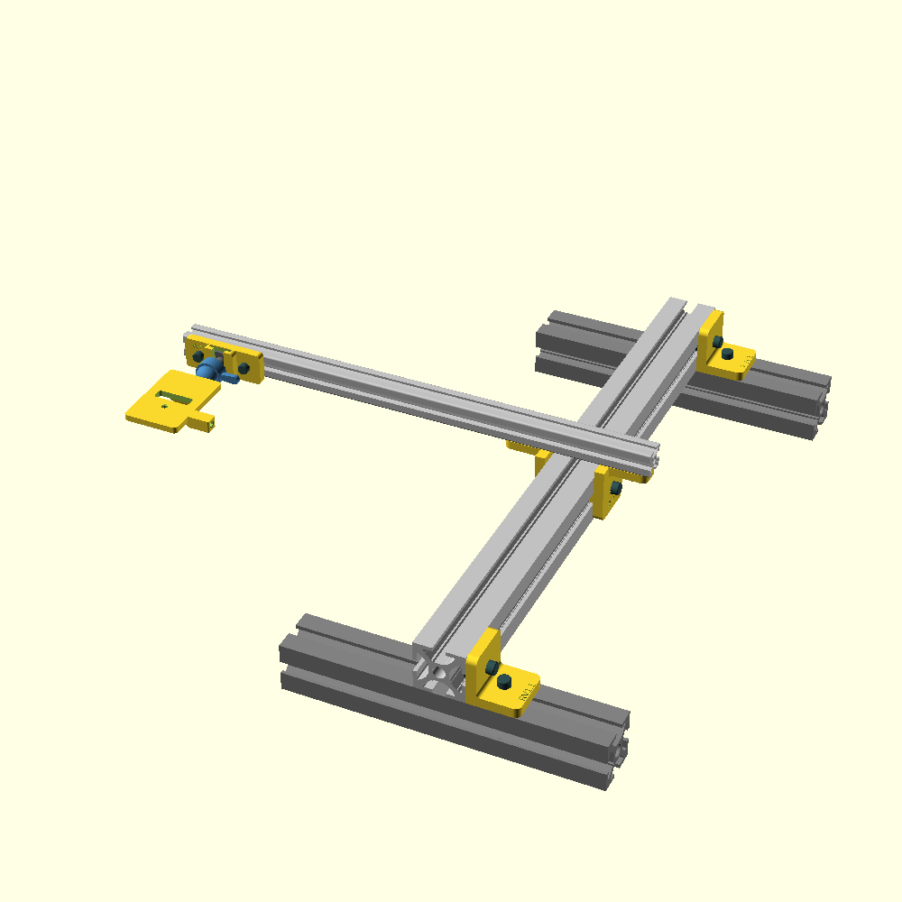
*Camera Rig Assembly*

### Materials

**Parts:** everything in the [Bill of Materials](./Bill-of-Materials.md) for one chamber: Camera Mount Hardware and Raspberry Pi & Camera Hardware. The Bill of Materials is the only parts list; quantities, sizes and suppliers are kept there. Prepare the Raspberry Pi first (see [Raspberry Pi 5 Preparation](#raspberry-pi-5-preparation)).

**Tools and consumables** (not in the Bill of Materials):

| Qty | Item | Notes |
| --- | --- | --- |
| 1 | Metric hex wrench set | |
| | Zip ties | |
| 1 | String, 1.5 m | |
| 1 | Small heavy weight, such as a nut | |
| | Scissors | |
| | Tape measure | |
| | Permanent marker | Optional |
| | Double sided tape | Optional |

|                                               |                                                         |                                                        |                                                  |
| :-------------------------------------------: | :-----------------------------------------------------: | :----------------------------------------------------: | :----------------------------------------------: |
|        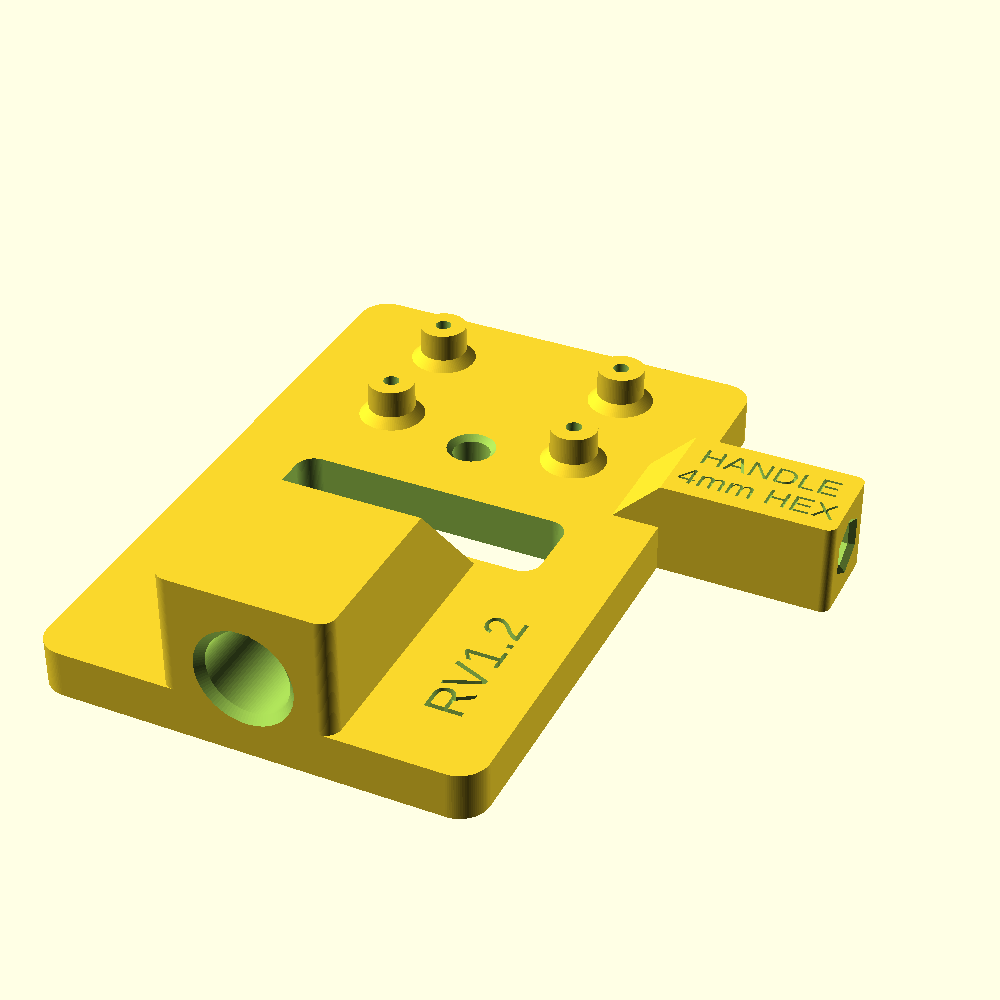        |             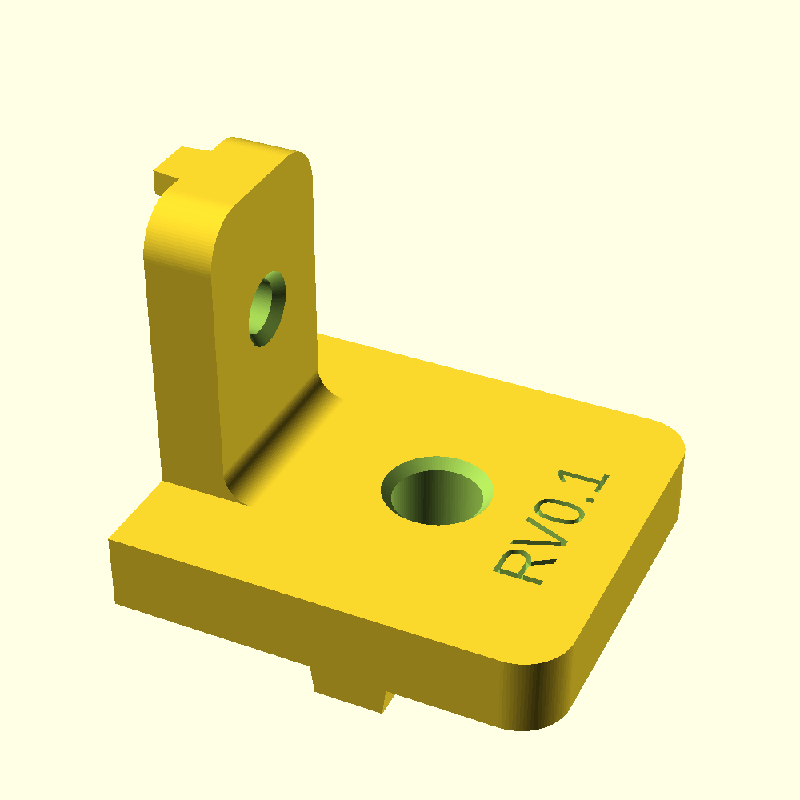              |             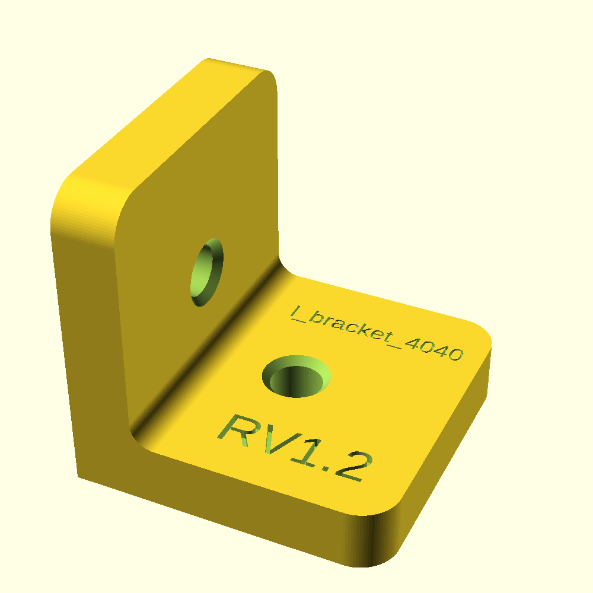             |         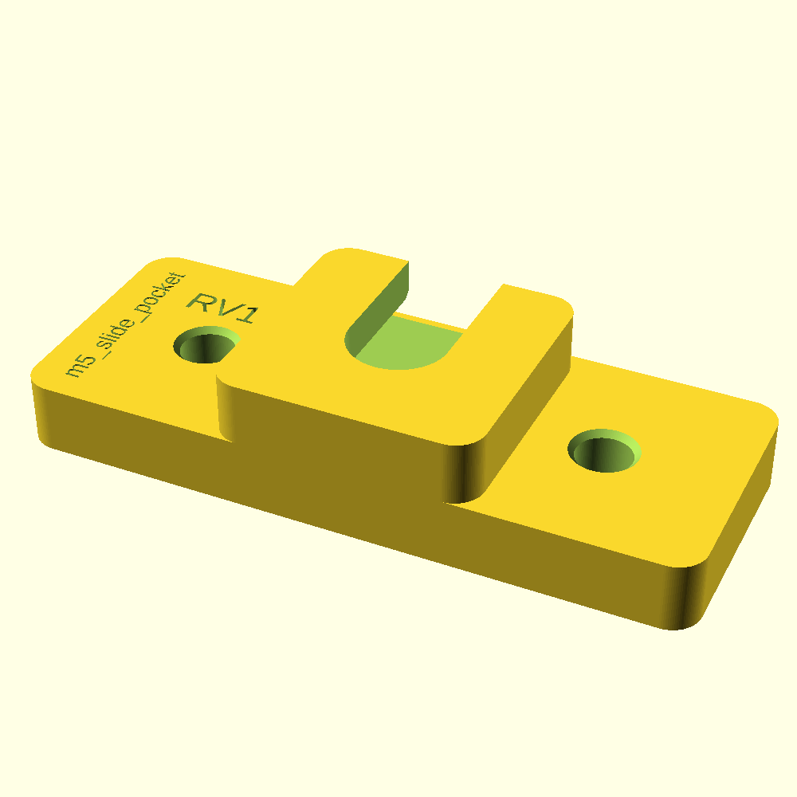          |
| [Camera Mount](./exports/camera_rig/arducam64_mount.stl) | [40x20 90 Degree Bracket](./exports/camera_rig/l_bracket_4020.stl) | [40x40 90 Degree Bracket](./images/l_bracket_4040.png) | [Cold Shoe Holder](./images/m5_slide_pocket.png) |

### Physical Installation Steps

Before starting: Ensure that the North and South TOP support 40x40 Profile rail are installed so the profile is exposed on the TOP of the rail. The default PSI install orients the channel facing down. It is possible to remove the corner braces, and rotate the bars in place without uninstalling them.

#### 40x40 Rail Installation

1. Loosely install the 90 degree bracket at either end of the 40x40 t-channel rail using slot 8 M8 t-nuts and M8x16 bolts. Do not tighten. 
2. Install one slot 8 M8 t-nut on the left and right side of the rail.
3. Secure one 40x20 90 degree bracket to the left and right sides of the rail (see *Illustration 1* below)
4. Secure an M5 bolt and a slot 5 M5 t-nut to each of the 20mm brackets
5. Near the center of each profile, slot one slot 8 M8 t-nut into the top-support north and south 40x40 profile. *Note: this can be done in place; the nuts can be rotated such that they fit in to the chanel.*
6. Lay the 40x40 across the top support spanning the north and south supports
7. Loosely secure the 90 degree brackets to the north and south top support (see *Illustration 2* below). *Note: The rig will need to be centered. Avoid tightening the brackets until the end.*
8. Ensure the table is approximately in the center of the growth chamber
9. Slide the 40x40 rail so it roughly aligns with the seams in the light panels. The goal is to block as little light as possible.

|                                                                       |                                                         |
| :-------------------------------------------------------------------: | :-----------------------------------------------------: |
| 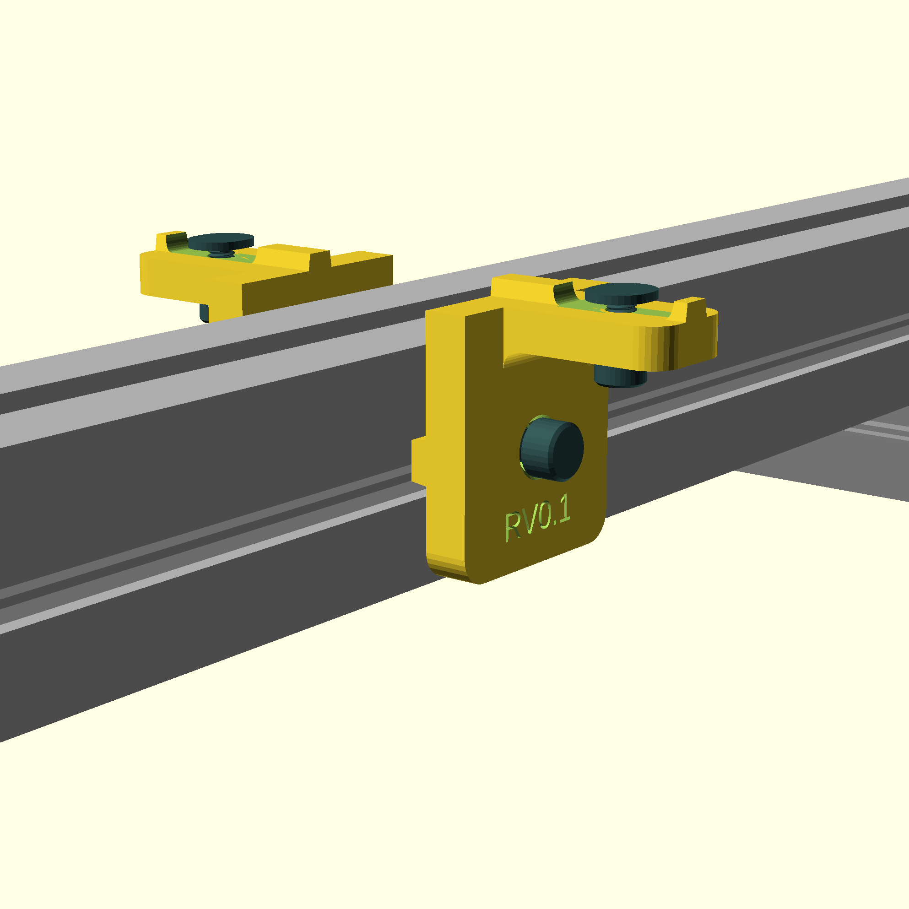 | 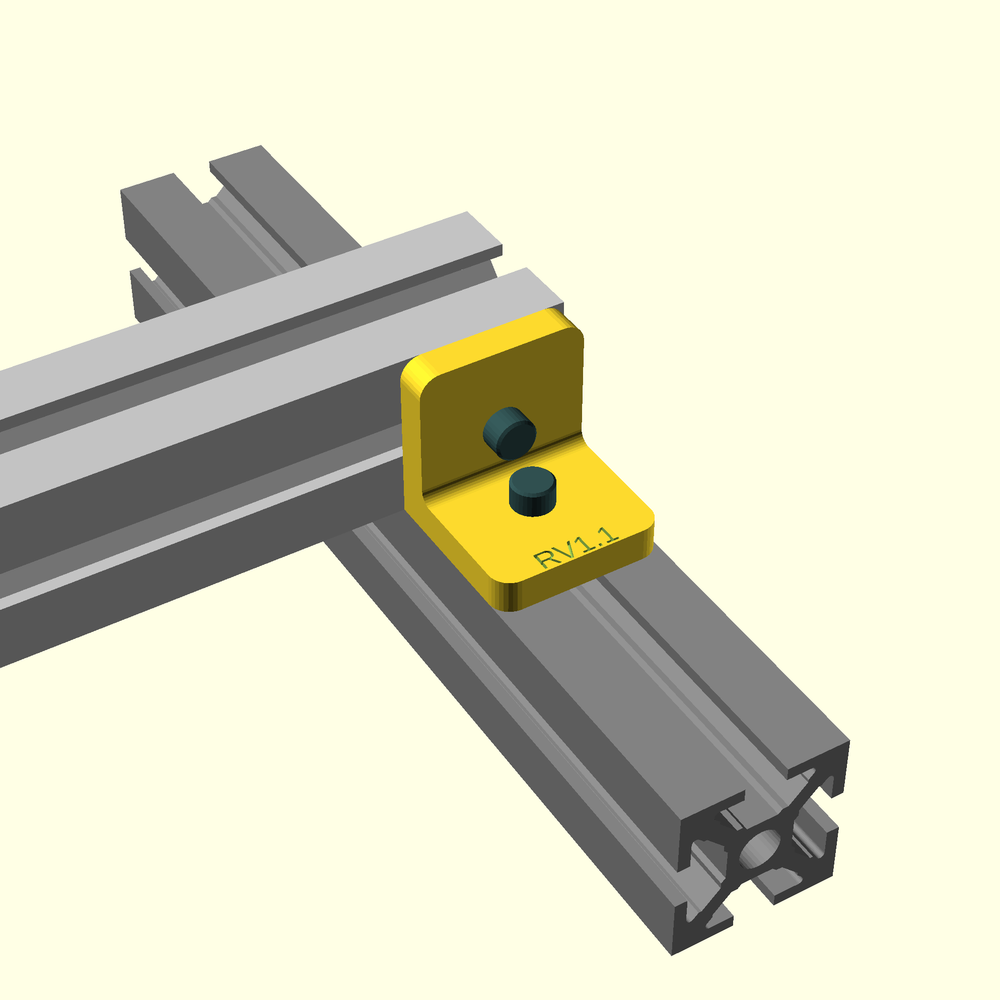 |
|                           *Illustration 1*                            |                    *Illustration 2*                     |
|                                                                       |                                                         |

#### 20x20 Bracket Installation

Do not attach the camera to the camera mount yet. This step establishes the coarse installation position.

1. Slot two slot 5 M5 t-nuts into the 20x20 profile rail
2. Loosely fasten the 3d printed cold-shoe holder to the 20x20 profile using M5 bolts (see *Illustration 3*). *Note: The final position will need to be adjusted. Avoid tightening until the end*
3. Slot the cold-shoe adapter into the slot. Secure it using the included thumb screws
4. Install the ball-head on the cold-shoe adapter and firmly tighten the thumb screw against the base
5. Before attaching the ArduCam to the 3D printed camera mount, secure it to the ball head with the screw holes pointing down (see *Illustration 4*)
6. Slide the 20x20 rail onto the 20x40 brackets and losely secure it.

|                                                                           |                                                         |
| :-----------------------------------------------------------------------: | :-----------------------------------------------------: |
| 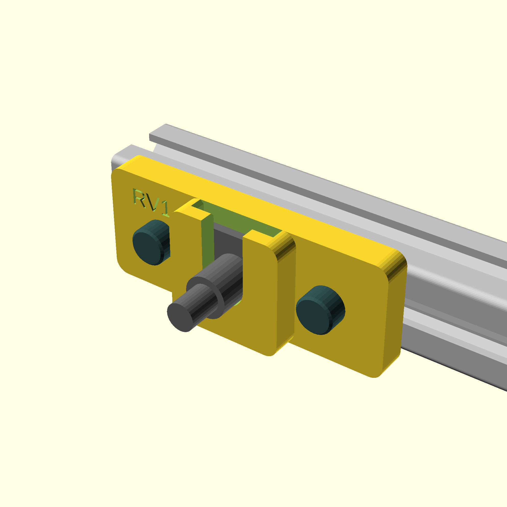 | 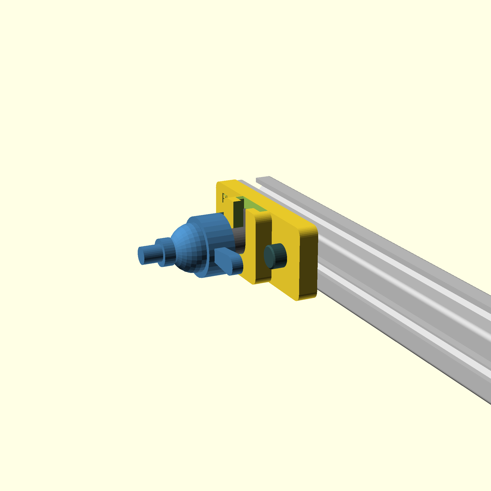 |
|                             *Illustration 3*                              |                    *Illustration 4*                     |
|    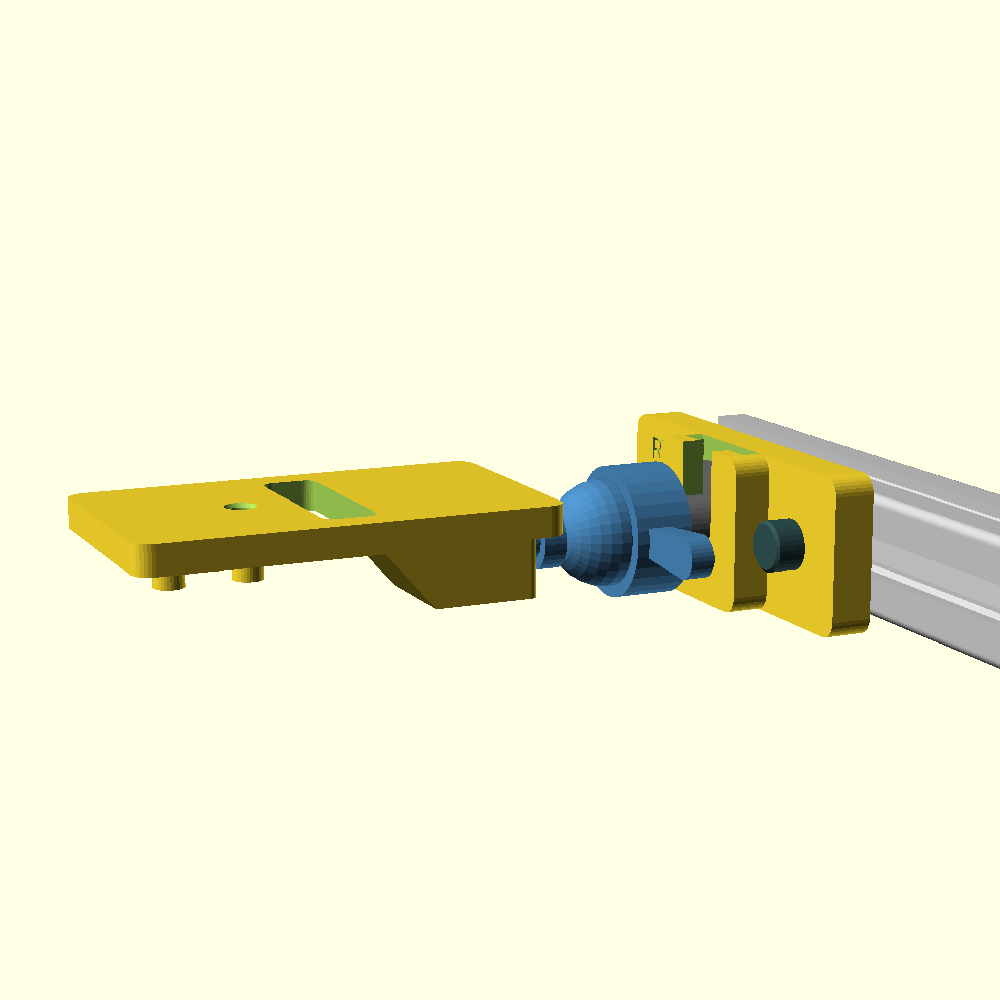     |   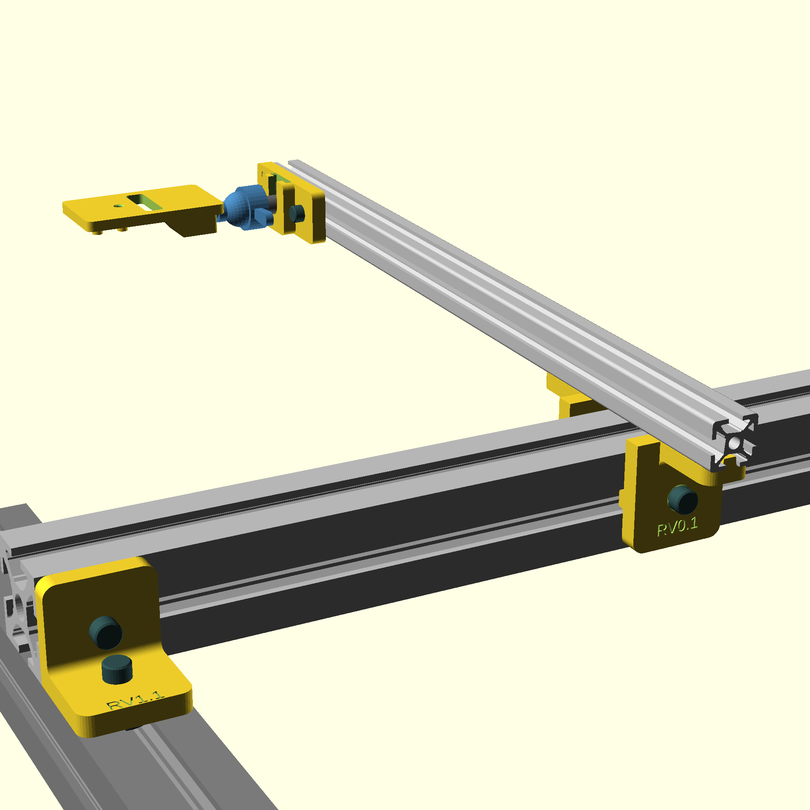   |
|                             *Illustration 5*                              |                    *Illustration 6*                     |
|                                                                           |                                                         |

#### Fiducial Tag Installation

**Development rig (since 2026-11-03, #349):** the corner tags lie inside the table edge, clear of
the trays, on white holders. East and west they sit as below (200 mm and 370 mm); north and south
they lie just inside the edge (metrology log 31.1). The method below is production's, with the tags
on the outer edge.

The 50mm fiducial tags need to be installed on the North and South edges of the table. They are located at the NW, SW, NE, SE corners. They are NOT located on the East and West edges of the table. Refer to the conventions illustration above. Attach the 50mm April Tags using XXX method The tags should be level with the floor and flush with the top edge of the table. It is not important which of the 50mm tags are used as long as all four are unique within this chamber. The tags face the inside of the table.

Measure from the the outside of the table (not the leg) edge to the edge of the black border.

1. The NE and SE tags should be located 240mm from the East edge of the table.
2. The NW and SW tags should be located 425mm from the West edge of the table.

**NOTE:** The tags MUST be parallel along the North/South dimension. The precise location from the table edge are less important than ensuring that the East pair and west pair are at the same location. If they are offset to the east/west, calibration will be more complex and difficult.

#### Coarse Camera Centering

The camera needs to be located above the usable geographic center of the table. The drain area cannot be used for growth trays and must be excluded. The drain area is ~170mm wide. This method uses a weighted string to identify the center of the camera mount.

1. Move the North/South support so it rests under one of the seams in the light panels such that it blocks as little light as possible.
2. Lay a tape measure across the table from the East to the West across the "equator" of the table. Making marks on the East and West edges can help.
3. Identify the center of the table equator excluding unusable portion of the table around the drain. Making a mark on the tape measure at the center can help. 
4. Attach the string to the weight.
5. Attach the weighted string to the hole in the ArduCam mount so the weight is just over the surface of the table, but not touching the table
6. Orient the camera mount so it is roughly parallel with the surface of the table
7. Move the mount until the weight aligns with the mark on the tape measure. Make a mark on the table for reference.
8. Secure all the bolts around the table starting with the brackets and finishing with the camera mount.
9.  Make any fine adjustments so the weight is still aligned with the center of the table
10. Mark the outline of the brackets on the aluminum rail

#### Camera and Pi Installation

It is extremely difficult to work over the table. It is significantly easier to remove the 20x20 rail entirely for this portion. Only loosen the M5 bolts that secure the 20x20 to the 40x40 rail.

1. Slide the 20x20 rail off of the mounts.
2. Attach the Flat CSI/DSI to the ZIF socket on the camera per the supplier instructions. Make sure to orient the conductors appropriately. 
3. Thread the flat cable through the opening in the mount. If using the AdaFruit CSI/DSI Thingy, attach attach one end of the cable to the Pi5 Camera 0 slot.
4. Secure the camera using the mounting screws
5. Mount the camera to the ball-head
6. Attach the Pi to either the 40x40 bar or to the 20x20 bar using zip ties depending on cable length.
7. Remount the 20x20 bar using the marks to align the bar. Tighten the bolts.
8. Join the cables at the AdaFruit Thingy.
9. Plug in the Pi
10. Move on to the [Calibration and Setup section](#calibration-and-setup)

## Calibration and Setup

Calibration measures how many pixels make a millimetre across the table. Validation checks how far an area can be trusted in each tray slot. Plant data counts only after both are done.

**Requirements**

- The rig installed and running (see [Camera Mount Installation](#camera-mount-installation))
- The rig's IP address, noted during [WiFi Setup](#wifi-setup)
- 12 trays at their normal height
- 12 printed calibration sheets, 30 mm tags, IDs 300 to 449, all from one print run
  - PDF: [apriltags-36h11-30mm-a4-300-449.pdf](../reference/calibration-sheets/apriltags-36h11-30mm-a4-300-449.pdf)
- 4 corner tags, 50 mm, fixed to the table edges (see [Fiducial Tag Installation](#fiducial-tag-installation))
  - PDF: [apriltags-36h11-50mm-a4-450-499.pdf](../reference/calibration-sheets/apriltags-36h11-50mm-a4-450-499.pdf)
  - How the sheets were made: [reference/calibration-sheets/README.md](../reference/calibration-sheets/README.md)
- Callipers
- About 45 minutes. Validation alone takes at least 20 minutes.

#### Before You Start

1. Print the sheets at 100% / actual size. Do not use "fit to page".
2. Check each print against the ruler on page 1 of its PDF.
3. Measure one tag on each printed sheet with the callipers. Write down the size in mm. A sheet printed at 96% once got mixed in and read about 8% small in area.
4. Remove spare and cut-off tag prints from the chamber. The rig reads every tag it can see, even in a waste bin.
5. Place the 12 trays in two rows of six, long edge north/south.
6. Open `http://<rig IP>:8000/setup/calibration` in a browser.

#### Step 1: Sheets

1. Lay one calibration sheet on every tray, inside the tray rim, not over it.
2. Press each sheet down along all four edges.
3. Check that all four corners touch the tray and nothing is under the sheet.
4. Leave the corner tags where they are.
5. Press **Next**.

#### Step 2: Focus

1. Tap the **Live view** on the area you want sharp.
2. Press **Autofocus**, or set the lens with **Coarse** and **Fine** while watching the **Magnified view**.
3. Check the image is neither too dark nor washed out. If needed, turn off **Auto exposure**, change **Exposure** first, and **Gain** only if needed.
4. When the magnified view is as sharp as it gets, press **Lock focus**.
5. Wait until the status reads "Focus is locked at" a lens position.
6. Press **Next**.

The focus position is the experimenter's choice. Pick what suits the plants and trays.

#### Step 3: Square

1. Make sure the East side of the table (opposite the drain) is in view.
2. Drag the magenta handles so each line sits on a table edge. On a keyboard: **1**, **2** or **3** picks a line, **W A S D** or the arrow keys move it.
3. If the lines do not follow the edges, the camera is rotated or tilted. Adjust the rig and check again.
4. Turn on **Corner rings**.
5. Nudge the rig until all four rings are green.
6. Press **Next**.

If the rig was moved, go back to Step 2 and lock focus again.

#### Step 4: Run

1. Enter the tag size from [Before You Start](#before-you-start) in **Calibration tag size**.
2. Leave **Make this the current baseline** on.
3. Check that every line in **Ready to run?** is green.
4. Press **Run calibration**. Wait for the result.
5. Press **Next**.

#### Step 5: Report

1. Read each line of the report table.
2. If coverage is weak somewhere, press **Open diagnostics** to see where.
3. Add a sheet there and press **Run again**.
4. Press **Next**.

#### Step 6: Validate

1. Leave the sheets where they are.
2. Press **Start validation**. The Validation page opens.
3. Check that the page shows "Focus: locked" at the calibration's lens position.
4. Press **Start validation**.

#### Validation Rounds

Repeat 3 times:

1. Leave the trays where they are.
2. Move each sheet to a different tray, 2 to 5 cm from where a sheet lay before. One sheet per tray.
3. Lay each sheet inside the tray rim and press it down along all four edges.
4. Check that all four corners touch the tray and nothing is under the sheet.
5. Step out of view and close the chamber door.
6. Tick "The sheets are pressed flat and the chamber door is closed".
7. Press **Capture round**. It takes about 20 seconds.
8. Wait for the countdown before the next round.

Rounds must be at least 10 minutes apart, and at least 20 minutes from first to last. Readings rise and fall on a cycle of about 19 minutes.

A round taken within 60 minutes of the Pi starting is held back. A cold camera reads low. Wait, or press **Count it anyway**.

#### Validation Result

- **Validated**: done. Each slot shows its uncertainty as a percentage.
- **Not consistent**: read the red "Problem" note. Fix the sheet, tray or round it names, then run calibration and validation again.

When validation is done, remove all sheets before starting a growth run.

#### When to Repeat

Repeat focus, calibration and validation after any of these:

- Refocusing, even slightly
- Moving or knocking the camera
- Changing the table or tray height
- A new print of calibration sheets
- A validation that reads "Not consistent"

See [docs/operator-guide.md](../docs/operator-guide.md) for why each step is done this way.
