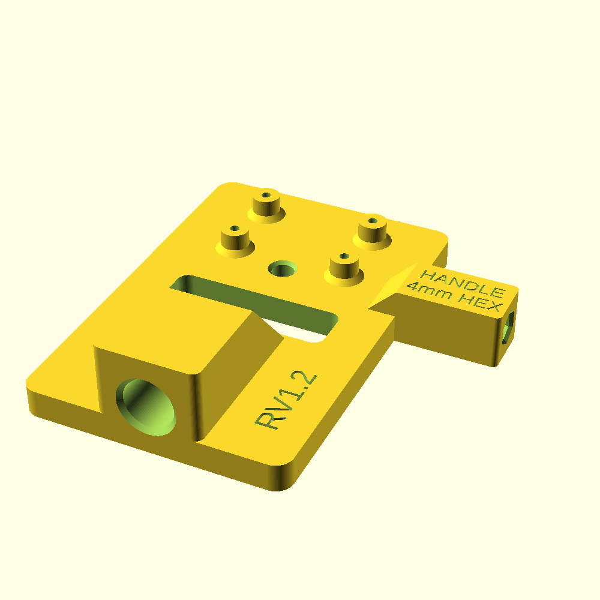
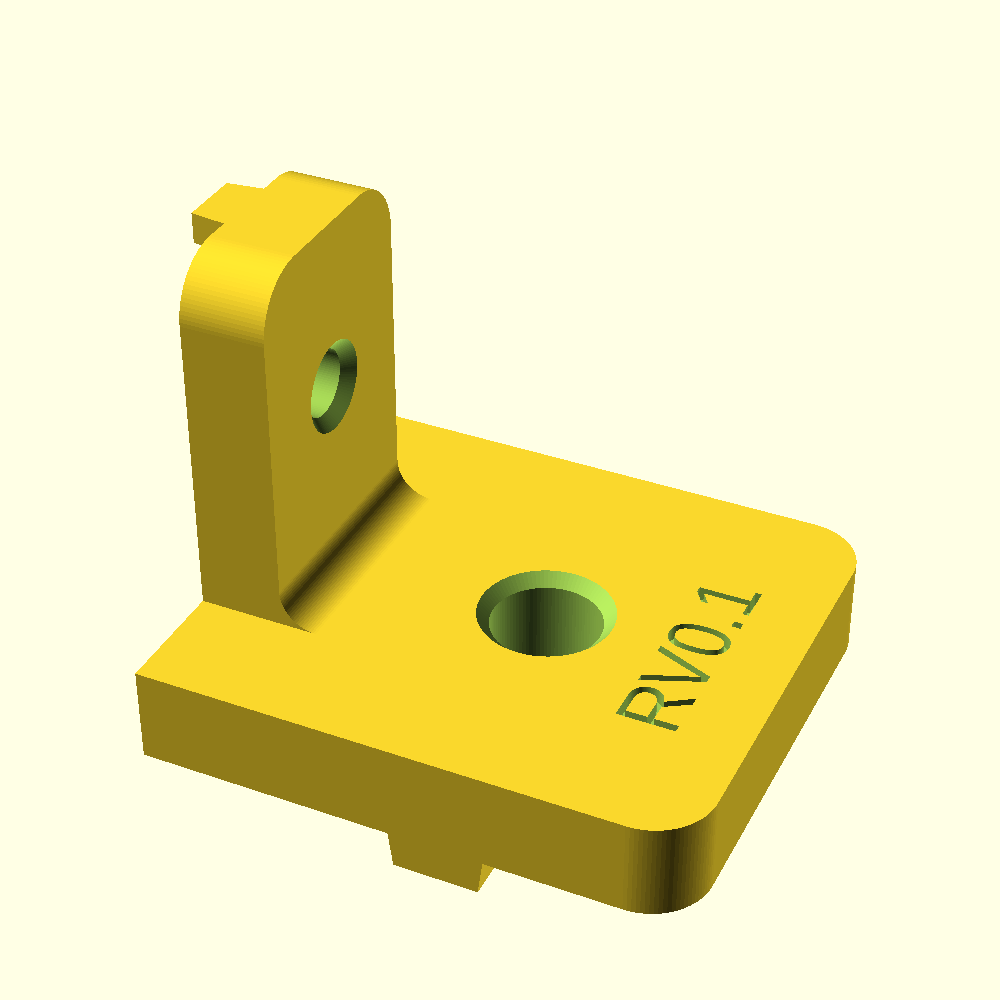
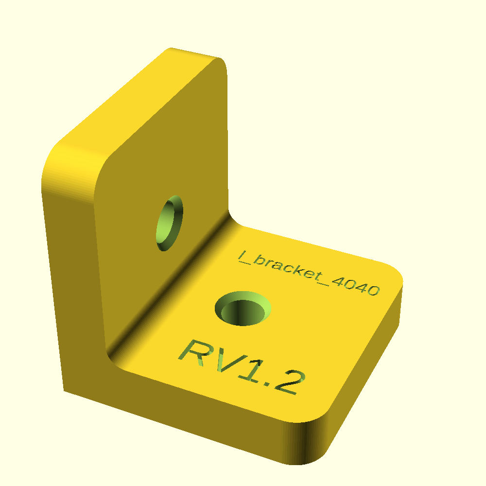
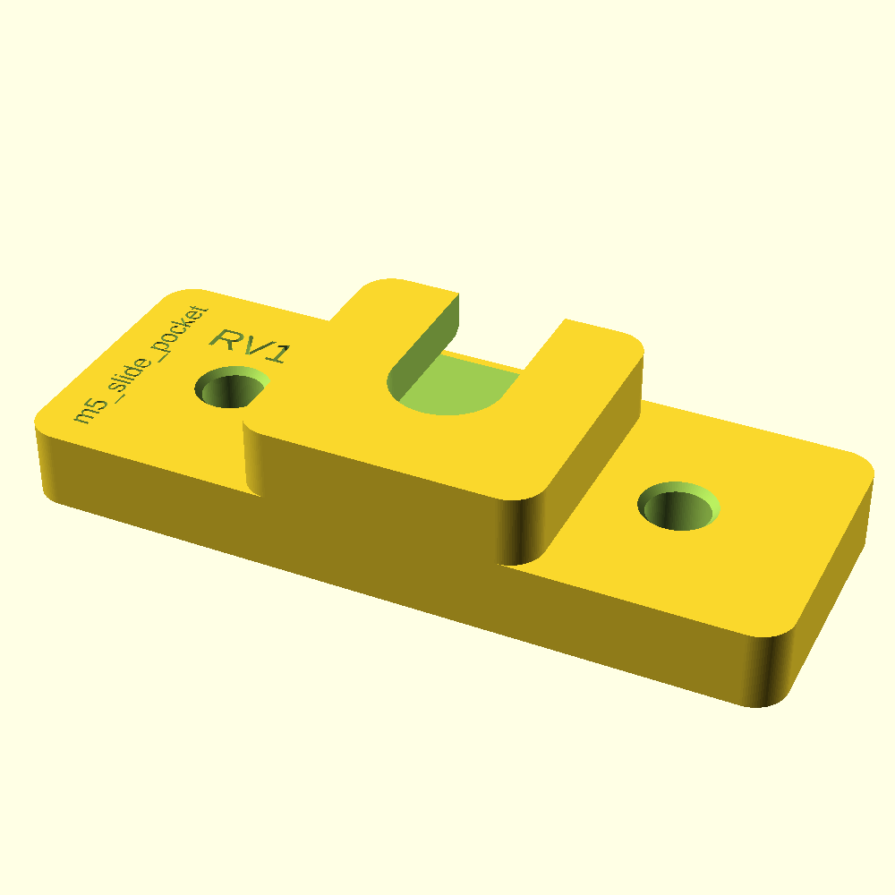
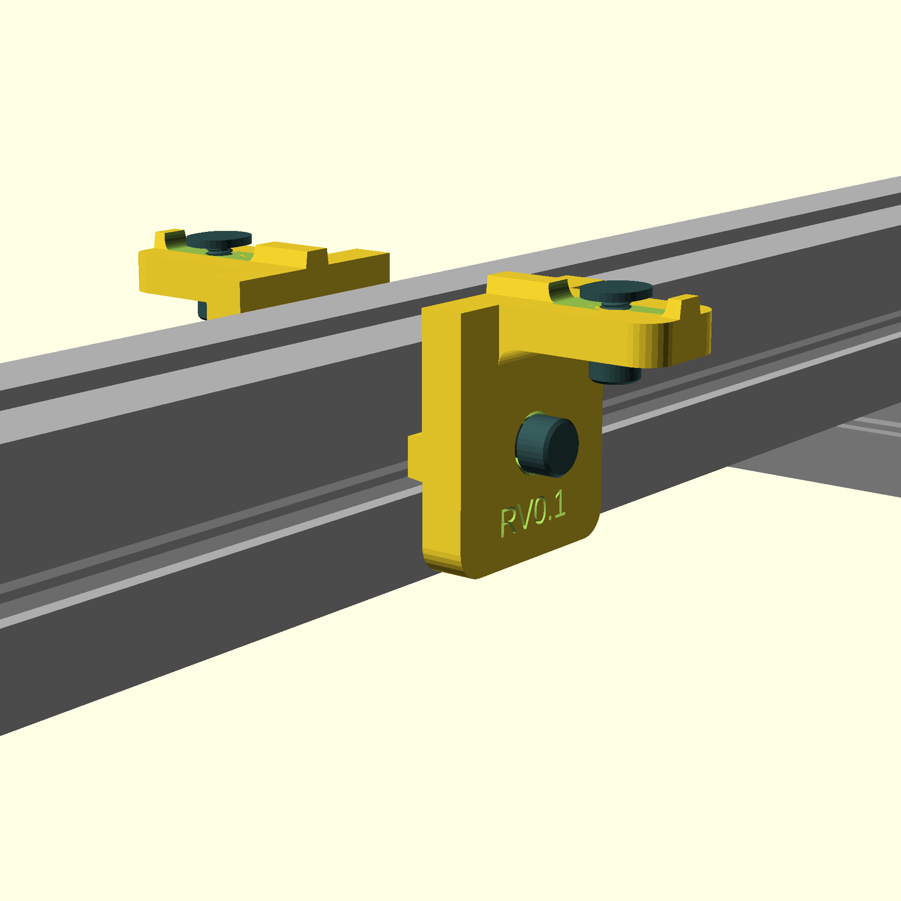
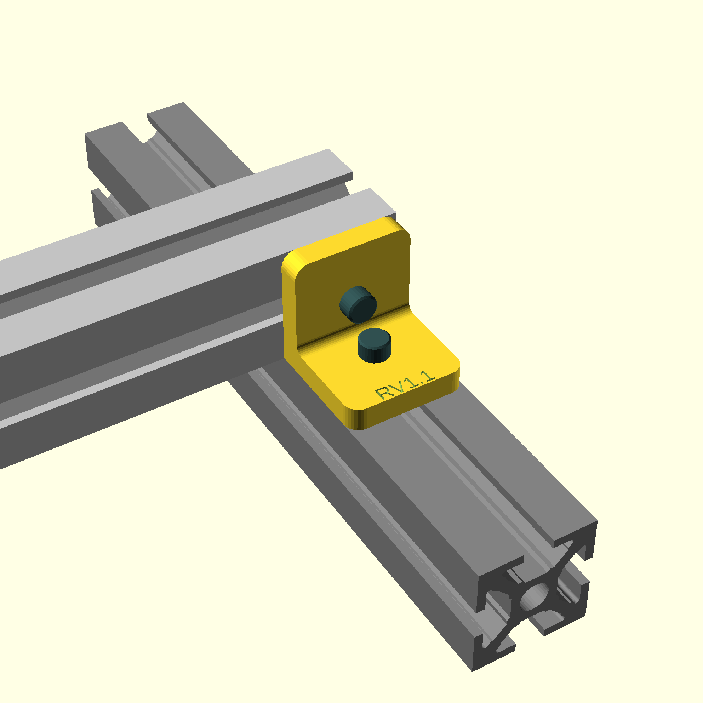
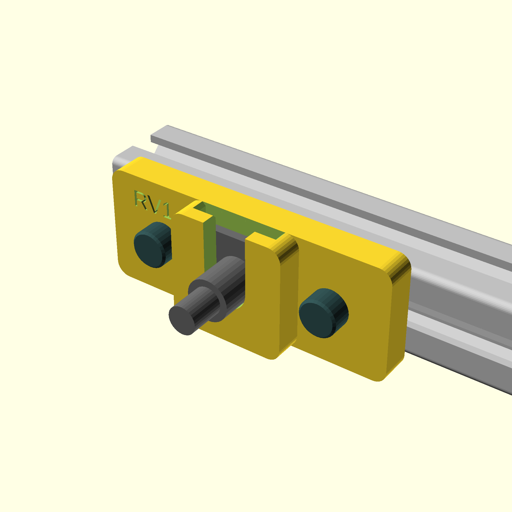
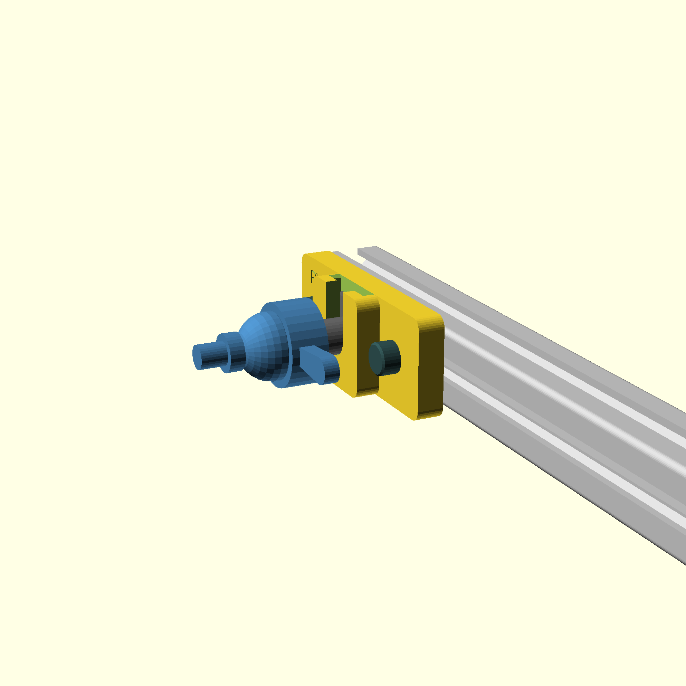
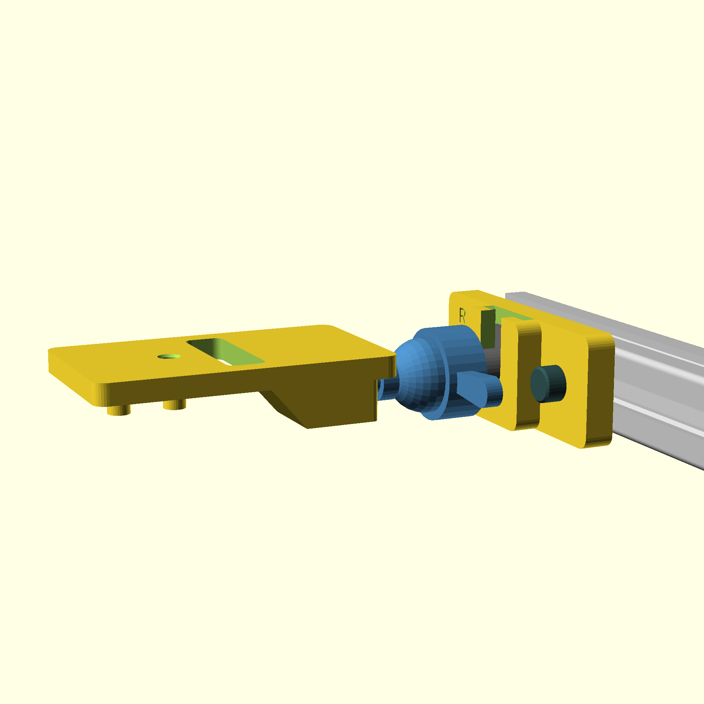
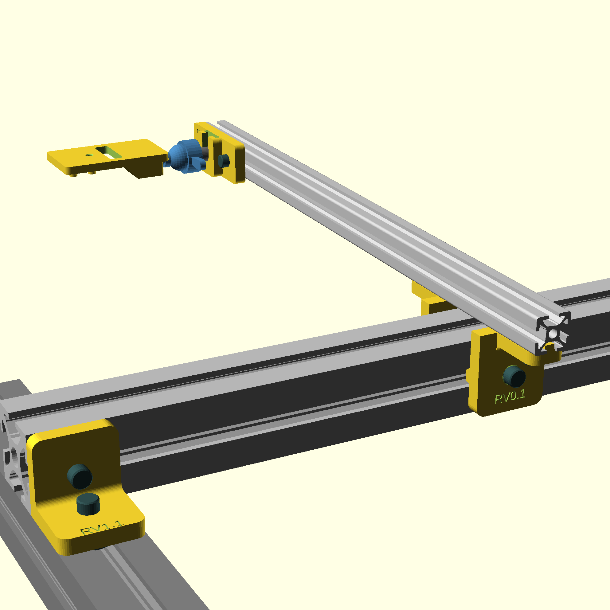

# Daylight Growth Chamber Hardware Installation Instructions <!-- omit in toc -->

- [Raspberry Pi 5 Preparation- Raspberry Pi 5 Preparation](#raspberry-pi-5-preparation--raspberry-pi-5-preparation)
- [Conventions](#conventions)
- [Camera Mount Installation](#camera-mount-installation)
- [Calibration and Setup](#calibration-and-setup)

## Raspberry Pi 5 Preparation- [Raspberry Pi 5 Preparation](#raspberry-pi-5-preparation)

This section prepares a Raspberry Pi 5 for chamber deployment.

## Conventions

Standing in the chamber door way, with the control panel to the right, the following conventions are used to define the chamber layout.

- Left side: West
- Right side: East
- Front (closest to door): South
- Back (farthest from door): North

When using this camera system, a maximum of 12 trays can be effectively captured. Trays are expected to be placed in two rows of six each. With the long edge oriented north/south. Other orientations are possible and should work, but the area around the drain cannot be effectively used and should be excluded.

**Top View**

```text
     NW                    North            NE
     ┌───────────────────────────────────────┐
     │ D                                     │
     │ R                   │                 │
West │ A ────────equator───+──equator─────── │ East
     │ I                   │                 │
     │ N                                     │
     └───────────────────────────────────────┘
     SW                   South             SE


    │
> ──+── < Geographic center of the table excluding the drain width
    │

```

**Front View**

```text
                    Top Support
    ┌───────────────────────────────────────┐
    │                                       │
    │                                       │
    │                                       │
    │                                       │
    ├───────────────────────────────────────┤
    │                 Table                 │
    ├───────────────────────────────────────┤
    │                                       │
    │                                       │
    │                                       │
```


## Camera Mount Installation

### Materials

See the [Bill of Materials](./Bill-of-Materials.md) document for complete parts list and UU approved distributors.

| Qty | Item                                                                                                                | Notes |
| --- | ------------------------------------------------------------------------------------------------------------------- | ----- |
| 1   | 3 Gang Power Strip w 3m cable                                                                                       |       |
| 1   | 1.3m 40x40 t-chanel profile aluminum rail                                                                           |       |
| 1   | .4m 20x20 t-chanel profile aluminum rail                                                                            |       |
| 4   | M5x?? Bolts                                                                                                         |       |
| 4   | M6x?? Bolts                                                                                                         |       |
| 4   | M5 t-nut guided I-type slot 6 (20x20 compatible)                                                                    |       |
| 4   | M6 t-nut guided I-type slot 8 (40x40 compatible)                                                                    |       |
| 2   | 40x40 compatible 90 degree brackets                                                                                 |       |
| 2   | 20x20 compatible 90 degree brackets or [3D printed bracket](./exports/camera_rig/l_bracket_4020.stl)                           |       |
| 1   | [3D printed Cold Shoe Holder](./exports/camera_rig/m5_slide_pocket.stl)                                                        |       |
| 4   | [50mm Fiducial Tags](../reference/calibration-sheets/apriltags-36h11-50mm-a4-450-499.pdf) mounted on table brackets |       |
| 1   | Cold Shoe Adapter 3/8" to 1/4"                                                                                      |       |
| 1   | 1/4" compatible Ball Joint                                                                                          |       |
| 1   | ArduCam64 and appropriate cables                                                                                    |       |
| 1   | *Prepared Raspberry Pi 5 & Power Supply                                                                             |       |
|     | Zip Ties                                                                                                            |       |
| 1   | 1.5 m string                                                                                                        |       |
| 1   | Small heavy weight such as a nut                                                                                    |       |
|     | Scissors                                                                                                            |       |
|     | Hex Wrenches (5mm, 6mm)                                                                                             |       |
|     | Permanent marker (optional)                                                                                         |       |
|     | Double sided tape (optional)                                                                                        |       |

* See FIXME instructions for preparing the Raspberry Pi.

|                                               |                                                         |                                                        |                                                  |
| :-------------------------------------------: | :-----------------------------------------------------: | :----------------------------------------------------: | :----------------------------------------------: |
|                |                           |                          |                   |
| [Camera Mount](./exports/camera_rig/arducam64_mount.stl) | [40x20 90 Degree Bracket](./exports/camera_rig/l_bracket_4020.stl) | [40x40 90 Degree Bracket](./images/l_bracket_4040.png) | [Cold Shoe Holder](./images/m5_slide_pocket.png) |


### Physical Installation Steps

Before starting: Ensure that the North and South TOP support 40x40 Profile rail are installed so the profile is exposed on the TOP of the rail. The default PSI install orients the channel facing down. It is possible to remove the corner braces, and rotate the bars in place without uninstalling them.

#### 40x40 Rail Installation

1. Loosely install the 90 degree bracket at either end of the 1.3m 40x40 t-chanel using the type 8 t-nuts and M6 bolts. Do not tighten. 
2. Install one type 8 t-nut on the left and right side of the rail.
3. Secure one 40x20 90 degree bracket to the left and right sides of the rail (see *Illustration 1* below)
4. Secure an M5 and type 6 t-nut to each of the 20mm brackets
5. Near the center of each profile, slot one type 8 t-nut into the top-support north and south 40x40 profile. *Note: this can be done in place; the nuts can be rotated such that they fit in to the chanel.*
6. Lay the 40x40 across the top support spanning the north and south supports
7. Loosely secure the 90 degree brackets to the north and south top support (see *Illustration 2* below). *Note: The rig will need to be centered. Avoid tightening the brackets until the end.*
8. Ensure the table is approximately in the center of the growth chamber
9. Slide the 40x40 rail so it roughly aligns with the seams in the light panels. The goal is to block as little light as possible.


|                                                                       |                                                         |
| :-------------------------------------------------------------------: | :-----------------------------------------------------: |
|  |  |
|                           *Illustration 1*                            |                    *Illustration 2*                     |
|                                                                       |                                                         |

#### 20x20 Bracket Installation

Do not attach the camera to the camera mount yet. This step establishes the coarse installation position.

1. Slot two type 6 t-nuts into the 20x20 profile rail
2. Loosely fasten the 3d printed cold-shoe holder to the 20x20 profile using 5mm bolts (see *Illustration 3*). *Note: The final position will need to be adjusted. Avoid tightening until the end*
3. Slot the cold-shoe adapter into the slot. Secure it using the included thumb screws
4. Install the ball-head on the cold-shoe adapter and firmly tighten the thumb screw against the base
5. Before attaching the ArduCam to the 3D printed camera mount, secure it to the ball head with the screw holes pointing down (see *Illustration 4*)
6. Slide the 20x20 rail onto the 20x40 brackets and losely secure it.

|                                                                           |                                                         |
| :-----------------------------------------------------------------------: | :-----------------------------------------------------: |
|  |  |
|                             *Illustration 3*                              |                    *Illustration 4*                     |
|         |      |
|                             *Illustration 5*                              |                    *Illustration 6*                     |
|                                                                           |                                                         |

#### Fiducial Tag Installation

**Development rig (since 2026-11-03, #349):** the corner tags lie inside the table edge, clear of
the trays. Their offsets and holder are not yet recorded here. The method below is production's,
with the tags on the outer edge.

The 50mm fiducial tags need to be installed on the North and South edges of the table. They are located at the NW, SW, NE, SE corners. They are NOT located on the East and West edges of the table. Refer to the conventions illustration above. Attach the 50mm April Tags using XXX method The tags should be level with the floor and flush with the top edge of the table. It is not important which of the 50mm tags are used as long as all four are unique within this chamber.

Measure from the the outside of the table (not the leg) edge to the edge of the black border.

1. The NE and SE tags should be located 200mm from the East edge of the table.
2. The NW and SW tags should be located 370mm from the West edge of the table.

**NOTE:** The tags MUST be parallel along the North/South dimension. The precise location from the table edge are less important than ensuring that the East pair and west pair are at the same location. If they are offset to the east/west, calibration will be more complex and difficult.

#### Coarse Camera Centering

The camera needs to be located above the usable geographic center of the table. The drain area cannot be used for growth trays and must be excluded. The drain area is ~170mm wide. This method uses a weighted string to identify the center of the camera mount.

1. Lay a tape measure across the table from the East to the West across the "equator" of the table. Making marks on the East and West edges can help.
2. Identify the center of the table equator excluding unusable portion of the table around the drain. Making a mark on the tape measure at the center can help. 
3. Attach the string to the weight.
4. Attach the weighted string to the hole in the ArduCam mount so the weight is just over the surface of the table, but not touching the table
5. Orient the camera mount so it is roughly parallel with the surface of the table
6. Move the mount until the weight aligns with the mark on the tape measure. Make a mark on the table for reference.
7. Secure all the bolts around the table starting with the brackets and finishing with the camera mount.
8. Make any fine adjustments so the weight is still aligned with the center of the table
9. Mark the outline of the brackets on the aluminum rail

#### Camera and Pi Installation

It is extremely difficult to work over the table. It is significantly easier to remove the 20x20 rail entirely for this portion. Only loosen the M5 bolts that secure the 20x20 to the 40x40 rail.

1. Slide the 20x20 rail off of the mounts.
2. Attach the Flat CSI/DSI to the ZIF socket on the camera per the supplier instructions. Make sure to orient the conductors appropriately. 
3. If using the HDMI adapter, attach one to the camera now and the other to the raspberry Pi 5 Camera 0 slot. Secure with double stick tape as necessary.
4. If not using the HDMI adapter, thread the flat cable through the opening in the mount. If using the AdaFruit CSI/DSI Thingy, attach attach one end of the cable to the Pi5 Camera 0 slot.
5. Secure the camera using the mounting screws
6. Mount the camera to the ball-head
7. Attach the Pi to either the 40x40 bar or to the 20x20 bar using zip ties depending on cable length.
8. Remount the 20x20 bar using the marks to align the bar. Tighten the bolts.
9. Plug in the HDMI cable or join the cables at the AdaFruit Thingy.
10. Plug in the Pi 
11. Move on to the calibration and setup steps

## Calibration and Setup

