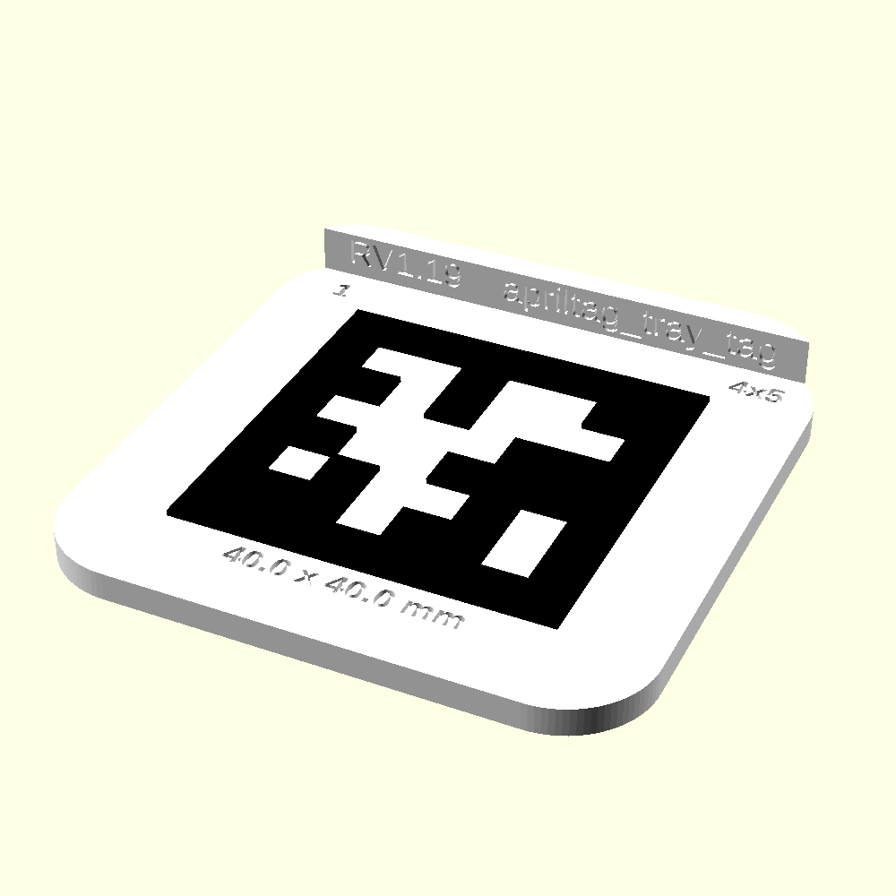
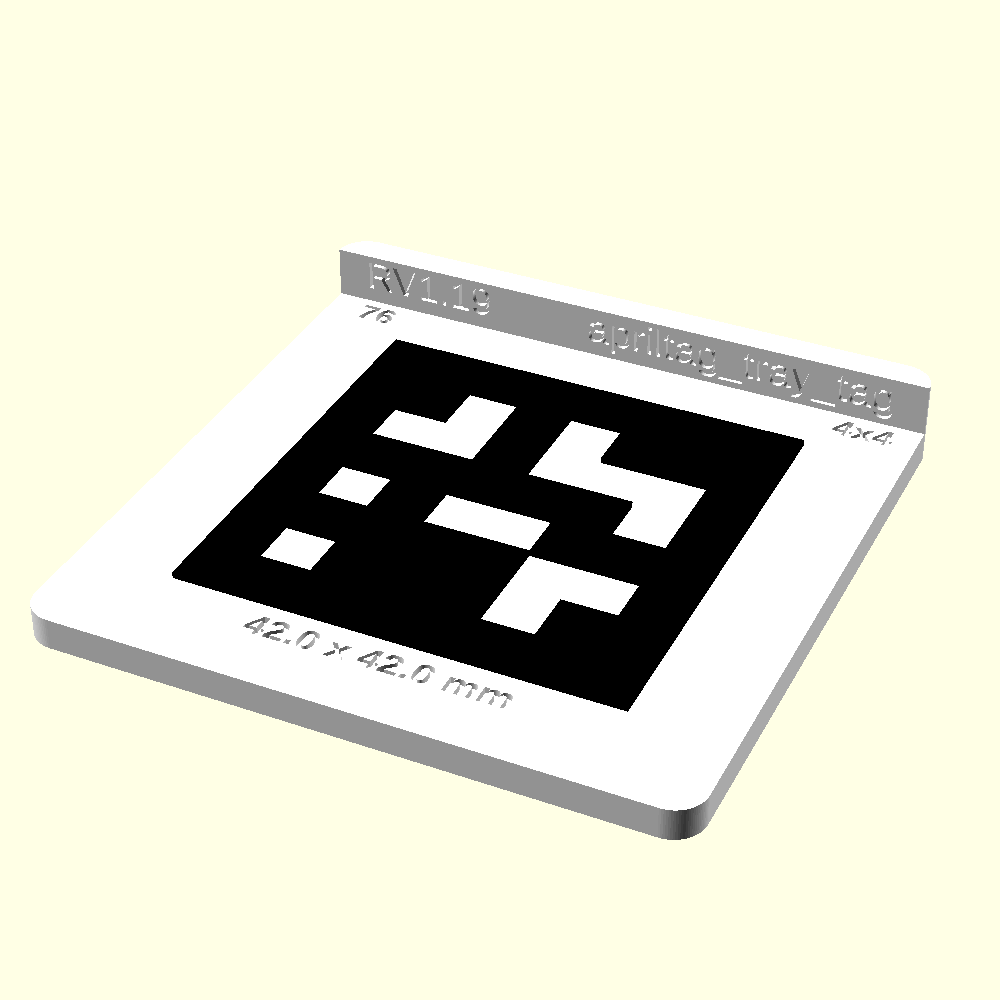
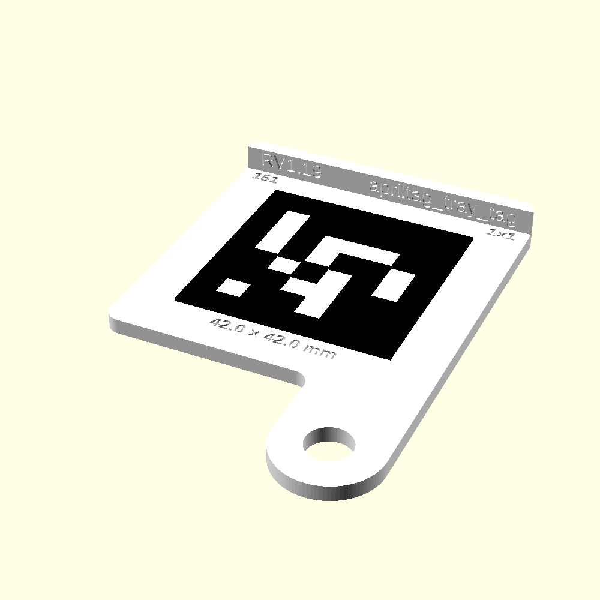
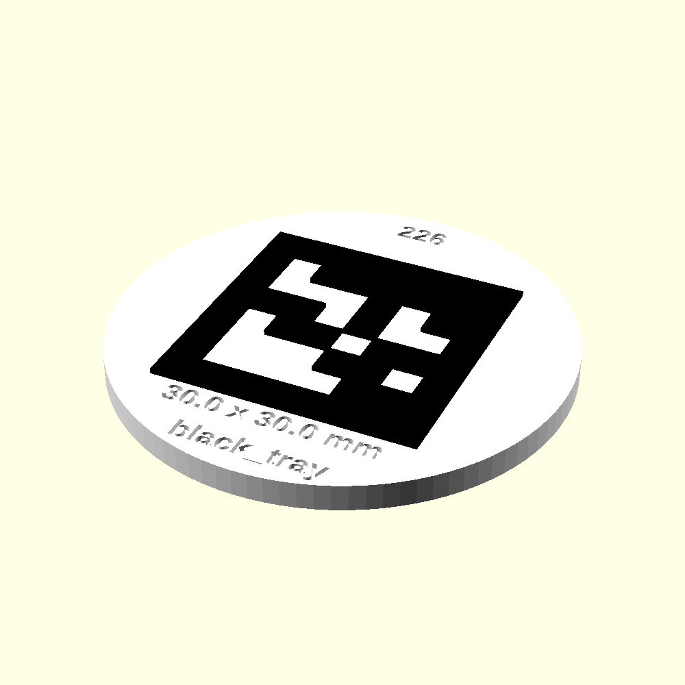
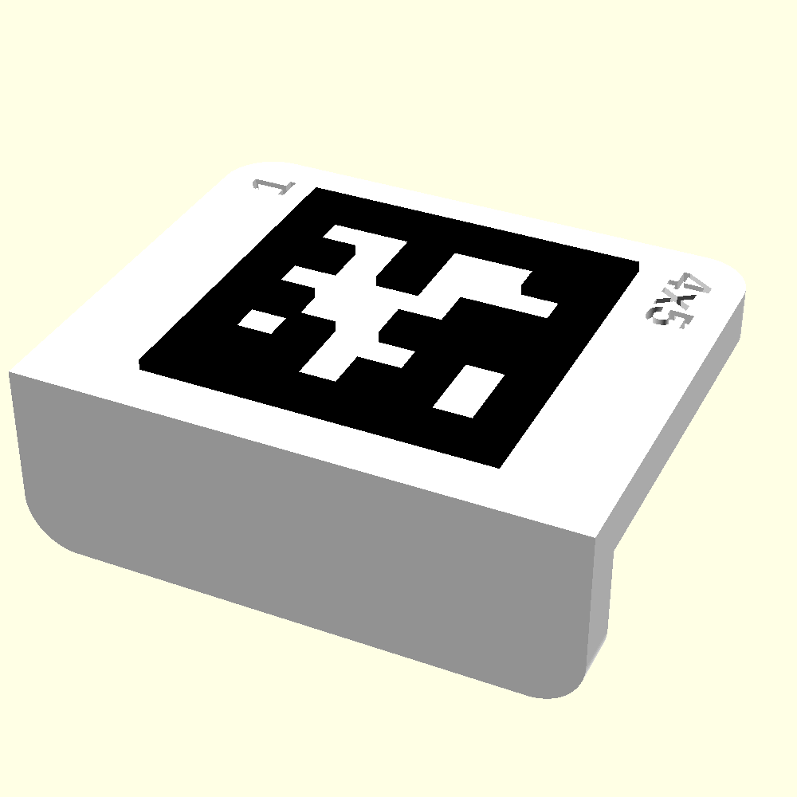
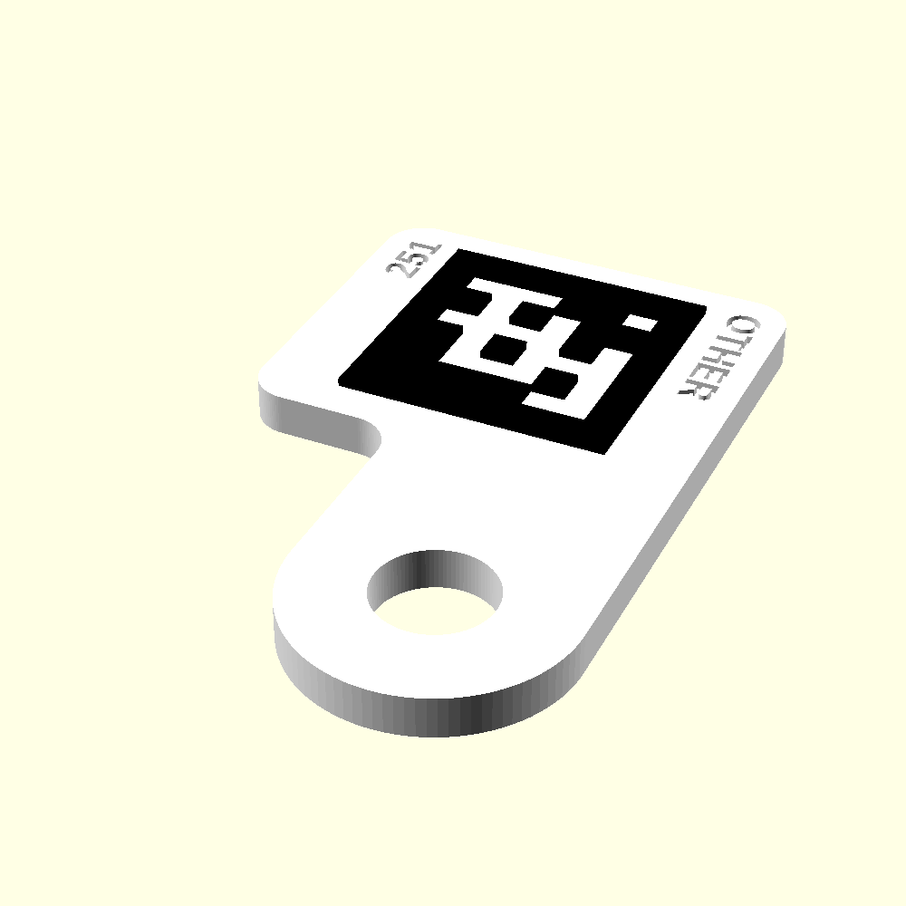
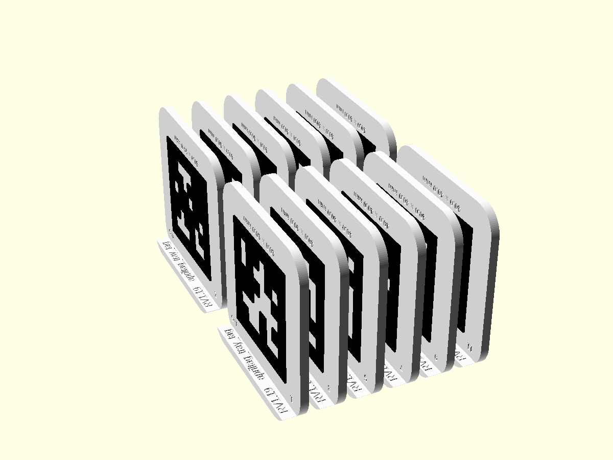

# Hardware

Parametric OpenSCAD models for the camera rig: printed mounts, T-slot extrusion stock and bolt
stand-ins. Installation steps are in [Installation.md](Installation.md) and the parts list is in
[Bill-of-Materials.md](Bill-of-Materials.md). This page covers printing the tray tags, the
AprilTag corner mounts, and how to export multi-color prints.

## Layout

| Folder | Contents |
|---|---|
| `camera_rig/` | Printable rig parts: brackets, slide pocket, camera mount, AprilTag corner mount, and `rig_assembly.scad`, the assembled mockup |
| `tray_tags/` | `apriltag_tray_tag.scad`, the per-tray AprilTag |
| `libraries/` | Modules other files `use`: vendored BOSL2, T-slot extrusion and bolt stand-ins, purchased-part stand-ins for the mockup (cold shoe stud, mini ball head), AprilTag geometry and bit data |
| `exports/` | STL and 3MF exports, in subfolders mirroring the source folders |
| `images/` | Preview renders for the docs, made by `render_images.sh` |
| `reference/` | Vendor CAD drawings, see `reference/README.md` |

The scripts (`scad_to_3mf.py`, `tray_tags.py`, `corner_tags.py`, `render_images.sh`) stay at
this level and find their files relative to themselves, so they work from any directory.
`.scad` files reach each other with relative paths such as `use <../libraries/t_slot_bolt.scad>`,
which OpenSCAD resolves from the including file's own folder.

## Print settings

Set in Orca for each print (Aaron, 2026-10-21):

| Part | File in `camera_rig/` or `tray_tags/` | Infill | Supports | Orientation |
|---|---|---|---|---|
| 40x20 L bracket | `l_bracket_4020.scad` | about 80% | yes | on its side, both legs on the bed (below) |
| 40x40 L bracket | `l_bracket_4040.scad` | about 80% | yes | on its side, both legs on the bed (below) |
| Auto-focus bracket | `auto-focus_bracket_2020.scad` | about 80% | not recorded | as in the file |
| Corner mounts | `apriltag_corner_mount.scad` | 50% or more, so they are robust | yes | as in the file |
| Tray tags | `apriltag_tray_tag.scad` | 20-30% | not recorded | as in the file |

**L brackets.** The purchased aluminium brackets in [Bill-of-Materials.md](Bill-of-Materials.md)
are preferred; print these only as a substitute. Both files model the bracket standing up: one
leg flat and the other upright. In Orca, turn it onto its side so the L-shaped face rests on the
bed and both legs lie on it. This puts the layer lines perpendicular to the load.

Not yet recorded: settings for the camera mount and slide pocket, and any slicer setting other
than infill and supports.

## Tray tags: printing a complete set

Every growth tray in the chamber carries one 3D-printed AprilTag. The camera reads the tag to
tell which tray it is looking at, what kind of tray it is, and where it lies. This section goes
from a computer with nothing installed to a finished, checked set of tags. Follow the steps in
order. Each step ends with a check; if a check fails, stop and fix it before going on.

### What each tray gets

The tag's ID number decides everything else: the tray type engraved on it, its shape and size,
and the folder its file goes in. Pick the ID range from the tray type:

| Tray | IDs | Style | Tag (black square) | Plate | Where the tag goes |
|---|---|---|---|---|---|
| 4 x 5 (20 cells) | 1-75 | `lip_round` | 40 mm | 60.5 mm square, rounded corners, lip | cell A1, roughly centred, any rotation; A1 holds no plant |
| 4 x 4 (16 cells) | 76-150 | `lip` | 42 mm | 61 mm square, lip | in the middle of the tray |
| 1 x 1 (one well) | 151-225 | `lip_bolt` | 42 mm | 61 mm square, lip, M8 bolt tab | bolted to a corner of the tray, so the whole tag lies inside the tray's footprint |
| Black tray | 226-250 | `disc` | 30 mm | 51 mm disc | in a pot |
| Any other tray | 251-299 | `tab` | 20 mm | 32 x 26 mm, tab over the tray edge | over the tray edge |

| 4 x 5: `lip_round` | 4 x 4: `lip` | 1 x 1: `lip_bolt` |
|---|---|---|
|  |  |  |
| **Black tray: `disc`** | **Other: `tab`** | **Not a default: `bolt`** |
|  |  |  |

What is engraved on each tag, so a printed tag can be checked by eye:

- **ID** (`1` above): top-left corner on the lip styles, above the tag on the disc.
- **Tray type** (`4x5`): top-right corner on the lip styles, below the tag on the disc.
- **Tag size** (`40.0 x 40.0 mm`): below the tag. This is the size the model draws, not a
  measurement of the print.
- **Revision and part name** (`RV1.19 apriltag_tray_tag`): on the inside face of the lip, or on
  the underside of the disc.

Rules for choosing IDs:

- **Every tray in a chamber needs its own ID.** Two trays with the same ID cannot be told apart.
- **Tray IDs are 1 to 299 only.** 300-449 are the calibration sheets, 450-499 the corner mounts,
  500 the auto-focus target, and 0 is unused (PLAN.md, *Tag ID allocation*). The script refuses
  anything else.
- **Keeping track of IDs is up to you.** This repo sets the ranges and what each one is for. It
  does not record which IDs have been printed or are on a tray. Keep your own list, and take
  new IDs from the free ones in the tray's range.

A1 is the south-west corner of a tray seen from above in portrait (`../reference/trays.md`).

### Step 1: install the tools (once per computer)

1. **OpenSCAD development snapshot ("nightly").** Download it from
   [openscad.org/downloads.html#snapshots](https://openscad.org/downloads.html#snapshots), the
   *Development Snapshots* section of the
   [OpenSCAD downloads page](https://openscad.org/downloads.html). Pick the build for your
   system (macOS, Windows or Linux AppImage).

   The release version, 2021.01, **does not work**. The export uses `--enable=lazy-union` and the
   `export-3mf` color options, which exist only in the snapshots. The files in `exports/` were
   made with snapshot 2026.09.18.

   - **macOS:** put `OpenSCAD.app` in `/Applications`. The scripts look for it there.
   - **Windows or Linux:** tell the scripts where OpenSCAD is, in every terminal you use them
     from:

     ```sh
     # Linux or macOS elsewhere, path to your own copy
     export OPENSCAD=~/Applications/OpenSCAD-nightly.AppImage
     ```

     ```powershell
     # Windows PowerShell, path to openscad.exe where you installed it
     $env:OPENSCAD = "C:\path\to\openscad.exe"
     ```

2. **uv**, which runs the Python scripts:
   [docs.astral.sh/uv/getting-started/installation](https://docs.astral.sh/uv/getting-started/installation/).
   The scripts use only the Python standard library; uv supplies Python itself.
3. **Orca Slicer**, to slice and print:
   [github.com/OrcaSlicer/OrcaSlicer/releases](https://github.com/OrcaSlicer/OrcaSlicer/releases).
4. **A copy of this repository**, with git. The repository is private: you need a GitHub
   account that has been given access, with an SSH key set up.

   ```sh
   git clone git@github.com:txoof/npec-camera-rig.git
   ```

**Check:** in a terminal, go to the `hardware/` folder and ask OpenSCAD and the script for their
versions:

```sh
cd npec-camera-rig/hardware
/Applications/OpenSCAD.app/Contents/MacOS/OpenSCAD --version   # or: "$OPENSCAD" --version
uv run tray_tags.py --help
```

OpenSCAD must print a dated snapshot version such as `OpenSCAD version 2026.09.18`, not
`2021.01`. The script must print its usage text. Every command below is run from this
`hardware/` folder.

### Step 2: use the ready-made files, or make new ones

Ready-to-print files for every ID from 1 to 250 are kept in `exports/tray_tags/`, 12 tags to a
file (one build plate each). Use them unless the `.scad` has changed since they were made.

| Tray type | Folder | Files | Revision |
|---|---|---|---|
| 4 x 5 | `exports/tray_tags/4x5/` | `apriltag_tray_tag_4x5_1-12_lip_round.3mf` to `..._73-75_lip_round.3mf` | RV1.19 |
| 4 x 4 | `exports/tray_tags/4x4/` | `apriltag_tray_tag_4x4_76-87_lip.3mf` to `..._148-150_lip.3mf` | RV1.18 |
| 1 x 1 | `exports/tray_tags/1x1/` | `apriltag_tray_tag_1x1_151-162_lip_bolt.3mf` to `..._223-225_lip_bolt.3mf` | RV1.18 |
| Black tray | `exports/tray_tags/black_tray/` | `apriltag_tray_tag_black_tray_226-237_disc.3mf` to `..._250_disc.3mf` | RV1.18 |

The 4 x 4, 1 x 1 and black tray files are RV1.18 because their shapes did not change in RV1.19.
Rebuilding them gives the same tags stamped RV1.19. There are no ready files for 251-299.

To make a file for the IDs you need, give `tray_tags.py` one group per build plate. A group is a
range (`13-24`) or a single ID (`7`), at most 12 tags, all of one tray type. Each group gets its
tray type's style from the table above.

```sh
# 4 x 5 tags 13 to 24, one build plate
uv run tray_tags.py 13-24

# 4 x 5 tags 13 to 24 and 4 x 4 tags 76 to 80: two groups, two files
uv run tray_tags.py 13-24 76-80
```

To rebuild every ready-made file, for example after changing the `.scad`:

```sh
# 4x5, lip_round
uv run tray_tags.py 1-12 13-24 25-36 37-48 49-60 61-72 73-75

# 4x4, lip
uv run tray_tags.py 76-87 88-99 100-111 112-123 124-135 136-147 148-150

# 1x1, lip_bolt
uv run tray_tags.py 151-162 163-174 175-186 187-198 199-210 211-222 223-225

# black_tray, disc
uv run tray_tags.py 226-237 238-249 250
```

Each file is written to `exports/tray_tags/<tray type>/apriltag_tray_tag_<tray type>_<ids>_<style>.3mf`,
replacing any file of the same name.

**Check:** every group prints one report. Each tag is one object with two parts (white body,
black tag), so 12 tags give `12 object(s), 24 parts`, and there are exactly two filaments:

```text
.../exports/tray_tags/4x5/apriltag_tray_tag_4x5_13-24_lip_round.3mf: 12 object(s), 24 parts
  filament 1: #FFFFFF
  filament 2: #000000
```

- A group that crosses a tray type boundary (`70-80`), goes past 299, or names an unknown style is
  refused with the reason, and nothing is exported. Split it at the boundary or fix the ID.
- A line starting `warning` means the file is not ready to print. Do not print it.
- `scad_to_3mf: OpenSCAD export failed` with `lazy-union` or `export-3mf` in the message means
  the release OpenSCAD was used, not the snapshot. Go back to Step 1.

### Step 3: slice and print in Orca

You need a printer that prints two filaments in one job: **white in slot 1, black in slot 2**.
The file already says which part uses which slot.

**Filament:** white and black PLA, or white and blue PLA. Do not use green, yellow or brown for
either part. The file calls the pattern black; for blue, load blue in slot 2. Use the same
filaments for every tag in a set.

**Infill:** 20-30% (see *Print settings* above).

1. In Orca, choose a printer preset with at least 2 filaments. With only one, the black parts
   fall back to filament 1 and the tags print all white.
2. Open the 3MF, for example by dragging it onto Orca's window. If Orca asks whether to
   combine or split the objects, decline.
3. Check the plate looks like the picture: 12 tags standing on edge in two rows, black pattern
   facing sideways. Disc tags lie flat. Do not rotate, arrange or scale anything: the layout and
   orientation are set in the file, and scaling changes the tag size.

   

4. In the filament list, set slot 1 to the white filament and slot 2 to the black (or blue)
   one loaded in the printer. Change the slots in Orca's list, not the colors in the file.
5. Slice. In the preview, the pattern should show in slot 2's color and everything else white.
   Print.

### Step 4: check every printed tag

1. **Read the engraving.** The ID and tray type must match what you meant to print and the tray
   the tag will go on. The revision must match the file you printed.
2. **Measure the black square with callipers**, across and down, 3 readings each. It should be
   within about 0.1 mm of the engraved size (40.0 mm on 4 x 5 tags). The camera uses the tag's
   size to measure the tray, so a tag that is off by 1% makes every area it touches about 2% off.
   Record the readings in `../docs/metrology-log.md`, as for every printed tag (`../CLAUDE.md`,
   *Facts not to rediscover*).
3. **Check that the camera reads it.** Put the tags on the chamber table, take a photo, and open
   it in the rig's Gallery with *Show tags* on. Every tag must be marked with its own ID. A tag
   that is not marked, or marked with the wrong ID, is not used.
4. **Place it on its tray** as the table at the top of this section says.

### Not yet decided or recorded

- Whether tray tags need supports, and slicer settings other than infill.
- The quiet-zone widths and the 0.2 mm overlap between the white and black parts are starting
  values, not measured ones. The 30 mm disc tag is still to be tested for detection.

### Other options

```sh
# a single tag
uv run tray_tags.py 7

# a style other than the default: the 20 mm tab tag for 4x5 ids 1 to 12
uv run tray_tags.py 1-12:tab

# write to another folder, lay the tags flat instead of on their side
uv run tray_tags.py 251-256 -o ~/prints -D on_side=false
```

A group may name a style after a colon (`1-12:bolt`); without one it gets its type's default.
`-o DIR` writes every file straight into `DIR`. `-D VAR=VALUE` passes any Customizer setting to
OpenSCAD, as for `scad_to_3mf.py` (see *Exporting 3MF files for Orca* below).
`uv run tray_tags.py --help` lists the types, defaults and examples.

### Changing the tray tag design

The ID table is in both `tray_type()` in `tray_tags/apriltag_tray_tag.scad` (which engraves the
label) and `TRAY_TYPES` in `tray_tags.py` (which names the file). Change them together, and keep
them inside `TRAY_ID_RANGE` in `src/npec_rig/tags.py`. The default styles are `DEFAULT_STYLE` in
`tray_tags.py` only. When the `.scad` changes, raise `revision` in it so the new prints can be
told apart from the old ones, rebuild the affected tray types (Step 2), and update the revision
column above. The pictures in `images/tray_tags/` are made with:

```sh
O=/Applications/OpenSCAD.app/Contents/MacOS/OpenSCAD
# one per style; ID 1 lip_round and tab, 76 lip, 151 lip_bolt, 226 disc, 251 bolt
$O --render=cgal --imgsize=1000,1000 --projection=perspective --camera=0,0,0,55,0,25,0 \
  --viewall --autocenter -D 'tag_style="lip_round"' -D 'tag_ids=[1]' -D on_side=false \
  -o images/tray_tags/style_lip_round.png tray_tags/apriltag_tray_tag.scad
# the build plate
$O --render=cgal --imgsize=1200,900 --projection=perspective --camera=0,0,0,60,0,245,0 \
  --viewall --autocenter -o images/tray_tags/plate_4x5_on_side.png tray_tags/apriltag_tray_tag.scad
```

## AprilTag corner mounts

The corner mounts carry the permanent reference fiducials at the table's outer edge
(36h11 family, IDs 450-499, see `PLAN.md`). Each mount bolts to the 20x20 T-slot rail and holds
one 50 mm tag flat and level with the rail's top face.


### What one mount is

| Feature | Detail |
|---|---|
| Tag | 50 mm 36h11, dark layer standing 0.6 mm proud of a white plate |
| Quiet zone | 10 mm of plain white plate on every side of the tag |
| Plate | 70 x 70 mm, 4 mm thick, flush with the rail's top face |
| Foot | 70 x 20 mm, 7 mm thick, sits on the rail |
| Fastening | one M4 bolt, centered, into a type-6 (spring-loaded ball) T-nut |
| Alignment | keying ridge under the foot runs in the rail's slot and stops the mount rotating |
| Markings | tag ID engraved left of the bolt, revision stamp engraved right of it |
| Footprint | 70 x 90 mm |

It prints in two colors on a multi-material printer, with no assembly or finishing:

- **Body** (white): foot, ridge and plate. The plate's top face is the tag's background and
  quiet zone.
- **Tag layer** (dark green): the tag's dark modules. It sits 0.2 mm into the plate so the two
  parts overlap instead of only touching.

### Files

| File | Role |
|---|---|
| `camera_rig/apriltag_corner_mount.scad` | The mount. Open this one. |
| `libraries/apriltag_36h11.scad` | Tag geometry module, `use`d by the mount. Also usable on its own for a standalone tag with its own base plate (`april_tag(id, edge)`). |
| `libraries/apriltags-36h11-0-586.scad` | Tag bit data for the full 36h11 family, `TAG_36H11_BITS[id]`, generated by `apriltag-gen export-scad`. Do not edit by hand. |
| `scad_to_3mf.py` | Exports a multi-color `.scad` as a 3MF that Orca loads ready to print. See below. |
| `corner_tags.py` | Exports groups of corner mounts, one 3MF per group. See below. |

The tag pattern placement has been checked cell by cell against `apriltag_gen.tags.tag_bits()`.
The quiet-zone width and the 0.2 mm overlap are informed starting values, not measured ones.
Check a printed mount against a real detector before putting it into service.

### Customizer settings

| Setting | Default | What it does |
|---|---|---|
| `tag_ids` | `[450, 451, 452, 453]` | IDs to print, one mount each, in this order. Any of 450-499. |
| `plate_gap` | `10` | Clear space between mounts on the plate, mm. Leave room for the supports under the foot. |
| `plate_cols` | `0` | Mounts per row. `0` picks the count that keeps the whole block closest to square. |
| `tag_raise_h` | `0.6` | Height of the dark layer above the plate, mm. |
| `tag_embed` | `0.2` | How far the dark layer sinks into the plate, mm. |
| `id_label` | `true` | Engrave each mount's ID on the foot. |
| `id_size`, `id_depth` | `5`, `1.0` | ID text height and engraving depth, mm. |
| `body_color`, `tag_pattern_color` | `White`, `DarkGreen` | Colors, which also decide filament order (see below). |
| `part` | `assembly` | `assembly` for printing; `body` or `graphic` for one color only; `bolted` is a single-mount preview with the bolt, not for export. |

Mounts are laid out left to right, then top to bottom, in `tag_ids` order.

## Exporting 3MF files for Orca

Use `scad_to_3mf.py` rather than OpenSCAD's own 3MF export. OpenSCAD writes each colored solid
as a separate object with no link between them, and Orca then drops every object to the bed
and ignores the colors. The script runs the export and then fixes the file, so that:

- each mount becomes one Orca object whose parts stay stacked where they were modeled
- every part already has a filament assigned, numbered in the order its color first appears
  (for the corner mount, white body is filament 1 and the green tag is filament 2)

### Requirements

- An OpenSCAD [development snapshot](https://openscad.org/downloads.html#snapshots) ("nightly"),
  not the 2021.01 release, which lacks the lazy-union and 3MF color options. The script uses `/Applications/OpenSCAD.app/Contents/MacOS/OpenSCAD` by default;
  point it elsewhere with `--openscad PATH` or the `OPENSCAD` environment variable.
- `uv`. The script only needs the Python standard library.

### Running it

Run from this `hardware/` directory:

```sh
# the four default corner tags, written to exports/camera_rig/apriltag_corner_mount.3mf
uv run scad_to_3mf.py camera_rig/apriltag_corner_mount.scad

# a different set of IDs
uv run scad_to_3mf.py camera_rig/apriltag_corner_mount.scad -D 'tag_ids=[454,455,456,457,458,459]'

# several overrides, and a different output folder
uv run scad_to_3mf.py camera_rig/apriltag_corner_mount.scad -D 'tag_ids=[460,461]' -D plate_gap=15 -o ~/prints
```

- `-o DIR` sets the output folder. The default is the `exports/` subfolder that mirrors the
  `.scad` file's folder, e.g. `exports/camera_rig/`. The file is named after the `.scad`.
- `-n NAME` names the file `NAME.3mf` instead, so exports of different ID sets don't
  overwrite each other.
- `-D VAR=VALUE` overrides any Customizer setting, exactly like OpenSCAD's own `-D`. Repeat it
  for several. Quote list values as shown.

The script reports what it wrote:

```text
exports/camera_rig/apriltag_corner_mount.3mf: 4 object(s), 8 parts
  filament 1: #FFFFFF
  filament 2: #006400
```

For the corner mount, expect one object per ID and two parts per object. A warning means some
solid came out with more than one color, or nothing was split into parts; see the rules below.

### Tray tags in batches

`tray_tags.py` exports tray tags through `scad_to_3mf.py`, one 3MF per group of IDs. How to
use it is in *Tray tags: printing a complete set* above.

### Corner mounts in batches

`corner_tags.py` does the same for `camera_rig/apriltag_corner_mount.scad`, for IDs 450-499 only. It has
no style and no type label, so a group is just a range (`450-453`) or a single ID (`460`).
Files go to `exports/camera_rig/corner_tags/` by default.

```sh
# writes exports/camera_rig/corner_tags/apriltag_corner_mount_450-453.3mf and ..._454-457.3mf
uv run corner_tags.py 450-453 454-457

# a single mount, more space between mounts, another folder
uv run corner_tags.py 460 -D plate_gap=15 -o ~/prints
```

`uv run corner_tags.py --help` lists the group format and examples.

### Loading in Orca

1. Make sure the printer preset has at least as many filaments as the report lists. With fewer,
   higher-numbered assignments may fall back to filament 1.
2. Open the 3MF. If Orca asks whether to combine or split objects, decline.
3. Each mount appears as its own object with two parts, already on the right filaments. Change
   which physical filament is loaded in each slot in Orca's filament list, not in the file.

### Making other parts multi-color

The script works on any `.scad`, provided the file follows these rules. They come from how
OpenSCAD's export decides what counts as a separate object:

- **Each color must be its own top-level statement**, for example
  `color("white") body(); color("green") inlay();`. Statements inside top-level `if` and `for`
  blocks still count as top level.
- **Don't color things inside a module and then call that module plain.** A module called
  without its own `color()` comes out as one object, whatever colors it uses inside. Keep
  modules uncolored and apply `color()` where you call them.
- **Parts of one printed item must overlap in plan view (X/Y); separate items must not.** The
  script groups parts into objects by X/Y footprint overlap. Parts that should print together
  also need a small real overlap, as `tag_embed` gives the corner mount, so the slicer fuses them.
