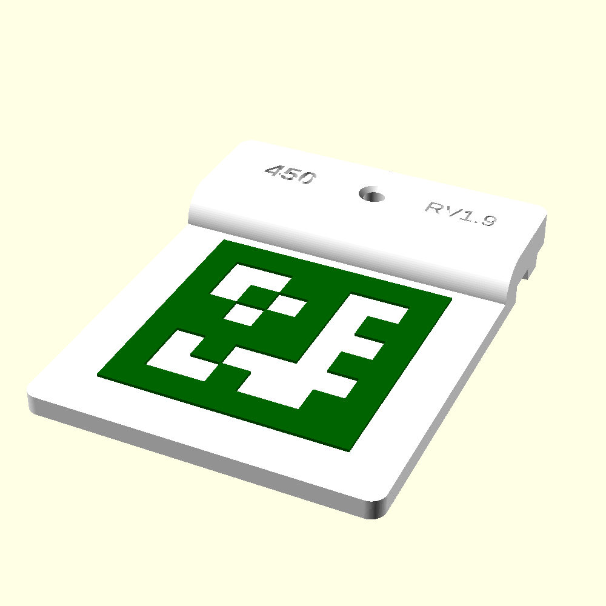

# Hardware

Parametric OpenSCAD models for the camera rig: printed mounts, T-slot extrusion stock and bolt
stand-ins. Installation steps are in [Installation.md](Installation.md) and the parts list is in
[Bill-of-Materials.md](Bill-of-Materials.md). This page covers the AprilTag corner mounts and
how to export multi-color prints.

## AprilTag corner mounts

The corner mounts carry the permanent reference fiducials at the table's outer edge
(36h11 family, IDs 450-499, see `PLAN.md`). Each mount bolts to the 20x20 T-slot rail and holds
one 50 mm tag flat and level with the rail's top face.



### What one mount is

| Feature | Detail |
|---|---|
| Tag | 50 mm 36h11, dark layer standing 0.6 mm proud of a white plate |
| Quiet zone | 10 mm of plain white plate on every side of the tag |
| Plate | 70 x 70 mm, 4 mm thick, flush with the rail's top face |
| Foot | 70 x 20 mm, 7 mm thick, sits on the rail |
| Fastening | one M4 bolt, centered, into a type-6 (spring-loaded ball) T-nut |
| Alignment | keying ridge under the foot runs in the rail's slot and stops the mount rotating |
| Markings | tag ID engraved left of the bolt, revision stamp engraved right of it |
| Footprint | 70 x 90 mm |

It prints in two colors on a multi-material printer, with no assembly or finishing:

- **Body** (white): foot, ridge and plate. The plate's top face is the tag's background and
  quiet zone.
- **Tag layer** (dark green): the tag's dark modules. It sits 0.2 mm into the plate so the two
  parts overlap instead of only touching.

### Files

| File | Role |
|---|---|
| `apriltag_corner_mount.scad` | The mount. Open this one. |
| `apriltag_36h11.scad` | Tag geometry module, `use`d by the mount. Also usable on its own for a standalone tag with its own base plate (`april_tag(id, edge)`). |
| `apriltags-36h11-1-499.scad` | Tag bit data, `TAG_36H11_BITS[id]`, generated by `apriltag-gen export-scad`. Do not edit by hand. |
| `scad_to_3mf.py` | Exports a multi-color `.scad` as a 3MF that Orca loads ready to print. See below. |
| `corner_tags.py` | Exports groups of corner mounts, one 3MF per group. See below. |

The tag pattern placement has been checked cell by cell against `apriltag_gen.tags.tag_bits()`.
The quiet-zone width and the 0.2 mm overlap are informed starting values, not measured ones.
Check a printed mount against a real detector before putting it into service.

### Customizer settings

| Setting | Default | What it does |
|---|---|---|
| `tag_ids` | `[450, 451, 452, 453]` | IDs to print, one mount each, in this order. Any of 450-499. |
| `plate_gap` | `10` | Clear space between mounts on the plate, mm. Leave room for the supports under the foot. |
| `plate_cols` | `0` | Mounts per row. `0` picks the count that keeps the whole block closest to square. |
| `tag_raise_h` | `0.6` | Height of the dark layer above the plate, mm. |
| `tag_embed` | `0.2` | How far the dark layer sinks into the plate, mm. |
| `id_label` | `true` | Engrave each mount's ID on the foot. |
| `id_size`, `id_depth` | `5`, `1.0` | ID text height and engraving depth, mm. |
| `body_color`, `tag_pattern_color` | `White`, `DarkGreen` | Colors, which also decide filament order (see below). |
| `part` | `assembly` | `assembly` for printing; `body` or `graphic` for one color only; `bolted` is a single-mount preview with the bolt, not for export. |

Mounts are laid out left to right, then top to bottom, in `tag_ids` order.

## Exporting 3MF files for Orca

Use `scad_to_3mf.py` rather than OpenSCAD's own 3MF export. OpenSCAD writes each colored solid
as a separate object with no link between them, and Orca then drops every object to the bed
and ignores the colors. The script runs the export and then fixes the file, so that:

- each mount becomes one Orca object whose parts stay stacked where they were modeled
- every part already has a filament assigned, numbered in the order its color first appears
  (for the corner mount, white body is filament 1 and the green tag is filament 2)

### Requirements

- OpenSCAD. The script uses `/Applications/OpenSCAD.app/Contents/MacOS/OpenSCAD` by default;
  point it elsewhere with `--openscad PATH` or the `OPENSCAD` environment variable.
- `uv`. The script only needs the Python standard library.

### Running it

Run from this `hardware/` directory:

```sh
# the four default corner tags, written to exports/apriltag_corner_mount.3mf
uv run scad_to_3mf.py apriltag_corner_mount.scad

# a different set of IDs
uv run scad_to_3mf.py apriltag_corner_mount.scad -D 'tag_ids=[454,455,456,457,458,459]'

# several overrides, and a different output folder
uv run scad_to_3mf.py apriltag_corner_mount.scad -D 'tag_ids=[460,461]' -D plate_gap=15 -o ~/prints
```

- `-o DIR` sets the output folder (default `./exports/`). The file is named after the `.scad`.
- `-n NAME` names the file `NAME.3mf` instead, so exports of different ID sets don't
  overwrite each other.
- `-D VAR=VALUE` overrides any Customizer setting, exactly like OpenSCAD's own `-D`. Repeat it
  for several. Quote list values as shown.

The script reports what it wrote:

```text
exports/apriltag_corner_mount.3mf: 4 object(s), 8 parts
  filament 1: #FFFFFF
  filament 2: #006400
```

For the corner mount, expect one object per ID and two parts per object. A warning means some
solid came out with more than one color, or nothing was split into parts; see the rules below.

### Tray tags in batches

`apriltag_tray_tag.scad` engraves each tag's tray type in the top-right corner, chosen from its
ID:

| IDs | Tray type | Default style |
|---|---|---|
| 1-100 | `4x5` | `tab` |
| 101-200 | `4x4` | `bolt` |
| 201-300 | `1x1` | `bolt` |
| 301-399 | `OTHER` | `tab` |

`tray_tags.py` exports a list of ID groups, one 3MF per group, through `scad_to_3mf.py`:

```sh
# writes apriltag_tray_tag_4x5_1-12_tab.3mf, ..._4x5_13-24_tab.3mf, ..._4x4_101-113_bolt.3mf
uv run tray_tags.py 1-12 13-24 101-113

# override the default style per group, another folder, extra Customizer overrides
uv run tray_tags.py 1-12:bolt 301-306 -o ~/prints -D on_side=false
```

A group is a range (`1-12`) or a single ID (`7`), optionally followed by `:tab` or `:bolt`
(`1-12:bolt`); without one it gets its type's default style. `uv run tray_tags.py --help` lists
the types, defaults and examples. A group must stay within one tray type: `95-105`
is refused, so split it at the boundary. Every group is checked before anything is exported.
The ID table is in both `tray_type()` in the `.scad` (which engraves the label) and
`TRAY_TYPES` in `tray_tags.py` (which names the file). Change them together. The default
styles are `DEFAULT_STYLE` in `tray_tags.py` only.

### Corner mounts in batches

`corner_tags.py` does the same for `apriltag_corner_mount.scad`, for IDs 450-499 only. It has
no style and no type label, so a group is just a range (`450-453`) or a single ID (`460`).
Files go to `exports/corner_tags/` by default.

```sh
# writes exports/corner_tags/apriltag_corner_mount_450-453.3mf and ..._454-457.3mf
uv run corner_tags.py 450-453 454-457

# a single mount, more space between mounts, another folder
uv run corner_tags.py 460 -D plate_gap=15 -o ~/prints
```

`uv run corner_tags.py --help` lists the group format and examples.

### Loading in Orca

1. Make sure the printer preset has at least as many filaments as the report lists. With fewer,
   higher-numbered assignments may fall back to filament 1.
2. Open the 3MF. If Orca asks whether to combine or split objects, decline.
3. Each mount appears as its own object with two parts, already on the right filaments. Change
   which physical filament is loaded in each slot in Orca's filament list, not in the file.

### Making other parts multi-color

The script works on any `.scad`, provided the file follows these rules. They come from how
OpenSCAD's export decides what counts as a separate object:

- **Each color must be its own top-level statement**, for example
  `color("white") body(); color("green") inlay();`. Statements inside top-level `if` and `for`
  blocks still count as top level.
- **Don't color things inside a module and then call that module plain.** A module called
  without its own `color()` comes out as one object, whatever colors it uses inside. Keep
  modules uncolored and apply `color()` where you call them.
- **Parts of one printed item must overlap in plan view (X/Y); separate items must not.** The
  script groups parts into objects by X/Y footprint overlap. Parts that should print together
  also need a small real overlap, as `tag_embed` gives the corner mount, so the slicer fuses them.
