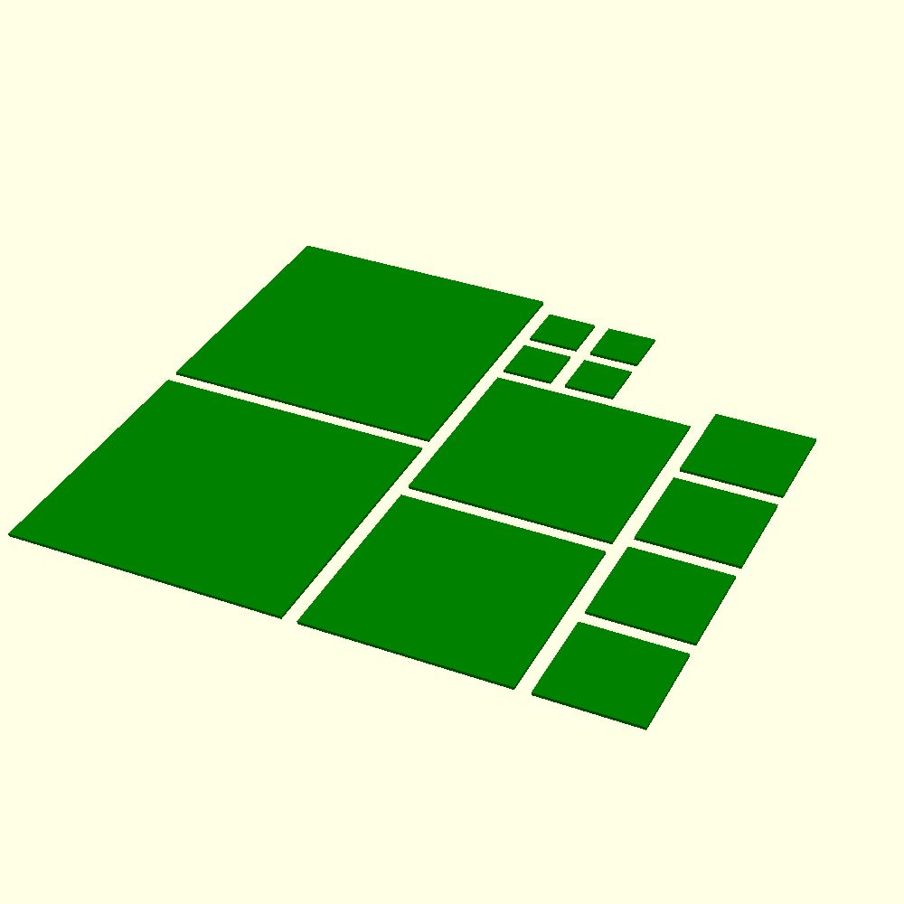

# Calibration targets

**Print in green filament.** The targets stand in for plant canopy, so they must be the colour
the segmenter looks for.

## `calibration_squares.scad`

One build plate of flat squares, 0.568 mm thick:

| Side (mm) | Copies | Area each (sq mm) |
|---|---|---|
| 10 | 4 | 100 |
| 20 | 4 | 400 |
| 40 | 2 | 1600 |
| 55 | 2 | 3025 |

The plate is about 121 x 113 mm with the default 3 mm gap. Print it flat, as in the file, with
no supports. Sides, thickness and gap are Customizer values.

The ready-to-print STL of the default plate is
`exports/calibration_targets/calibration_squares.stl`. Re-export it after changing any
Customizer value.

The sides above are the nominal values. Measure each printed square with callipers before using
it as a reference: the printed size is a measurement, not the number in the file. Write the
readings up in `docs/metrology-log.md` (instrument, readings per side, mean, date), as for the
AprilTag sheets.
